# Security Assessment Report - Juice Shop

_Analysis of security architecture and threats_

_Generated by appsec-advisor v0.6.0-beta.5 (analysis v5)_


---

> | | |
> |---|---|
> | **Project** | Juice Shop |
> | **Repository** | `https://github.com/juice-shop/juice-shop.git` |
> | **Homepage** | `https://github.com/juice-shop/juice-shop` |

---

## Changelog

_Append-only history of assessment runs. Most recent first._

| Version | Date | Mode | Depth | Reasoning | Baseline → Current | Δ Threats | Code | Note |
|--------|---------------------|--------|--------|--------------|------------------|----------------|--------|---------------|
| v1 | 2026-10-17 21:17 CEST | full | standard | sonnet-economy | _(initial)_ | 82 total | - | first full scan |

---

## Table of Contents

- [Management Summary](#management-summary)
- [Critical Findings by Root Cause](#critical-findings-by-root-cause)
1. [System Overview](#1-system-overview)
   - [Scope](#scope)
   - [Identified Actors](#identified-actors)
   - [Trust Boundaries](#trust-boundaries)
2. [Architecture Diagrams](#2-architecture-diagrams)
   - [2.1 System Context](#21-system-context)
   - [2.2 Container Architecture](#22-container-architecture)
   - [2.3 Components](#23-components)
3. [Attack Walkthroughs](#3-attack-walkthroughs)
   - [3.1 SQL injection in Search](#31-sql-injection-in-search)
   - [3.2 SQL injection in login query](#32-sql-injection-in-login-query)
   - [3.3 Missing Object Ownership Checks in Order](#33-missing-object-ownership-checks-in-order)
   - [3.4 Broken authorization in Data Export](#34-broken-authorization-in-data-export)
   - [3.5 User registration accepts privileged fields in Juice Shop Express Server](#35-user-registration-accepts-privileged-fields-in-juice-shop-express-server)
   - [3.6 Hardcoded Secrets in Source](#36-hardcoded-secrets-in-source)
   - [3.7 Request data evaluated by notevil in vm sandbox](#37-request-data-evaluated-by-notevil-in-vm-sandbox)
4. [Assets](#4-assets)
5. [Attack Surface](#5-attack-surface)
   - [5.1 Unauthenticated Entry Points (69)](#51-unauthenticated-entry-points-69)
   - [5.2 Authenticated Entry Points (40)](#52-authenticated-entry-points-40)
6. [Security Architecture](#6-security-architecture)
   - [6.1 Security Control Overview](#61-security-control-overview)
   - [6.2 Identity and Authentication Controls](#62-identity-and-authentication-controls)
   - [6.3 Session and Token Controls](#63-session-and-token-controls)
   - [6.4 Authorization Controls](#64-authorization-controls)
   - [6.5 Query Construction and Data Access Controls](#65-query-construction-and-data-access-controls)
   - [6.6 Input Boundary Validation Controls](#66-input-boundary-validation-controls)
   - [6.7 Output Encoding and Rendering Controls](#67-output-encoding-and-rendering-controls)
   - [6.8 Browser and Cross-Origin Controls](#68-browser-and-cross-origin-controls)
   - [6.9 Cryptography Secrets and Data Protection](#69-cryptography-secrets-and-data-protection)
   - [6.10 File Parser and Outbound Request Controls](#610-file-parser-and-outbound-request-controls)
   - [6.11 Operations Runtime and Supply Chain Controls](#611-operations-runtime-and-supply-chain-controls)
   - [6.12 Real-time and Not Applicable Controls](#612-real-time-and-not-applicable-controls)
   - [6.13 Defense-in-Depth Summary](#613-defense-in-depth-summary)
7. [Weakness Register](#7-weakness-register)
8. [Findings Register](#8-findings-register)
9. [Abuse Cases](#9-abuse-cases)
10. [Mitigation Register](#10-mitigation-register)
11. [Out of Scope](#11-out-of-scope)
   - [Not Covered by This Method](#not-covered-by-this-method)
   - [Excluded from This Assessment](#excluded-from-this-assessment)
- [Appendix: Run Statistics](#appendix-run-statistics)
- [Appendix A - Attack Vector Taxonomy](#appendix-a-vektor-taxonomy)

---

## Management Summary

### Verdict

🔴 **Critical security concerns** - This web shop lets unauthenticated attackers sign in as any user, including administrators, and reach server-side code execution. It should run only as an isolated training target, never with real customer data or exposure beyond a controlled network.

**Risk distribution:** 🔴 Critical: 3 · 🟠 High: 14 · 🟡 Medium: 24 · 🟢 Low: n/a · **Total: 41**<br/>**Assessment evidence:** 32 of 39 finding(s) confirmed in code<br/>**Weakness classes:** 41 (35 implementation, 6 design) - see [§7 Weakness Register](#7-weakness-register)

<br/>

**Security concerns behind this assessment:**

<blockquote style="border-left: 3px solid #dc2626; padding: 16px 20px; margin: 0;">

- **Login bypass and database takeover** — SQL injection in login and product search lets anonymous internet users sign in as anyone, including administrators, and read database contents. *(🔴 [F-013](#f-013), 🔴 [F-007](#f-007) → [W-001](#w-001))*
- **Other customers' records read and changed** — Missing ownership checks (IDOR) let any signed-in customer read or modify another customer's baskets, orders and exported data. *(🔴 [F-001](#f-001), 🔴 [F-009](#f-009), 🟠 [F-006](#f-006) → [W-002](#w-002))* — ✓ cited finding in a code-verified chain
- **Anyone can forge logins** — Signing secrets committed to source code let anyone with repository access mint valid sessions with any role. *(🟠 [F-005](#f-005), 🟠 [F-016](#f-016) → [W-007](#w-007), [W-008](#w-008))* — ✓ cited finding in a code-verified chain
- **Self-made administrator accounts** — Registration accepts privileged fields (mass assignment), so a new visitor can create an account with administrator rights. *(🟠 [F-038](#f-038) → [W-023](#w-023))* — ✓ cited finding in a code-verified chain
- **Server takeover through code execution** — User-supplied text is evaluated as code in the B2B order and profile handlers, risking arbitrary code execution on the server. *(🟡 [F-048](#f-048), 🟠 [F-033](#f-033) → [W-003](#w-003))* — ✓ cited finding in a code-verified chain
- **Active login stolen from customers** — Stored cross-site scripting (XSS) combined with session tokens kept in browser storage lets attackers hijack a victim's account. *(🟠 [F-004](#f-004), 🟠 [F-003](#f-003) → [W-005](#w-005), [W-006](#w-006))*

</blockquote>

<br/>

Fixing these needs structural changes to data access, authorization and secret handling before any use beyond an isolated training setting.

**About this assessment:** An AI-assisted threat model derived from the implementation of Juice Shop. It reconstructs the implemented architecture (9 components and 3 external services, see [§2](#2-architecture-diagrams)) and identifies threats and control gaps in it.


**Method and limits:** Automated static analysis of code and configuration, not a pentest or a team threat-modeling session; Low and Informational findings not reported (threshold: medium) - see [§11 Out of Scope](#11-out-of-scope).

### Remediation Priorities

The root causes behind the findings, ranked by severity, each with the measures to do first. The lasting fix under a root cause removes it and every finding it causes. Every mitigation that fixes a Critical finding is listed. Details in the [§7 Weakness Register](#7-weakness-register) and the [§10 Mitigation Register](#10-mitigation-register).

<table style="table-layout:fixed;width:100%">
<colgroup><col width="34%" style="width:34%"><col width="46%" style="width:46%"><col width="12%" style="width:12%"><col width="8%" style="width:8%"></colgroup>
<thead><tr><th>Root cause → lasting fix</th><th>Do first</th><th>Resolves</th><th>Effort</th></tr></thead>
<tbody>
<tr><td rowspan="2" style="overflow-wrap:break-word">🔴 <a href="#w-001">W-001</a> - Database access relies on concatenated queries<br/><em>→ provide one parameterised repository or query-builder path and prohibit application-value interpolation in database queries</em></td><td style="overflow-wrap:break-word">● <a href="#m-030">M-030</a> - Parameterize the login query with bind replacements</td><td>🔴 <a href="#f-013">F-013</a></td><td>Low</td></tr>
<tr><td style="overflow-wrap:break-word">● <a href="#m-029">M-029</a> - Use parameterized database queries (<a href="#f-007">F-007</a>)</td><td>🔴 <a href="#f-007">F-007</a></td><td>Medium</td></tr>
<tr><td rowspan="3" style="overflow-wrap:break-word">🔴 <a href="#w-002">W-002</a> - Authorization is implemented route by route<br/><em>→ enforce authorization through a shared server-side policy layer and make ownership and tenant scope mandatory inputs to data access</em></td><td style="overflow-wrap:break-word">● <a href="#m-023">M-023</a> - Enforce object-level (ownership) authorization (<a href="#f-001">F-001</a>)</td><td>🔴 <a href="#f-001">F-001</a><br/>🔴 <a href="#f-009">F-009</a></td><td>Medium</td></tr>
<tr><td style="overflow-wrap:break-word">◕ <a href="#m-028">M-028</a> - Check basket ownership before returning</td><td>🟠 <a href="#f-006">F-006</a></td><td>Low</td></tr>
<tr><td style="overflow-wrap:break-word">◕ <a href="#m-045">M-045</a> - Enforce server-side authorization on every endpoint (<a href="#f-036">F-036</a>)</td><td>🟠 <a href="#f-036">F-036</a></td><td>Low</td></tr>
<tr><td rowspan="1" style="overflow-wrap:break-word">🟠 <a href="#w-007">W-007</a> - Secrets are committed to source instead of a managed store<br/><em>→ move every secret to a managed secret store or injected environment configuration, rotate the exposed values, and add secret-scanning to CI</em></td><td style="overflow-wrap:break-word">◕ <a href="#m-027">M-027</a> - Load signing keys from a secret store</td><td>🟠 <a href="#f-005">F-005</a></td><td>Medium</td></tr>
<tr><td rowspan="1" style="overflow-wrap:break-word">🟠 <a href="#w-003">W-003</a> - Application data crosses into executable code<br/><em>→ replace evaluation of application values with a data parser or a fixed set of operations whose arguments remain data</em></td><td style="overflow-wrap:break-word">◕ <a href="#m-044">M-044</a> - Remove eval of username in profile rendering</td><td>🟠 <a href="#f-033">F-033</a></td><td>Low</td></tr>
<tr><td rowspan="1" style="overflow-wrap:break-word">🟡 <a href="#w-023">W-023</a> - Privileged attributes lack an enforced write allowlist<br/><em>→ define operation-specific write schemas and assign privileged attributes exclusively through server-side policy</em></td><td style="overflow-wrap:break-word">◕ <a href="#m-047">M-047</a> - Allowlist client-controlled fields</td><td>🟠 <a href="#f-038">F-038</a></td><td>Low</td></tr>
<tr><td rowspan="3" style="overflow-wrap:break-word">🟠 <a href="#w-006">W-006</a> - Frontend rendering lacks enforced output encoding<br/><em>→ use framework-safe rendering by default and isolate any required raw HTML behind one reviewed sanitisation and Trusted Types policy</em></td><td style="overflow-wrap:break-word">◕ <a href="#m-024">M-024</a> - Remove sanitizer bypass and render feedback as text</td><td>🟠 <a href="#f-002">F-002</a></td><td>Low</td></tr>
<tr><td style="overflow-wrap:break-word">◕ <a href="#m-025">M-025</a> - Remove sanitizer bypass and render IP as text</td><td>🟠 <a href="#f-003">F-003</a></td><td>Low</td></tr>
<tr><td style="overflow-wrap:break-word">◕ <a href="#m-040">M-040</a> - Encode output instead of bypassing the framework sanitizer (<a href="#f-028">F-028</a>)</td><td>🟠 <a href="#f-028">F-028</a></td><td>Low</td></tr>
</tbody>
</table>

*15 more P1/P2 mitigations and 69 P3/P4 backlog items in the [§10 Mitigation Register](#10-mitigation-register). ● P1 · ◕ P2 · ◑ P3 · ○ P4*

### Open Questions for the Team

The code cannot answer these questions; the people who own the business and the deployment can. Each question states under it what its answer changes.

- _Which operations on other users' or tenants' data in Juice Shop Express Server or Authentication & Session Surface are intended for support staff or administrators?_ ([W-002](#w-002): [F-009](#f-009), [F-006](#f-006), [F-034](#f-034) +3 more)
  Each access confirmed as intended narrows the finding to the remaining routes; if none are intended, every listed route is a live authorization gap.
- _Which sensitive business records can the production database account used by Juice Shop Express Server or Authentication & Session Surface access?_ ([W-001](#w-001): [F-007](#f-007), [F-013](#f-013))
  Personal or regulated data in reach raises both the breach impact and any notification duty; a narrowly scoped account limits the blast radius.
- _If an attacker runs code in Juice Shop Express Server, which other services, secrets or credentials can that process reach?_ ([F-033](#f-033), [F-048](#f-048) (unproven))
  Every reachable service or credential extends this from one component to a wider compromise and raises the priority of isolating that process; an isolated process contains it.

### Security Posture & Top Threats

**Figure 1a - Runtime Architecture and Threat Overview**

At runtime, Juice Shop has 8 components in 3 layers and exchanges data with 4 external services. Figure 1a shows these data flows and where each of the 7 attack scenarios below begins. The complete boundary catalogue remains in [§1 Trust Boundaries](#trust-boundaries).

<picture><source media="(prefers-color-scheme: dark)" srcset="security-assessment-juice-shop-standard-v0.6.0b5.figure1-dark.svg">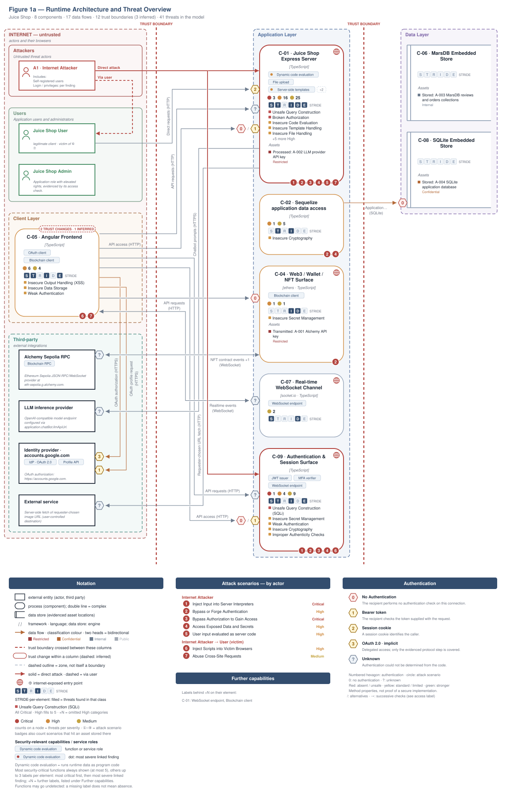</picture>

**Build pipeline**, not drawn in this runtime view: GitHub Actions, GitLab CI. ⑧ A2 · Supply-Chain / Build Attacker → [Figure 1b](#figure-1b).

Role access and finding assignments are listed in [Identified Actors](#identified-actors).

**Actor grouping.** Regular self-registered users are grouped with anonymous internet attackers because registration is open. Each finding retains its login and privilege requirements.

<a id="figure-1b"></a>

**Figure 1b - Supply Chain and Build**

Juice Shop builds in GitHub Actions, GitLab CI. Figure 1b shows the inputs, build systems and release artifacts the repository evidences, with 9 findings attached to them. The highlighted path follows 🟡 [F-056](#f-056) — Dependency Install Scripts Run at Build Time as far as the repository evidences it. The control assessment is in [§6.11](#611-operations-runtime-and-supply-chain-controls).

<picture><source media="(prefers-color-scheme: dark)" srcset="security-assessment-juice-shop-standard-v0.6.0b5.figure1b-dark.svg">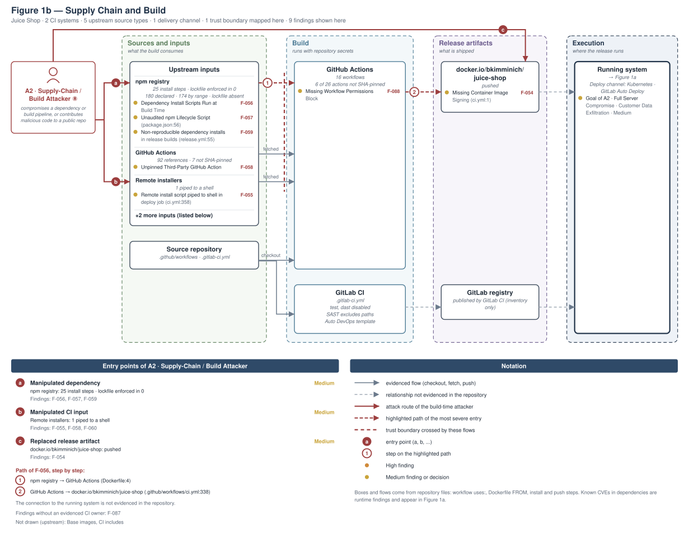</picture>

**Figure 2 - Attack Routes and Impact**

Each numbered route names one example finding from the corresponding Top Threats group with its access prerequisite, the register weakness it is linked to, and the group's potential business harm, which depends on deployment and affected assets. W-IDs in parentheses link the example to an existing weakness. The attack step, affected component and technical consequence are listed in the findings register. Red arrows indicate attacks; dashed red arrows involve a victim; grey arrows lead to potential harm.

<picture><source media="(prefers-color-scheme: dark)" srcset="security-assessment-juice-shop-standard-v0.6.0b5.figure2-dark.svg">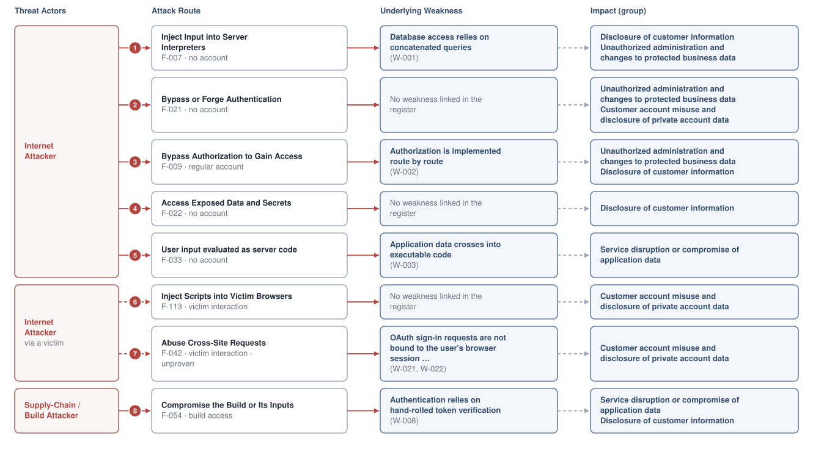</picture>

**Threat actors.** The actors below drive the numbered attack paths in the figures above. The **Juice Shop User** is the *victim* of client-side attacks (XSS / CSRF), not an attacker. Figure 2 marks victim interaction on the applicable attack routes.

- **Juice Shop User** — legitimate end user; target of client-side attacks; target of ⑥ Output Encoding / Cross-Site Scripting, ⑦ CSRF / Permissive CORS.
- **Internet Attacker** — can self-register a regular account; drives ① Insecure Query Construction & Data Access, ② Hardcoded Secrets & Weak Cryptography, ③ Broken Authorization & Access Control, ④ Sensitive File & Secret Exposure, ⑤ Remote Code Execution (unsafe eval), ⑥ Output Encoding / Cross-Site Scripting.
- **Supply-Chain / Build Attacker** — compromises a dependency or build pipeline, or contributes malicious code to a public repo; drives ⑧ Build Pipeline & Dependency Integrity.

**8 structural threats**, grouped by weakness class - each row is one threat, not one finding. *Threat Description* states the general architectural weakness (STRIDE in brackets); *Findings* lists the concrete instances, each linked to [§8 Findings Register](#8-findings-register) with its component; *Risk & Impact* combines severity with business consequence.

| # | Threat Description | Findings (→ Component) | Risk & Impact | Fix |
|---|------------------------------------|------------------------------------------------|------------------------------------|--------|
| <a id="path-injection"></a>① | **Insecure Query Construction & Data Access** _(T·I)_<br/>Request values are concatenated into database queries and templates, letting attackers change query logic to bypass authentication or read data. | <span style="white-space:nowrap">🔴&nbsp;[F-007](#f-007)</span> - SQL injection <span style="white-space:nowrap">→&nbsp;[C-01](#c-01)</span>&nbsp;Juice Shop Express Server<br/><span style="white-space:nowrap">🔴&nbsp;[F-013](#f-013)</span> - SQL injection in login query <span style="white-space:nowrap">→&nbsp;[C-09](#c-09)</span>&nbsp;Authentication & Session Surface<br/><span style="white-space:nowrap">🟠&nbsp;[F-025](#f-025)</span> - Input in executable NoSQL predicate <span style="white-space:nowrap">→&nbsp;[C-01](#c-01)</span>&nbsp;Juice Shop Express Server<br/><span style="white-space:nowrap">🟠&nbsp;[F-026](#f-026)</span> - Input in executable NoSQL predicate <span style="white-space:nowrap">→&nbsp;[C-01](#c-01)</span>&nbsp;Juice Shop Express Server<br/><span style="white-space:nowrap">🟠&nbsp;[F-031](#f-031)</span> - XML external entity expansion in upload parser <span style="white-space:nowrap">→&nbsp;[C-01](#c-01)</span>&nbsp;Juice Shop Express Server<br/><span style="white-space:nowrap">🟠&nbsp;[F-027](#f-027)</span> - Input compiled as template source <span style="white-space:nowrap">→&nbsp;[C-01](#c-01)</span>&nbsp;Juice Shop Express Server | 🔴 **Critical**<br/>Customer Data Exfiltration · Full Admin Takeover | <span style="white-space:nowrap">● [M-029](#m-029)</span> — Use parameterized database queries (F-007)<br/><span style="white-space:nowrap">● [M-030](#m-030)</span> — Parameterize the login query with bind replacements |
| <a id="path-auth-bypass"></a>② | **Hardcoded Secrets & Weak Cryptography** _(S·E)_<br/>Weak token verification and committed signing secrets let attackers forge credentials and impersonate other users. | <span style="white-space:nowrap">🟠&nbsp;[F-005](#f-005)</span> - Hardcoded Secrets in Source <span style="white-space:nowrap">→&nbsp;[C-09](#c-09)</span>&nbsp;Authentication & Session Surface<br/><span style="white-space:nowrap">🟠&nbsp;[F-016](#f-016)</span> - JWT verify call missing algorithms allowlist <span style="white-space:nowrap">→&nbsp;[C-01](#c-01)</span>&nbsp;Juice Shop Express Server<br/><span style="white-space:nowrap">🟠&nbsp;[F-021](#f-021)</span> - Password reset by security answer only <span style="white-space:nowrap">→&nbsp;[C-09](#c-09)</span>&nbsp;Authentication & Session Surface<br/><span style="white-space:nowrap">🟠&nbsp;[F-015](#f-015)</span> - Chat identity taken from unverified JWT <span style="white-space:nowrap">→&nbsp;[C-01](#c-01)</span>&nbsp;Juice Shop Express Server<br/><span style="white-space:nowrap">🟠&nbsp;[F-032](#f-032)</span> - Passwords hashed with unsalted fast `MD5` <span style="white-space:nowrap">→&nbsp;[C-02](#c-02)</span>&nbsp;Sequelize application data access<br/><span style="white-space:nowrap">🟡&nbsp;[F-040](#f-040)</span> - Hard-coded cookie signing secret <span style="white-space:nowrap">→&nbsp;[C-01](#c-01)</span>&nbsp;Juice Shop Express Server<br/><span style="white-space:nowrap">🟡&nbsp;[F-073](#f-073)</span> - Security answers HMAC with hardcoded key <span style="white-space:nowrap">→&nbsp;[C-02](#c-02)</span>&nbsp;Sequelize application data access | 🟠 **High**<br/>Full Admin Takeover · Customer Session Hijack | <span style="white-space:nowrap">◕ [M-027](#m-027)</span> — Load signing keys from a secret store<br/><span style="white-space:nowrap">◕ [M-032](#m-032)</span> — Enforce JWT signature and algorithm verification (F-016) |
| <a id="path-privilege-escalation"></a>③ | **Broken Authorization & Access Control** _(E·I)_<br/>Missing ownership and role checks let ordinary users access other users' records or obtain administrative privileges. | <span style="white-space:nowrap">🔴&nbsp;[F-001](#f-001)</span> - Missing Object Ownership Checks <span style="white-space:nowrap">→&nbsp;[C-01](#c-01)</span>&nbsp;Juice Shop Express Server<br/><span style="white-space:nowrap">🟠&nbsp;[F-006](#f-006)</span> - Systemic IDOR Missing Ownership Checks <span style="white-space:nowrap">→&nbsp;[C-01](#c-01)</span>&nbsp;Juice Shop Express Server<br/><span style="white-space:nowrap">🔴&nbsp;[F-009](#f-009)</span> - Broken authorization <span style="white-space:nowrap">→&nbsp;[C-01](#c-01)</span>&nbsp;Juice Shop Express Server<br/><span style="white-space:nowrap">🟠&nbsp;[F-036](#f-036)</span> - Missing authorization on product update route <span style="white-space:nowrap">→&nbsp;[C-01](#c-01)</span>&nbsp;Juice Shop Express Server<br/><span style="white-space:nowrap">🟠&nbsp;[F-038](#f-038)</span> - User registration accepts privileged fields <span style="white-space:nowrap">→&nbsp;[C-01](#c-01)</span>&nbsp;Juice Shop Express Server<br/><span style="white-space:nowrap">🟠&nbsp;[F-017](#f-017)</span> - Password change without current password <span style="white-space:nowrap">→&nbsp;[C-01](#c-01)</span>&nbsp;Juice Shop Express Server<br/><span style="white-space:nowrap">🟠&nbsp;[F-034](#f-034)</span> - Sensitive Routes Registered Without Authentication Middleware <span style="white-space:nowrap">→&nbsp;[C-01](#c-01)</span>&nbsp;Juice Shop Express Server<br/><span style="white-space:nowrap">🟠&nbsp;[F-037](#f-037)</span> - Sensitive Routes Registered Without Authentication Middleware <span style="white-space:nowrap">→&nbsp;[C-01](#c-01)</span>&nbsp;Juice Shop Express Server<br/><span style="white-space:nowrap">🟡&nbsp;[F-069](#f-069)</span> - Order history lookup by vowel-masked email <span style="white-space:nowrap">→&nbsp;[C-01](#c-01)</span>&nbsp;Juice Shop Express Server<br/><span style="white-space:nowrap">🟡&nbsp;[F-086](#f-086)</span> - Chatbot coupon discount unbounded server-side <span style="white-space:nowrap">→&nbsp;[C-01](#c-01)</span>&nbsp;Juice Shop Express Server<br/><span style="white-space:nowrap">🟡&nbsp;[F-090](#f-090)</span> - Any authenticated user can list all accounts <span style="white-space:nowrap">→&nbsp;[C-09](#c-09)</span>&nbsp;Authentication & Session Surface | 🔴 **Critical**<br/>Full Admin Takeover · Customer Data Exfiltration | <span style="white-space:nowrap">● [M-023](#m-023)</span> — Enforce object-level (ownership) authorization (F-001)<br/><span style="white-space:nowrap">◕ [M-028](#m-028)</span> — Check basket ownership before returning |
| <a id="path-sensitive-data-exposure"></a>④ | **Sensitive File & Secret Exposure** _(I)_<br/>Unchecked file paths and archive entries let attackers read or overwrite files outside the intended directories. | <span style="white-space:nowrap">🟠&nbsp;[F-022](#f-022)</span> - Path Traversal <span style="white-space:nowrap">→&nbsp;[C-01](#c-01)</span>&nbsp;Juice Shop Express Server<br/><span style="white-space:nowrap">🟠&nbsp;[F-023](#f-023)</span> - Zip Slip path traversal during archive extraction <span style="white-space:nowrap">→&nbsp;[C-01](#c-01)</span>&nbsp;Juice Shop Express Server<br/><span style="white-space:nowrap">🟠&nbsp;[F-030](#f-030)</span> - Unauthenticated log directory listing <span style="white-space:nowrap">→&nbsp;[C-01](#c-01)</span>&nbsp;Juice Shop Express Server<br/><span style="white-space:nowrap">🟡&nbsp;[F-046](#f-046)</span> - Substring redirect allowlist check <span style="white-space:nowrap">→&nbsp;[C-09](#c-09)</span>&nbsp;Authentication & Session Surface<br/><span style="white-space:nowrap">🟡&nbsp;[F-062](#f-062)</span> - Null byte extension allowlist bypass in FTP file <span style="white-space:nowrap">→&nbsp;[C-01](#c-01)</span>&nbsp;Juice Shop Express Server<br/><span style="white-space:nowrap">🟡&nbsp;[F-063](#f-063)</span> - JSONP and arbitrary field selection on current user <span style="white-space:nowrap">→&nbsp;[C-01](#c-01)</span>&nbsp;Juice Shop Express Server<br/><span style="white-space:nowrap">🟡&nbsp;[F-064](#f-064)</span> - Unauthenticated memories listing joins user records <span style="white-space:nowrap">→&nbsp;[C-01](#c-01)</span>&nbsp;Juice Shop Express Server<br/><span style="white-space:nowrap">🟡&nbsp;[F-067](#f-067)</span> - Unauthenticated log directory listing and download <span style="white-space:nowrap">→&nbsp;[C-01](#c-01)</span>&nbsp;Juice Shop Express Server<br/><span style="white-space:nowrap">🟡&nbsp;[F-068](#f-068)</span> - Unauthenticated encryption key directory exposure <span style="white-space:nowrap">→&nbsp;[C-01](#c-01)</span>&nbsp;Juice Shop Express Server<br/><span style="white-space:nowrap">🟡&nbsp;[F-070](#f-070)</span> - Server-side request forgery <span style="white-space:nowrap">→&nbsp;[C-01](#c-01)</span>&nbsp;Juice Shop Express Server<br/><span style="white-space:nowrap">🟡&nbsp;[F-071](#f-071)</span> - Payment card numbers stored in plaintext <span style="white-space:nowrap">→&nbsp;[C-02](#c-02)</span>&nbsp;Sequelize application data access<br/><span style="white-space:nowrap">🟡&nbsp;[F-072](#f-072)</span> - TOTP secrets stored in plaintext <span style="white-space:nowrap">→&nbsp;[C-02](#c-02)</span>&nbsp;Sequelize application data access<br/><span style="white-space:nowrap">🟡&nbsp;[F-075](#f-075)</span> - Full user record with password hash in JWT <span style="white-space:nowrap">→&nbsp;[C-09](#c-09)</span>&nbsp;Authentication & Session Surface | 🟠 **High**<br/>Customer Data Exfiltration | <span style="white-space:nowrap">◕ [M-036](#m-036)</span> — Constrain file paths to a safe base directory (F-022)<br/><span style="white-space:nowrap">◕ [M-037](#m-037)</span> — Constrain zip entries to the extraction directory |
| <a id="path-remote-code-execution"></a>⑤ | **Remote Code Execution (unsafe eval)** _(E)_<br/>Untrusted input reaches code-evaluation routines on the server, allowing attackers to run commands in the application process. | <span style="white-space:nowrap">🟠&nbsp;[F-033](#f-033)</span> - Code injection <span style="white-space:nowrap">→&nbsp;[C-01](#c-01)</span>&nbsp;Juice Shop Express Server<br/><span style="white-space:nowrap">🟡&nbsp;[F-048](#f-048)</span> - Request data evaluated by notevil in vm sandbox <span style="white-space:nowrap">→&nbsp;[C-01](#c-01)</span>&nbsp;Juice Shop Express Server | 🟠 **High**<br/>Full Server Compromise | <span style="white-space:nowrap">◕ [M-044](#m-044)</span> — Remove eval of username in profile rendering<br/><span style="white-space:nowrap">◑ [M-057](#m-057)</span> — Remove dynamic evaluation of order lines |
| <a id="path-cross-site-scripting"></a>⑥ | **Output Encoding / Cross-Site Scripting** _(T·I)_<br/>Unsafe HTML rendering lets injected script run in a victim's browser and use session tokens held in browser storage. | <span style="white-space:nowrap">🟠&nbsp;[F-002](#f-002)</span> - XSS via Trusted HTML Binding <span style="white-space:nowrap">→&nbsp;[C-05](#c-05)</span>&nbsp;Angular Frontend<br/><span style="white-space:nowrap">🟠&nbsp;[F-003](#f-003)</span> - Angular Sanitizer Bypass XSS <span style="white-space:nowrap">→&nbsp;[C-05](#c-05)</span>&nbsp;Angular Frontend<br/><span style="white-space:nowrap">🟠&nbsp;[F-004](#f-004)</span> - Session Token Stored in `localStorage` <span style="white-space:nowrap">→&nbsp;[C-05](#c-05)</span>&nbsp;Angular Frontend<br/><span style="white-space:nowrap">🟠&nbsp;[F-028](#f-028)</span> - DOM XSS <span style="white-space:nowrap">→&nbsp;[C-05](#c-05)</span>&nbsp;Angular Frontend<br/><span style="white-space:nowrap">🟡&nbsp;[F-061](#f-061)</span> - Unsanitised login IP header stored for later <span style="white-space:nowrap">→&nbsp;[C-09](#c-09)</span>&nbsp;Authentication & Session Surface<br/><span style="white-space:nowrap">🟠&nbsp;[F-113](#f-113)</span> - Session token stored in web-accessible client storage <span style="white-space:nowrap">→&nbsp;[C-05](#c-05)</span>&nbsp;Angular Frontend | 🟠 **High**<br/>Customer Session Hijack | <span style="white-space:nowrap">◕ [M-024](#m-024)</span> — Remove sanitizer bypass and render feedback as text<br/><span style="white-space:nowrap">◕ [M-025](#m-025)</span> — Remove sanitizer bypass and render IP as text |
| <a id="path-cross-site-request-forgery"></a>⑦ | **CSRF / Permissive CORS** _(S·T)_<br/>a permissive CORS policy plus missing anti-CSRF tokens let any external page issue authenticated state-changing requests in the victim's session. | <span style="white-space:nowrap">🟡&nbsp;[F-042](#f-042)</span> - OAuth implicit flow without state or nonce <span style="white-space:nowrap">→&nbsp;[C-05](#c-05)</span>&nbsp;Angular Frontend<br/><span style="white-space:nowrap">🟡&nbsp;[F-049](#f-049)</span> - Cookie-authenticated profile update <span style="white-space:nowrap">→&nbsp;[C-01](#c-01)</span>&nbsp;Juice Shop Express Server | 🟡 **Medium**<br/>Customer Session Hijack | <span style="white-space:nowrap">◑ [M-051](#m-051)</span> — Use authorization code flow with PKCE and state<br/><span style="white-space:nowrap">◑ [M-058](#m-058)</span> — Add CSRF token and SameSite cookie flags |
| <a id="path-supply-chain"></a>⑧ | **Build Pipeline & Dependency Integrity** _(T·E)_<br/>a dependency, build input, pipeline step or published artifact can be replaced or altered, so attacker-controlled code reaches the shipped application.<br/>Path through the build: [Figure 1b](#figure-1b) · controls: [§6.11](#611-operations-runtime-and-supply-chain-controls) | <span style="white-space:nowrap">🟡&nbsp;[F-054](#f-054)</span> - Missing Container Image Signing <span style="white-space:nowrap">→&nbsp;[C-03](#c-03)</span>&nbsp;CI/CD Pipeline<br/><span style="white-space:nowrap">🟡&nbsp;[F-055](#f-055)</span> - Remote install script piped to shell in deploy job <span style="white-space:nowrap">→&nbsp;[C-03](#c-03)</span>&nbsp;CI/CD Pipeline<br/><span style="white-space:nowrap">🟡&nbsp;[F-056](#f-056)</span> - Dependency Install Scripts Run at Build Time <span style="white-space:nowrap">→&nbsp;[C-03](#c-03)</span>&nbsp;CI/CD Pipeline<br/><span style="white-space:nowrap">🟡&nbsp;[F-057](#f-057)</span> - Unaudited npm Lifecycle Script <span style="white-space:nowrap">→&nbsp;[C-03](#c-03)</span>&nbsp;CI/CD Pipeline<br/><span style="white-space:nowrap">🟡&nbsp;[F-058](#f-058)</span> - Unpinned Third-Party GitHub Action <span style="white-space:nowrap">→&nbsp;[C-03](#c-03)</span>&nbsp;CI/CD Pipeline<br/><span style="white-space:nowrap">🟡&nbsp;[F-059](#f-059)</span> - Non-reproducible dependency installs in release builds <span style="white-space:nowrap">→&nbsp;[C-03](#c-03)</span>&nbsp;CI/CD Pipeline<br/><span style="white-space:nowrap">🟡&nbsp;[F-060](#f-060)</span> - Unpinned floating container base images <span style="white-space:nowrap">→&nbsp;[C-03](#c-03)</span>&nbsp;CI/CD Pipeline<br/><span style="white-space:nowrap">🟡&nbsp;[F-087](#f-087)</span> - Container Runs as Root <span style="white-space:nowrap">→&nbsp;[C-03](#c-03)</span>&nbsp;CI/CD Pipeline<br/><span style="white-space:nowrap">🟡&nbsp;[F-088](#f-088)</span> - Missing Workflow Permissions Block <span style="white-space:nowrap">→&nbsp;[C-03](#c-03)</span>&nbsp;CI/CD Pipeline | 🟡 **Medium**<br/>Full Server Compromise · Customer Data Exfiltration | <span style="white-space:nowrap">◑ [M-017](#m-017)</span> — Sign and verify release artifacts<br/><span style="white-space:nowrap">◑ [M-063](#m-063)</span> — Verify or remove curl-pipe Heroku CLI install |

_STRIDE: S spoofing · T tampering · R repudiation · I information disclosure · D denial of service · E elevation of privilege. Risk, findings, components, impact and Fix are derived deterministically; only the one-line weakness description is authored._

**Verified attack chains.** 7 fully viable ([AC-B-003](#ac-b-003), [AC-T-002](#ac-t-002), [AC-T-004](#ac-t-004), [AC-T-005](#ac-t-005), [AC-T-007](#ac-t-007), [AC-T-006](#ac-t-006), [AC-B-005](#ac-b-005)). These chains combine individual findings into end-to-end exploitation paths verified step-by-step against the code - see [§9 Abuse Cases](#9-abuse-cases) for the per-step breakdown and blocking mitigations.

### AI / LLM Exposure

This system embeds an LLM/AI surface (an LLM/AI integration); the risks below are architectural - they follow from how untrusted input reaches the model's prompt, tools, and outputs. See **[§6 Security Architecture](#6-security-architecture)** for the per-control detail.


- **[LLM06](https://genai.owasp.org/llmrisk/llm06/) Excessive Agency** — The LLM is granted tool/function-calling authority without a secondary authorization boundary, so a manipulated model turn can invoke privileged actions on the user's behalf. _([C-01](#c-01) — Juice Shop Express Server)_
  - ↳ 🟠 [F-015](#f-015) — Chat identity taken from unverified JWT _([ASI03](https://genai.owasp.org/resource/owasp-top-10-for-agentic-applications-for-2026/))_
  - ↳ 🟡 [F-086](#f-086) — Chatbot coupon discount unbounded server-side _([ASI02](https://genai.owasp.org/resource/owasp-top-10-for-agentic-applications-for-2026/))_

- **[LLM01](https://genai.owasp.org/llmrisk/llm01/) Prompt Injection** — Untrusted user input reaches the LLM prompt/context without sufficient trust separation, letting an attacker override system instructions, redirect tool calls, or coerce unintended model behaviour. _([C-01](#c-01) — Juice Shop Express Server)_
  - ↳ 🟡 [F-051](#f-051) — Unvalidated client chat history passed to model _([ASI01](https://genai.owasp.org/resource/owasp-top-10-for-agentic-applications-for-2026/))_

- **[LLM05](https://genai.owasp.org/llmrisk/llm05/) Improper Output Handling** — LLM-generated output flows into a downstream sink (browser, shell, query, eval) without validation or encoding, turning a model completion into an injection vector. _([C-01](#c-01) — Juice Shop Express Server)_
  - ↳ 🟡 [F-086](#f-086) — Chatbot coupon discount unbounded server-side _([ASI02](https://genai.owasp.org/resource/owasp-top-10-for-agentic-applications-for-2026/))_

- **[LLM10](https://genai.owasp.org/llmrisk/llm10/) Unbounded Consumption** — The LLM endpoint imposes no authentication, rate, or quota boundary, so any client can drive unbounded model invocations — uncontrolled provider cost and denial of service for legitimate users. _([C-01](#c-01) — Juice Shop Express Server)_
  - ↳ 🟡 [F-079](#f-079) — Unbounded unauthenticated chat consumption

### Operational Strengths

Operational controls rated Adequate or Partial - grouped into broad clusters (full per-control breakdown in [§6](#6-security-architecture)). Clusters demoted to Weak by open Critical/High findings appear in [§6](#6-security-architecture) instead, not here.

<table style="table-layout:fixed;width:100%">
<colgroup><col width="18%" style="width:18%"><col width="30%" style="width:30%"><col width="40%" style="width:40%"><col width="12%" style="width:12%"></colgroup>
<thead><tr><th>Strength</th><th>What's in Place</th><th>Effectiveness</th><th>Mitigates</th></tr></thead>
<tbody>
<tr><td style="overflow-wrap:break-word"><strong>Container &amp; Supply-Chain Hardening</strong></td><td style="overflow-wrap:break-word"><em>Build-time and runtime hardening - minimal base image, non-root execution, dependency inventory.</em><br/>Container image hardening</td><td style="overflow-wrap:break-word">✅ Adequate</td><td style="overflow-wrap:break-word">-</td></tr>
<tr><td style="overflow-wrap:break-word"><strong>Hardened HTTP Stack</strong></td><td style="overflow-wrap:break-word"><em>Browser-facing HTTP hardening — security headers, cookie flags, cross-origin policy, and abuse-protection limits.</em><br/>Socket.io CORS origin restriction<br/>Rate limiting</td><td style="overflow-wrap:break-word">⚠️ Partial — 2 medium/low-severity finding(s) within the cluster's remit remain open — see <a href="#8-findings-register">§8</a> Findings Register for details.</td><td style="overflow-wrap:break-word">🟡 <a href="#f-042">F-042</a> — OAuth implicit flow without state or nonce (login.compone…<br/>🟡 <a href="#f-049">F-049</a> — Cookie-authenticated profile update (routes/updateUserPro…</td></tr>
<tr><td style="overflow-wrap:break-word"><strong>Observability &amp; Audit</strong></td><td style="overflow-wrap:break-word"><em>Runtime visibility - access logging, audit trails, and operational telemetry for post-incident review.</em><br/>Error handling and logging for WebSocket provider<br/>Sensitive endpoint exposure (metrics, log directory, API docs)</td><td style="overflow-wrap:break-word">⚠️ Partial - Coverage incomplete - see <a href="#7-weakness-register">§7</a> control assessment.</td><td style="overflow-wrap:break-word">-</td></tr>
</tbody>
</table>


**Bottom line:** These controls narrow specific attack surfaces but none eliminates a Critical finding on its own.

---

<a id="critical-attack-chain"></a><a id="critical-attack-tree"></a><a id="critical-findings-by-root-cause"></a>
## Critical Findings by Root Cause

4 of 4 Critical findings trace back to 2 root causes; fixing a root cause addresses every finding linked to it.

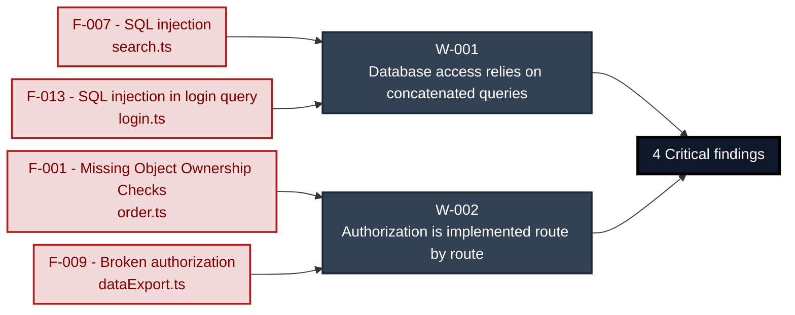

**Structural fixes** (full detail in [§7 Weakness Register](#7-weakness-register)):

- **[W-001](#w-001)** — Provide one parameterised repository or query-builder path and prohibit application-value interpolation in database queries _(closes [F-007](#f-007), [F-013](#f-013))_
- **[W-002](#w-002)** — Enforce authorization through a shared server-side policy layer and make ownership and tenant scope mandatory inputs to data access _(closes [F-001](#f-001), [F-009](#f-009))_

---

## 1. System Overview

Probably the most modern and sophisticated insecure web application

**Repository:** `https://github.com/juice-shop/juice-shop.git`
**Runtime:** Node\.js 22 - 26

### Scope

This threat model covers 9 components of juice-shop: 

- Juice Shop Express Server
- Sequelize application data access
- CI/CD Pipeline
- Web3 / Wallet / NFT Surface
- Angular Frontend
- MarsDB Embedded Store
- Real-time WebSocket Channel
- SQLite Embedded Store
- Authentication & Session Surface

**Not individually examined:** 124 source files in 4 components had no route, lead or security signal (Sequelize application data access 11, CI/CD Pipeline 4, Angular Frontend 108, MarsDB Embedded Store 1).

**Not assessed:** 4 security-relevant code locations were read but could not be judged (CI/CD Pipeline 1, Web3 / Wallet / NFT Surface 1, Angular Frontend 1, Authentication & Session Surface 1); `security-assessment.yaml` records each with its reason under `meta.undecided_targets`.

**Not assigned to any component:** 134 program files belong to no component and were not analysed (`data/` 97, `lib/` 21, `frontend/` 5, `(repository root)` 4, `rsn/` 4, `models/` 1, `routes/` 1, `views/` 1).

**Out of scope:** third-party hosted dependencies, browser runtime, operating-system kernel, and the underlying network infrastructure.

**Basis:** An automated, AI-assisted threat model built from the repository's source code and configuration - static analysis only, no dynamic or penetration testing. It describes the system as built, not as designed.

---

<a id="identified-actors"></a>
### Identified Actors

Figure 1a draws **Internet Attacker** as attacker and **Juice Shop User** and **Juice Shop Admin** as legitimate roles of Juice Shop. [Figure 1b](#figure-1b) draws **Supply-Chain / Build Attacker** and the build it attacks. Each row gives that actor's access and the findings attributed to it.

| Actor | Type | Access | Scenarios | Attributed findings |
|----------------------|---------------|----------------------|--------------|-------------------|
| A1 · Internet Attacker | Attacker | can self-register a regular account | ① ② ③ ④ ⑤ ⑥ ⑦ | 🔴 1 · 🟠 4 · 🟡 12 |
| A2 · Supply-Chain / Build Attacker | Attacker | compromises a dependency or build pipeline, or contributes malicious code to a public repo · [Figure 1b](#figure-1b) | ⑧ | 🟡 9 |
| Juice Shop User | Role (victim) | legitimate client | ⑥ ⑦ | - |
| Juice Shop Admin | Privileged role | Application role with elevated rights,<br/>evidenced by its access check. | - | - |

56 findings are not represented in the actor counts (3 Critical, 21 High, 32 Medium). These counts cover assigned findings only; absence from them does not establish inaccessibility.

---

### Trust Boundaries

Each row names a crossing and the condition it relies on. A modelled crossing does not prove that its control works.

<table style="table-layout:fixed;width:100%">
<colgroup><col width="7%" style="width:7%"><col width="25%" style="width:25%"><col width="36%" style="width:36%"><col width="32%" style="width:32%"></colgroup>
<thead><tr><th>ID</th><th>Crossing</th><th>Required condition</th><th>Findings / open question</th></tr></thead>
<tbody>
<tr><td style="white-space:nowrap"><a id="tb-1"></a>tb-1</td><td style="overflow-wrap:break-word">external → Real-time WebSocket Channel</td><td style="overflow-wrap:break-word">Every Socket.io event payload is validated before it influences server state or challenge logic.<br/>Control: not identified</td><td style="overflow-wrap:break-word">Gap evidenced: <em>Authentication</em><br/>🟡 <a href="#f-043">F-043</a></td></tr>
<tr><td style="white-space:nowrap"><a id="tb-2"></a>tb-2</td><td style="overflow-wrap:break-word">external → Authentication &amp;amp; Session Surface</td><td style="overflow-wrap:break-word">Every state-changing or user-specific auth route is registered behind <code>isAuthorized()</code> so unauthenticated callers are rejected.<br/>Control: <code>expressJwt</code> <code>isAuthorized</code> middleware</td><td style="overflow-wrap:break-word">Gap evidenced: <em>Validation</em><br/>🔴 <a href="#f-013">F-013</a></td></tr>
<tr><td style="white-space:nowrap"><a id="tb-3"></a>tb-3</td><td style="overflow-wrap:break-word">external → Juice Shop Express Server</td><td style="overflow-wrap:break-word">Every state-changing or user-scoped API route is registered behind <code>security.isAuthorized()</code>.<br/>Control: <code>security.isAuthorized()</code> route middleware</td><td style="overflow-wrap:break-word">43 related findings; relevance to this crossing remains unverified.</td></tr>
<tr><td style="white-space:nowrap"><a id="tb-4"></a>tb-4</td><td style="overflow-wrap:break-word">external → CI/CD Pipeline</td><td style="overflow-wrap:break-word">Code from pushes and pull requests runs in CI only with the privileges and secrets scoped to that trigger.<br/>Control: GitHub Actions workflow triggers</td><td style="overflow-wrap:break-word">9 related findings; relevance to this crossing remains unverified.</td></tr>
<tr><td style="white-space:nowrap"><a id="tb-5"></a>tb-5</td><td style="overflow-wrap:break-word">external → Real-time WebSocket Channel</td><td style="overflow-wrap:break-word">Every Socket.IO event payload is treated as untrusted and type-checked before it influences server state.<br/>Control: Socket.IO CORS origin setting</td><td style="overflow-wrap:break-word">2 related findings; relevance to this crossing remains unverified.</td></tr>
<tr><td style="white-space:nowrap"><a id="tb-6"></a>tb-6</td><td style="overflow-wrap:break-word">external → Web3 / Wallet / NFT Surface<br/>Crossing: inferred</td><td style="overflow-wrap:break-word">Every <code>/rest/web3</code> route enforces a credential check before serving NFT state or accepting wallet keys.<br/>Control: not identified</td><td style="overflow-wrap:break-word">1 related finding; relevance to this crossing remains unverified.</td></tr>
<tr><td style="white-space:nowrap"><a id="tb-7"></a>tb-7</td><td style="overflow-wrap:break-word">external → Authentication &amp;amp; Session Surface<br/>Crossing: inferred</td><td style="overflow-wrap:break-word">Every API request from the SPA is authenticated and authorized server-side, as the server cannot distinguish SPA calls from forged ones.<br/>Control: not identified</td><td style="overflow-wrap:break-word">11 related findings; relevance to this crossing remains unverified.</td></tr>
<tr><td style="white-space:nowrap"><a id="tb-8"></a>tb-8</td><td style="overflow-wrap:break-word">Angular Frontend → external<br/>Crossing: inferred</td><td style="overflow-wrap:break-word">The OAuth access token returned by the identity provider is accepted only for a redirect URI registered for this client.<br/>Control: Google registered redirect URIs</td><td style="overflow-wrap:break-word">No linked finding establishes a gap; control effectiveness is not established.</td></tr>
<tr><td style="white-space:nowrap"><a id="tb-9"></a>tb-9</td><td style="overflow-wrap:break-word">Sequelize application data access → SQLite Embedded Store</td><td style="overflow-wrap:break-word">Every query reaches SQLite through Sequelize parameter binding, never concatenated into raw SQL.<br/>Control: Sequelize parameter binding</td><td style="overflow-wrap:break-word">No linked finding establishes a gap; control effectiveness is not established.</td></tr>
<tr><td style="white-space:nowrap"><a id="tb-10"></a>tb-10</td><td style="overflow-wrap:break-word">Juice Shop Express Server → external</td><td style="overflow-wrap:break-word">The destination of a server-side image fetch is restricted to hosts the server is meant to reach.<br/>Control: not identified</td><td style="overflow-wrap:break-word">Gap evidenced: <em>Egress destination</em><br/>🟡 <a href="#f-070">F-070</a></td></tr>
<tr><td style="white-space:nowrap"><a id="tb-11"></a>tb-11</td><td style="overflow-wrap:break-word">Juice Shop Express Server → external</td><td style="overflow-wrap:break-word">Only content intended for the LLM provider, excluding confidential data, reaches the configured endpoint.<br/>Control: not identified</td><td style="overflow-wrap:break-word">No linked finding establishes a gap; control effectiveness is not established.</td></tr>
<tr><td style="white-space:nowrap"><a id="tb-12"></a>tb-12</td><td style="overflow-wrap:break-word">Web3 / Wallet / NFT Surface → external</td><td style="overflow-wrap:break-word">Event data received from the Alchemy Sepolia RPC is treated as untrusted before it influences challenge state.<br/>Control: not identified</td><td style="overflow-wrap:break-word">No linked finding establishes a gap; control effectiveness is not established.</td></tr>
<tr><td style="white-space:nowrap"><a id="tb-13"></a>tb-13</td><td style="overflow-wrap:break-word">Angular Frontend → external</td><td style="overflow-wrap:break-word">The OAuth redirect URI is used only if it matches a configured authorized redirect.<br/>Control: <code>googleOauth</code> <code>authorizedRedirects</code> allow-list</td><td style="overflow-wrap:break-word">No linked finding establishes a gap; control effectiveness is not established.</td></tr>
</tbody>
</table>

Crossing types, source evidence and provenance are retained in `security-assessment.yaml`.

---

## 2. Architecture Diagrams

### 2.1 System Context

Who uses and attacks Juice Shop, and which external systems it exchanges data with. Solid arrows name the data a flow carries; dashed red arrows are attack routes. Actors carry the names Figure 1 uses (C4 Level 1).

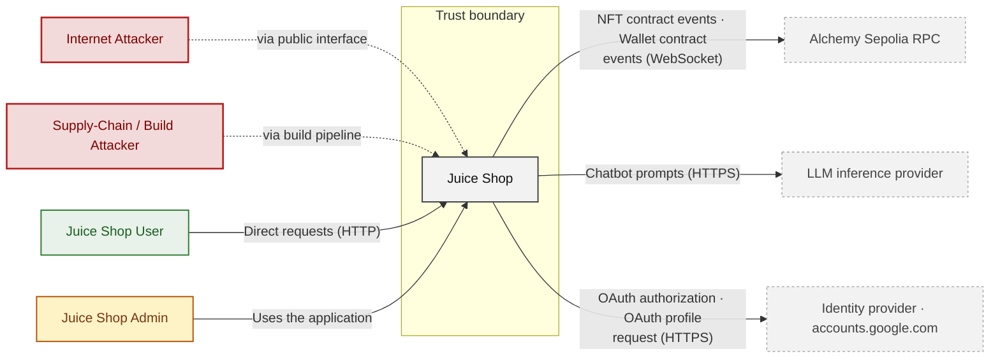

**Key takeaway:** Juice Shop serves Juice Shop User and Juice Shop Admin and depends on Alchemy Sepolia RPC, LLM inference provider and Identity provider · accounts.google.com; Internet Attacker and Supply-Chain / Build Attacker attack it.

### 2.2 Container Architecture

How the system decomposes into deployable units. Each box is a separate runtime process or service container; arrows show synchronous request paths between them. Components with ≥3 Critical findings carry a red border, ≥2 High amber (C4 Level 2).

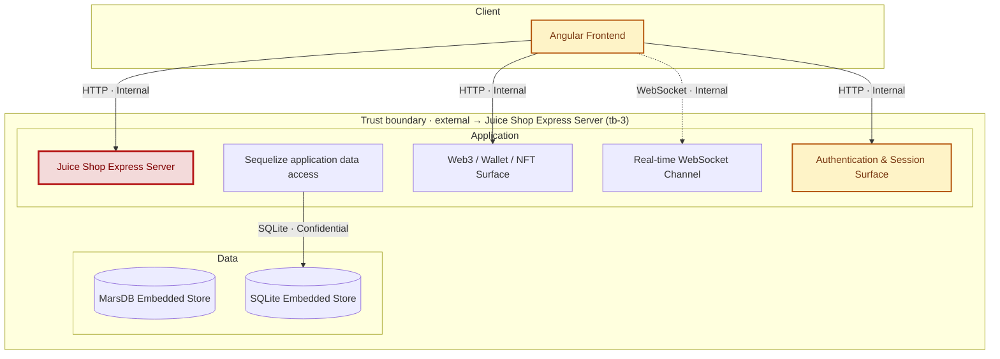

*Trust boundaries not drawn above: Sequelize application data access → SQLite Embedded Store (tb-9), external → CI/CD Pipeline (tb-4), Angular Frontend → external (tb-8, tb-13), Juice Shop Express Server → external (tb-10, tb-11), +1 more - every boundary is listed in [§1 Trust Boundaries](#trust-boundaries).*

**Key takeaway:** The system decomposes into 1 client, 5 application and 2 data unit(s); Juice Shop Express Server carries the most Critical findings (3) and bounds the worst-case blast radius. The build plane (CI/CD Pipeline) is shown in [Figure 1b](#figure-1b).

### 2.3 Components

How each component is reached, what it handles, how many threats hit it, and how effective the controls evidenced on it are. The component table below holds source paths and linked threats per `C-NN`; per-finding evidence is in [§8 Findings Register](#8-findings-register).

<!-- detail-table -->
| Component | Inbound flows | Data handled | Threats | Controls: worst effectiveness per domain |
|----------------------|----------------------|------------|----------------------|----------------------|
| [C-01](#c-01) · Juice Shop Express Server | 2 unauthenticated<br/>1 authentication unknown<br/>2 authenticated (bearer, cookie) | Internal | 44 (🔴 3 · 🟠 16 · 🟡 25) | 🔴 Missing: AuthN, AuthZ<br/>🟠 Weak: Input / query |
| [C-02](#c-02) · Sequelize application data access | none modeled | Confidential | 6 (🟠 1 · 🟡 5) | 🟠 Weak: Secrets / crypto |
| [C-03](#c-03) · CI/CD Pipeline | none modeled | – | 9 (🟡 9) | 🟠 Weak: Supply chain (7) |
| [C-04](#c-04) · Web3 / Wallet / NFT Surface | 1 unauthenticated | Internal | 2 (🟠 1 · 🟡 1) | – |
| [C-05](#c-05) · Angular Frontend | none modeled | Confidential | 10 (🟠 6 · 🟡 4) | – |
| [C-06](#c-06) · MarsDB Embedded Store | none modeled | – | none | – |
| [C-07](#c-07) · Real-time WebSocket Channel | 1 authentication unknown | Internal | 2 (🟡 2) | 🔴 Missing: AuthN, AuthZ<br/>🟠 Weak: Input / query |
| [C-08](#c-08) · SQLite Embedded Store | 1 unauthenticated | Confidential | none | 🟠 Weak: Secrets / crypto |
| [C-09](#c-09) · Authentication &amp; Session Surface | 1 unauthenticated<br/>1 authentication unknown<br/>1 authenticated (bearer) | Internal | 14 (🔴 1 · 🟠 4 · 🟡 9) | 🔴 Missing: AuthN, AuthZ<br/>🟠 Weak: Input / query |
| System-wide: evidence not tied to one<br/>component | – | – | – | 🔴 Unsafe: AuthN (10), Input / query (3)<br/>🔴 Missing: Supply chain<br/>🟠 Weak: Session (4), Secrets / crypto (4),<br/>LLM<br/>🟡 Partial: AuthZ (3), Transport, Logging |

*🔴 **Unsafe**: relied upon but defeated or trivially bypassable - fix it · 🔴 **Missing**: never built - add it · 🟠 **Weak**: present, with exploitable gaps · 🟡 **Partial**: covers some surfaces, meaningful gaps remain · 🟢 **Adequate**: present and sound. A control counts for the component whose paths hold its implementation evidence; a domain without an evidenced control is not listed; (n) counts the controls behind a rating. Threat counts use the Figure 1 attribution; [§6](#6-security-architecture) holds the full assessment.*

**Key takeaway:** 3 components have at least one control rated Unsafe or Missing (C-01, C-07, C-09); 3 components have no component-specific control (C-04, C-05, C-06); 28 controls apply system-wide.

| ID | Name | Type | Key Paths | Linked Threats |
|----|----------------------|-----------|----------------------------------------|------------------------------------------------|
| <a id="c-01"></a><a id="component-191fd03d5dfa5985"></a><span style="white-space:nowrap">C-01</span> | Juice Shop Express Server | application | `lib/startup/registerWebsocketEvents.ts`<br/>`routes/address.ts`<br/>`routes/appConfiguration.ts`<br/>`routes/appVersion.ts`<br/>`routes/b2bOrder.ts` | 🔴 [F-001](#f-001) — Missing Object Ownership Checks<br/>🔴 [F-007](#f-007) — SQL injection<br/>🔴 [F-009](#f-009) — Broken authorization<br/>🟠 [F-006](#f-006) — Systemic IDOR Missing Ownership Checks<br/>🟠 [F-015](#f-015) — Chat identity taken from unverified JWT<br/>🟠 [F-016](#f-016) — JWT verify call missing algorithms allowlist<br/>🟠 [F-017](#f-017) — Password change without current password<br/>🟠 [F-022](#f-022) — Path Traversal<br/>🟠 [F-023](#f-023) — Zip Slip path traversal during archive extraction<br/>🟠 [F-025](#f-025) — Input in executable NoSQL predicate<br/>🟠 [F-026](#f-026) — Input in executable NoSQL predicate<br/>🟠 [F-027](#f-027) — Input compiled as template source<br/>🟠 [F-030](#f-030) — Unauthenticated log directory listing<br/>🟠 [F-031](#f-031) — XML external entity expansion in upload parser<br/>🟠 [F-033](#f-033) — Code injection<br/>🟠 [F-034](#f-034) — Sensitive Routes Registered Without Authentication Middleware<br/>🟠 [F-036](#f-036) — Missing authorization on product update route<br/>🟠 [F-037](#f-037) — Sensitive Routes Registered Without Authentication Middleware<br/>🟠 [F-038](#f-038) — User registration accepts privileged fields<br/>🟡 [F-039](#f-039) — Unauthenticated review creation<br/>🟡 [F-040](#f-040) — Hard-coded cookie signing secret<br/>🟡 [F-047](#f-047) — Wallet top-up accepts unvalidated balance amount<br/>🟡 [F-048](#f-048) — Request data evaluated by notevil in vm sandbox<br/>🟡 [F-049](#f-049) — Cookie-authenticated profile update<br/>🟡 [F-050](#f-050) — Client-supplied coupon data accepted without server-side<br/>🟡 [F-051](#f-051) — Unvalidated client chat history passed to model<br/>🟡 [F-062](#f-062) — Null byte extension allowlist bypass in FTP file<br/>🟡 [F-063](#f-063) — JSONP and arbitrary field selection on current user<br/>🟡 [F-064](#f-064) — Unauthenticated memories listing joins user records<br/>🟡 [F-065](#f-065) — Security question disclosure<br/>🟡 [F-066](#f-066) — Unauthenticated metrics endpoint<br/>🟡 [F-067](#f-067) — Unauthenticated log directory listing and download<br/>🟡 [F-068](#f-068) — Unauthenticated encryption key directory exposure<br/>🟡 [F-069](#f-069) — Order history lookup by vowel-masked email<br/>🟡 [F-070](#f-070) — Server-side request forgery<br/>🟡 [F-077](#f-077) — Blocking busy-wait sleep reachable from review<br/>🟡 [F-078](#f-078) — Unbounded zip extraction output size<br/>🟡 [F-079](#f-079) — Unbounded unauthenticated chat consumption<br/>🟡 [F-080](#f-080) — Disk upload without size limit<br/>🟡 [F-081](#f-081) — Unbounded disk upload processed before authentication<br/>🟡 [F-084](#f-084) — Basket ID check bypass<br/>🟡 [F-085](#f-085) — Deluxe upgrade without payment for unrecognized payment<br/>🟡 [F-086](#f-086) — Chatbot coupon discount unbounded server-side |
| <a id="c-02"></a><a id="component-290ae722e9565831"></a><span style="white-space:nowrap">C-02</span> | Sequelize application data access | application | `models/address.ts`<br/>`models/basket.ts`<br/>`models/basketitem.ts`<br/>`models/captcha.ts`<br/>`models/card.ts` | 🟠 [F-032](#f-032) — Passwords hashed with unsalted fast MD5<br/>🟡 [F-052](#f-052) — Product description stored without sanitization<br/>🟡 [F-053](#f-053) — User email stored without sanitization<br/>🟡 [F-071](#f-071) — Payment card numbers stored in plaintext<br/>🟡 [F-072](#f-072) — TOTP secrets stored in plaintext<br/>🟡 [F-073](#f-073) — Security answers HMAC with hardcoded key |
| <a id="c-03"></a><a id="component-31ebe1b93ddf60d5"></a><span style="white-space:nowrap">C-03</span> | CI/CD Pipeline | application | `.dockerignore`<br/>`.github/workflows/ci.yml`<br/>`.github/workflows/codeql-analysis.yml`<br/>`.github/workflows/frontend-bundle-analysis.yml`<br/>`.github/workflows/image_actions.yml` | 🟡 [F-054](#f-054) — Missing Container Image Signing<br/>🟡 [F-055](#f-055) — Remote install script piped to shell in deploy job<br/>🟡 [F-056](#f-056) — Dependency Install Scripts Run at Build Time<br/>🟡 [F-057](#f-057) — Unaudited npm Lifecycle Script<br/>🟡 [F-058](#f-058) — Unpinned Third-Party GitHub Action<br/>🟡 [F-059](#f-059) — Non-reproducible dependency installs in release builds<br/>🟡 [F-060](#f-060) — Unpinned floating container base images<br/>🟡 [F-087](#f-087) — Container Runs as Root<br/>🟡 [F-088](#f-088) — Missing Workflow Permissions Block |
| <a id="c-04"></a><a id="component-6ffadbc3868c2a3b"></a><span style="white-space:nowrap">C-04</span> | Web3 / Wallet / NFT Surface | application | `routes/checkKeys.ts`<br/>`routes/nftMint.ts`<br/>`routes/redirect.ts`<br/>`routes/web3Wallet.ts` | 🟡 [F-082](#f-082) — Unbounded wallet set growth without validation |
| <a id="c-05"></a><a id="component-6ffaf23414c56207"></a><span style="white-space:nowrap">C-05</span> | Angular Frontend | client | `frontend/src/app/Models/backup.model.ts`<br/>`frontend/src/app/Models/challenge.model.ts`<br/>`frontend/src/app/Models/deliveryMethod.model.ts`<br/>`frontend/src/app/Models/hint.model.ts`<br/>`frontend/src/app/Models/product.model.ts` | 🟠 [F-002](#f-002) — XSS via Trusted HTML Binding<br/>🟠 [F-003](#f-003) — Angular Sanitizer Bypass XSS<br/>🟠 [F-004](#f-004) — Session Token Stored in localStorage<br/>🟠 [F-018](#f-018) — Predictable password derived from OAuth email address<br/>🟠 [F-028](#f-028) — DOM XSS<br/>🟠 [F-113](#f-113) — Session token stored in web-accessible client storage<br/>🟡 [F-041](#f-041) — Client-supplied review author identity<br/>🟡 [F-042](#f-042) — OAuth implicit flow without state or nonce<br/>🟡 [F-074](#f-074) — Passwords sent in GET query string unencoded<br/>🟡 [F-089](#f-089) — Client-side role guards trust unverified JWT claims |
| <a id="c-06"></a><a id="component-790db1fed70651aa"></a><span style="white-space:nowrap">C-06</span> | MarsDB Embedded Store | data | `data/mongodb.ts` | - |
| <a id="c-07"></a><a id="component-8c3a32ee53769307"></a><span style="white-space:nowrap">C-07</span> | Real-time WebSocket Channel | application | `lib/challengeUtils.ts`<br/>`lib/startup/registerWebsocketEvents.ts` | 🟡 [F-043](#f-043) — Unauthenticated WebSocket Channel<br/>🟡 [F-083](#f-083) — Unhandled TypeError from non-string socket |
| <a id="c-08"></a><a id="component-b213d5ab01236933"></a><span style="white-space:nowrap">C-08</span> | SQLite Embedded Store | data | `models/index.ts` | - |
| <a id="c-09"></a><a id="component-dff0840e0f4855be"></a><span style="white-space:nowrap">C-09</span> | Authentication & Session Surface | application | `lib/insecurity.ts`<br/>`lib/startup/registerWebsocketEvents.ts`<br/>`routes/2fa.ts`<br/>`routes/authenticatedUsers.ts`<br/>`routes/login.ts` | 🔴 [F-013](#f-013) — SQL injection in login query<br/>🟠 [F-005](#f-005) — Hardcoded Secrets in Source<br/>🟠 [F-021](#f-021) — Password reset by security answer only<br/>🟡 [F-044](#f-044) — Weak 2FA code guessing bounds<br/>🟡 [F-045](#f-045) — No brute-force protection on login<br/>🟡 [F-046](#f-046) — Substring redirect allowlist check<br/>🟡 [F-061](#f-061) — Unsanitised login IP header stored for later<br/>🟡 [F-075](#f-075) — Full user record with password hash in JWT<br/>🟡 [F-076](#f-076) — Session token cookie without security attributes<br/>🟡 [F-090](#f-090) — Any authenticated user can list all accounts<br/>🟡 [F-091](#f-091) — Sessions cannot be revoked |

> **Legend:** `-->` synchronous request/response (REST, HTTPS, gRPC) · `-.->` asynchronous / event-driven (WebSocket, queue, pub-sub) · **red border** ≥ 3 Critical threats on the component · **amber border** ≥ 2 High threats

---

## 3. Attack Walkthroughs

This section walks through how the highest-risk findings are exploited - one short walkthrough per Critical, each with attack steps, a focused sequence diagram, and the primary mitigation. Which root cause each Critical traces back to is in [Critical Findings by Root Cause](#critical-findings-by-root-cause); full per-finding context (severity rationale, assets, detection signals) is in the [§8 Findings Register](#8-findings-register).

### 3.1 SQL injection in Search

**Source:** 🔴 [F-007](#f-007) — `routes/search.ts:23`

Severity **Critical** ([CWE-89](https://cwe.mitre.org/data/definitions/89.html)). STRIDE: Tampering. See [§8 F-007](#f-007) for the full register row.

**Attack Steps**

1. Find the request parameter that reaches the raw query at `routes/search.ts:23`.
2. Interpolating request-controlled text into a SQL statement lets an attacker alter the query - exfiltrating or modifying arbitrary rows, bypassing authentication, or escalating to full database control.

**Sequence Diagram**

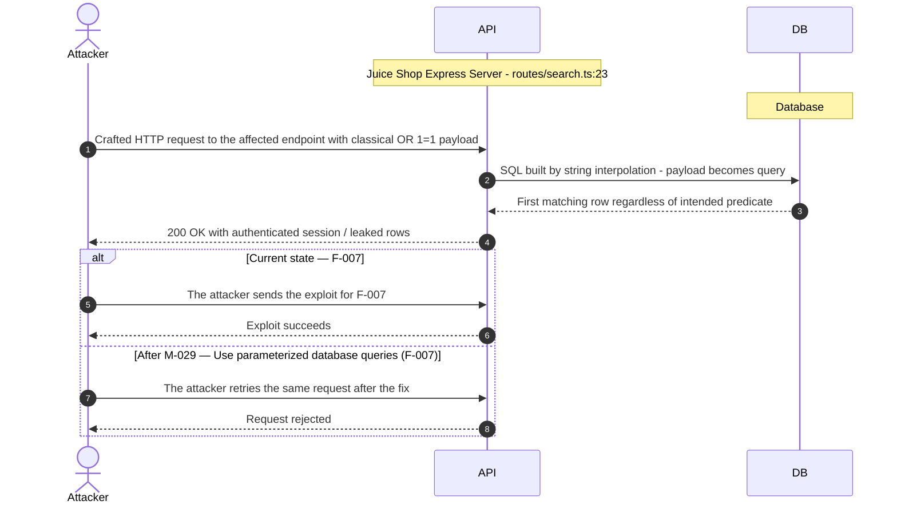

**Key takeaway:** Until ● [M-029](#m-029) (Use parameterized database queries (🔴 [F-007](#f-007))) lands, 🔴 [F-007](#f-007) — SQL injection is exploitable at `routes/search.ts:23` (Critical-severity, [CWE-89](https://cwe.mitre.org/data/definitions/89.html)).

**Defense in Depth**

- Primary mitigation: ● [M-029](#m-029) (Use parameterized database queries (🔴 [F-007](#f-007)))

### 3.2 SQL injection in login query

**Source:** 🔴 [F-013](#f-013) — `routes/login.ts:34`

Severity **Critical** ([CWE-89](https://cwe.mitre.org/data/definitions/89.html)). STRIDE: Tampering. See [§8 F-013](#f-013) for the full register row.

**Attack Steps**

1. POST `/rest/user/login` with email set to admin@host'-- and any password.
2. The injected quote ends the email literal and comments out the password and `deletedAt` checks.
3. Receive the JWT issued for the admin row and call privileged APIs.

**Sequence Diagram**

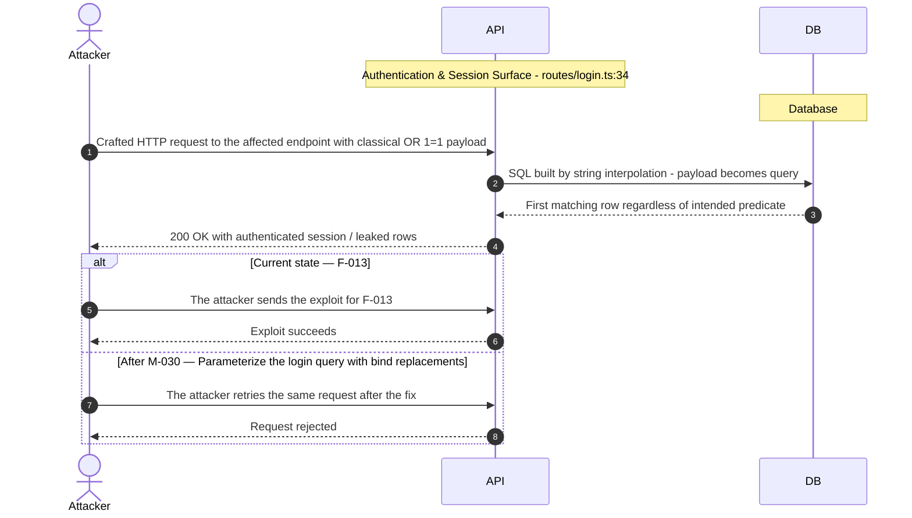

**Key takeaway:** Until ● [M-030](#m-030) (Parameterize the login query with bind replacements) lands, 🔴 [F-013](#f-013) — SQL injection in login query is exploitable at `routes/login.ts:34` (Critical-severity, [CWE-89](https://cwe.mitre.org/data/definitions/89.html)).

**Defense in Depth**

- Primary mitigation: ● [M-030](#m-030) (Parameterize the login query with bind replacements)

### 3.3 Missing Object Ownership Checks in Order

**Source:** 🔴 [F-001](#f-001) — `routes/order.ts:148`

Severity **Critical** ([CWE-639](https://cwe.mitre.org/data/definitions/639.html)). STRIDE: Tampering. See [§8 F-001](#f-001) for the full register row.

**Attack Steps**

1. An attacker crafts a request that reaches the code at `routes/order.ts:148`.
2. A signed-in attacker puts another user's ID into the owner field of the request (`req.body.UserId` and the like); the query trusts it instead of the session identity, so the attacker reads or changes every other user's records - horizontal privilege escalation across all accounts.

**Sequence Diagram**

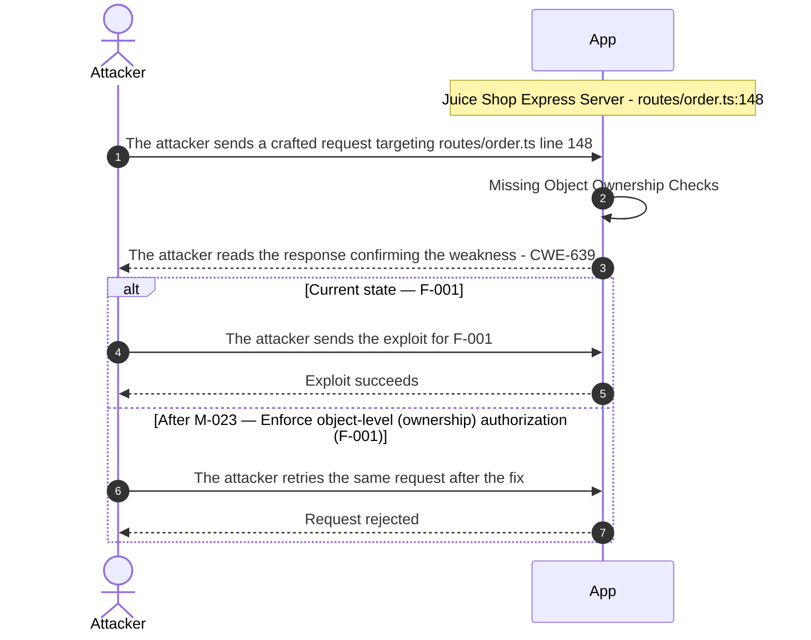

**Key takeaway:** Until ● [M-023](#m-023) (Enforce object-level (ownership) authorization (🔴 [F-001](#f-001))) lands, 🔴 [F-001](#f-001) — Missing Object Ownership Checks is exploitable at `routes/order.ts:148` (Critical-severity, [CWE-639](https://cwe.mitre.org/data/definitions/639.html)).

**Defense in Depth**

- Primary mitigation: ● [M-023](#m-023) (Enforce object-level (ownership) authorization (🔴 [F-001](#f-001)))
- Defence in depth: ◑ [M-001](#m-001) (Manual review: verify Missing Object Ownership Checks)

### 3.4 Broken authorization in Data Export

**Source:** 🔴 [F-009](#f-009) — `routes/dataExport.ts:26`

Severity **Critical** ([CWE-639](https://cwe.mitre.org/data/definitions/639.html)). STRIDE: Tampering. See [§8 F-009](#f-009) for the full register row.

**Attack Steps**

1. An attacker crafts a request that reaches the code at `routes/dataExport.ts:26`.
2. A signed-in attacker puts another user's ID into the owner field of the request (`req.body.UserId` and the like); the query trusts it instead of the session identity, so the attacker reads or changes every other user's records - horizontal privilege escalation across all accounts.

**Sequence Diagram**

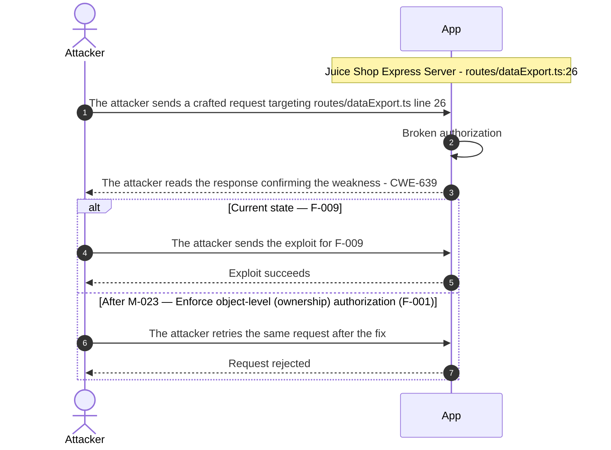

**Key takeaway:** Until ● [M-023](#m-023) (Enforce object-level (ownership) authorization (🔴 [F-001](#f-001))) lands, 🔴 [F-009](#f-009) — Broken authorization is exploitable at `routes/dataExport.ts:26` (Critical-severity, [CWE-639](https://cwe.mitre.org/data/definitions/639.html)).

**Defense in Depth**

- Primary mitigation: ● [M-023](#m-023) (Enforce object-level (ownership) authorization (🔴 [F-001](#f-001)))

### 3.5 User registration accepts privileged fields in Juice Shop Express Server

**Source:** 🟠 [F-038](#f-038) — `server.ts:503`

Severity **High** ([CWE-915](https://cwe.mitre.org/data/definitions/915.html)). STRIDE: Elevation of Privilege. See [§8 F-038](#f-038) for the full register row.

**Attack Steps**

1. An attacker crafts a request that reaches the code at `server.ts:503`.
2. POST `/api/Users` is passed to the generated finale User resource after only trimming; the body is not filtered, so the attacker supplies a role such as admin at registration.

**Sequence Diagram**

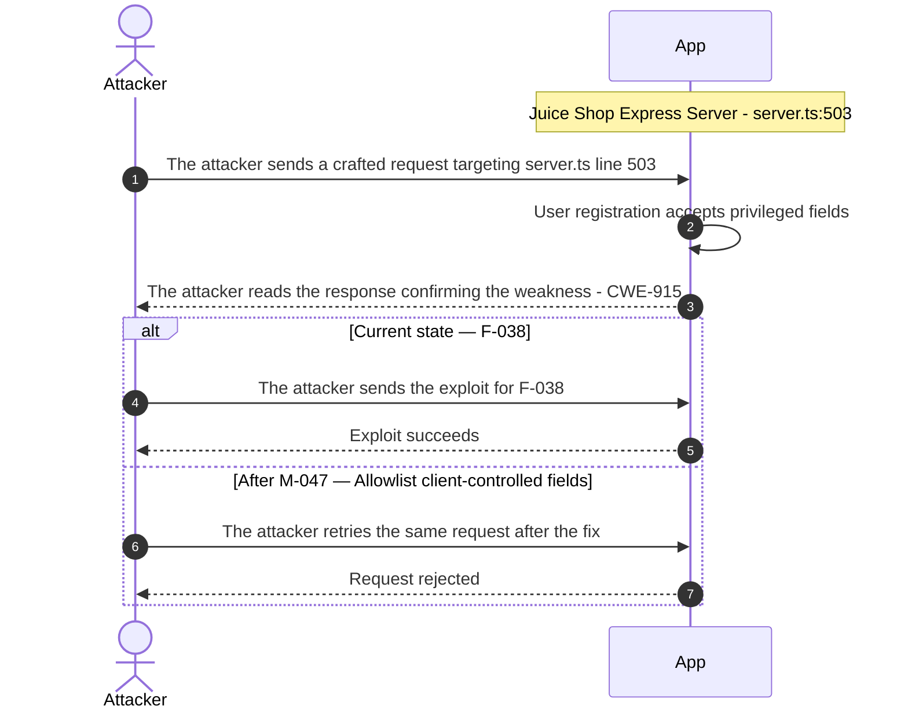

**Key takeaway:** Until ◕ [M-047](#m-047) (Allowlist client-controlled fields) lands, 🟠 [F-038](#f-038) — User registration accepts privileged fields is exploitable at `server.ts:503` (High-severity, [CWE-915](https://cwe.mitre.org/data/definitions/915.html)).

**Defense in Depth**

- Primary mitigation: ◕ [M-047](#m-047) (Allowlist client-controlled fields)

### 3.6 Hardcoded Secrets in Source

**Source:** 🟠 [F-005](#f-005) — `lib/insecurity.ts:21`

Severity **High** ([CWE-798](https://cwe.mitre.org/data/definitions/798.html)). STRIDE: Information Disclosure. See [§8 F-005](#f-005) for the full register row.

**Attack Steps**

1. An attacker crafts a request that reaches the code at `lib/insecurity.ts:21`.
2. The `RS256` signing key is a literal in source and the security-answer HMAC key is a literal at line 42.
3. Anyone with the source can sign tokens for any user or role, or compute answer hashes offline.

**Sequence Diagram**

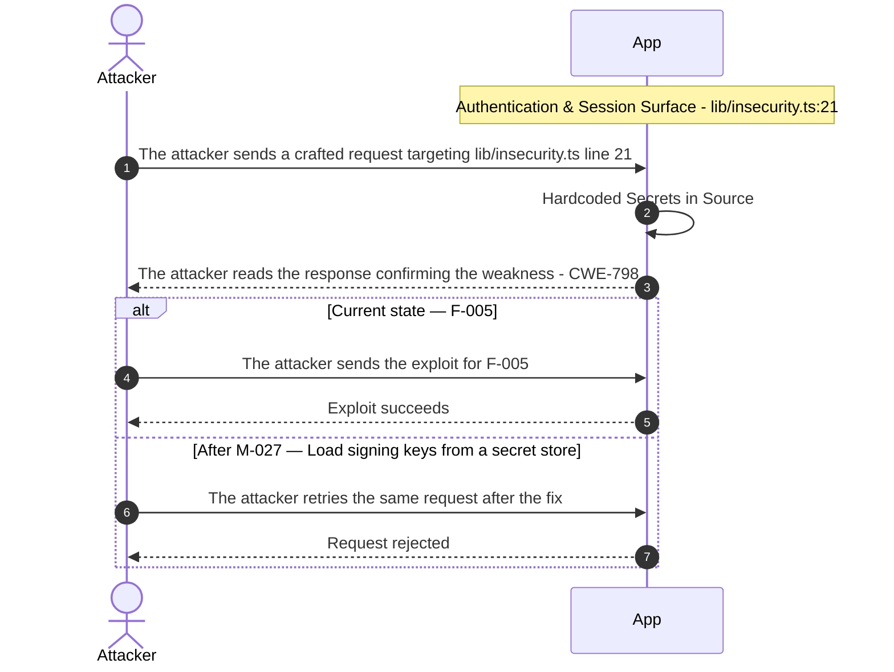

**Key takeaway:** Until ◕ [M-027](#m-027) (Load signing keys from a secret store) lands, 🟠 [F-005](#f-005) — Hardcoded Secrets in Source is exploitable at `lib/insecurity.ts:21` (High-severity, [CWE-798](https://cwe.mitre.org/data/definitions/798.html)).

**Defense in Depth**

- Primary mitigation: ◕ [M-027](#m-027) (Load signing keys from a secret store)

### 3.7 Request data evaluated by notevil in vm sandbox

**Source:** 🟡 [F-048](#f-048) — `routes/b2bOrder.ts:23`

Severity **Medium** ([CWE-95](https://cwe.mitre.org/data/definitions/95.html)). STRIDE: Tampering. See [§8 F-048](#f-048) for the full register row.

**Attack Steps**

1. Authenticate and POST `/b2b/v2/orders` with a crafted `orderLinesData` expression.
2. Escape the notevil/vm sandbox to execute code in the server process.

**Sequence Diagram**

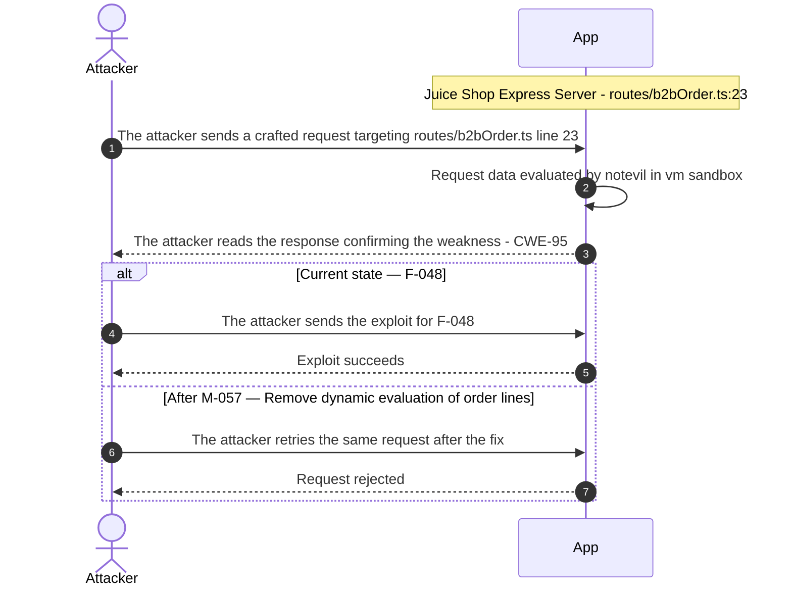

**Key takeaway:** Until ◑ [M-057](#m-057) (Remove dynamic evaluation of order lines) lands, 🟡 [F-048](#f-048) — Request data evaluated by notevil in vm sandbox is exploitable at `routes/b2bOrder.ts:23` (Medium-severity, [CWE-95](https://cwe.mitre.org/data/definitions/95.html)).

**Defense in Depth**

- Primary mitigation: ◑ [M-057](#m-057) (Remove dynamic evaluation of order lines)

<!-- generated:walkthrough_renderer -->

---

## 4. Assets

Information assets and the classification level that drives the Confidentiality / Integrity / Availability targets used in [§8 Findings Register](#8-findings-register) risk scoring.

| Asset | Classification | Description |
|----------------------|--------------|------------------------------------|
| Alchemy API key | Restricted | API key read from environment and embedded<br/>in the Alchemy RPC URL. |
| LLM provider API key | Restricted | API key read from environment and used for<br/>chatbot model calls. |
| SQLite application database | Confidential | Sequelize-managed SQLite file<br/>data/juiceshop.sqlite holding application<br/>model data. |
| MarsDB reviews and orders collections | Internal | In-process collections for product reviews<br/>(posts) and orders. |

---

## 5. Attack Surface

Network-reachable entry points classified by authentication requirement. Each row links to the threat(s) referenced in its **Notes** column. The **Risk** column reflects the highest-severity linked finding. Entry points with no linked finding are still listed when they sit on a sensitive surface (authentication, registration, management) or look like a missing-auth/authz suspect - marked **⚑ Review** in Notes.

### 5.1 Unauthenticated Entry Points (69)

<table style="table-layout:fixed;width:100%">
<colgroup><col width="9%" style="width:9%"><col width="30%" style="width:30%"><col width="14%" style="width:14%"><col width="47%" style="width:47%"></colgroup>
<thead><tr><th>Method</th><th>Route</th><th>Risk</th><th>Notes</th></tr></thead>
<tbody>
<tr><td>POST</td><td style="overflow-wrap:anywhere"><code>/rest/user/data-export</code></td><td>🔴 Critical</td><td>🔴 <a href="#f-009">F-009</a> — Broken authorization<br/>🟠 <a href="#f-028">F-028</a> — DOM XSS</td></tr>
<tr><td>POST</td><td style="overflow-wrap:anywhere"><code>/rest/user/login</code></td><td>🔴 Critical</td><td>🔴 <a href="#f-013">F-013</a> — SQL injection in login query<br/>🟡 <a href="#f-045">F-045</a> — No brute-force protection on login<br/>🟡 <a href="#f-075">F-075</a> — Full user record with password hash in JWT<br/>Public by design</td></tr>
<tr><td>GET</td><td style="overflow-wrap:anywhere"><code>/rest/products/search</code></td><td>🔴 Critical</td><td>🔴 <a href="#f-007">F-007</a> — SQL injection</td></tr>
<tr><td>POST</td><td style="overflow-wrap:anywhere"><code>/api/Users</code></td><td>🟠 High</td><td>🟠 <a href="#f-038">F-038</a> — User registration accepts privileged fields</td></tr>
<tr><td>POST</td><td style="overflow-wrap:anywhere"><code>/file-upload</code></td><td>🟠 High</td><td>🟠 <a href="#f-023">F-023</a> — Zip Slip path traversal during archive extraction<br/>🟠 <a href="#f-031">F-031</a> — XML external entity expansion in upload parser<br/>🟠 <a href="#f-034">F-034</a> — Sensitive Routes Registered Without Authentication Middleware</td></tr>
<tr><td>POST</td><td style="overflow-wrap:anywhere"><code>/rest/2fa/verify</code></td><td>🟠 High</td><td>🟠 <a href="#f-016">F-016</a> — JWT verify call missing algorithms allowlist<br/>🟡 <a href="#f-044">F-044</a> — Weak 2FA code guessing bounds<br/>Public by design</td></tr>
<tr><td>POST</td><td style="overflow-wrap:anywhere"><code>/rest/chat</code></td><td>🟠 High</td><td>🟠 <a href="#f-015">F-015</a> — Chat identity taken from unverified JWT<br/>🟡 <a href="#f-051">F-051</a> — Unvalidated client chat history passed to model<br/>🟡 <a href="#f-079">F-079</a> — Unbounded unauthenticated chat consumption</td></tr>
<tr><td>POST</td><td style="overflow-wrap:anywhere"><code>/rest/user/reset-password</code></td><td>🟠 High</td><td>🟠 <a href="#f-021">F-021</a> — Password reset by security answer only<br/>🟡 <a href="#f-065">F-065</a> — Security question disclosure<br/>Public by design</td></tr>
<tr><td>GET</td><td style="overflow-wrap:anywhere"><code>/rest/track-order/:id</code></td><td>🟠 High</td><td>🟠 <a href="#f-026">F-026</a> — Input in executable NoSQL predicate</td></tr>
<tr><td>GET</td><td style="overflow-wrap:anywhere"><code>/rest/user/change-password</code></td><td>🟠 High</td><td>🟠 <a href="#f-017">F-017</a> — Password change without current password<br/>🟡 <a href="#f-074">F-074</a> — Passwords sent in GET query string unencoded</td></tr>
<tr><td>ALL</td><td style="overflow-wrap:anywhere"><code>/support/logs/:file</code></td><td>🟠 High</td><td>🟠 <a href="#f-030">F-030</a> — Unauthenticated log directory listing<br/>🟡 <a href="#f-067">F-067</a> — Unauthenticated log directory listing and download</td></tr>
<tr><td>GET</td><td style="overflow-wrap:anywhere"><code>/metrics</code></td><td>🟡 Medium</td><td>🟡 <a href="#f-066">F-066</a> — Unauthenticated metrics endpoint<br/>Management surface</td></tr>
<tr><td>POST</td><td style="overflow-wrap:anywhere"><code>/rest/deluxe-membership</code></td><td>🟡 Medium</td><td>🟡 <a href="#f-085">F-085</a> — Deluxe upgrade without payment for unrecognized payment</td></tr>
<tr><td>POST</td><td style="overflow-wrap:anywhere"><code>/rest/memories</code></td><td>🟡 Medium</td><td>🟡 <a href="#f-064">F-064</a> — Unauthenticated memories listing joins user records</td></tr>
<tr><td>PUT</td><td style="overflow-wrap:anywhere"><code>/rest/wallet/balance</code></td><td>🟡 Medium</td><td>🟡 <a href="#f-047">F-047</a> — Wallet top-up accepts unvalidated balance amount</td></tr>
<tr><td>ALL</td><td style="overflow-wrap:anywhere"><code>/encryptionkeys/:file</code></td><td>🟡 Medium</td><td>🟡 <a href="#f-068">F-068</a> — Unauthenticated encryption key directory exposure</td></tr>
<tr><td>GET</td><td style="overflow-wrap:anywhere"><code>/rest/deluxe-membership</code></td><td>🟡 Medium</td><td>🟡 <a href="#f-085">F-085</a> — Deluxe upgrade without payment for unrecognized payment</td></tr>
<tr><td>GET</td><td style="overflow-wrap:anywhere"><code>/rest/memories</code></td><td>🟡 Medium</td><td>🟡 <a href="#f-064">F-064</a> — Unauthenticated memories listing joins user records</td></tr>
<tr><td>GET</td><td style="overflow-wrap:anywhere"><code>/rest/saveLoginIp</code></td><td>🟡 Medium</td><td>🟡 <a href="#f-061">F-061</a> — Unsanitised login IP header stored for later</td></tr>
<tr><td>GET</td><td style="overflow-wrap:anywhere"><code>/rest/user/security-question</code></td><td>🟡 Medium</td><td>🟡 <a href="#f-065">F-065</a> — Security question disclosure</td></tr>
<tr><td>GET</td><td style="overflow-wrap:anywhere"><code>/rest/user/whoami</code></td><td>🟡 Medium</td><td>🟡 <a href="#f-063">F-063</a> — JSONP and arbitrary field selection on current user</td></tr>
<tr><td>GET</td><td style="overflow-wrap:anywhere"><code>/rest/wallet/balance</code></td><td>🟡 Medium</td><td>🟡 <a href="#f-047">F-047</a> — Wallet top-up accepts unvalidated balance amount</td></tr>
<tr><td>POST</td><td style="overflow-wrap:anywhere"><code>/api/Addresss</code></td><td>-</td><td><em>⚑ Review: no auth guard detected</em></td></tr>
<tr><td>PUT</td><td style="overflow-wrap:anywhere"><code>/api/Addresss/:id</code></td><td>-</td><td><em>⚑ Review: no auth guard detected</em></td></tr>
<tr><td>DELETE</td><td style="overflow-wrap:anywhere"><code>/api/Addresss/:id</code></td><td>-</td><td><em>⚑ Review: no auth guard detected</em></td></tr>
<tr><td>POST</td><td style="overflow-wrap:anywhere"><code>/api/Cards</code></td><td>-</td><td><em>⚑ Review: no auth guard detected</em></td></tr>
<tr><td>DELETE</td><td style="overflow-wrap:anywhere"><code>/api/Cards/:id</code></td><td>-</td><td><em>⚑ Review: no auth guard detected</em></td></tr>
<tr><td>POST</td><td style="overflow-wrap:anywhere"><code>/api/Feedbacks</code></td><td>-</td><td><em>⚑ Review: no auth guard detected</em></td></tr>
<tr><td>GET</td><td style="overflow-wrap:anywhere"><code>/​rest/​admin/​application-​configuration</code></td><td>-</td><td>Management surface<br/><em>⚑ Review: no auth guard detected</em></td></tr>
<tr><td>GET</td><td style="overflow-wrap:anywhere"><code>/​rest/​admin/​application-​version</code></td><td>-</td><td>Management surface<br/><em>⚑ Review: no auth guard detected</em></td></tr>
<tr><td>PUT</td><td style="overflow-wrap:anywhere"><code>/​rest/​continue-​code-​findIt/​apply/​:​continueCode</code></td><td>-</td><td><em>⚑ Review: no auth guard detected</em></td></tr>
<tr><td>PUT</td><td style="overflow-wrap:anywhere"><code>/​rest/​continue-​code-​fixIt/​apply/​:​continueCode</code></td><td>-</td><td><em>⚑ Review: no auth guard detected</em></td></tr>
<tr><td>PUT</td><td style="overflow-wrap:anywhere"><code>/​rest/​continue-​code/​apply/​:​continueCode</code></td><td>-</td><td><em>⚑ Review: no auth guard detected</em></td></tr>
<tr><td>PUT</td><td style="overflow-wrap:anywhere"><code>/rest/products/:id/reviews</code></td><td>-</td><td><em>⚑ Review: no auth guard detected</em></td></tr>
<tr><td>POST</td><td style="overflow-wrap:anywhere"><code>/rest/web3/submitKey</code></td><td>-</td><td><em>⚑ Review: no auth guard detected</em></td></tr>
<tr><td>POST</td><td style="overflow-wrap:anywhere"><code>/​rest/​web3/​walletExploitAddress</code></td><td>-</td><td><em>⚑ Review: no auth guard detected</em></td></tr>
<tr><td>POST</td><td style="overflow-wrap:anywhere"><code>/rest/web3/walletNFTVerify</code></td><td>-</td><td><em>⚑ Review: no auth guard detected</em></td></tr>
<tr><td>POST</td><td style="overflow-wrap:anywhere"><code>/snippets/fixes</code></td><td>-</td><td><em>⚑ Review: no auth guard detected</em></td></tr>
<tr><td>POST</td><td style="overflow-wrap:anywhere"><code>/snippets/verdict</code></td><td>-</td><td><em>⚑ Review: no auth guard detected</em></td></tr>
</tbody>
</table>

_30 further entry point(s) in this category carry no linked finding and no elevated review signal, and are not listed individually (69 total). The complete route inventory is available in `.route-inventory.json` and, when exported, `pentest-tasks-juice-shop-standard-v0.6.0b5.yaml`._

### 5.2 Authenticated Entry Points (40)

<table style="table-layout:fixed;width:100%">
<colgroup><col width="9%" style="width:9%"><col width="30%" style="width:30%"><col width="14%" style="width:14%"><col width="47%" style="width:47%"></colgroup>
<thead><tr><th>Method</th><th>Route</th><th>Risk</th><th>Notes</th></tr></thead>
<tbody>
<tr><td>DELETE</td><td style="overflow-wrap:anywhere"><code>/api/Products/:id</code></td><td>🟠 High</td><td>🟠 <a href="#f-036">F-036</a> — Missing authorization on product update route<br/>Authorization not confirmed (review)</td></tr>
<tr><td>PUT</td><td style="overflow-wrap:anywhere"><code>/api/Products/:id</code></td><td>🟠 High</td><td>🟠 <a href="#f-036">F-036</a> — Missing authorization on product update route<br/>Authorization not confirmed (review)</td></tr>
<tr><td>GET</td><td style="overflow-wrap:anywhere"><code>/rest/basket/:id</code></td><td>🟠 High</td><td>🟠 <a href="#f-006">F-006</a> — Systemic IDOR Missing Ownership Checks</td></tr>
<tr><td>POST</td><td style="overflow-wrap:anywhere"><code>/rest/basket/:id/checkout</code></td><td>🟠 High</td><td>🟠 <a href="#f-006">F-006</a> — Systemic IDOR Missing Ownership Checks<br/>Authorization not confirmed (review)</td></tr>
<tr><td>PUT</td><td style="overflow-wrap:anywhere"><code>/​rest/​basket/​:​id/​coupon/​:​coupon</code></td><td>🟠 High</td><td>🟠 <a href="#f-006">F-006</a> — Systemic IDOR Missing Ownership Checks<br/>Authorization not confirmed (review)</td></tr>
<tr><td>POST</td><td style="overflow-wrap:anywhere"><code>/api/Products</code></td><td>🟠 High</td><td>🟠 <a href="#f-036">F-036</a> — Missing authorization on product update route<br/>Authorization not confirmed (review)</td></tr>
<tr><td>GET</td><td style="overflow-wrap:anywhere"><code>/api/Users</code></td><td>🟠 High</td><td>🟠 <a href="#f-038">F-038</a> — User registration accepts privileged fields</td></tr>
<tr><td>GET</td><td style="overflow-wrap:anywhere"><code>/profile</code></td><td>🟠 High</td><td>🟠 <a href="#f-033">F-033</a> — Code injection<br/>🟡 <a href="#f-049">F-049</a> — Cookie-authenticated profile update<br/>🟡 <a href="#f-070">F-070</a> — Server-side request forgery</td></tr>
<tr><td>POST</td><td style="overflow-wrap:anywhere"><code>/profile</code></td><td>🟠 High</td><td>🟠 <a href="#f-033">F-033</a> — Code injection<br/>🟡 <a href="#f-049">F-049</a> — Cookie-authenticated profile update<br/>🟡 <a href="#f-070">F-070</a> — Server-side request forgery<br/>Authorization not confirmed (review)</td></tr>
<tr><td>PUT</td><td style="overflow-wrap:anywhere"><code>/api/BasketItems/:id</code></td><td>🟡 Medium</td><td>🟡 <a href="#f-084">F-084</a> — Basket ID check bypass<br/>Authorization not confirmed (review)</td></tr>
<tr><td>PUT</td><td style="overflow-wrap:anywhere"><code>/​rest/​order-​history/​:​id/​delivery-​status</code></td><td>🟡 Medium</td><td>🟡 <a href="#f-069">F-069</a> — Order history lookup by vowel-masked email<br/>Authorization not confirmed (review)</td></tr>
<tr><td>POST</td><td style="overflow-wrap:anywhere"><code>/api/BasketItems</code></td><td>🟡 Medium</td><td>🟡 <a href="#f-084">F-084</a> — Basket ID check bypass<br/>Authorization not confirmed (review)</td></tr>
<tr><td>POST</td><td style="overflow-wrap:anywhere"><code>/profile/image/file</code></td><td>🟡 Medium</td><td>🟡 <a href="#f-070">F-070</a> — Server-side request forgery<br/>Authorization not confirmed (review)</td></tr>
<tr><td>POST</td><td style="overflow-wrap:anywhere"><code>/profile/image/url</code></td><td>🟡 Medium</td><td>🟡 <a href="#f-070">F-070</a> — Server-side request forgery<br/>Authorization not confirmed (review)</td></tr>
<tr><td>GET</td><td style="overflow-wrap:anywhere"><code>/rest/order-history</code></td><td>🟡 Medium</td><td>🟡 <a href="#f-069">F-069</a> — Order history lookup by vowel-masked email</td></tr>
<tr><td>GET</td><td style="overflow-wrap:anywhere"><code>/rest/order-history/orders</code></td><td>🟡 Medium</td><td>🟡 <a href="#f-069">F-069</a> — Order history lookup by vowel-masked email</td></tr>
<tr><td>GET</td><td style="overflow-wrap:anywhere"><code>/​rest/​user/​authentication-​details</code></td><td>🟡 Medium</td><td>🟡 <a href="#f-090">F-090</a> — Any authenticated user can list all accounts</td></tr>
<tr><td>PUT</td><td style="overflow-wrap:anywhere"><code>/api/Cards/:id</code></td><td>-</td><td>Authorization not confirmed (review)<br/><em>⚑ Review: no authz guard detected</em></td></tr>
<tr><td>PUT</td><td style="overflow-wrap:anywhere"><code>/api/Feedbacks/:id</code></td><td>-</td><td>Authorization not confirmed (review)<br/><em>⚑ Review: no authz guard detected</em></td></tr>
<tr><td>DELETE</td><td style="overflow-wrap:anywhere"><code>/api/Quantitys/:id</code></td><td>-</td><td>Authorization not confirmed (review)<br/><em>⚑ Review: no authz guard detected</em></td></tr>
<tr><td>PUT</td><td style="overflow-wrap:anywhere"><code>/api/Recycles/:id</code></td><td>-</td><td>Authorization not confirmed (review)<br/><em>⚑ Review: no authz guard detected</em></td></tr>
<tr><td>DELETE</td><td style="overflow-wrap:anywhere"><code>/api/Recycles/:id</code></td><td>-</td><td>Authorization not confirmed (review)<br/><em>⚑ Review: no authz guard detected</em></td></tr>
<tr><td>POST</td><td style="overflow-wrap:anywhere"><code>/rest/2fa/disable</code></td><td>-</td><td>Public by design<br/><em>⚑ Review: auth/token endpoint</em></td></tr>
<tr><td>POST</td><td style="overflow-wrap:anywhere"><code>/rest/2fa/setup</code></td><td>-</td><td>Public by design<br/><em>⚑ Review: auth/token endpoint</em></td></tr>
<tr><td>GET</td><td style="overflow-wrap:anywhere"><code>/rest/2fa/status</code></td><td>-</td><td>Public by design<br/><em>⚑ Review: auth/token endpoint</em></td></tr>
</tbody>
</table>

_15 further entry point(s) in this category carry no linked finding and no elevated review signal, and are not listed individually (40 total). The complete route inventory is available in `.route-inventory.json` and, when exported, `pentest-tasks-juice-shop-standard-v0.6.0b5.yaml`._

---

## 6. Security Architecture

This chapter is organized by security-control category. Findings are listed only where the affected control is described.

_Cataloged controls: 43 total - 3 adequate, 11 partial, 19 weak, 3 unsafe, 7 missing._

**How to read the verdicts.** Every control category (and every sub-control below it) carries exactly one status. The two red verdicts do **not** mean the same thing - this is the distinction that decides what you have to do about a finding:

| Status | Meaning | What it asks of you |
|----------|------------------------------------|------------------------|
| 🟢 Adequate | Control is present and sound | Nothing - keep it |
| 🟡 Partial | Present, but with meaningful gaps | Close the gap |
| 🟠 Weak | Present, but has exploitable gaps | Strengthen it |
| 🔴 Unsafe | **Present and relied upon, but defeated /<br/>trivially bypassable** | **Fix the existing control** |
| 🔴 Missing | **Control was never built** | **Add the control** |
| - | Not applicable to this codebase | - |

So "🔴 Unsafe" on a control category does *not* mean the control is absent - it means the control exists but does not hold (e.g. an `MD5` password hash, a raw-SQL query path, a hardcoded signing key). "🔴 Missing" is reserved for controls that were never built (e.g. no `Content-Security-Policy` header).

### 6.1 Security Control Overview

<!-- §6.1 MECHANICAL-FROZEN — DO NOT EDIT (overview table is pregenerator-owned) -->

| Control category | Verdict | Main reason |
|----------------------|---------|------------------------------------|
| [6.2 Identity and Authentication Controls](#62-identity-and-authentication-controls) | 🔴 Unsafe | 11 findings; catalogued controls are present<br/>but defeated (e.g. Chat endpoint caller<br/>identity, Wallet ownership verification). |
| [6.3 Session and Token Controls](#63-session-and-token-controls) | 🟠 Weak | 4 findings; catalogued controls are weak<br/>(e.g. Cookie signing secret, Client-side<br/>session token storage). |
| [6.4 Authorization Controls](#64-authorization-controls) | 🔴 Missing | 12 findings; required controls not in place<br/>(e.g. Route-level authorization middleware,<br/>LLM agent tool authorization and coupon<br/>policy). |
| [6.5 Query Construction and Data Access Controls](#65-query-construction-and-data-access-controls) | 🔴 Unsafe | 4 findings; catalogued controls are present<br/>but defeated (e.g. Chatbot tool query<br/>construction, Sequelize connection and<br/>transaction configuration). |
| [6.6 Input Boundary Validation Controls](#66-input-boundary-validation-controls) | 🔴 Missing | 6 findings; required controls not in place<br/>(e.g. Rate limiting, Request input<br/>validation for wallet address). |
| [6.7 Output Encoding and Rendering Controls](#67-output-encoding-and-rendering-controls) | 🟠 Weak | 6 findings; no compensating controls<br/>catalogued. |
| [6.8 Browser and Cross-Origin Controls](#68-browser-and-cross-origin-controls) | 🟠 Weak | 2 findings; catalogued controls are weak<br/>(e.g. Socket\.io CORS origin restriction). |
| [6.9 Cryptography Secrets and Data Protection](#69-cryptography-secrets-and-data-protection) | 🟠 Weak | 5 findings; catalogued controls are weak<br/>(e.g. Database access credentials and<br/>storage protection, RPC API key handling and<br/>transport). |
| [6.10 File Parser and Outbound Request Controls](#610-file-parser-and-outbound-request-controls) | 🔴 Missing | 13 findings; required controls not in place<br/>(e.g. Profile image URL fetch (SSRF<br/>protection), Upload size and type limits). |
| [6.11 Operations Runtime and Supply Chain Controls](#611-operations-runtime-and-supply-chain-controls) | 🔴 Missing | 10 findings; required controls not in place<br/>(e.g. Sensitive endpoint exposure (metrics,<br/>log directory, API docs), GitHub Actions<br/>pinning to commit SHAs). |
| [6.12 Real-time and Not Applicable Controls](#612-real-time-and-not-applicable-controls) | 🟠 Weak | 0 findings; catalogued controls are weak<br/>(e.g. Socket\.io client connection). |

<!-- §6.1 MECHANICAL-FROZEN END -->

### 6.2 Identity and Authentication Controls

<a id="ctrl-identity-and-authentication-controls"></a>


**Systemic weaknesses:** [W-008](#w-008), [W-009](#w-009), [W-011](#w-011), [W-012](#w-012)
**Verdict:** 🔴 Unsafe - login, reset, OAuth, and WebSocket entry points exist but are defeated by missing throttling, answer-only reset, and absent caller verification.

<!-- The line below is mechanically derived from the controls table — LLM must not re-author it. -->
**Controls covered:**

- [6.2.1 OAuth implicit flow login and token handling](#621-oauth-implicit-flow-login-and-token-handling)
- [6.2.2 Hardcoded test credentials and OAuth client ID in client code](#622-hardcoded-test-credentials-and-oauth-client-id-in-client-code)
- [6.2.3 Two-factor authentication](#623-two-factor-authentication)
- [6.2.4 Password reset via security question](#624-password-reset-via-security-question)

**Implemented controls:** Chat endpoint caller identity, Wallet ownership verification, OAuth implicit flow login and token handling, Hardcoded test credentials and OAuth client ID in client code, Two-factor authentication (TOTP).

**Assessment:** Password login has no attempt limit (🟡 [F-045](#f-045)), reset needs only a security answer (🟠 [F-021](#f-021)), and the OAuth adapter derives a predictable password (🟠 [F-018](#f-018)). TOTP is present but has loose guess bounds (🟡 [F-044](#f-044)). Each successful flow ends with the server issuing a session token. Signing, validation, storage, and lifecycle of that token are described in [§6.3 Session and Token Controls](#63-session-and-token-controls).

<!-- §6.2 AUTH-MECHANISMS-FROZEN — deterministic inventory, pregenerator-owned. DO NOT EDIT. -->
**Authentication mechanisms (at a glance).** Every authentication mechanism detected on the application, its effective status, where it is assessed, and its linked findings. Controls are catalogued by domain, so JWT/session handling is assessed under [§6.3 Session and Token Controls](#63-session-and-token-controls) and password hashing under [§6.9 Cryptography Secrets and Data Protection](#69-cryptography-secrets-and-data-protection).

| Mechanism | Status | Assessed in | Findings |
|----------------------|---------|-----------|------------------------------------------------|
| User registration | 🔴 Unsafe | [§6.2](#62-identity-and-authentication-controls) | [W-002](#w-002) — Authorization is implemented route by route<br/>[W-023](#w-023) — Privileged attributes lack an enforced write allowlist<br/>🟡 [F-083](#f-083) — Unhandled TypeError from non-string socket — `registerWebsocketEvents.ts:46` |
| Password login | 🔴 Missing | [§6.2](#62-identity-and-authentication-controls) | [W-012](#w-012) — No brute-force protection on login (`login.ts:32`) |
| Password reset / change | 🟠 Weak | [§6.2](#62-identity-and-authentication-controls) | 🟠 [F-017](#f-017) — Password change without current password — `routes/changePassword.ts:39`<br/>🟠 [F-021](#f-021) — Password reset by security answer only<br/>🟡 [F-065](#f-065) — Security question disclosure — `routes/securityQuestion.ts:15` |
| Password storage (hashing) | 🟠 Weak | [§6.9](#69-cryptography-secrets-and-data-protection) | [W-041](#w-041) — Security-sensitive data uses weak cryptographic primitives<br/>[W-030](#w-030) — Full user record with password hash in JWT (`login.ts:24`) |
| JWT / bearer-token session | 🟡 Partial | [§6.3](#63-session-and-token-controls) | [W-008](#w-008) — Authentication relies on hand-rolled token verification<br/>[W-030](#w-030) — Full user record with password hash in JWT (`login.ts:24`)<br/>[W-020](#w-020) — Client-side role guards trust unverified JWT claims (`app.guard.ts:54`) |
| Session-token storage | 🟠 Weak | [§6.3](#63-session-and-token-controls) | [W-005](#w-005) — Browser scripts retain reusable session credentials<br/>🟠 [F-113](#f-113) — Session token stored in web-accessible client storage — `basket.service.ts:64` |
| Multi-factor authentication (TOTP / 2FA) | 🟡 Partial | [§6.2](#62-identity-and-authentication-controls) | [W-011](#w-011) — Weak 2FA code guessing bounds (`2fa.ts:31`)<br/>[W-036](#w-036) — TOTP secrets stored in plaintext (`user.ts:112`) |
| OAuth / OIDC federated login | 🔴 Unsafe | [§6.2](#62-identity-and-authentication-controls) | 🟠 [F-018](#f-018) — Predictable password derived from OAuth email address — `oauth.component.ts:30`<br/>[W-021](#w-021) — OAuth sign-in requests are not bound to the user's browser session |

<!-- §6.2 AUTH-MECHANISMS-FROZEN END -->

**Findings in this category without a control:**

- 🟡 [F-039](#f-039) — Unauthenticated review creation
- 🟡 [F-041](#f-041) — Client-supplied review author identity
- 🟡 [F-043](#f-043) — Unauthenticated WebSocket Channel
- 🟡 [F-066](#f-066) — Unauthenticated metrics endpoint

<a id="chat-endpoint-caller-identity"></a>
**Chat endpoint caller identity.**


**Status:** 🟠 Weak - the route derives the caller name from a token that is decoded but never signature-checked.

`POST /rest/chat` decodes the bearer token to read the user name, then inserts that name into the chatbot system prompt and uses it for order lookups.

**Security assessment**

<!-- Model assessment (facts the narrative must not contradict): POST /rest/chat has no authentication middleware. Per the flow analysis, the token is decoded without signature verification to derive the user name, which is then inserted into the system prompt. -->
The caller identity on the chat route is client-asserted:

- The token is decoded without signature verification and the route has no `isAuthorized` guard (🟠 [F-015](#f-015)).
- Chat history arrives in the request body and goes to the model verbatim (🟡 [F-051](#f-051)).

**Relevant findings**

- None linked to this control; see the other findings of this category.

<a id="wallet-ownership-verification"></a>
**Wallet ownership verification.**


**Status:** 🟠 Weak - addresses come from the request body and nothing binds the caller to them.

The wallet and NFT handlers read `req.body.walletAddress` and match it against on-chain event sets to decide eligibility.

The diagram shows the intended wallet check path:
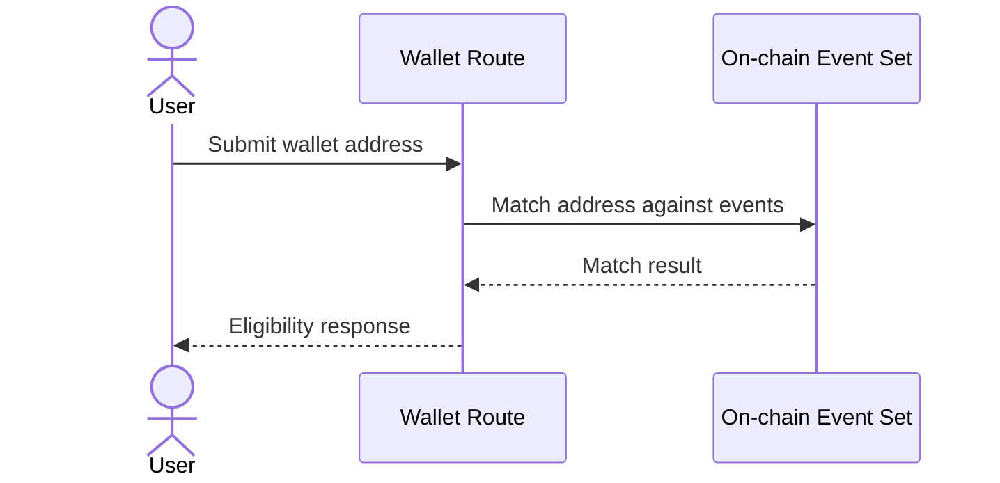

**Security assessment**

<!-- Model assessment (facts the narrative must not contradict): Wallet addresses are taken from the request body and matched against on-chain event sets. No signature or session binds the caller to the address. Any caller can submit any address, including one that minted or exploited elsewhere. The wallet and NFT handlers in the inspected files have no credential check. -->
Possession of an address is never proven, so any caller can claim any address:

- No signature or session ties the request to the address owner.
- The route accepts raw balance and address values without validation (🟡 [F-047](#f-047)).
- The address set grows without bound (🟡 [F-082](#f-082)).


**Relevant findings**

- None linked to this control; see the other findings of this category.

<a id="oauth-implicit-flow-login-and-token-handling"></a>
#### 6.2.1 OAuth implicit flow login and token handling

**Status:** 🟠 Weak - the implicit flow carries no state, nonce, or PKCE, and the result becomes a predictable local password.

<!-- Model implementation note (facts for the intro): login.component.ts googleLogin and ngOnInit; user.service.ts oauthLogin -->
`login.component.ts` starts Google login with `response_type=token`, and `UserService.oauthLogin()` turns the returned profile into a local session. A server-supplied allow-list of redirect URIs is checked before OAuth is enabled.

The diagram shows how the frontend OAuth adapter ends in the local login flow:
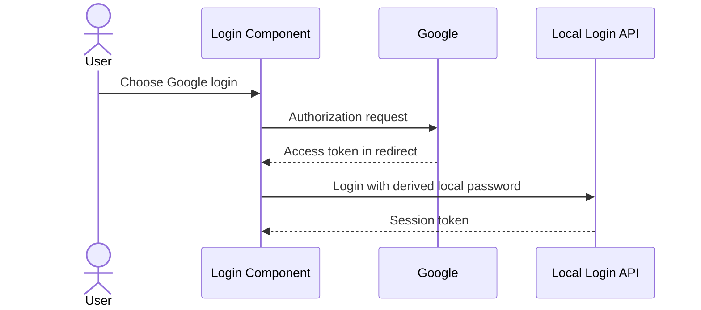

**Security assessment**

<!-- Model assessment (facts the narrative must not contradict): Google login uses response_type=token (implicit flow) with no state or nonce parameter and no PKCE. The access token is later put in the query string of a userinfo request. The redirect URI is checked against a server-supplied allow-list before OAuth is enabled, which is a partial mitigation. -->
The flow only partly resembles a server-side OAuth control:

- No `state` or `nonce` is generated or verified (🟡 [F-042](#f-042)).
- The local password is derived deterministically from the email address (🟠 [F-018](#f-018)).
- The access token travels in a query string, where logs and `Referer` headers can capture it.
- The redirect allow-list check is a partial mitigation.


**Relevant findings**

- None linked to this control; see the other findings of this category.

<a id="hardcoded-test-credentials-and-oauth-client-id-in-client-code"></a>
#### 6.2.2 Hardcoded test credentials and OAuth client ID in client code

**Status:** 🔴 Unsafe - test credentials and an OAuth client ID are hardcoded in the shipped login component.

<!-- Model implementation note (facts for the intro): login.component.ts lines 58-62 -->
`login.component.ts` pre-populates test credentials and embeds a Google OAuth client ID in the client bundle.

The diagram shows how the login form submits credentials:
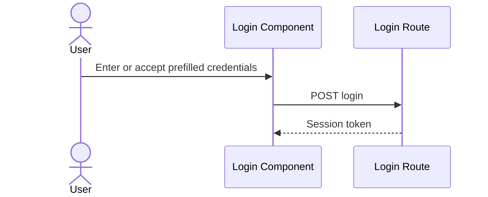

**Security assessment**

<!-- Model assessment (facts the narrative must not contradict): Testing credentials are hardcoded in the shipped login component. The OAuth client ID is also hardcoded, but client IDs are public by design. This is a training application, so the exposure may be deliberate. -->
Exposure here is limited and may be deliberate in a training application:

- Anyone reading the bundle sees working test credentials.
- The OAuth client ID is public by design and carries little risk by itself.
- No finding is routed to this control.


**Relevant findings**

- None linked to this control; see the other findings of this category.

<a id="websocket-connection-authentication"></a>
**WebSocket connection authentication.**


**Status:** 🔴 Missing - the connection handler accepts every client without a token, session, or middleware check.

This control is not evidenced in the repository.

**Security assessment**

<!-- Model assessment (facts the narrative must not contradict): The socket.io connection handler accepts every connection without a token, session or middleware check (no io.use). Any client receives stored notifications and may emit handler events. -->
The `socket.io` server has no `io.use` authentication step:

- Any client receives stored notifications and may emit handler events (🟡 [F-043](#f-043)).
- A non-string payload raises an unhandled `TypeError` (🟡 [F-083](#f-083)).

**Relevant findings**

- None linked to this control; see the other findings of this category.

<a id="two-factor-authentication"></a><a id="two-factor-authentication-totp"></a>
#### 6.2.3 Two-factor authentication

**Status:** 🟡 Partial - TOTP is enforced after the password step, but guess bounds are loose and secrets are stored in plaintext.

`routes/2fa.ts` issues a typed temporary token after the password step and requires a TOTP code before the session token is released. Setup and disable require the password.

The diagram shows the positive password login path, including the branch into TOTP verification:
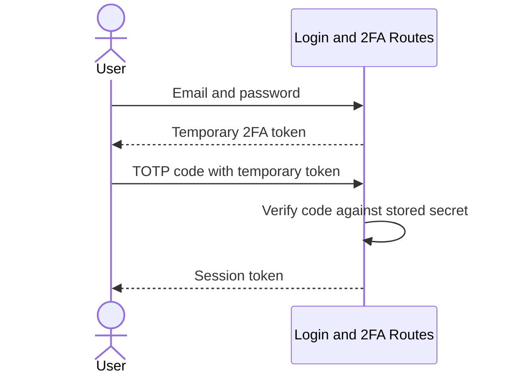

**Security assessment**

<!-- Model assessment (facts the narrative must not contradict): TOTP is enforced after the password step with a typed temporary token. Setup and disable require the password. There is no rate limiting or attempt lockout on /rest/2fa/verify in the inspected code. The totpSecret is stored in plaintext. epochTolerance of 30 widens the accepted window. -->
The possession factor holds in structure but is weakened in three places:

- Verification tolerates a wide time window with no per-user lockout (🟡 [F-044](#f-044)).
- The TOTP secret is stored as plaintext (🟡 [F-072](#f-072)).
- The only limit is an IP-based rate limit.


**Relevant findings**

- None linked to this control; see the other findings of this category.

<a id="password-reset-via-security-question"></a>
#### 6.2.4 Password reset via security question

**Status:** 🟠 Weak - an email and a security-question answer are the only proof needed to set a new password.

Password reset compares an HMAC of the submitted answer with the stored one, then updates the password. A separate route reveals the security question for an email.

The diagram shows the intended reset path:
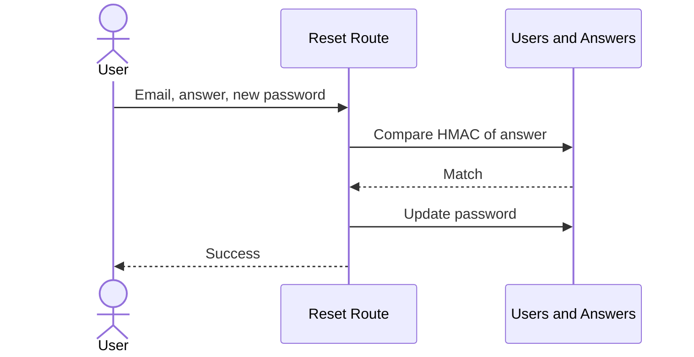

**Security assessment**

<!-- Model assessment (facts the narrative must not contradict): Reset needs only an email and a security-question answer. There is no rate limiting, no out-of-band verification and no current-password or notification step. A guessable or researchable answer allows account takeover. -->
Account takeover needs only a guessable or researchable answer:

- Reset has no out-of-band step and no notification (🟠 [F-021](#f-021)).
- The question disclosure route distinguishes existing accounts (🟡 [F-065](#f-065)).
- Password change can skip the current-password check (🟠 [F-017](#f-017)).


**Relevant findings**

- None linked to this control; see the other findings of this category.

<a id="brute-force-protection-on-login"></a>
**Brute-force protection on login.**


**Status:** 🔴 Missing - the login handler applies no lockout or throttling.

This control is not evidenced in the repository.

The diagram shows the plain login path where an attempt limit would need to sit:
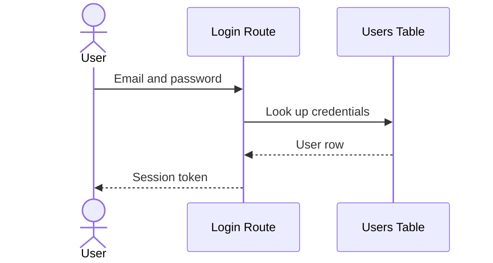

**Security assessment**

<!-- Model assessment (facts the narrative must not contradict): The login handler has no lockout or throttling, and the inspected scope contains none. A rate limiter in server.ts was not inspected. -->
Unlimited guessing is possible against the login endpoint:

- No attempt limit exists on the handler or its registration (🟡 [F-045](#f-045)).
- Fast unsalted `MD5` hashing makes offline guessing cheap (🟠 [F-032](#f-032) — Passwords hashed with unsalted fast MD5 (Passwords hashed with unsalted fast `MD5`)).
- A limiter elsewhere in `server.ts` was not inspected.


**Relevant findings**

- None linked to this control; see the other findings of this category.

### 6.3 Session and Token Controls

<a id="ctrl-session-and-token-controls"></a>

**Verdict:** 🟠 Weak - `RS256` tokens are used, but the signing key and cookie secret are in source, tokens sit in script-readable storage, and revocation does not exist.

<!-- The line below is mechanically derived from the controls table — LLM must not re-author it. -->
**Controls covered:**

- [6.3.1 Cookie signing secret](#631-cookie-signing-secret)
- [6.3.2 Client-side session token storage](#632-client-side-session-token-storage)
- [6.3.3 JWT signing and verification](#633-jwt-signing-and-verification)
- [6.3.4 In-memory token map and session cookie](#634-in-memory-token-map-and-session-cookie)

**Implemented controls:** Cookie signing secret, Client-side session token storage, JWT signing and verification, In-memory token map and session cookie.

**Assessment:** This application uses a single locally-signed token format (JWT) for every authenticated session, regardless of the [§6.2](#62-identity-and-authentication-controls) flow that established it. The sub-sections below trace the lifecycle: cookie signing, browser storage, signing and validation, and revocation with cookie attributes. Storage, revocation, and signing-key handling are the weakest stages.

**Findings in this category without a control:**

- 🟠 [F-004](#f-004) — Session Token Stored in localStorage
- 🟡 [F-076](#f-076) — Session token cookie without security attributes
- 🟡 [F-091](#f-091) — Sessions cannot be revoked
- 🟠 [F-113](#f-113) — Session token stored in web-accessible client storage

<a id="cookie-signing-secret"></a>
#### 6.3.1 Cookie signing secret

**Status:** 🟠 Weak - the cookie-signing secret is a literal in source.

`cookieParser` in `server.ts` is initialised with a fixed literal secret that signs cookies.

**Security assessment**

<!-- Model assessment (facts the narrative must not contradict): cookieParser uses a hard-coded literal secret 'kekse' that is the signing key for signed cookies. -->
Anyone with the source can forge signed cookies:

- The secret is committed to the repository (🟡 [F-040](#f-040)).

**Relevant findings**

- None linked to this control; see the other findings of this category.

<a id="client-side-session-token-storage"></a>
#### 6.3.2 Client-side session token storage

**Status:** 🟠 Weak - the token is readable by any script in the page origin.

<!-- Model implementation note (facts for the intro): login.component.ts login() lines 101-105 -->
`login()` in `login.component.ts` writes the JWT to `localStorage` and to a script-set cookie that expires after 8 hours.

**Security assessment**

<!-- Model assessment (facts the narrative must not contradict): The JWT is stored in localStorage and in a script-set cookie that expires after 8 hours. Any script running in the page origin can read both copies. The cookie is set from JavaScript, so it cannot be HttpOnly. The only logout handling seen in these slices is the login error path, which removes the token. -->
Both token copies are exposed to injected script:

- The token lives in script-accessible storage (🟠 [F-004](#f-004) — Session Token Stored in localStorage (Session Token Stored in `localStorage`), 🟠 [F-113](#f-113) — Session token stored in web-accessible client storage).
- The cookie is set from JavaScript, so it cannot be HttpOnly.
- Only the login error path removes the token.

**Relevant findings**

- None linked to this control; see the other findings of this category.

<a id="jwt-signing-and-verification"></a>
#### 6.3.3 JWT signing and verification

**Status:** 🟡 Partial - `RS256` signing and verification exist, but the key is embedded and the algorithm is not pinned.

Tokens are signed with `RS256`, expire after 6 hours, and `expressJwt` verifies them against the public key. The full user record goes into the payload.

The diagram shows token issuance and validation on a protected request:
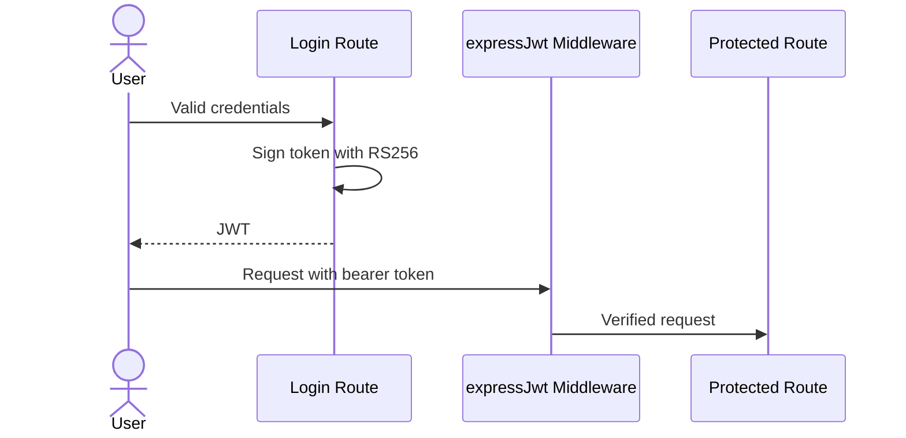

**Security assessment**

<!-- Model assessment (facts the narrative must not contradict): Tokens are signed with RS256 and expire after 6h, and expressJwt verifies them against the public key. The private key is embedded in source. verify() passes the public key to jws.verify without pinning the algorithm. The complete JWT payload, including the user record (with the password hash), is embedded in the token. -->
Signing is sound in format but the surrounding handling is not:

- The private key is a string literal in source (🟠 [F-005](#f-005)).
- The `verify()` call passes no algorithm allowlist (🟠 [F-016](#f-016)).
- The payload carries the user record including the password hash (🟡 [F-075](#f-075)).
- The chat route and client guards trust unverified claims (🟠 [F-015](#f-015), 🟡 [F-089](#f-089)).


**Relevant findings**

- None linked to this control; see the other findings of this category.

<a id="in-memory-token-map-and-session-cookie"></a>
#### 6.3.4 In-memory token map and session cookie

**Status:** 🟠 Weak - sessions are never removed and the cookie carries no security attributes.

`lib/insecurity.ts` keeps issued tokens in a process-local map and sets the token cookie through `res.cookie()` without an options object.

**Security assessment**

<!-- Model assessment (facts the narrative must not contradict): Sessions live in a process-local map with no logout or revocation path in the inspected code. The token cookie is set without httpOnly, secure or sameSite attributes, and tokens are never removed. -->
Revocation and cookie hardening are both absent:

- No code deletes entries from the token map, so sessions cannot be revoked (🟡 [F-091](#f-091)).
- The cookie has no `httpOnly`, `secure`, or `sameSite` attributes (🟡 [F-076](#f-076)).

**Relevant findings**

- None linked to this control; see the other findings of this category.

### 6.4 Authorization Controls

<a id="ctrl-authorization-controls"></a>


**Systemic weaknesses:** [W-002](#w-002), [W-020](#w-020), [W-021](#w-021), [W-022](#w-022), [W-023](#w-023)
**Verdict:** 🔴 Missing - server-side authorization is not applied consistently, and object ownership checks are absent across the API.

<!-- The line below is mechanically derived from the controls table — LLM must not re-author it. -->
**Controls covered:**

- [6.4.1 Route-level authorization middleware](#641-route-level-authorization-middleware)
- [6.4.2 LLM agent tool authorization and coupon policy](#642-llm-agent-tool-authorization-and-coupon-policy)
- [6.4.3 Per-event authorization on shared notification state](#643-per-event-authorization-on-shared-notification-state)
- [6.4.4 Role checks](#644-role-checks)

**Implemented controls:** Route-level authorization middleware, LLM agent tool authorization and coupon policy, Role checks.

**Assessment:** Guards cover baskets, complaints, B2B, and 2FA routes, but coverage is uneven. Product update, registration, and several data routes lack guards (🟠 [F-036](#f-036), 🟠 [F-034](#f-034), 🟠 [F-037](#f-037)), ownership checks are missing (🔴 [F-001](#f-001), 🟠 [F-006](#f-006)), and Angular guards decide access from unverified claims (🟡 [F-089](#f-089)). The missing piece is a server-side authorization pattern.

**Findings in this category without a control:**

- 🔴 [F-001](#f-001) — Missing Object Ownership Checks
- 🟠 [F-006](#f-006) — Systemic IDOR Missing Ownership Checks
- 🔴 [F-009](#f-009) — Broken authorization
- 🟠 [F-034](#f-034) — Sensitive Routes Registered Without Authentication Middleware
- 🟠 [F-036](#f-036) — Missing authorization on product update route
- 🟠 [F-037](#f-037) — Sensitive Routes Registered Without Authentication Middleware
- 🟠 [F-038](#f-038) — User registration accepts privileged fields
- 🟡 [F-050](#f-050) — Client-supplied coupon data accepted without server-side
- 🟡 [F-069](#f-069) — Order history lookup by vowel-masked email
- 🟡 [F-086](#f-086) — Chatbot coupon discount unbounded server-side
- 🟡 [F-089](#f-089) — Client-side role guards trust unverified JWT claims
- 🟡 [F-090](#f-090) — Any authenticated user can list all accounts

<a id="route-level-authorization-middleware"></a>
#### 6.4.1 Route-level authorization middleware

**Status:** 🟡 Partial - guards exist on several route groups but coverage is uneven.

`isAuthorized`, `denyAll`, and `isAccounting` middleware in `server.ts` guard baskets, complaints, B2B, and 2FA routes.

**Security assessment**

<!-- Model assessment (facts the narrative must not contradict): isAuthorized/denyAll/isAccounting guard baskets, complaints, B2B, and 2FA routes. Coverage is uneven: PUT /api/Products isAuthorized is commented out, /api/Deliverys, /rest/chat, /rest/deluxe-membership GET, and /rest/order-history have no visible guard in server.ts, and /api/Cards/Addresss rely on appendUserId only (no isAuthorized visible). -->
Route coverage has visible holes:

- Product update has its guard commented out (🟠 [F-036](#f-036)).
- Sensitive routes are registered without authentication middleware (🟠 [F-034](#f-034), 🟠 [F-037](#f-037)).
- Object ownership is not checked (🔴 [F-001](#f-001), 🟠 [F-006](#f-006), 🔴 [F-009](#f-009)).
- Any signed-in user can list all accounts (🟡 [F-090](#f-090)).

**Relevant findings**

- None linked to this control; see the other findings of this category.

<a id="llm-agent-tool-authorization-and-coupon-policy"></a>
#### 6.4.2 LLM agent tool authorization and coupon policy

**Status:** 🟠 Weak - discount limits live only in the system prompt, not in server code.

The chatbot calls tools including `generateCoupon` and `getOrderById`. The order tool checks ownership through the authenticated user, but compares masked emails.

**Security assessment**

<!-- Model assessment (facts the narrative must not contradict): The coupon limit (max 10%) and eligibility conditions are enforced only in the system prompt. The generateCoupon tool accepts any number and issues a coupon without server-side bounds, order verification or authentication. A confidential discount offer is embedded in the prompt. getOrderById does check ownership via the authenticated user, but compares masked emails. Messages come from the request body unfiltered. Not inspected: external LLM endpoint enforcement. -->
The model is trusted to enforce policy that the server does not:

- The coupon tool accepts any number and issues a coupon without bounds, order check, or authentication (🟡 [F-086](#f-086)).
- Client-supplied coupon data is accepted without server-side validation (🟡 [F-050](#f-050)).
- Messages from the request body reach the model unfiltered (🟡 [F-051](#f-051)).
- External LLM endpoint enforcement was not inspected.

**Relevant findings**

- None linked to this control; see the other findings of this category.

<a id="per-event-authorization-on-shared-notification-state"></a>
#### 6.4.3 Per-event authorization on shared notification state

**Status:** 🔴 Missing - any client can change shared notification state, and no ownership check exists.

This control is not evidenced in the repository.

**Security assessment**

<!-- Model assessment (facts the narrative must not contradict): The global notifications array is replayed to every new connection and mutated by any client via 'notification received' with no ownership or authorization check. -->
The global notifications array is replayed to every new connection and mutated through the `notification received` event:

- No ownership or authorization check applies, so any client can delete shared entries.
- The unauthenticated channel is the root cause (🟡 [F-043](#f-043)).

**Relevant findings**

- None linked to this control; see the other findings of this category.

<a id="role-checks"></a>
#### 6.4.4 Role checks

**Status:** 🟡 Partial - role checks verify the signature first but cover only a few roles.

`isAccounting` and `isDeluxe` verify the token signature before reading the role. The deluxe token is an HMAC keyed with the private key.

**Security assessment**

<!-- Model assessment (facts the narrative must not contradict): isAccounting and isDeluxe verify the token signature before checking the role. The deluxe token is an HMAC keyed with the private key. Coverage is limited to the roles checked here. -->
Server-side role checks are sound where present, but narrow:

- Coverage is limited to the accounting and deluxe roles.
- Frontend guards read the role from an unverified token (🟡 [F-089](#f-089)).

**Relevant findings**

- None linked to this control; see the other findings of this category.

### 6.5 Query Construction and Data Access Controls

<a id="ctrl-query-construction-and-data-access-controls"></a>


**Systemic weaknesses:** [W-001](#w-001)
**Verdict:** 🔴 Unsafe - raw SQL and string-built NoSQL predicates are in use on login, search, and review paths.

<!-- The line below is mechanically derived from the controls table — LLM must not re-author it. -->
**Controls covered:**

- [6.5.1 Chatbot tool query construction](#651-chatbot-tool-query-construction)
- [6.5.2 Sequelize connection and transaction configuration](#652-sequelize-connection-and-transaction-configuration)
- [6.5.3 Login SQL query construction](#653-login-sql-query-construction)

**Implemented controls:** Chatbot tool query construction, Sequelize connection and transaction configuration.

**Assessment:** Sequelize backs most data access, but login and search build raw SQL (🔴 [F-013](#f-013), 🔴 [F-007](#f-007)), and two routes build executable NoSQL predicates from input (🟠 [F-025](#f-025), 🟠 [F-026](#f-026)). The chatbot tools are the better-constrained path.

**Findings in this category without a control:**

- 🔴 [F-007](#f-007) — SQL injection
- 🔴 [F-013](#f-013) — SQL injection in login query
- 🟠 [F-025](#f-025) — Input in executable NoSQL predicate
- 🟠 [F-026](#f-026) — Input in executable NoSQL predicate

<a id="chatbot-tool-query-construction"></a>
#### 6.5.1 Chatbot tool query construction

**Status:** 🔴 Unsafe - the id is coerced to a number before use, which limits injection, but a string-built predicate remains.

The chatbot reviews tool coerces the id with `Number()` before building a MongoDB `$where` string. Product search uses a parameterized Sequelize operator, and tool arguments are typed with `zod`.

**Security assessment**

<!-- Model assessment (facts the narrative must not contradict): The reviews tool coerces the id with Number() before concatenating into a MongoDB \$where string, which limits injection (NaN or numeric only). The product search uses a parameterized Sequelize operator, which is adequate. Model-directed tool arguments are schema-typed via zod. -->
The chatbot path is mostly contained:

- Numeric coercion limits injection to NaN or digits.
- Parameterized search and schema-typed arguments are adequate.
- The same string-built predicate pattern is exploitable in the review and tracking routes (🟠 [F-025](#f-025), 🟠 [F-026](#f-026)).

**Relevant findings**

- None linked to this control; see the other findings of this category.

<a id="sequelize-connection-and-transaction-configuration"></a>
#### 6.5.2 Sequelize connection and transaction configuration

**Status:** 🟡 Partial - transactions and retry are configured, and the rating covers connection setup only.

<!-- Model implementation note (facts for the intro): models/index.ts createSequelize lines 32-44 -->
`createSequelize` in `models/index.ts` configures SQLite with IMMEDIATE transactions and bounded retry on `SQLITE_BUSY`.

**Security assessment**

<!-- Model assessment (facts the narrative must not contradict): Sequelize uses IMMEDIATE transactions and bounded retry on SQLITE_BUSY, which supports write integrity and availability under contention. Only the connection and model initialization were inspected; query construction in the individual models and in callers was not reviewed, so this rating covers connection configuration only. -->
The rating is narrow by design:

- Write integrity and availability under contention are supported.
- Query construction in models and callers was not reviewed here.
- No finding is routed to this control.

**Relevant findings**

- None linked to this control; see the other findings of this category.

<a id="login-sql-query-construction"></a>
#### 6.5.3 Login SQL query construction

**Status:** 🔴 Missing - the login query is built by concatenating the email into raw SQL.

This control is not evidenced in the repository.

The diagram shows the login lookup path:
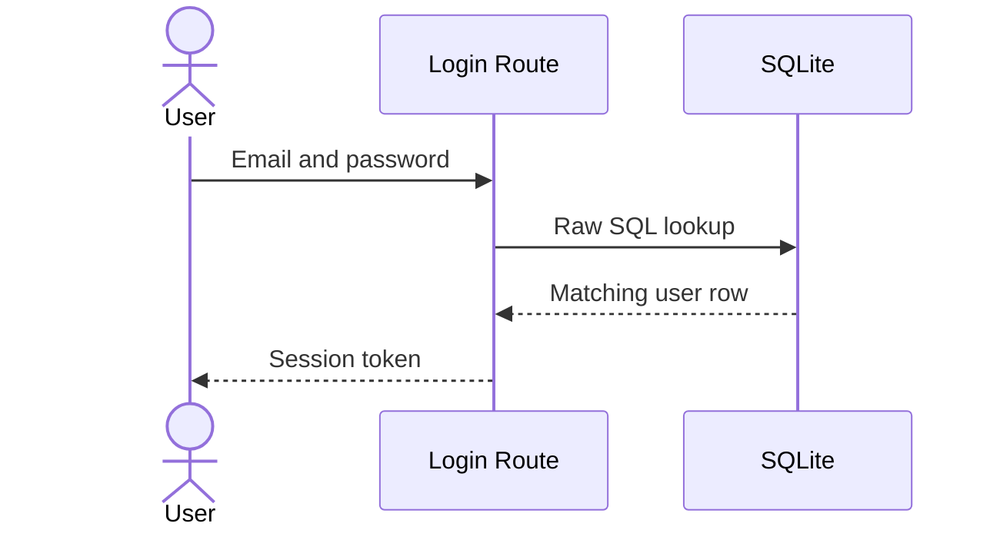

**Security assessment**

<!-- Model assessment (facts the narrative must not contradict): The login query concatenates req.body.email directly into raw SQL with no parameterization or escaping, so authentication can be bypassed by injection. -->
No parameter binding separates query structure from input on this path:

- `req.body.email` is interpolated into the login query, which allows authentication bypass (🔴 [F-013](#f-013)).
- Product search follows the same raw construction (🔴 [F-007](#f-007)).


**Relevant findings**

- None linked to this control; see the other findings of this category.

### 6.6 Input Boundary Validation Controls

<a id="ctrl-input-boundary-validation-controls"></a>

**Verdict:** 🔴 Missing - rate limits cover two endpoints only, and wallet, upload, chat, and amount inputs have no boundary checks.

<!-- The line below is mechanically derived from the controls table — LLM must not re-author it. -->
**Controls covered:**

- [6.6.1 Validation Approach](#661-validation-approach)
- [6.6.2 Rate limiting](#662-rate-limiting)
- [6.6.3 Request input validation for wallet address](#663-request-input-validation-for-wallet-address)
- [6.6.4 Client-side login form validation](#664-client-side-login-form-validation)
- [6.6.5 Guest basket sessionStorage parsing](#665-guest-basket-sessionstorage-parsing)
- [6.6.6 WebSocket message payload validation](#666-websocket-message-payload-validation)

**Implemented controls:** Rate limiting, Client-side login form validation, Guest basket `sessionStorage` parsing, WebSocket message payload validation.

**Assessment:** Validation is sparse. Rate limits exist for reset and 2FA only, wallet and top-up values are unchecked (🟡 [F-047](#f-047), 🟡 [F-082](#f-082)), and chat and upload paths have no size or usage bounds (🟡 [F-079](#f-079), 🟡 [F-080](#f-080), 🟡 [F-081](#f-081)). Only guest basket parsing is solid.

**Findings in this category without a control:**

- 🟡 [F-047](#f-047) — Wallet top-up accepts unvalidated balance amount
- 🟡 [F-077](#f-077) — Blocking busy-wait sleep reachable from review
- 🟡 [F-079](#f-079) — Unbounded unauthenticated chat consumption
- 🟡 [F-080](#f-080) — Disk upload without size limit
- 🟡 [F-081](#f-081) — Unbounded disk upload processed before authentication
- 🟡 [F-082](#f-082) — Unbounded wallet set growth without validation

<a id="validation-approach"></a>
#### 6.6.1 Validation Approach

**Status:** 🟠 Weak - bounds exist on a few inputs, while chat, uploads, wallet, and review paths are unbounded.

Validation is handled per route. The guest basket parser and the in-memory upload cap are the clearest examples of enforced input bounds.

**Security assessment**

Boundary checks are uneven across the API:

- Wallet top-up accepts a raw balance value (🟡 [F-047](#f-047)).
- Chat consumption has no input or output bounds (🟡 [F-079](#f-079)).
- Disk uploads have no size limit (🟡 [F-080](#f-080), 🟡 [F-081](#f-081)).
- A blocking sleep is reachable from review input (🟡 [F-077](#f-077)).

**Relevant findings**

- None linked to this control; see the other findings of this category.

<a id="rate-limiting"></a>
#### 6.6.2 Rate limiting

**Status:** 🟠 Weak - limits exist only on reset-password and 2FA, and the reset key can be rotated.

`express-rate-limit` guards the reset-password and 2FA endpoints. The reset key generator reads the `X-Forwarded-For` header.

**Security assessment**

<!-- Model assessment (facts the narrative must not contradict): Rate limits exist only on reset-password and 2FA endpoints. The reset-password key generator trusts the X-Forwarded-For header, which a client can rotate to evade the limit. No limit is visible on login or chat. -->
Throttling misses the endpoints that need it most:

- Login has no visible limit (🟡 [F-045](#f-045)).
- The 2FA limit is per IP, with no per-user lockout (🟡 [F-044](#f-044)).
- Chat has no limit (🟡 [F-079](#f-079)).
- A client can rotate `X-Forwarded-For` to evade the reset limit.

**Relevant findings**

- None linked to this control; see the other findings of this category.

<a id="request-input-validation-for-wallet-address"></a>
#### 6.6.3 Request input validation for wallet address

**Status:** 🔴 Missing - wallet addresses are stored without type, format, or length checks.

This control is not evidenced in the repository.

**Security assessment**

<!-- Model assessment (facts the narrative must not contradict): req.body.walletAddress is added to an in-memory Set without type, format or length checks. Repeated calls can grow the set without bound. -->
`req.body.walletAddress` is added to an in-memory `Set` directly:

- No format or length validation applies.
- Repeated calls grow the set without bound (🟡 [F-082](#f-082)).

**Relevant findings**

- None linked to this control; see the other findings of this category.

<a id="client-side-login-form-validation"></a>
#### 6.6.4 Client-side login form validation

**Status:** 🟠 Weak - the form checks only that fields are present, and attackers can bypass it anyway.

<!-- Model implementation note (facts for the intro): login.component.ts lines 50-52 -->
`login.component.ts` marks the email and password fields as required with a minimum length of one.

The diagram shows the client-side form path before the request is sent:
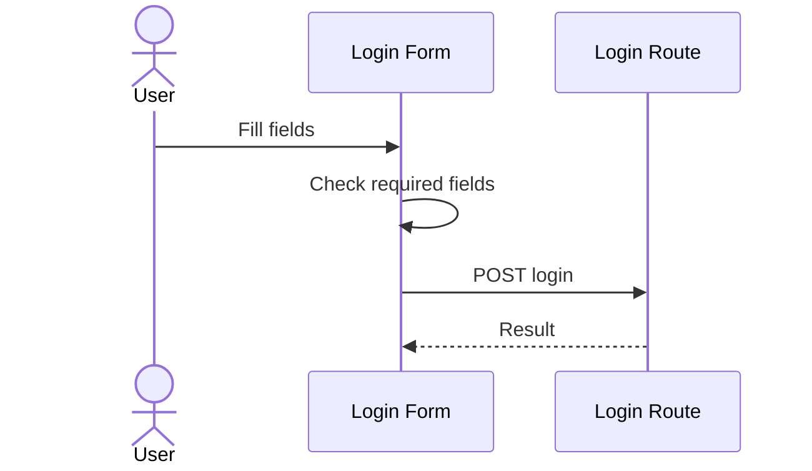

**Security assessment**

<!-- Model assessment (facts the narrative must not contradict): The form only checks that the fields are present (required, minLength 1). The client enforces no email format, and an attacker can bypass client validation anyway. Server-side validation was not inspected here. -->
Client validation is a usability aid only:

- No email format is enforced.
- Direct requests skip the form entirely.
- Server-side validation was not inspected here.


**Relevant findings**

- None linked to this control; see the other findings of this category.

<a id="guest-basket-sessionstorage-parsing"></a>
#### 6.6.5 Guest basket sessionStorage parsing

**Status:** 🟢 Adequate - stored basket data is parsed defensively and malformed items are dropped.

<!-- Model implementation note (facts for the intro): basket.service.ts getGuestBasketItems lines 82-109 -->
`getGuestBasketItems` in `basket.service.ts` parses `sessionStorage` in a try/catch and coerces each item's product id and quantity to a positive integer.

**Security assessment**

<!-- Model assessment (facts the narrative must not contradict): Guest basket data read from sessionStorage is parsed in a try/catch. Each item is coerced to a positive integer ProductId and quantity, and malformed items are dropped. Server-side checks still decide what is accepted. -->
This is the one well-formed input check in the section:

- Malformed items are dropped rather than passed on.
- Server-side checks still decide what is accepted.
- No finding is routed to this control.

**Relevant findings**

- None linked to this control; see the other findings of this category.

<a id="websocket-message-payload-validation"></a>
#### 6.6.6 WebSocket message payload validation

**Status:** 🟠 Weak - handlers take untyped data with little validation, and any client can call them.

Socket handlers receive data typed `any`. The SVG handler uses a regex and `isRedirectAllowed`, and the close-notifications handler checks `Array.isArray`.

**Security assessment**

<!-- Model assessment (facts the narrative must not contradict): Handlers take data typed any with little schema validation. The SVG handler uses optional chaining and a regex plus isRedirectAllowed, and the close-notifications handler checks Array.isArray. Others use only utils.contains or findIndex. Handler effects are limited to challenge solving and notification removal, but any unauthenticated client can invoke them, and 'notification received' lets any client delete shared notifications. -->
Validation depth varies by handler:

- Some handlers use only `utils.contains` or `findIndex`.
- A non-string payload raises an unhandled error (🟡 [F-083](#f-083)).
- Any unauthenticated client can invoke handlers, which can solve challenges or delete shared notifications (🟡 [F-043](#f-043)).

**Relevant findings**

- None linked to this control; see the other findings of this category.

### 6.7 Output Encoding and Rendering Controls


**Systemic weaknesses:** [W-006](#w-006), [W-025](#w-025), [W-026](#w-026), [W-027](#w-027)
**Verdict:** 🟠 Weak - raw HTML is bound in several components and unsanitised values are persisted for later rendering.

<!-- The line below is mechanically derived from the section's default mechanism — LLM must not re-author it. -->
**Controls covered:**

- [6.7.1 Output Encoding and Client-Side Rendering](#671-output-encoding-and-client-side-rendering)

**Implemented controls:** Angular default template escaping and a `sanitizeSecure` helper on some persistence paths.

**Assessment:** Default escaping holds for ordinary bindings, but trusted-HTML bypasses (🟠 [F-002](#f-002), 🟠 [F-003](#f-003)) and `document.write` (🟠 [F-028](#f-028)) defeat it. Product descriptions, emails, and login IP headers are stored unsanitised (🟡 [F-052](#f-052), 🟡 [F-053](#f-053), 🟡 [F-061](#f-061)), so output encoding is the only barrier.

**Findings in this category without a control:**

- 🟡 [F-061](#f-061) — Unsanitised login IP header stored for later

<a id="output-encoding-and-client-side-rendering"></a>
#### 6.7.1 Output Encoding and Client-Side Rendering

**Status:** 🟠 Weak - default escaping exists but is bypassed in several components, and stored values are not sanitised.

Users see feedback, product claims, and exported data rendered in their browser. Standard template escaping handles ordinary values, and a sanitising helper runs on some write paths.

**Security assessment**

The frontend marks feedback and claim text as trusted HTML and binds it to `innerHTML`. `data-export.component.ts:71` passes server data straight to `document.write`. On the write side, `models/product.ts:45`, `models/user.ts:60`, and `routes/saveLoginIp.ts:32` persist raw values because sanitisation runs only in the else branch of a challenge flag.

**Relevant findings**

- 🟠 [F-002](#f-002) — XSS via Trusted HTML Binding
- 🟠 [F-003](#f-003) — Angular Sanitizer Bypass XSS
- 🟠 [F-028](#f-028) — DOM XSS
- 🟡 [F-052](#f-052) — Product description stored without sanitization
- 🟡 [F-053](#f-053) — User email stored without sanitization

### 6.8 Browser and Cross-Origin Controls

**Verdict:** 🟠 Weak - the only catalogued browser control is a single hardcoded Socket\.io origin, and cross-site request protections are missing elsewhere.

<!-- The line below is mechanically derived from the controls table — LLM must not re-author it. -->
**Controls covered:**

- [6.8.1 Socket\.io CORS origin restriction](#681-socketio-cors-origin-restriction)

**Implemented controls:** Socket\.io CORS origin restriction.

**Assessment:** The Socket\.io CORS origin is restricted but hardcoded. The OAuth flow lacks a state parameter (🟡 [F-042](#f-042)), and cookie-authenticated profile updates have no CSRF protection (🟡 [F-049](#f-049)).

**Findings in this category without a control:**

- 🟡 [F-042](#f-042) — OAuth implicit flow without state or nonce
- 🟡 [F-049](#f-049) — Cookie-authenticated profile update

<a id="socketio-cors-origin-restriction"></a>
#### 6.8.1 Socket\.io CORS origin restriction

**Status:** 🟡 Partial - CORS is restricted to one origin, but it is hardcoded and not an authentication control.

The `socket.io` server allows one hardcoded browser origin, `http://localhost:4200`.

**Security assessment**

<!-- Model assessment (facts the narrative must not contradict): CORS is limited to a single hardcoded origin (http://localhost:4200). This restricts browser cross-origin reads but is not authentication, and non-browser clients ignore it. The hardcoded value is not deployment-appropriate. -->
The origin restriction has limited reach:

- It limits browser cross-origin reads only, and non-browser clients ignore it.
- The localhost value does not fit a deployed environment.
- Cross-site gaps sit in neighbouring flows (🟡 [F-042](#f-042), 🟡 [F-049](#f-049)).

**Relevant findings**

- None linked to this control; see the other findings of this category.

### 6.9 Cryptography Secrets and Data Protection


**Systemic weaknesses:** [W-041](#w-041)
**Verdict:** 🟠 Weak - secrets are committed to source and password and TOTP data are stored with weak protection.

<!-- The line below is mechanically derived from the controls table — LLM must not re-author it. -->
**Controls covered:**

- [6.9.1 Database access credentials and storage protection](#691-database-access-credentials-and-storage-protection)
- [6.9.2 RPC API key handling and transport](#692-rpc-api-key-handling-and-transport)
- [6.9.3 Sensitive data in URL query strings](#693-sensitive-data-in-url-query-strings)
- [6.9.4 Database storage protection](#694-database-storage-protection)
- [6.9.5 Password Hashing and Credential Storage](#695-password-hashing-and-credential-storage)
- [6.9.6 Hard-coded HMAC key for security answers](#696-hard-coded-hmac-key-for-security-answers)

**Implemented controls:** Database access credentials and storage protection, RPC API key handling and transport, Sensitive data in URL query strings, Database storage protection (SQLite file), Password hashing.

**Assessment:** Signing keys and the HMAC key are literals in source (🟠 [F-005](#f-005), 🟡 [F-073](#f-073)), the cookie secret is hardcoded (🟡 [F-040](#f-040)), and an encryption key directory is served (🟡 [F-068](#f-068)). TOTP secrets are plaintext (🟡 [F-072](#f-072)) and passwords use unsalted `MD5` (🟠 [F-032](#f-032) (Passwords hashed with unsalted fast `MD5`)).

**Findings in this category without a control:**

- 🟠 [F-005](#f-005) — Hardcoded Secrets in Source
- 🟡 [F-040](#f-040) — Hard-coded cookie signing secret
- 🟡 [F-068](#f-068) — Unauthenticated encryption key directory exposure
- 🟡 [F-072](#f-072) — TOTP secrets stored in plaintext
- 🟡 [F-073](#f-073) — Security answers HMAC with hardcoded key

<a id="database-access-credentials-and-storage-protection"></a>
#### 6.9.1 Database access credentials and storage protection

**Status:** 🟠 Weak - the SQLite file has placeholder credentials that the engine ignores.

<!-- Model implementation note (facts for the intro): models/index.ts lines 33-41 -->
`createSequelize` in `models/index.ts` points Sequelize at a plain SQLite file, `data/juiceshop.sqlite`, with placeholder credentials.

**Security assessment**

<!-- Model assessment (facts the narrative must not contradict): The embedded SQLite database is a plain file at data/juiceshop.sqlite, and the placeholder credentials passed to Sequelize are not enforced by the SQLite engine. Access control therefore depends entirely on host filesystem permissions and process isolation. No at-rest encryption is configured in this file; encryption could be applied elsewhere, such as at the volume level, which this review did not inspect. -->
Protection depends on the host, not the database:

- The engine enforces no login, so access control is file permissions and process isolation.
- No at-rest encryption appears in this file. Volume-level encryption was not inspected.

**Relevant findings**

- None linked to this control; see the other findings of this category.

<a id="rpc-api-key-handling-and-transport"></a>
#### 6.9.2 RPC API key handling and transport

**Status:** 🟡 Partial - the key comes from an environment variable over `wss`, but it sits in the URL path and fails open when unset.

The Alchemy RPC key is read from an environment variable and used on a `wss` connection.

**Security assessment**

<!-- Model assessment (facts the narrative must not contradict): The Alchemy API key is read from an environment variable rather than hardcoded, and the connection uses wss. The key is embedded in the URL path, and it falls back to an empty string when unset. The fallback is a fail-open configuration. -->
Handling is better than hardcoding but still loose:

- The key is embedded in the URL path.
- It falls back to an empty string when unset, so misconfiguration fails open.
- No finding is routed to this control.

**Relevant findings**

- None linked to this control; see the other findings of this category.

<a id="sensitive-data-in-url-query-strings"></a>
#### 6.9.3 Sensitive data in URL query strings

**Status:** 🟠 Weak - passwords and an OAuth token travel in URL query strings.

<!-- Model implementation note (facts for the intro): user.service.ts changePassword and oauthLogin -->
`changePassword` and `oauthLogin` in `user.service.ts` build request URLs that include the current password, new password, and access token.

**Security assessment**

<!-- Model assessment (facts the narrative must not contradict): The change-password request sends the current and new passwords in a GET query string. The OAuth access token is also sent in a query string. Query strings can end up in logs, history and Referer headers. The values are not URL-encoded, so special characters in them can alter the query string. -->
Query strings leak into logs, history, and `Referer` headers:

- Passwords are concatenated into a GET URL without encoding (🟡 [F-074](#f-074)).
- Special characters can alter the query string.

**Relevant findings**

- None linked to this control; see the other findings of this category.

<a id="database-storage-protection"></a><a id="database-storage-protection-sqlite-file"></a>
#### 6.9.4 Database storage protection

**Status:** 🟠 Weak - the database is an unencrypted file protected only by host permissions.

<!-- Model implementation note (facts for the intro): models/index.ts:33-43 createSequelize configures the sqlite dialect with file storage. -->
`models/index.ts` configures the sqlite dialect with file storage, and the embedded engine has no login of its own.

**Security assessment**

<!-- Model assessment (facts the narrative must not contradict): The SQLite database is a plain file at data/juiceshop.sqlite. The Sequelize constructor uses placeholder credentials ('database', 'username', 'password'), and the embedded engine has no login of its own. The inspected source shows no encryption at rest and no database-level access control. Access to the file depends on host filesystem permissions, which this source does not show. Application-level protection of sensitive fields is outside this slice. -->
No database-level protection is visible:

- No encryption at rest or database access control appears in the inspected source.
- Sensitive columns such as card numbers are stored unencrypted (🟡 [F-071](#f-071)).
- Host filesystem permissions are not shown by the source.

**Relevant findings**

- None linked to this control; see the other findings of this category.

<a id="password-hashing"></a><a id="password-hashing-and-credential-storage"></a>
#### 6.9.5 Password Hashing and Credential Storage

**Status:** 🟠 Weak - passwords use unsalted `MD5`, a single fast hash with no work factor.

Password hashing happens in a shared helper in `lib/insecurity.ts`, used at login and in 2FA setup and disable.

**Security assessment**

<!-- Model assessment (facts the narrative must not contradict): Passwords are hashed with unsalted MD5, which is fast and vulnerable to rainbow-table and brute-force attacks. The same hash is used in login and in 2FA setup/disable. -->
A database dump yields recoverable passwords:

- Unsalted `MD5` is open to rainbow-table and brute-force recovery (🟠 [F-032](#f-032) — Passwords hashed with unsalted fast MD5 (Passwords hashed with unsalted fast `MD5`)).
- The JWT payload also embeds the hash (🟡 [F-075](#f-075)).

**Relevant findings**

- None linked to this control; see the other findings of this category.

<a id="hard-coded-hmac-key-for-security-answers"></a>
#### 6.9.6 Hard-coded HMAC key for security answers

**Status:** 🟠 Weak - the HMAC key for security answers is a literal anyone with the source can read.

`models/securityAnswer.ts` stores security answers through `security.hmac`, an HMAC-SHA256 with a fixed key.

**Security assessment**

<!-- Model assessment (facts the narrative must not contradict): The HMAC-SHA256 key used for security answers is a literal in source, so anyone with the code can compute answer hashes offline. -->
The key is not secret, so answers can be guessed offline:

- The key is a source literal with no per-record salt or work factor (🟡 [F-073](#f-073)).
- Reset depends on this answer alone (🟠 [F-021](#f-021)).

**Relevant findings**

- None linked to this control; see the other findings of this category.

### 6.10 File Parser and Outbound Request Controls

<a id="ctrl-file-parser-and-outbound-request-controls"></a>


**Systemic weaknesses:** [W-003](#w-003), [W-040](#w-040)
**Verdict:** 🔴 Missing - the profile image fetch has no SSRF controls, and parser and upload handling are exploitable.

<!-- The line below is mechanically derived from the controls table — LLM must not re-author it. -->
**Controls covered:**

- [6.10.1 Profile image URL fetch](#6101-profile-image-url-fetch)
- [6.10.2 Upload size and type limits](#6102-upload-size-and-type-limits)

**Implemented controls:** Upload size and type limits.

**Assessment:** Upload limits are partial. Archive and XML handling allow path traversal and entity expansion (🟠 [F-023](#f-023), 🟠 [F-031](#f-031)), the profile image fetch is open to request forgery (🟡 [F-070](#f-070)), and code is evaluated from request data (🟠 [F-033](#f-033), 🟡 [F-048](#f-048)). Exposure of logs and key files adds further leaks.

**Findings in this category without a control:**

- 🟠 [F-022](#f-022) — Path Traversal
- 🟠 [F-023](#f-023) — Zip Slip path traversal during archive extraction
- 🟠 [F-027](#f-027) — Input compiled as template source
- 🟠 [F-030](#f-030) — Unauthenticated log directory listing
- 🟠 [F-031](#f-031) — XML external entity expansion in upload parser
- 🟠 [F-033](#f-033) — Code injection
- 🟡 [F-046](#f-046) — Substring redirect allowlist check
- 🟡 [F-048](#f-048) — Request data evaluated by notevil in vm sandbox
- 🟡 [F-063](#f-063) — JSONP and arbitrary field selection on current user
- 🟡 [F-064](#f-064) — Unauthenticated memories listing joins user records
- 🟡 [F-070](#f-070) — Server-side request forgery
- 🟡 [F-075](#f-075) — Full user record with password hash in JWT
- 🟡 [F-078](#f-078) — Unbounded zip extraction output size

<a id="profile-image-url-fetch"></a><a id="profile-image-url-fetch-ssrf-protection"></a>
#### 6.10.1 Profile image URL fetch

**Status:** 🔴 Missing - the server fetches any requester-supplied URL with no host or scheme validation.

This control is not evidenced in the repository.

**Security assessment**

<!-- Model assessment (facts the narrative must not contradict): The server fetches a requester-supplied URL with no scheme, host or private-address allow/deny validation; the only URL inspection flags a challenge. On fetch failure the raw URL is stored as the profile image. -->
Outbound fetches are unrestricted:

- Server-side request forgery is possible through the profile image URL route (🟡 [F-070](#f-070)).
- On fetch failure the raw URL is stored as the profile image.
- The only URL inspection flags a challenge.

**Relevant findings**

- None linked to this control; see the other findings of this category.

<a id="upload-size-and-type-limits"></a>
#### 6.10.2 Upload size and type limits

**Status:** 🟡 Partial - size and MIME limits exist for memory uploads, and disk uploads lack a size cap.

In-memory uploads are capped at 200 KB. Disk uploads check the client-declared MIME type against an allowlist and sanitise the file name.

**Security assessment**

<!-- Model assessment (facts the narrative must not contradict): In-memory uploads are capped at 200 KB, disk uploads check MIME type from the client header against an allowlist and sanitize the file name. The MIME check relies on the client-declared type and the disk upload has no size limit visible. -->
The limits are shallow:

- The MIME check trusts the client header.
- Disk uploads have no size limit (🟡 [F-080](#f-080), 🟡 [F-081](#f-081)).
- Decompressed archive output is not bounded (🟡 [F-078](#f-078)).
- Archive extraction accepts traversal paths (🟠 [F-023](#f-023)).

**Relevant findings**

- None linked to this control; see the other findings of this category.

### 6.11 Operations Runtime and Supply Chain Controls

**Build path.** [Figure 1b](#figure-1b) shows the inputs, build systems and release artifacts that Juice Shop evidences.

Highlighted path of 🟡 [F-056](#f-056) — Dependency Install Scripts Run at Build Time: npm registry → GitHub Actions → docker.io/bkimminich/juice-shop. The path stops where the evidence ends.

**Attack entries:**

- **Manipulated dependency**
  - 🟡 [F-056](#f-056) — Dependency Install Scripts Run at Build Time
  - 🟡 [F-057](#f-057) — Unaudited npm Lifecycle Script
  - 🟡 [F-059](#f-059) — Non-reproducible dependency installs in release builds
- **Manipulated CI input**
  - 🟡 [F-055](#f-055) — Remote install script piped to shell in deploy job
  - 🟡 [F-058](#f-058) — Unpinned Third-Party GitHub Action
  - 🟡 [F-060](#f-060) — Unpinned floating container base images
- **Replaced release artifact**
  - 🟡 [F-054](#f-054) — Missing Container Image Signing

**Not attributable to a build step:**

- 🟡 [F-087](#f-087) — Container Runs as Root


**Systemic weaknesses:** [W-010](#w-010), [W-024](#w-024)
**Verdict:** 🔴 Missing - pipeline hardening has gaps in lockfile enforcement, install integrity, and base image pinning, and management endpoints are exposed.

<!-- The line below is mechanically derived from the controls table — LLM must not re-author it. -->
**Controls covered:**

- [6.11.1 Sensitive endpoint exposure](#6111-sensitive-endpoint-exposure)
- [6.11.2 GitHub Actions pinning to commit SHAs](#6112-github-actions-pinning-to-commit-shas)
- [6.11.3 Dependency installation integrity in build and release](#6113-dependency-installation-integrity-in-build-and-release)
- [6.11.4 Container image hardening](#6114-container-image-hardening)
- [6.11.5 CI secret handling and token scoping](#6115-ci-secret-handling-and-token-scoping)
- [6.11.6 Build script isolation in lint job](#6116-build-script-isolation-in-lint-job)
- [6.11.7 Error handling and logging for WebSocket provider](#6117-error-handling-and-logging-for-websocket-provider)
- [6.11.8 Build pipeline and dependency controls](#6118-build-pipeline-and-dependency-controls)

**Implemented controls:** Sensitive endpoint exposure (metrics, log directory, API docs), GitHub Actions pinning to commit SHAs, Dependency installation integrity in build and release, Container image hardening, CI secret handling and token scoping.

**Assessment:** Container hardening and lint-job isolation hold, but management endpoints are unauthenticated (🟠 [F-030](#f-030), 🟡 [F-066](#f-066), 🟡 [F-067](#f-067)), builds resolve dependencies at install time (🟡 [F-059](#f-059), 🟡 [F-060](#f-060)), and a remote script is piped to a shell (🟡 [F-055](#f-055)). Workflow permissions are unset (🟡 [F-088](#f-088)).

**Findings in this category without a control:**

- 🟡 [F-054](#f-054) — Missing Container Image Signing
- 🟡 [F-055](#f-055) — Remote install script piped to shell in deploy job
- 🟡 [F-059](#f-059) — Non-reproducible dependency installs in release builds
- 🟡 [F-067](#f-067) — Unauthenticated log directory listing and download
- 🟡 [F-087](#f-087) — Container Runs as Root
- 🟡 [F-088](#f-088) — Missing Workflow Permissions Block

<a id="sensitive-endpoint-exposure"></a><a id="sensitive-endpoint-exposure-metrics-log-directory-api-docs"></a>
#### 6.11.1 Sensitive endpoint exposure

**Status:** 🟠 Weak - logs, metrics, and API docs are served without an authentication check.

`server.ts` registers a log directory listing, `/metrics`, and `/api-docs`. Access logging uses `morgan` with daily rotation and two-day retention.

**Security assessment**

<!-- Model assessment (facts the narrative must not contradict): /support/logs directory listing, /metrics and /api-docs are registered without an authentication check in the inspected code. Access logging with daily rotation (2-day retention) exists via morgan. -->
Operational data is publicly reachable:

- The log directory is listed and downloadable (🟠 [F-030](#f-030), 🟡 [F-067](#f-067)).
- The metrics endpoint has no authentication (🟡 [F-066](#f-066)).
- The encryption key directory is also exposed (🟡 [F-068](#f-068)).

**Relevant findings**

- None linked to this control; see the other findings of this category.

<a id="github-actions-pinning-to-commit-shas"></a>
#### 6.11.2 GitHub Actions pinning to commit SHAs

**Status:** 🟡 Partial - most actions are pinned to commit SHAs, with at least one mutable tag.

Release and Docker login actions in the workflows are pinned to full commit SHAs.

**Security assessment**

<!-- Model assessment (facts the narrative must not contradict): Most third-party actions are pinned to full commit SHAs, including the release and Docker login actions. coverallsapp/github-action@v2 is pinned only to a mutable tag. It receives GITHUB_TOKEN. The archived dawidd6/action-get-tag is pinned by SHA but is flagged in a TODO for replacement. -->
Pinning is incomplete:

- `coverallsapp/github-action@v2` uses a mutable tag and receives `GITHUB_TOKEN` (🟡 [F-058](#f-058)).
- An archived action is pinned by SHA but flagged in a TODO for replacement.

**Relevant findings**

- None linked to this control; see the other findings of this category.

<a id="dependency-installation-integrity-in-build-and-release"></a>
#### 6.11.3 Dependency installation integrity in build and release

**Status:** 🟠 Weak - builds resolve dependencies at install time instead of from the lockfile.

Release and image builds run `npm install`, and global tools are installed from semver ranges.

**Security assessment**

<!-- Model assessment (facts the narrative must not contradict): Release and image builds use `npm install` rather than `npm ci`, and install global tools with semver ranges (typescript ^6, cyclonedx-npm range). The Docker builder base image `node:24` is a floating tag. Any lockfile enforcement was not inspected. Dependency resolution at release time may therefore differ from reviewed state. -->
Release output may differ from what was reviewed:

- `npm install` is used instead of `npm ci` (🟡 [F-059](#f-059)).
- The builder image uses a floating `node:24` tag (🟡 [F-060](#f-060)).
- Lockfile enforcement was not inspected.

**Relevant findings**

- None linked to this control; see the other findings of this category.

<a id="container-image-hardening"></a>
#### 6.11.4 Container image hardening

**Status:** 🟢 Adequate - a multi-stage distroless image runs as a non-root user.

The `Dockerfile` builds in stages and ships a distroless runtime image as UID 65532, with dev dependencies omitted and an SBOM generated at build.

**Security assessment**

<!-- Model assessment (facts the narrative must not contradict): A multi-stage build produces a distroless runtime image that runs as non-root UID 65532, with dev dependencies omitted. Writable directories are limited. The base image is not digest-pinned. An SBOM is generated at build (line 20). -->
This is the strongest operational control, with caveats:

- The base image is not digest-pinned (🟡 [F-060](#f-060)).
- A separate finding reports root execution (🟡 [F-087](#f-087)), which should be reconciled against the non-root runtime stage.

**Relevant findings**

- None linked to this control; see the other findings of this category.

<a id="ci-secret-handling-and-token-scoping"></a>
#### 6.11.5 CI secret handling and token scoping

**Status:** 🟡 Partial - secrets are step-scoped, but workflow token permissions are not restricted.

Secrets pass through GitHub secrets and attach to single steps, for example `ALCHEMY_API_KEY` on the API test step. The release workflow runs only on `v*` tags.

**Security assessment**

<!-- Model assessment (facts the narrative must not contradict): Secrets are passed through GitHub secrets and scoped to individual steps (for example ALCHEMY_API_KEY only on the API test step). The inspected ci.yml, release.yml and zap_scan.yml set no top-level `permissions:` block, so GITHUB_TOKEN uses repository default scopes. The ci.yml pull_request trigger can run `npm install` lifecycle scripts on PR code in the full test jobs. Fork-PR secret exposure was not verified. The release workflow is triggered only by `v*` tags. -->
Token scope is wider than needed:

- No top-level `permissions:` block is set, so `GITHUB_TOKEN` uses repository defaults (🟡 [F-088](#f-088)).
- Pull request triggers can run install lifecycle scripts on PR code in test jobs.
- Fork-PR secret exposure was not verified.

**Relevant findings**

- None linked to this control; see the other findings of this category.

<a id="build-script-isolation-in-lint-job"></a>
#### 6.11.6 Build script isolation in lint job

**Status:** 🟢 Adequate - the lint job installs with scripts disabled.

The lint job in `ci.yml` installs with `--ignore-scripts`, and fork test jobs run a single ubuntu and node-24 combination.

**Security assessment**

<!-- Model assessment (facts the narrative must not contradict): The lint job installs with `—ignore-scripts`. Test jobs on forks are restricted to a single ubuntu/node-24 combination, which limits exposure. Other jobs run full installs. -->
Isolation holds for lint only:

- Other jobs run full installs.
- Install-time scripts remain a concern elsewhere (🟡 [F-056](#f-056), 🟡 [F-057](#f-057)).

**Relevant findings**

- None linked to this control; see the other findings of this category.

<a id="error-handling-and-logging-for-websocket-provider"></a>
#### 6.11.7 Error handling and logging for WebSocket provider

**Status:** 🟡 Partial - errors are logged and recovery works, but error text reaches the client.

The WebSocket provider logs errors and resets its listener flag so the listener can be recreated.

**Security assessment**

<!-- Model assessment (facts the narrative must not contradict): WebSocket errors are logged and the listener flag is reset so it can be recreated. The 500 handler returns the error message to the client through utils.getErrorMessage, which may leak details. There is no rate limit on listener creation or on the verify endpoint in the inspected files. -->
Error handling is partial:

- The 500 handler returns the message from `utils.getErrorMessage`, which may leak details.
- Listener creation and the verify endpoint have no rate limit in the inspected files.
- No finding is routed to this control.

**Relevant findings**

- None linked to this control; see the other findings of this category.

<a id="build-pipeline-and-dependency-controls"></a>
#### 6.11.8 Build pipeline and dependency controls

**Status:** 🔴 Missing - gaps in Lockfile hygiene, CI install integrity, Action pinning, Base image pinning, Install scripts

<!-- Model implementation note (facts for the intro): In place: Automated SCA scanning, Action pinning, Static analysis (SAST) -->
Build and release run through GitHub Actions workflows and Dockerfiles. Automated SCA scanning and static analysis are in place, which the lifecycle bullets below grade.

- **Automated SCA scanning** — 🟢 Adequate. Automated SCA scanning present: `.gitlab-ci.yml:2`.
- **Automated dependency updates** — Not evidenced in the repository; it may run outside it (GitHub App, default setup, organization policy, agent).
- **Lockfile hygiene** — 🔴 Missing. Lockfile hygiene not detected in the repository (.gitignore:10, .npmrc:1).
- **CI install integrity** — 🔴 Missing. CI installs dependencies by resolving versions at install time: `.github/workflows/ci.yml:36`, `.github/workflows/ci.yml:38`, `.github/workflows/ci.yml:51`.
- **Action pinning** — 🟡 Partial. Some CI action or image references use a mutable tag or branch: `.github/workflows/ci.yml:188`, `.github/workflows/codeql-analysis.yml:23`, `.github/workflows/codeql-analysis.yml:34`. → 🟡 [F-058](#f-058) — Unpinned Third-Party GitHub Action
- **Base image pinning** — 🔴 Missing. Base images use no tag or a mutable tag: `Dockerfile:1`, `Dockerfile:22`, `test/smoke/Dockerfile:1`. → 🟡 [F-060](#f-060) — Unpinned floating container base images
- **Install scripts** — 🟠 Weak. A build step executes code fetched from an external URL: `.github/workflows/ci.yml:358`. → 🟡 [F-056](#f-056) — Dependency Install Scripts Run at Build Time, 🟡 [F-057](#f-057) — Unaudited npm Lifecycle Script
- **Static analysis (SAST)** — 🟢 Adequate. Static analysis runs in CI: `.github/workflows/codeql-analysis.yml:36`, `.gitlab-ci.yml:2`.

**Security assessment**

Gaps: Lockfile hygiene (Missing), CI install integrity (Missing), Action pinning (Partial), Base image pinning (Missing), Install scripts (Weak). Not evidenced in the repository: Automated dependency updates.

**Relevant findings**

- 🟡 [F-058](#f-058) — Unpinned Third-Party GitHub Action
- 🟡 [F-060](#f-060) — Unpinned floating container base images
- 🟡 [F-056](#f-056) — Dependency Install Scripts Run at Build Time
- 🟡 [F-057](#f-057) — Unaudited npm Lifecycle Script

### 6.12 Real-time and Not Applicable Controls

**Verdict:** 🟠 Weak - the real-time channel accepts unauthenticated clients and untyped events.

<!-- The line below is mechanically derived from the controls table — LLM must not re-author it. -->
**Controls covered:**

- [6.12.1 Socket\.io client connection](#6121-socketio-client-connection)

**Implemented controls:** Socket\.io client connection.

**Assessment:** `Socket.IO` is in use, so this domain applies. The channel has no connection authentication (🟡 [F-043](#f-043)) and handlers can fail on unexpected payloads (🟡 [F-083](#f-083)); CORS is the only restriction.

<a id="socketio-client-connection"></a>
#### 6.12.1 Socket\.io client connection

**Status:** 🟠 Weak - the client connects with no credential, and server-side authorization is absent.

<!-- Model implementation note (facts for the intro): socket-io.service.ts constructor -->
`socket-io.service.ts` opens the connection in its constructor using the page origin or a configured host.

**Security assessment**

<!-- Model assessment (facts the narrative must not contradict): The socket connects without any credential or auth option in the client code. It uses the page origin, or a configured host that has no transport enforcement visible here. Server-side connection authorization was not inspected. -->
The client sends no identity, so the server cannot tell callers apart:

- No credential or auth option is passed (🟡 [F-043](#f-043)).
- No transport enforcement is visible for a configured host.
- Server-side connection authorization is covered in [§6.2](#62-identity-and-authentication-controls).

**Relevant findings**

- None.

### 6.13 Defense-in-Depth Summary

<!-- §6.13 FORMAT — NEVER a table, at most 120 words, no file:line. Two short bullet lists: **What holds** (the individual positive controls that exist, strongest first, e.g. distroless runtime image, RS256 algorithm choice) and **Repair first** (the control-boundary repairs that would restore layered defense, each with its mitigation link [M-NNN](#m-nnn)). Do NOT emit a Markdown table — `| header |` lines under §6.13 are a contract violation. -->

**What holds**

- Distroless non-root runtime image.
- `RS256` token signing with expiry.
- Pinned actions for most workflows.
- Lint job without install scripts.

**Repair first**

- Replace raw SQL and string-built predicates on login, search, and review routes.
- Add server-side authorization and ownership checks on routes and the chat tools.
- Move signing keys and secrets out of source.
- Authenticate the WebSocket channel and add login throttling.

---

<a id="weakness-register"></a>
## 7. Weakness Register

Systemic control gaps behind the findings, ordered by severity (W-001 = most severe). Each weakness names the missing, home-grown, or misused control, the findings that evidence it, the components it spans, and its remediation. A weakness may also rest on observed unsafe practice or an absent architectural control with no confirmed exploit - only confirmed findings carry a CVSS score.

- 🔴 **Critical** · [W-001](#w-001) - Database access relies on concatenated queries · confirmed · 2 findings · 2 components
- 🔴 **Critical** · [W-002](#w-002) - Authorization is implemented route by route · confirmed · 9 findings · 2 components
- 🟠 **High** · [W-003](#w-003) - Application data crosses into executable code · confirmed · 2 findings · 1 component
- 🟠 **High** · [W-004](#w-004) - Document-database queries take their structure from application values · observed-practice · 2 findings · 1 component
- 🟠 **High** · [W-005](#w-005) - Browser scripts retain reusable session credentials · observed-practice · 1 finding · 1 component
- 🟠 **High** · [W-006](#w-006) - Frontend rendering lacks enforced output encoding · design-risk · 4 findings · 2 components
- 🟠 **High** · [W-007](#w-007) - Secrets are committed to source instead of a managed store · design-risk · 3 findings · 4 components
- 🟡 **Medium** · [W-008](#w-008) - Authentication relies on hand-rolled token verification · confirmed · 3 findings · 3 components
- 🟡 **Medium** · [W-009](#w-009) - Endpoints are reachable without enforced authentication · confirmed · 2 findings · 2 components
- 🟡 **Medium** · [W-010](#w-010) - Build pipeline trusts mutable third-party references · confirmed · 3 findings · 1 component
- 🟡 **Medium** · [W-011](#w-011) - Weak 2FA code guessing bounds (`2fa.ts:31`) · observed-practice · 1 finding · 1 component
- 🟡 **Medium** · [W-012](#w-012) - No brute-force protection on login (`login.ts:32`) · observed-practice · 1 finding · 1 component
- 🟡 **Medium** · [W-013](#w-013) - Blocking busy-wait sleep reachable from review query (`showProductReviews.ts:23`) · observed-practice · 1 finding · 1 component
- 🟡 **Medium** · [W-014](#w-014) - Unbounded unauthenticated chat consumption (`chat.ts:203`) · observed-practice · 1 finding · 1 component
- 🟡 **Medium** · [W-015](#w-015) - Disk upload without size limit (`server.ts:698`) · observed-practice · 1 finding · 1 component
- 🟡 **Medium** · [W-016](#w-016) - Unbounded disk upload processed before authentication (`server.ts:698`) · observed-practice · 1 finding · 1 component
- 🟡 **Medium** · [W-017](#w-017) - Application data builds operating-system commands · observed-practice · 0 findings · 1 component
- 🟡 **Medium** · [W-018](#w-018) - Application data crosses into template source · observed-practice · 1 finding · 1 component
- 🟡 **Medium** · [W-019](#w-019) - Stored username interpolated into system prompt (`chat.ts:83`) · observed-practice · 0 findings · 1 component
- 🟡 **Medium** · [W-020](#w-020) - Client-side role guards trust unverified JWT claims (`app.guard.ts:54`) · observed-practice · 1 finding · 1 component
- 🟡 **Medium** · [W-021](#w-021) - OAuth sign-in requests are not bound to the user's browser session · observed-practice · 1 finding · 1 component
- 🟡 **Medium** · [W-022](#w-022) - Cookie-authenticated changes lack request authenticity checks · observed-practice · 2 findings · 2 components
- 🟡 **Medium** · [W-023](#w-023) - Privileged attributes lack an enforced write allowlist · observed-practice · 1 finding · 1 component
- 🟡 **Medium** · [W-024](#w-024) - Unaudited npm Lifecycle Script · observed-practice · 1 finding · 1 component
- 🟡 **Medium** · [W-025](#w-025) - Product description stored without sanitization (`product.ts:45`) · observed-practice · 1 finding · 1 component
- 🟡 **Medium** · [W-026](#w-026) - User email stored without sanitization (`user.ts:60`) · observed-practice · 1 finding · 1 component
- 🟡 **Medium** · [W-027](#w-027) - Sensitive cookies remain accessible to browser scripts · observed-practice · 1 finding · 1 component
- 🟡 **Medium** · [W-028](#w-028) - JSONP and arbitrary field selection on current user endpoint (`currentUser.ts:58`) · observed-practice · 1 finding · 1 component
- 🟡 **Medium** · [W-029](#w-029) - Unauthenticated memories listing joins user records (`memory.ts:24`) · observed-practice · 1 finding · 1 component
- 🟡 **Medium** · [W-030](#w-030) - Full user record with password hash in JWT (`login.ts:24`) · observed-practice · 1 finding · 1 component
- 🟡 **Medium** · [W-031](#w-031) - Full application configuration served unauthenticated (`appConfiguration.ts:15`) · observed-practice · 0 findings · 1 component
- 🟡 **Medium** · [W-032](#w-032) - Confidential offer embedded in system prompt (`chat.ts:105`) · observed-practice · 0 findings · 1 component
- 🟡 **Medium** · [W-033](#w-033) - Upstream LLM error text streamed to client (`chat.ts:255`) · observed-practice · 0 findings · 1 component
- 🟡 **Medium** · [W-034](#w-034) - Payment card numbers stored in plaintext (`card.ts:38`) · observed-practice · 1 finding · 1 component
- 🟡 **Medium** · [W-035](#w-035) - Unencrypted SQLite database file storage (`index.ts:41`) · observed-practice · 0 findings · 1 component
- 🟡 **Medium** · [W-036](#w-036) - TOTP secrets stored in plaintext (`user.ts:112`) · observed-practice · 1 finding · 1 component
- 🟡 **Medium** · [W-037](#w-037) - Unauthenticated encryption key directory exposure (`keyServer.ts:14`) · observed-practice · 1 finding · 1 component
- 🟡 **Medium** · [W-038](#w-038) - Passwords sent in GET query string unencoded (`user.service.ts:54`) · observed-practice · 1 finding · 1 component
- 🟡 **Medium** · [W-039](#w-039) - OAuth access token placed in query string (`user.service.ts:68`) · observed-practice · 0 findings · 1 component
- 🟡 **Medium** · [W-040](#w-040) - Substring redirect allowlist check (`insecurity.ts:136`) · observed-practice · 1 finding · 1 component
- 🟡 **Medium** · [W-041](#w-041) - Security-sensitive data uses weak cryptographic primitives · observed-practice · 1 finding · 1 component

<a id="w-001"></a>
### W-001 — Database access relies on concatenated queries

🔴 **Critical** · design weakness · confirmed · 2 findings

Database queries are assembled from application values instead of passing those values through an enforced parameterised data-access path. This leaves every call site responsible for preserving query structure.

**Architectural anti-pattern - Raw SQL string interpolation.** Queries are built by concatenating request values across several routes, so one fix cannot close the class. Parameterized queries must become the default data-access path.

**Confirmed findings:**

- 🔴 [F-007](#f-007) — SQL injection
- 🔴 [F-013](#f-013) — SQL injection in login query

**Practice sites:**

- `routes/login.ts:34`
- `routes/search.ts:23`

**Architecture evidence:** Parameterized Queries, ORM / Repository Layer, Source evidence (`routes/vulnCodeSnippet.ts:46`)

**Affected components:** [C-01](#c-01), [C-09](#c-09)

**Remediation:**

- **Structural** — provide one parameterised repository or query-builder path and prohibit application-value interpolation in database queries
- **Tactical** — ● [M-029](#m-029) — Use parameterized database queries (F-007), ● [M-030](#m-030) — Parameterize the login query with bind replacements

<a id="w-002"></a>
### W-002 — Authorization is implemented route by route

🔴 **Critical** · design weakness · confirmed · 9 findings

Authorization depends on per-handler checks instead of a policy boundary that consistently enforces role, ownership, and tenant scope. New routes can bypass protection by omitting a local check.

**Architectural anti-pattern - Missing server-side authorization layer.** Authorization is implemented route by route with no central ownership or role enforcement, so each new route can silently omit it.

**Confirmed findings:**

- 🟠 [F-006](#f-006) — Systemic IDOR Missing Ownership Checks
- 🔴 [F-009](#f-009) — Broken authorization
- 🟠 [F-034](#f-034) — Sensitive Routes Registered Without Authentication Middleware
- 🟠 [F-036](#f-036) — Missing authorization on product update route
- 🟡 [F-086](#f-086) — Chatbot coupon discount unbounded server-side
- 🟡 [F-090](#f-090) — Any authenticated user can list all accounts

**Practice sites:**

- 🔴 [F-001](#f-001) — Missing Object Ownership Checks
- 🟠 [F-037](#f-037) — Sensitive Routes Registered Without Authentication Middleware
- 🟡 [F-069](#f-069) — Order history lookup by vowel-masked email
- `lib/startup/registerWebsocketEvents.ts:34`

**Architecture evidence:** Centralised AuthZ Policy, Role / Scope Enforcement, Ownership Check, Source evidence (`server.ts:371`), Source evidence (`server.ts:389`), Source evidence (`server.ts:390`) (+66 more)

**Affected components:** [C-01](#c-01), [C-09](#c-09)

**Remediation:**

- **Structural** — enforce authorization through a shared server-side policy layer and make ownership and tenant scope mandatory inputs to data access
- **Tactical** — ◕ [M-028](#m-028) — Check basket ownership before returning, ● [M-023](#m-023) — Enforce object-level (ownership) authorization (F-001), ◕ [M-045](#m-045) — Enforce server-side authorization on every endpoint (F-036), ◑ [M-091](#m-091) — Enforce coupon limits in server code, ◑ [M-093](#m-093) — Enforce server-side authorization, ◑ [M-001](#m-001) — Manual review: verify Missing Object Ownership Checks, ◑ [M-006](#m-006) — Manual review: verify Sensitive Routes Registered Without Authentication Middleware, ◕ [M-046](#m-046) — Enforce server-side authorization on every endpoint (F-037), ◑ [M-074](#m-074) — Enforce object-level (ownership) authorization (F-069)

<a id="w-003"></a>
### W-003 — Application data crosses into executable code

🟠 **High** · implementation weakness · confirmed · 2 findings

An interpreter evaluates application values as code. The affected path mixes data processing with executable program construction instead of constraining callers to predefined operations.

**Confirmed findings:**

- 🟠 [F-033](#f-033) — Code injection

**Practice sites:**

- 🟡 [F-048](#f-048) — Request data evaluated by notevil in vm sandbox

**Affected components:** [C-01](#c-01)

**Remediation:**

- **Structural** — replace evaluation of application values with a data parser or a fixed set of operations whose arguments remain data
- **Tactical** — ◕ [M-044](#m-044) — Remove eval of username in profile rendering, ◑ [M-057](#m-057) — Remove dynamic evaluation of order lines

<a id="w-004"></a>
### W-004 — Document-database queries take their structure from application values

🟠 **High** · implementation weakness · observed-practice · 2 findings

Document-store queries take operators or JavaScript predicates from application values instead of fixed query structures with typed values. Callers can change what a query selects, for example through injected operators or evaluated expressions.

**Practice sites:**

- 🟠 [F-025](#f-025) — Input in executable NoSQL predicate
- 🟠 [F-026](#f-026) — Input in executable NoSQL predicate

**Affected components:** [C-01](#c-01)

**Remediation:**

- **Structural** — build document queries from fixed operator structures, coerce request values to the expected scalar types, and disable server-side JavaScript evaluation in the database
- **Tactical** — ◑ [M-004](#m-004) — Manual review: verify Input in executable NoSQL predicate, ◕ [M-038](#m-038) — Use typed query predicates instead of \$where

<a id="w-005"></a>
### W-005 — Browser scripts retain reusable session credentials

🟠 **High** · implementation weakness · observed-practice · 1 finding

Browser code retains reusable authentication credentials in script-readable storage. Script execution in the same origin can obtain the credentials and reuse the authenticated session.

**Practice sites:**

- 🟠 [F-004](#f-004) — Session Token Stored in localStorage

**Affected components:** [C-05](#c-05)

**Remediation:**

- **Structural** — move reusable credentials behind a server-managed session boundary and keep browser-visible state free of reusable authentication secrets
- **Tactical** — ◕ [M-026](#m-026) — Move session token to HttpOnly cookie

<a id="w-006"></a>
### W-006 — Frontend rendering lacks enforced output encoding

🟠 **High** · design weakness · design-risk · 4 findings

Browser rendering paths write HTML or DOM content directly without one enforced contextual-encoding or sanitisation boundary. Safety depends on each individual component using the right API.

**Architectural anti-pattern - SPA without BFF.** The Angular frontend keeps the session token in browser storage and no Backend-for-Frontend holds it server-side, so any script injection yields account takeover. Move the token to an HttpOnly Secure `SameSite=Strict` cookie.

**Practice sites:**

- 🟠 [F-002](#f-002) — XSS via Trusted HTML Binding
- 🟠 [F-003](#f-003) — Angular Sanitizer Bypass XSS
- 🟠 [F-028](#f-028) — DOM XSS
- 🟡 [F-061](#f-061) — Unsanitised login IP header stored for later
- `frontend/src/app/about/about.component.ts:119`
- `frontend/src/app/administration/administration.component.ts:73`
- `frontend/src/app/administration/administration.component.ts:91`
- `frontend/src/app/data-export/data-export.component.ts:57`
- `frontend/src/app/last-login-ip/last-login-ip.component.ts:39`

**Architecture evidence:** Template Autoescape, Output Encoding, Content Security Policy, Source evidence (`frontend/src/app/about/about.component.ts:119`), Source evidence (`frontend/src/app/last-login-ip/last-login-ip.component.ts:39`), Source evidence (`frontend/src/app/administration/administration.component.ts:73`) (+5 more)

**Affected components:** [C-05](#c-05), [C-09](#c-09)

**Remediation:**

- **Structural** — use framework-safe rendering by default and isolate any required raw HTML behind one reviewed sanitisation and Trusted Types policy
- **Tactical** — ◕ [M-024](#m-024) — Remove sanitizer bypass and render feedback as text, ◑ [M-002](#m-002) — Manual review: verify Angular Sanitizer Bypass XSS, ◕ [M-025](#m-025) — Remove sanitizer bypass and render IP as text, ◑ [M-005](#m-005) — Manual review: verify DOM XSS via document.write of exported user data, ◕ [M-040](#m-040) — Encode output instead of bypassing the framework sanitizer (F-028), ◑ [M-012](#m-012) — Manual review: verify Unsanitised login IP header stored for later rendering, ◑ [M-066](#m-066) — Encode output instead of bypassing the framework sanitizer (F-061)

<a id="w-007"></a>
### W-007 — Secrets are committed to source instead of a managed store

🟠 **High** · design weakness · design-risk · 3 findings

Cryptographic keys, credentials, and other high-entropy secrets are embedded as literals in source or config rather than resolved at runtime from a managed secret store, so anyone with repository read access obtains reusable signing material and credentials.

**Architectural anti-pattern - Secrets hardcoded in source.** Signing keys and other secrets are committed to the repository instead of a managed store, so anyone with source access can forge sessions.

**Practice sites:**

- 🟠 [F-005](#f-005) — Hardcoded Secrets in Source
- 🟡 [F-040](#f-040) — Hard-coded cookie signing secret
- 🟡 [F-073](#f-073) — Security answers HMAC with hardcoded key
- `frontend/src/app/login/login.component.ts:62`

**Architecture evidence:** Managed Secret Store, Runtime Secret Injection, Source evidence (`routes/checkKeys.ts:10`), Source evidence (`lib/insecurity.ts:21`)

**Affected components:** [C-01](#c-01), [C-02](#c-02), [C-05](#c-05), [C-09](#c-09)

**Remediation:**

- **Structural** — move every secret to a managed secret store or injected environment configuration, rotate the exposed values, and add secret-scanning to CI
- **Tactical** — ◕ [M-027](#m-027) — Load signing keys from a secret store, ◑ [M-007](#m-007) — Manual review: verify Hard-coded cookie signing secret, ◑ [M-049](#m-049) — Load the cookie secret from environment config, ◑ [M-078](#m-078) — Move cryptographic keys to a managed secret store

<a id="w-008"></a>
### W-008 — Authentication relies on hand-rolled token verification

🟡 **Medium** · implementation weakness · confirmed · 3 findings

Token validation is implemented in application code rather than behind one vetted and consistently configured authentication path. Algorithm, issuer, audience, and key-handling checks can diverge between callers.

**Confirmed findings:**

- 🟡 [F-054](#f-054) — Missing Container Image Signing

**Practice sites:**

- 🟠 [F-015](#f-015) — Chat identity taken from unverified JWT
- 🟠 [F-016](#f-016) — JWT verify call missing algorithms allowlist

**Affected components:** [C-01](#c-01), [C-03](#c-03), [C-04](#c-04)

**Remediation:**

- **Structural** — centralise token validation on a vetted library with pinned algorithms, issuer and audience checks, and managed signing keys
- **Tactical** — ◑ [M-017](#m-017) — Sign and verify release artifacts, ◕ [M-031](#m-031) — Verify JWT signature, ◑ [M-003](#m-003) — Manual review: verify JWT verify call missing algorithms allowlist, ◕ [M-032](#m-032) — Enforce JWT signature and algorithm verification (F-016)

<a id="w-009"></a>
### W-009 — Endpoints are reachable without enforced authentication

🟡 **Medium** · design weakness · confirmed · 2 findings

Sensitive API routes and real-time channels are exposed without an enforced authentication check at the endpoint boundary. Access control depends on each handler (or the caller) remembering to require a session, so an unauthenticated client can reach privileged operations directly.

**Confirmed findings:**

- 🟡 [F-043](#f-043) — Unauthenticated WebSocket Channel

**Practice sites:**

- 🟡 [F-066](#f-066) — Unauthenticated metrics endpoint

**Architecture evidence:** Route Authentication Middleware, Server-Side Session Enforcement, Source evidence (`server.ts:309`), Source evidence (`server.ts:312`), Source evidence (`server.ts:402`), Source evidence (`server.ts:404`) (+4 more)

**Affected components:** [C-01](#c-01), [C-07](#c-07)

**Remediation:**

- **Structural** — enforce authentication centrally at the routing and channel boundary so every exposed endpoint requires a verified session unless explicitly marked public
- **Tactical** — ◑ [M-052](#m-052) — Require authentication on every exposed endpoint (F-043), ◑ [M-071](#m-071) — Restrict metrics endpoint access

<a id="w-010"></a>
### W-010 — Build pipeline trusts mutable third-party references

🟡 **Medium** · design weakness · confirmed · 3 findings

CI/CD workflows resolve third-party actions and other build dependencies to mutable tags or branches instead of immutable commit digests, so a retagged or compromised upstream runs inside the pipeline with its token and secret scope.

**Confirmed findings:**

- 🟡 [F-058](#f-058) — Unpinned Third-Party GitHub Action

**Practice sites:**

- 🟡 [F-059](#f-059) — Non-reproducible dependency installs in release builds
- 🟡 [F-060](#f-060) — Unpinned floating container base images

**Architecture evidence:** Commit-SHA Action Pinning, Dependency Provenance Verification, Source evidence (`.github/workflows/image_actions.yml:33`), Source evidence (`.github/workflows/image_actions.yml:42`), Source evidence (`.github/workflows/ci.yml:188`)

**Affected components:** [C-03](#c-03)

**Remediation:**

- **Structural** — pin every third-party action and build dependency to an immutable commit SHA (or a vetted internal mirror) and enforce SHA-pinning in CI
- **Tactical** — ◑ [M-020](#m-020) — Third-party GitHub Actions pinned to commit SHA, ◑ [M-011](#m-011) — Manual review: verify Non-reproducible dependency installs in release builds, ◑ [M-064](#m-064) — Commit lockfiles and install from them, ◑ [M-065](#m-065) — Pin base images by digest

<a id="w-011"></a>
### W-011 — Weak 2FA code guessing bounds (2fa.ts:31)

🟡 **Medium** · implementation weakness · observed-practice · 1 finding

**Practice sites:**

- 🟡 [F-044](#f-044) — Weak 2FA code guessing bounds

**Affected components:** [C-09](#c-09)

**Remediation:**

- **Tactical** — ◑ [M-053](#m-053) — Add per-user lockout and shrink the TOTP window

<a id="w-012"></a>
### W-012 — No brute-force protection on login (login.ts:32)

🟡 **Medium** · implementation weakness · observed-practice · 1 finding

**Practice sites:**

- 🟡 [F-045](#f-045) — No brute-force protection on login

**Affected components:** [C-09](#c-09)

**Remediation:**

- **Tactical** — ◑ [M-009](#m-009) — Manual review: verify No brute-force protection on login, ◑ [M-054](#m-054) — Add per-account and per-IP throttling to login

<a id="w-013"></a>
### W-013 — Blocking busy-wait sleep reachable from review query (showProductReviews.ts:23)

🟡 **Medium** · implementation weakness · observed-practice · 1 finding

**Practice sites:**

- 🟡 [F-077](#f-077) — Blocking busy-wait sleep reachable from review

**Affected components:** [C-01](#c-01)

**Remediation:**

- **Tactical** — ◑ [M-014](#m-014) — Manual review: verify Blocking busy-wait sleep reachable from review query, ◑ [M-082](#m-082) — Rate-limit expensive requests and bound input size

<a id="w-014"></a>
### W-014 — Unbounded unauthenticated chat consumption (chat.ts:203)

🟡 **Medium** · implementation weakness · observed-practice · 1 finding

**Practice sites:**

- 🟡 [F-079](#f-079) — Unbounded unauthenticated chat consumption

**Affected components:** [C-01](#c-01)

**Remediation:**

- **Tactical** — ◑ [M-084](#m-084) — Add rate limit and token caps to chat

<a id="w-015"></a>
### W-015 — Disk upload without size limit (server.ts:698)

🟡 **Medium** · implementation weakness · observed-practice · 1 finding

**Practice sites:**

- 🟡 [F-080](#f-080) — Disk upload without size limit

**Affected components:** [C-01](#c-01)

**Remediation:**

- **Tactical** — ◑ [M-085](#m-085) — Set fileSize limit on disk uploads

<a id="w-016"></a>
### W-016 — Unbounded disk upload processed before authentication (server.ts:698)

🟡 **Medium** · implementation weakness · observed-practice · 1 finding

**Practice sites:**

- 🟡 [F-081](#f-081) — Unbounded disk upload processed before authentication

**Affected components:** [C-01](#c-01)

**Remediation:**

- **Tactical** — ◑ [M-015](#m-015) — Manual review: verify Unbounded disk upload processed before authentication, ◑ [M-086](#m-086) — Authenticate first and cap disk upload size

<a id="w-017"></a>
### W-017 — Application data builds operating-system commands

🟡 **Medium** · implementation weakness · observed-practice

A command line is assembled from application values and handed to a shell. Shell syntax in those values runs as further commands with the privileges of the service.

**Practice sites:**

- `.github/workflows/update-news-www.yml:19`

**Affected components:** [C-03](#c-03)

**Remediation:**

- **Structural** — call a fixed executable with an argument list and no shell, and accept only allowlisted argument values from callers

<a id="w-018"></a>
### W-018 — Application data crosses into template source

🟡 **Medium** · implementation weakness · observed-practice · 1 finding

Template construction treats application values as template source. Rendering can therefore interpret data as template instructions.

**Practice sites:**

- 🟠 [F-027](#f-027) — Input compiled as template source

**Affected components:** [C-01](#c-01)

**Remediation:**

- **Structural** — compile fixed templates and pass application values only through their data-binding interface
- **Tactical** — ◕ [M-039](#m-039) — Remove server-side evaluation of untrusted input (F-027)

<a id="w-019"></a>
### W-019 — Stored username interpolated into system prompt (chat.ts:83)

🟡 **Medium** · implementation weakness · observed-practice

**Practice sites:**

- `routes/chat.ts:83`

**Affected components:** [C-01](#c-01)

<a id="w-020"></a>
### W-020 — Client-side role guards trust unverified JWT claims (app.guard.ts:54)

🟡 **Medium** · implementation weakness · observed-practice · 1 finding

**Practice sites:**

- 🟡 [F-089](#f-089) — Client-side role guards trust unverified JWT claims

**Affected components:** [C-05](#c-05)

**Remediation:**

- **Tactical** — ◑ [M-092](#m-092) — Enforce authorization on the server (F-089)

<a id="w-021"></a>
### W-021 — OAuth sign-in requests are not bound to the user's browser session

🟡 **Medium** · implementation weakness · observed-practice · 1 finding

The client starts OAuth or OpenID Connect sign-in without a per-request state value that its callback verifies. A forged authorization response can then complete sign-in in the victim's browser with the attacker's grant.

**Practice sites:**

- 🟡 [F-042](#f-042) — OAuth implicit flow without state or nonce

**Affected components:** [C-05](#c-05)

**Remediation:**

- **Structural** — start every sign-in through a maintained OAuth/OIDC client that generates and verifies state (and PKCE) for each authorization request
- **Tactical** — ◑ [M-051](#m-051) — Use authorization code flow with PKCE and state

<a id="w-022"></a>
### W-022 — Cookie-authenticated changes lack request authenticity checks

🟡 **Medium** · implementation weakness · observed-practice · 2 findings

A state-changing operation accepts ambient browser credentials without an enforced check that the authenticated user initiated the request. The affected mutation path lacks a request-authenticity boundary.

**Practice sites:**

- 🟡 [F-042](#f-042) — OAuth implicit flow without state or nonce
- 🟡 [F-049](#f-049) — Cookie-authenticated profile update

**Affected components:** [C-01](#c-01), [C-05](#c-05)

**Remediation:**

- **Structural** — enforce framework CSRF protection or validated origin and anti-CSRF tokens on every mutation that accepts ambient browser credentials
- **Tactical** — ◑ [M-051](#m-051) — Use authorization code flow with PKCE and state, ◑ [M-058](#m-058) — Add CSRF token and SameSite cookie flags

<a id="w-023"></a>
### W-023 — Privileged attributes lack an enforced write allowlist

🟡 **Medium** · implementation weakness · observed-practice · 1 finding

Model binding accepts caller-selected attributes across a privileged write boundary. The affected binding path does not separate fields callers may change from fields reserved for server-side policy.

**Practice sites:**

- 🟠 [F-038](#f-038) — User registration accepts privileged fields

**Affected components:** [C-01](#c-01)

**Remediation:**

- **Structural** — define operation-specific write schemas and assign privileged attributes exclusively through server-side policy
- **Tactical** — ◕ [M-047](#m-047) — Allowlist client-controlled fields

<a id="w-024"></a>
### W-024 — Unaudited npm Lifecycle Script

🟡 **Medium** · implementation weakness · observed-practice · 1 finding

**Practice sites:**

- 🟡 [F-057](#f-057) — Unaudited npm Lifecycle Script

**Affected components:** [C-03](#c-03)

**Remediation:**

- **Tactical** — ◑ [M-010](#m-010) — Manual review: verify Unaudited npm Lifecycle Script, ◑ [M-019](#m-019) — No postinstall scripts

<a id="w-025"></a>
### W-025 — Product description stored without sanitization (product.ts:45)

🟡 **Medium** · implementation weakness · observed-practice · 1 finding

**Practice sites:**

- 🟡 [F-052](#f-052) — Product description stored without sanitization

**Affected components:** [C-02](#c-02)

**Remediation:**

- **Tactical** — ◑ [M-061](#m-061) — Always sanitize product description

<a id="w-026"></a>
### W-026 — User email stored without sanitization (user.ts:60)

🟡 **Medium** · implementation weakness · observed-practice · 1 finding

**Practice sites:**

- 🟡 [F-053](#f-053) — User email stored without sanitization

**Affected components:** [C-02](#c-02)

**Remediation:**

- **Tactical** — ◑ [M-062](#m-062) — Sanitize email and username unconditionally

<a id="w-027"></a>
### W-027 — Sensitive cookies remain accessible to browser scripts

🟡 **Medium** · implementation weakness · observed-practice · 1 finding

Sensitive cookies are issued without HttpOnly protection. Browser scripts in the same origin can read values that should remain confined to the browser's HTTP cookie handling.

**Practice sites:**

- 🟡 [F-076](#f-076) — Session token cookie without security attributes

**Affected components:** [C-09](#c-09)

**Remediation:**

- **Structural** — issue sensitive cookies server-side with HttpOnly protection and keep script-readable application preferences separate from session credentials
- **Tactical** — ◑ [M-081](#m-081) — Set secure session-cookie attributes

<a id="w-028"></a>
### W-028 — JSONP and arbitrary field selection on current user endpoint (currentUser.ts:58)

🟡 **Medium** · implementation weakness · observed-practice · 1 finding

**Practice sites:**

- 🟡 [F-063](#f-063) — JSONP and arbitrary field selection on current user

**Affected components:** [C-01](#c-01)

**Remediation:**

- **Tactical** — ◑ [M-068](#m-068) — Remove JSONP and allowlist returned user fields

<a id="w-029"></a>
### W-029 — Unauthenticated memories listing joins user records (memory.ts:24)

🟡 **Medium** · implementation weakness · observed-practice · 1 finding

**Practice sites:**

- 🟡 [F-064](#f-064) — Unauthenticated memories listing joins user records

**Affected components:** [C-01](#c-01)

**Remediation:**

- **Tactical** — ◑ [M-013](#m-013) — Manual review: verify Unauthenticated memories listing joins user records, ◑ [M-069](#m-069) — Return only whitelisted user fields from memories

<a id="w-030"></a>
### W-030 — Full user record with password hash in JWT (login.ts:24)

🟡 **Medium** · implementation weakness · observed-practice · 1 finding

**Practice sites:**

- 🟡 [F-075](#f-075) — Full user record with password hash in JWT

**Affected components:** [C-09](#c-09)

**Remediation:**

- **Tactical** — ◑ [M-080](#m-080) — Stop exposing internal information to clients (F-075)

<a id="w-031"></a>
### W-031 — Full application configuration served unauthenticated (appConfiguration.ts:15)

🟡 **Medium** · implementation weakness · observed-practice

**Practice sites:**

- `routes/appConfiguration.ts:15`

**Affected components:** [C-01](#c-01)

<a id="w-032"></a>
### W-032 — Confidential offer embedded in system prompt (chat.ts:105)

🟡 **Medium** · implementation weakness · observed-practice

**Practice sites:**

- `routes/chat.ts:105`

**Affected components:** [C-01](#c-01)

<a id="w-033"></a>
### W-033 — Upstream LLM error text streamed to client (chat.ts:255)

🟡 **Medium** · implementation weakness · observed-practice

**Practice sites:**

- `routes/chat.ts:255`

**Affected components:** [C-01](#c-01)

<a id="w-034"></a>
### W-034 — Payment card numbers stored in plaintext (card.ts:38)

🟡 **Medium** · implementation weakness · observed-practice · 1 finding

**Practice sites:**

- 🟡 [F-071](#f-071) — Payment card numbers stored in plaintext

**Affected components:** [C-02](#c-02)

**Remediation:**

- **Tactical** — ◑ [M-076](#m-076) — Encrypt or tokenize card numbers

<a id="w-035"></a>
### W-035 — Unencrypted SQLite database file storage (index.ts:41)

🟡 **Medium** · implementation weakness · observed-practice

**Practice sites:**

- `models/index.ts:41`

**Affected components:** [C-08](#c-08)

<a id="w-036"></a>
### W-036 — TOTP secrets stored in plaintext (user.ts:112)

🟡 **Medium** · implementation weakness · observed-practice · 1 finding

**Practice sites:**

- 🟡 [F-072](#f-072) — TOTP secrets stored in plaintext

**Affected components:** [C-02](#c-02)

**Remediation:**

- **Tactical** — ◑ [M-077](#m-077) — Stop storing sensitive data in cleartext

<a id="w-037"></a>
### W-037 — Unauthenticated encryption key directory exposure (keyServer.ts:14)

🟡 **Medium** · implementation weakness · observed-practice · 1 finding

**Practice sites:**

- 🟡 [F-068](#f-068) — Unauthenticated encryption key directory exposure

**Affected components:** [C-01](#c-01)

**Remediation:**

- **Tactical** — ◑ [M-073](#m-073) — Remove public serving of the encryptionkeys directory

<a id="w-038"></a>
### W-038 — Passwords sent in GET query string unencoded (user.service.ts:54)

🟡 **Medium** · implementation weakness · observed-practice · 1 finding

**Practice sites:**

- 🟡 [F-074](#f-074) — Passwords sent in GET query string unencoded

**Affected components:** [C-05](#c-05)

**Remediation:**

- **Tactical** — ◑ [M-079](#m-079) — Send passwords in a POST body

<a id="w-039"></a>
### W-039 — OAuth access token placed in query string (user.service.ts:68)

🟡 **Medium** · implementation weakness · observed-practice

**Practice sites:**

- `frontend/src/app/Services/user.service.ts:68`

**Affected components:** [C-05](#c-05)

<a id="w-040"></a>
### W-040 — Substring redirect allowlist check (insecurity.ts:136)

🟡 **Medium** · implementation weakness · observed-practice · 1 finding

**Practice sites:**

- 🟡 [F-046](#f-046) — Substring redirect allowlist check

**Affected components:** [C-09](#c-09)

**Remediation:**

- **Tactical** — ◑ [M-055](#m-055) — Validate redirect targets against an allowlist

<a id="w-041"></a>
### W-041 — Security-sensitive data uses weak cryptographic primitives

🟡 **Medium** · implementation weakness · observed-practice · 1 finding

Password, token, or integrity protection uses a weak hash, predictable random source, or insufficient work factor. The application may use a standard library, but the selected primitive does not provide the required security property.

**Practice sites:**

- 🟠 [F-032](#f-032) — Passwords hashed with unsalted fast MD5

**Affected components:** [C-02](#c-02)

**Remediation:**

- **Structural** — standardise on a password KDF, a CSPRNG for secrets, and modern authenticated cryptographic primitives with centrally reviewed parameters
- **Tactical** — ◕ [M-043](#m-043) — Hash passwords with a strong, salted algorithm

---

## 8. Findings Register

Findings are grouped by severity (Critical → High → Medium → Low); within a tier they are ordered by attack vektor (Repo-Read → Internet-Anon → Internet-User → Victim-Required). Every finding card shows **Severity · Component · Location**, **Issue**, **Fix**, and **Classification** (with external CWE / OWASP links). **Evidence**, **Root cause**, violated requirements, the weakness, and the trust boundary gap appear when they apply.

**Risk Distribution:** 🔴 Critical: 4 · 🟠 High: 25 · 🟡 Medium: 53 · 🟢 Low: n/a · **Total findings: 82**
*This register counts every finding card below. The Management Summary's risk distribution (Total: 41) counts folded insecure-practice sites under their weakness and adds each design risk once.*
**STRIDE Coverage:** Spoofing: 13 · Tampering: 27 · Repudiation: 0 · Information Disclosure: 21 · Denial of Service: 7 · Elevation of Privilege: 14

The root causes and the fixes to do first are summarized in **Remediation Priorities** in the Management Summary; evidence-backed weaknesses are documented in the [Weakness Register](#weakness-register).

**Findings index:**<br/>🔴 [F-001](#f-001) — Missing Object Ownership Checks<br/>🔴 [F-007](#f-007) — SQL injection<br/>🔴 [F-009](#f-009) — Broken authorization<br/>🔴 [F-013](#f-013) — SQL injection in login query<br/>🟠 [F-002](#f-002) — XSS via Trusted HTML Binding<br/>🟠 [F-003](#f-003) — Angular Sanitizer Bypass XSS<br/>🟠 [F-004](#f-004) — Session Token Stored in localStorage<br/>🟠 [F-005](#f-005) — Hardcoded Secrets in Source<br/>🟠 [F-006](#f-006) — Systemic IDOR Missing Ownership Checks<br/>🟠 [F-015](#f-015) — Chat identity taken from unverified JWT<br/>🟠 [F-016](#f-016) — JWT verify call missing algorithms allowlist<br/>🟠 [F-017](#f-017) — Password change without current password<br/>🟠 [F-018](#f-018) — Predictable password derived from OAuth email address<br/>🟠 [F-021](#f-021) — Password reset by security answer only<br/>🟠 [F-022](#f-022) — Path Traversal<br/>🟠 [F-023](#f-023) — Zip Slip path traversal during archive extraction<br/>🟠 [F-025](#f-025) — Input in executable NoSQL predicate<br/>🟠 [F-026](#f-026) — Input in executable NoSQL predicate<br/>🟠 [F-027](#f-027) — Input compiled as template source<br/>🟠 [F-028](#f-028) — DOM XSS<br/>🟠 [F-030](#f-030) — Unauthenticated log directory listing<br/>🟠 [F-031](#f-031) — XML external entity expansion in upload parser<br/>🟠 [F-032](#f-032) — Passwords hashed with unsalted fast MD5<br/>🟠 [F-033](#f-033) — Code injection<br/>🟠 [F-034](#f-034) — Sensitive Routes Registered Without Authentication Middleware<br/>🟠 [F-036](#f-036) — Missing authorization on product update route<br/>🟠 [F-037](#f-037) — Sensitive Routes Registered Without Authentication Middleware<br/>🟠 [F-038](#f-038) — User registration accepts privileged fields<br/>🟠 [F-113](#f-113) — Session token stored in web-accessible client storage<br/>🟡 [F-039](#f-039) — Unauthenticated review creation<br/>🟡 [F-040](#f-040) — Hard-coded cookie signing secret<br/>🟡 [F-041](#f-041) — Client-supplied review author identity<br/>🟡 [F-042](#f-042) — OAuth implicit flow without state or nonce<br/>🟡 [F-043](#f-043) — Unauthenticated WebSocket Channel<br/>🟡 [F-044](#f-044) — Weak 2FA code guessing bounds<br/>🟡 [F-045](#f-045) — No brute-force protection on login<br/>🟡 [F-046](#f-046) — Substring redirect allowlist check<br/>🟡 [F-047](#f-047) — Wallet top-up accepts unvalidated balance amount<br/>🟡 [F-048](#f-048) — Request data evaluated by notevil in vm sandbox<br/>🟡 [F-049](#f-049) — Cookie-authenticated profile update<br/>🟡 [F-050](#f-050) — Client-supplied coupon data accepted without server-side<br/>🟡 [F-051](#f-051) — Unvalidated client chat history passed to model<br/>🟡 [F-052](#f-052) — Product description stored without sanitization<br/>🟡 [F-053](#f-053) — User email stored without sanitization<br/>🟡 [F-054](#f-054) — Missing Container Image Signing<br/>🟡 [F-055](#f-055) — Remote install script piped to shell in deploy job<br/>🟡 [F-056](#f-056) — Dependency Install Scripts Run at Build Time<br/>🟡 [F-057](#f-057) — Unaudited npm Lifecycle Script<br/>🟡 [F-058](#f-058) — Unpinned Third-Party GitHub Action<br/>🟡 [F-059](#f-059) — Non-reproducible dependency installs in release builds<br/>🟡 [F-060](#f-060) — Unpinned floating container base images<br/>🟡 [F-061](#f-061) — Unsanitised login IP header stored for later<br/>🟡 [F-062](#f-062) — Null byte extension allowlist bypass in FTP file<br/>🟡 [F-063](#f-063) — JSONP and arbitrary field selection on current user<br/>🟡 [F-064](#f-064) — Unauthenticated memories listing joins user records<br/>🟡 [F-065](#f-065) — Security question disclosure<br/>🟡 [F-066](#f-066) — Unauthenticated metrics endpoint<br/>🟡 [F-067](#f-067) — Unauthenticated log directory listing and download<br/>🟡 [F-068](#f-068) — Unauthenticated encryption key directory exposure<br/>🟡 [F-069](#f-069) — Order history lookup by vowel-masked email<br/>🟡 [F-070](#f-070) — Server-side request forgery<br/>🟡 [F-071](#f-071) — Payment card numbers stored in plaintext<br/>🟡 [F-072](#f-072) — TOTP secrets stored in plaintext<br/>🟡 [F-073](#f-073) — Security answers HMAC with hardcoded key<br/>🟡 [F-074](#f-074) — Passwords sent in GET query string unencoded<br/>🟡 [F-075](#f-075) — Full user record with password hash in JWT<br/>🟡 [F-076](#f-076) — Session token cookie without security attributes<br/>🟡 [F-077](#f-077) — Blocking busy-wait sleep reachable from review<br/>🟡 [F-078](#f-078) — Unbounded zip extraction output size<br/>🟡 [F-079](#f-079) — Unbounded unauthenticated chat consumption<br/>🟡 [F-080](#f-080) — Disk upload without size limit<br/>🟡 [F-081](#f-081) — Unbounded disk upload processed before authentication<br/>🟡 [F-082](#f-082) — Unbounded wallet set growth without validation<br/>🟡 [F-083](#f-083) — Unhandled TypeError from non-string socket<br/>🟡 [F-084](#f-084) — Basket ID check bypass<br/>🟡 [F-085](#f-085) — Deluxe upgrade without payment for unrecognized payment<br/>🟡 [F-086](#f-086) — Chatbot coupon discount unbounded server-side<br/>🟡 [F-087](#f-087) — Container Runs as Root<br/>🟡 [F-088](#f-088) — Missing Workflow Permissions Block<br/>🟡 [F-089](#f-089) — Client-side role guards trust unverified JWT claims<br/>🟡 [F-090](#f-090) — Any authenticated user can list all accounts<br/>🟡 [F-091](#f-091) — Sessions cannot be revoked

<a id="th-01"></a><a id="th-06"></a><a id="th-02"></a><a id="th-03"></a><a id="th-04"></a><a id="th-05"></a><a id="th-07"></a><a id="th-09"></a><a id="th-10"></a><a id="th-11"></a><a id="th-08"></a><a id="th-12"></a><a id="th-14"></a><a id="th-15"></a><a id="th-16"></a><a id="th-17"></a><a id="th-18"></a>

### 🔴 Critical (4)

<a id="t-001"></a><a id="f-001"></a>
#### F-001 · Missing Object Ownership Checks

**Severity:** 🔴 Critical  ·  **Component:** [C-01](#c-01) - Juice Shop Express Server  ·  **Location:** Multiple locations (7)

**Weakness:** [W-002](#w-002) - Authorization is implemented route by route

**Instances (7):** `routes/basketItems.ts`: 68; `routes/order.ts`: 148, 150; `routes/orderHistory.ts`: 36; `routes/payment.ts`: 21, 41, 70

**Issue:** A signed-in attacker puts another user's ID into the owner field of the request (`req.body.UserId` and the like); the query trusts it instead of the session identity, so the attacker reads or changes every other user's records - horizontal privilege escalation across all accounts.

**Evidence:** ◌ ambiguous

```typescript
routes/order.ts
  145 │
  146 │           if (req.body.UserId) {
  147 │             if (req.body.orderDetails && req.body.orderDetails.paymentId === 'wallet') {
→ 148 │               const wallet = await WalletModel.findOne({ where: { UserId: req.body.UserId } })
  149 │               if ((wallet != null) && wallet.balance >= totalPrice) {
  150 │                 await WalletModel.decrement({ balance: totalPrice }, { where: { UserId: req.body.UserId } })
  151 │               } else {
```

**Fix:** Tie every object lookup to the requesting user's identity and reject cross-tenant references → ◑ [M-001](#m-001) — Manual review: verify Missing Object Ownership Checks · ● [M-023](#m-023) — Enforce object-level (ownership) authorization (🔴 [F-001](#f-001))

**Classification:** Broken Access Control · STRIDE: Tampering · [CWE-639](https://cwe.mitre.org/data/definitions/639.html) · [OWASP A01:2025](https://owasp.org/Top10/2025/A01_2025-Broken_Access_Control/) · walkthrough [Walkthrough §3.3](#33-missing-object-ownership-checks-in-order)

<a id="t-007"></a><a id="f-007"></a>
#### F-007 · SQL injection

**Severity:** 🔴 Critical  ·  **Component:** [C-01](#c-01) - Juice Shop Express Server  ·  **Location:** `routes/search.ts:23`

**Weakness:** [W-001](#w-001) - Database access relies on concatenated queries

**Issue:** Interpolating request-controlled text into a SQL statement lets an attacker alter the query - exfiltrating or modifying arbitrary rows, bypassing authentication, or escalating to full database control.

**Evidence:** ✓ verified

```typescript
  20 │   return (req: Request, res: Response, next: NextFunction) => {
  21 │     let criteria: any = req.query.q === 'undefined' ? '' : req.query.q ?? ''
  22 │     criteria = (criteria.length <= 200) ? criteria : criteria.substring(0, 200)
→ 23 │     models.sequelize.query(`SELECT * FROM Products WHERE ((name LIKE '%${criteria}%' OR description LIKE '%${criteria}%') AND deletedAt IS NULL) ORDER BY name`) // vuln-code-snippet vuln-line unionSqlInjectionChallenge dbSchemaChallenge
  24 │       .then(([products]: any) => {
  25 │         const dataString = JSON.stringify(products)
  26 │         if (challengeUtils.notSolved(challenges.unionSqlInjectionChallenge)) { // vuln-code-snippet hide-start
```

**Fix:** Switch all SQL execution to parameterised queries or ORM-bound parameters → ● [M-029](#m-029) — Use parameterized database queries (🔴 [F-007](#f-007))

**Classification:** Injection · STRIDE: Tampering · [CWE-89](https://cwe.mitre.org/data/definitions/89.html) · [OWASP A05:2025](https://owasp.org/Top10/2025/A05_2025-Injection/) · walkthrough [Walkthrough §3.1](#31-sql-injection-in-search)

<a id="t-009"></a><a id="f-009"></a>
#### F-009 · Broken authorization

**Severity:** 🔴 Critical  ·  **Component:** [C-01](#c-01) - Juice Shop Express Server  ·  **Location:** `routes/dataExport.ts:26`

**Weakness:** [W-002](#w-002) - Authorization is implemented route by route

**Issue:** A signed-in attacker puts another user's ID into the owner field of the request (`req.body.UserId` and the like); the query trusts it instead of the session identity, so the attacker reads or changes every other user's records - horizontal privilege escalation across all accounts.

**Evidence:** ✓ verified

```typescript
  23 │
  24 │         let memories, orders, reviews
  25 │         try {
→ 26 │           memories = await MemoryModel.findAll({ where: { UserId: req.body.UserId } })
  27 │         } catch (error) {
  28 │           next(error)
  29 │           return
```

**Fix:** Tie every object lookup to the requesting user's identity and reject cross-tenant references → ● [M-023](#m-023) — Enforce object-level (ownership) authorization (🔴 [F-001](#f-001))

**Classification:** Broken Access Control · STRIDE: Tampering · [CWE-639](https://cwe.mitre.org/data/definitions/639.html) · [OWASP A01:2025](https://owasp.org/Top10/2025/A01_2025-Broken_Access_Control/) · walkthrough [Walkthrough §3.4](#34-broken-authorization-in-data-export)

<a id="t-013"></a><a id="f-013"></a>
#### F-013 · SQL injection in login query

**Severity:** 🔴 Critical  ·  **Component:** [C-09](#c-09) - Authentication & Session Surface  ·  **Location:** `routes/login.ts:34`

**Weakness:** [W-001](#w-001) - Database access relies on concatenated queries

**Trust boundary gap:** [tb-2](#tb-2) 🌐 External - external → Authentication &amp; Session Surface · Validation: The finding's evidence line is the interface this boundary cites; CWE-89 breaks its validation condition.

**Issue:** An unauthenticated attacker posts an email such as admin' -- to `/rest/user/login`. The value is concatenated into raw SQL, so the password check is commented out and a valid admin token is issued.

Authentication bypass for any account including admin, and database read access through injected queries.

**Evidence:** ✓ verified - `req.body.email` is interpolated into a raw `sequelize.query` string on the unauthenticated login route.

```typescript
  31 │
  32 │   return (req: Request, res: Response, next: NextFunction) => {
  33 │     verifyPreLoginChallenges(req) // vuln-code-snippet hide-line
→ 34 │     models.sequelize.query(`SELECT * FROM Users WHERE email = '${req.body.email || ''}' AND password = '${security.hash(req.body.password || '')}' AND deletedAt IS NULL`, { model: UserModel, plain: true }) // vuln-code-snippet vuln-line loginAdminChallenge loginBenderChallenge loginJimChallenge
  35 │       .then((authenticatedUser) => { // vuln-code-snippet neutral-line loginAdminChallenge loginBenderChallenge loginJimChallenge
  36 │         const user = utils.queryResultToJson(authenticatedUser)
  37 │         if (user.data?.id && user.data.totpSecret !== '') {
```

**Fix:** Switch all SQL execution to parameterised queries or ORM-bound parameters → ● [M-030](#m-030) — Parameterize the login query with bind replacements

**Classification:** Injection · STRIDE: Tampering · [CWE-89](https://cwe.mitre.org/data/definitions/89.html) · [OWASP A05:2025](https://owasp.org/Top10/2025/A05_2025-Injection/) · walkthrough [Walkthrough §3.2](#32-sql-injection-in-login-query)

### 🟠 High (25)

<a id="t-005"></a><a id="f-005"></a>
#### F-005 · Hardcoded Secrets in Source

**Severity:** 🟠 High - secret committed to the public source repo - extractable on clone, no prior access needed; elevated to Critical as a verified attack-chain keystone in AC-T-005 (Authentication Bypass via Exposed Secret Material); see [§9](#9-abuse-cases) _(raw Critical)_  ·  **Component:** [C-09](#c-09) - Authentication & Session Surface  ·  **Location:** Multiple locations (3)

**Weakness:** [W-007](#w-007) - Secrets are committed to source instead of a managed store

**Instances (3):** `routes/checkKeys.ts`: 10; `lib/insecurity.ts`: 21; `routes/login.ts`: 60

**Issue:** The `RS256` signing key is a literal in source and the security-answer HMAC key is a literal at line 42. Anyone with the source can sign tokens for any user or role, or compute answer hashes offline. Complete forgery of sessions and roles.

**Evidence:** ✓ verified - `privateKey` is a string literal used by authorize and `deluxeToken`; exploitation needs source access.

```typescript
lib/insecurity.ts
  19 │
  20 │ export const publicKey = fs ? fs.readFileSync('encryptionkeys/jwt.pub', 'utf8') : 'placeholder-public-key'
→ 21 │ const privateKey = '[PEM PRIVATE KEY — REDACTED] …
  22 │
  23 │ interface ResponseWithUser {
```

**Fix:** Move the credential out of source control into a secret store and rotate it → ◕ [M-027](#m-027) — Load signing keys from a secret store

**Classification:** Cryptographic Failures · STRIDE: Information Disclosure · [CWE-798](https://cwe.mitre.org/data/definitions/798.html) · [OWASP A04:2025](https://owasp.org/Top10/2025/A04_2025-Cryptographic_Failures/) · walkthrough [Walkthrough §3.6](#36-hardcoded-secrets-in-source)

<a id="t-015"></a><a id="f-015"></a>
#### F-015 · Chat identity taken from unverified JWT

**Severity:** 🟠 High - verified attack-chain contributor in AC-T-005 (Authentication Bypass via Exposed Secret Material); see [§9](#9-abuse-cases)  ·  **Component:** [C-01](#c-01) - Juice Shop Express Server  ·  **Location:** `routes/chat.ts:45`

**Weakness:** [W-008](#w-008) - Authentication relies on hand-rolled token verification

**Issue:** ASI03: POST `/rest/chat` has no auth middleware and `getUserId` uses `security.decode`, which does not verify the signature. An attacker forges a token with another user's `data.id`; `getOrderById` then fetches that user's email and returns their order, and the username enters the system prompt.

Another customer's order data can be read through the chatbot; decode implementation was inferred from the supplied flow analysis.

**Evidence:** ✓ verified - `security.decode` result is used as the caller identity for order lookup without signature verification and without `isAuthorized` on the route.

```typescript
  43 │   const token = utils.jwtFrom(req)
  44 │   if (!token) return undefined
→ 45 │   const decoded = security.decode(token) as { data?: { id?: number } } | undefined
  46 │   return decoded?.data?.id
  47 │ }
```

**Fix:** Pin the signature algorithm explicitly and reject `alg:none` and unknown algorithms → ◕ [M-031](#m-031) — Verify JWT signature

**Classification:** Broken Authentication · STRIDE: Spoofing · [CWE-347](https://cwe.mitre.org/data/definitions/347.html) · [OWASP A07:2025](https://owasp.org/Top10/2025/A07_2025-Authentication_Failures/)

<a id="t-016"></a><a id="f-016"></a>
#### F-016 · JWT verify call missing algorithms allowlist

**Severity:** 🟠 High _(raw Critical)_  ·  **Component:** [C-01](#c-01) - Juice Shop Express Server  ·  **Location:** Multiple locations (3)

**Weakness:** [W-008](#w-008) - Authentication relies on hand-rolled token verification

**Instances (3):** `lib/insecurity.ts`: 55, 189; `routes/verify.ts`: 120

**Issue:** Without an explicit algorithm allowlist, attackers can forge tokens with `alg:none` (older lib versions) or use the public key as an HMAC secret to mint valid signatures.

**Evidence:** ◌ ambiguous

```typescript
routes/verify.ts
  118 │     }
  119 │
→ 120 │     jwt.verify(token, security.publicKey, (err: jwt.VerifyErrors | null) => {
  121 │       if (err === null) {
  122 │         challengeUtils.solveIf(challenge, () => {
```

**Fix:** Pin the signature algorithm explicitly and reject `alg:none` and unknown algorithms → ◑ [M-003](#m-003) — Manual review: verify JWT verify call missing algorithms allowlist · ◕ [M-032](#m-032) — Enforce JWT signature and algorithm verification (🟠 [F-016](#f-016))

**Classification:** Broken Authentication · STRIDE: Spoofing · [CWE-347](https://cwe.mitre.org/data/definitions/347.html) · [OWASP A07:2025](https://owasp.org/Top10/2025/A07_2025-Authentication_Failures/)

<a id="t-017"></a><a id="f-017"></a>
#### F-017 · Password change without current password

**Severity:** 🟠 High  ·  **Component:** [C-01](#c-01) - Juice Shop Express Server  ·  **Location:** `routes/changePassword.ts:39`

**Issue:** The current password is only checked when supplied (`currentPassword` && ...). Anyone holding a session token, e.g. a stolen or leaked one, omits the 'current' parameter and sets a new password, taking over the account permanently.

Passwords also travel in the query string. A stolen session token escalates to permanent account takeover.

**Evidence:** ✓ verified - Verification of the current password is skipped when the parameter is absent.

```typescript
  37 │     }
  38 │
→ 39 │     if (currentPassword && security.hash(currentPassword) !== loggedInUser.data.password) {
  40 │       res.status(401).send(res.__('Current password is not correct.'))
  41 │       return
```

**Fix:** ◕ [M-033](#m-033) — Require current password for password change

**Classification:** Broken Authentication · STRIDE: Spoofing · [CWE-620](https://cwe.mitre.org/data/definitions/620.html) · [OWASP A07:2025](https://owasp.org/Top10/2025/A07_2025-Authentication_Failures/)

<a id="t-018"></a><a id="f-018"></a>
#### F-018 · Predictable password derived from OAuth email address

**Severity:** 🟠 High  ·  **Component:** [C-05](#c-05) - Angular Frontend  ·  **Location:** `frontend/src/app/oauth/oauth.component.ts:30`

**Issue:** After Google sign-in, the client sets the account password to btoa of the reversed email, then registers and logs in with it. An attacker who knows a victim's email computes the same password and logs in through the normal login endpoint.

This takes over accounts created through OAuth. An attacker can authenticate as any OAuth-registered user and reach their orders, addresses and wallet.

**Evidence:** ✓ verified - Line 30 builds the password deterministically from the email. Line 46 reuses it for login. Server acceptance was not read.

```typescript
  28 │     this.userService.oauthLogin(this.parseRedirectUrlParams().access_token).subscribe({
  29 │       next: (profile: any) => {
→ 30 │         const password = btoa(profile.email.split('').reverse().join(''))
  31 │         this.userService.save({ email: profile.email, password, passwordRepeat: password }).subscribe({
  32 │           next: () => {
```

**Fix:** ◕ [M-034](#m-034) — Stop deriving OAuth account passwords from the email

**Classification:** OAuth / OIDC Misconfiguration · STRIDE: Spoofing · [CWE-1391](https://cwe.mitre.org/data/definitions/1391.html) · [OWASP A07:2025](https://owasp.org/Top10/2025/A07_2025-Authentication_Failures/)

<a id="t-021"></a><a id="f-021"></a>
#### F-021 · Password reset by security answer only

**Severity:** 🟠 High - verified attack-chain keystone in AC-B-003 (User takes over another account); see [§9](#9-abuse-cases)  ·  **Component:** [C-09](#c-09) - Authentication & Session Surface  ·  **Location:** Multiple locations (2)

**Instances (2):** `routes/resetPassword.ts`: 41, 10

**Issue:** An unauthenticated attacker posts a victim's email, a guessed security answer and a new password to `/rest/user/reset-password`. A correct answer resets the password with no out-of-band check, no rate limit and no notice to the owner.

Full account takeover through guessable or researchable answers, with unlimited guesses.

**Evidence:** ✓ verified - The only proof is `hmac(answer)` equal to the stored answer, then `user.update` sets the new password; no attempt limit is applied.

```typescript
routes/resetPassword.ts
  39 │         }]
  40 │       })
→ 41 │       if ((data != null) && security.hmac(answer) === data.answer) {
  42 │         const user = await UserModel.findByPk(data.UserId)
  43 │         if (user) {
```

**Fix:** ◕ [M-035](#m-035) — Require emailed one-time token and rate-limit reset

**Classification:** Broken Authentication · STRIDE: Spoofing · [CWE-640](https://cwe.mitre.org/data/definitions/640.html) · [OWASP A07:2025](https://owasp.org/Top10/2025/A07_2025-Authentication_Failures/)

<a id="t-022"></a><a id="f-022"></a>
#### F-022 · Path Traversal

**Severity:** 🟠 High  ·  **Component:** [C-01](#c-01) - Juice Shop Express Server  ·  **Location:** Multiple locations (2)

**Instances (2):** `routes/dataErasure.ts`: 107, 104

**Issue:** A request-controlled path with `../` can read arbitrary files (`/etc/passwd`, source, secrets) or write outside the intended root.

**Evidence:** ✓ verified

```typescript
routes/dataErasure.ts
  102 │
  103 │       if (req.body.layout) {
→ 104 │         const filePath: string = path.resolve(req.body.layout).toLowerCase()
  105 │         const isForbiddenFile: boolean = (filePath.includes('ftp') || filePath.includes('ctf.key') || filePath.includes('encryptionkeys'))
  106 │         if (!isForbiddenFile) {
```

**Fix:** Resolve and normalise every constructed path and reject anything that escapes the intended base directory → ◕ [M-036](#m-036) — Constrain file paths to a safe base directory (🟠 [F-022](#f-022))

**Classification:** Insecure File Handling · STRIDE: Tampering · [CWE-22](https://cwe.mitre.org/data/definitions/22.html) · [OWASP A06:2025](https://owasp.org/Top10/2025/A06_2025-Insecure_Design/)

<a id="t-023"></a><a id="f-023"></a>
#### F-023 · Zip Slip path traversal during archive extraction

**Severity:** 🟠 High  ·  **Component:** [C-01](#c-01) - Juice Shop Express Server  ·  **Location:** `routes/fileUpload.ts:34`

**Issue:** An unauthenticated attacker uploads a .zip to POST `/file-upload` whose entry names contain ../ segments. The containment check only tests that the resolved path contains the working directory, so traversal inside the app root passes and the entry is written outside uploads/complaints, overwriting files such as `ftp/legal.md` or application assets.

Arbitrary file overwrite inside the application directory, enabling content tampering and potentially code replacement.

**Evidence:** ✓ verified - `createWriteStream` uses the raw entry name; the `includes(path.resolve('.'))` check at line 33 accepts any path under the cwd.

```typescript
  32 │     challengeUtils.solveIf(challenges.fileWriteChallenge, () => { return absolutePath === path.resolve('ftp/legal.md') })
  33 │     if (absolutePath.includes(path.resolve('.'))) {
→ 34 │       await pipeline(entry.stream(), fs.createWriteStream('uploads/complaints/' + fileName))
  35 │     }
  36 │   }
```

**Fix:** Resolve and normalise every constructed path and reject anything that escapes the intended base directory → ◕ [M-037](#m-037) — Constrain zip entries to the extraction directory

**Classification:** Insecure File Handling · STRIDE: Tampering · [CWE-22](https://cwe.mitre.org/data/definitions/22.html) · [OWASP A06:2025](https://owasp.org/Top10/2025/A06_2025-Insecure_Design/)

<a id="t-025"></a><a id="f-025"></a>
#### F-025 · Input in executable NoSQL predicate

**Severity:** 🟠 High  ·  **Component:** [C-01](#c-01) - Juice Shop Express Server  ·  **Location:** `routes/showProductReviews.ts:36`

**Weakness:** [W-004](#w-004) - Document-database queries take their structure from application values

**Issue:** Request input read reaches an executable expression. Observed path conditions: const id = !`utils.isChallengeEnabled(challenges.noSqlCommandChallenge)` ? The unsafe path is observed; attacker control, access prerequisites, and active configuration require verification.

**Evidence:** ◌ ambiguous

```typescript
  34 │     const t0 = new Date().getTime()
  35 │
→ 36 │     db.reviewsCollection.find({ $where: 'this.product == ' + id }).then((reviews: Review[]) => {
  37 │       const t1 = new Date().getTime()
  38 │       challengeUtils.solveIf(challenges.noSqlCommandChallenge, () => { return (t1 - t0) > 2000 })
```

**Fix:** Replace string concatenation in query operators with parameter binding → ◑ [M-004](#m-004) — Manual review: verify Input in executable NoSQL predicate · ◕ [M-038](#m-038) — Use typed query predicates instead of \$where

**Classification:** Injection · STRIDE: Tampering · [CWE-943](https://cwe.mitre.org/data/definitions/943.html) · [OWASP A05:2025](https://owasp.org/Top10/2025/A05_2025-Injection/)

<a id="t-026"></a><a id="f-026"></a>
#### F-026 · Input in executable NoSQL predicate

**Severity:** 🟠 High  ·  **Component:** [C-01](#c-01) - Juice Shop Express Server  ·  **Location:** `routes/trackOrder.ts:18`

**Weakness:** [W-004](#w-004) - Document-database queries take their structure from application values

**Issue:** Request input read reaches an executable expression. Observed path conditions: const id = !`utils.isChallengeEnabled(challenges.reflectedXssChallenge)` ? The unsafe path is observed; attacker control, access prerequisites, and active configuration require verification.

**Evidence:** ✓ verified

```typescript
  16 │
  17 │     challengeUtils.solveIf(challenges.reflectedXssChallenge, () => { return utils.contains(id, '<iframe src="javascript:alert(`xss`)">') })
→ 18 │     db.ordersCollection.find({ $where: `this.orderId === '${id}'` }).then((order: any) => {
  19 │       const result = utils.queryResultToJson(order)
  20 │       challengeUtils.solveIf(challenges.noSqlOrdersChallenge, () => { return result.data.length > 1 })
```

**Fix:** Replace string concatenation in query operators with parameter binding → ◕ [M-038](#m-038) — Use typed query predicates instead of \$where

**Classification:** Injection · STRIDE: Tampering · [CWE-943](https://cwe.mitre.org/data/definitions/943.html) · [OWASP A05:2025](https://owasp.org/Top10/2025/A05_2025-Injection/)

<a id="t-030"></a><a id="f-030"></a>
#### F-030 · Unauthenticated log directory listing

**Severity:** 🟠 High  ·  **Component:** [C-01](#c-01) - Juice Shop Express Server  ·  **Location:** `server.ts:281`

**Issue:** `/support/logs` is served with `serveIndex` and file serving, with no authentication middleware. An anonymous attacker can list and download access logs, which contain URLs, IPs and query strings. Disclosure of request logs aids reconnaissance and may expose user data.

**Evidence:** ✓ verified - The `serveIndex('logs')` and `serveLogFiles` routes are registered without `isAuthorized`.

```typescript
  279 │
  280 │   /* /logs directory browsing */ // vuln-code-snippet neutral-line accessLogDisclosureChallenge
→ 281 │   app.use('/support/logs', serveIndexMiddleware, serveIndex('logs', { icons: true, view: 'details' })) // vuln-code-snippet vuln-line accessLogDisclosureChallenge
  282 │   app.use('/support/logs', verify.accessControlChallenges()) // vuln-code-snippet hide-line
  283 │   app.use('/support/logs/:file', serveLogFiles()) // vuln-code-snippet vuln-line accessLogDisclosureChallenge
```

**Fix:** ◕ [M-041](#m-041) — Disable public directory listings

**Classification:** Unauthenticated Management Plane · STRIDE: Information Disclosure · [CWE-548](https://cwe.mitre.org/data/definitions/548.html) · [OWASP A01:2025](https://owasp.org/Top10/2025/A01_2025-Broken_Access_Control/)

<a id="t-031"></a><a id="f-031"></a>
#### F-031 · XML external entity expansion in upload parser

**Severity:** 🟠 High  ·  **Component:** [C-01](#c-01) - Juice Shop Express Server  ·  **Location:** `routes/fileUpload.ts:76`

**Issue:** An attacker uploads an .xml file to POST `/file-upload` containing a DOCTYPE with an external entity pointing at `file:///etc/passwd`. The parser is configured with entity substitution and DTD loading and filesystem providers, and the parsed document is echoed back in the error message.

Local file disclosure and entity-expansion resource exhaustion from an unauthenticated endpoint.

**Evidence:** ✓ verified - `parseXmlString` enables NOENT and DTDLOAD with FS providers and the result is returned in the line 79 error.

```typescript
  74 │       const data = file.buffer.toString()
  75 │       try {
→ 76 │         const xmlString = await parseXmlString(data)
  77 │         challengeUtils.solveIf(challenges.xxeFileDisclosureChallenge, () => { return (utils.matchesEtcPasswdFile(xmlString) || utils.matchesSystemIniFile(xmlString)) })
  78 │         res.status(410)
```

**Fix:** Disable external entity resolution on every XML parser and reject DOCTYPE declarations → ◕ [M-042](#m-042) — Disable XML external entity (XXE) resolution

**Classification:** Insecure File Handling · STRIDE: Information Disclosure · [CWE-611](https://cwe.mitre.org/data/definitions/611.html) · [OWASP A06:2025](https://owasp.org/Top10/2025/A06_2025-Insecure_Design/)

<a id="t-032"></a><a id="f-032"></a>
#### F-032 · Passwords hashed with unsalted fast MD5

**Severity:** 🟠 High  ·  **Component:** [C-02](#c-02) - Sequelize application data access  ·  **Location:** Multiple locations (2)

**Weakness:** [W-041](#w-041) - Security-sensitive data uses weak cryptographic primitives

**Instances (2):** `models/user.ts`: 76; `lib/insecurity.ts`: 41

**Issue:** The User password setter stores `security.hash(clearTextPassword)`, which is an unsalted `MD5` digest. An attacker who obtains the SQLite file or a query result can crack the hashes quickly with rainbow tables or GPU brute force and recover plaintext passwords.

Cracked passwords give account takeover, including admin accounts, and enable credential reuse elsewhere.

**Evidence:** ✓ verified - The setter calls `security.hash`, which `lib/insecurity.ts:41` implements as an unsalted `MD5` digest; database read access is a precondition.

**Fix:** Replace the broken hash with a salted password-hashing function (bcrypt/Argon2id) → ◕ [M-043](#m-043) — Hash passwords with a strong, salted algorithm

**Classification:** Cryptographic Failures · STRIDE: Information Disclosure · [CWE-916](https://cwe.mitre.org/data/definitions/916.html) · [OWASP A04:2025](https://owasp.org/Top10/2025/A04_2025-Cryptographic_Failures/)

<a id="t-034"></a><a id="f-034"></a>
#### F-034 · Sensitive Routes Registered Without Authentication Middleware

**Severity:** 🟠 High  ·  **Component:** [C-01](#c-01) - Juice Shop Express Server  ·  **Location:** Multiple locations (4)

**Weakness:** [W-002](#w-002) - Authorization is implemented route by route

**Instances (4):** `server.ts`: 309, 607, 676, 729

**Issue:** The state-changing / management route `POST /file-upload` (`server.ts:309`) has no authentication or authorization check in its handler body, so it is reachable by an unauthenticated caller.

**Evidence:** ✓ verified

```typescript
server.ts
  307 │   app.use(bodyParser.urlencoded({ extended: true }))
  308 │   /* File Upload */
→ 309 │   app.post('/file-upload', uploadToMemory.single('file'), ensureFileIsPassed, metrics.observeFileUploadMetricsMiddleware(), checkUploadSize, checkFileType, handleZipFileUpload, handleXmlUpload, handleYamlUpload)
  310 │   app.post('/profile/image/file', uploadToMemory.single('file'), ensureFileIsPassed, metrics.observeFileUploadMetricsMiddleware(), utils.asyncHandler(profileImageFileUpload()))
  311 │   app.post('/profile/image/url', uploadToMemory.single('file'), utils.asyncHandler(profileImageUrlUpload()))
```

**Fix:** _no mitigation mapped - see [§10](#10-mitigation-register)_

**Classification:** Broken Access Control · STRIDE: Elevation of Privilege · [CWE-862](https://cwe.mitre.org/data/definitions/862.html) · [OWASP A01:2025](https://owasp.org/Top10/2025/A01_2025-Broken_Access_Control/)

<a id="t-036"></a><a id="f-036"></a>
#### F-036 · Missing authorization on product update route

**Severity:** 🟠 High  ·  **Component:** [C-01](#c-01) - Juice Shop Express Server  ·  **Location:** `server.ts:370`

**Weakness:** [W-002](#w-002) - Authorization is implemented route by route

**Issue:** The `isAuthorized` guard for PUT `/api/Products/:id` is commented out, and finale generates a PUT endpoint for the Product model. An unauthenticated attacker can send PUT `/api/Products/1` with a modified body to change product names, prices and descriptions.

Anyone can alter catalog data, such as prices, which affects shop integrity.

**Evidence:** ✓ verified - Line 370 is commented out, while the Product resource is registered with finale at line 485 with no other guard.

```typescript
  368 │   /* Products: Only GET is allowed in order to view products */ // vuln-code-snippet neutral-line changeProductChallenge
  369 │   app.post('/api/Products', security.isAuthorized()) // vuln-code-snippet neutral-line changeProductChallenge
→ 370 │   // app.put('/api/Products/:id', security.isAuthorized()) // vuln-code-snippet vuln-line changeProductChallenge
  371 │   app.delete('/api/Products/:id', security.denyAll())
  372 │   /* Challenges: GET list of challenges allowed. Everything else forbidden entirely */
```

**Fix:** ◕ [M-045](#m-045) — Enforce server-side authorization on every endpoint (🟠 [F-036](#f-036))

**Classification:** Broken Access Control · STRIDE: Elevation of Privilege · [CWE-862](https://cwe.mitre.org/data/definitions/862.html) · [OWASP A01:2025](https://owasp.org/Top10/2025/A01_2025-Broken_Access_Control/)

<a id="t-037"></a><a id="f-037"></a>
#### F-037 · Sensitive Routes Registered Without Authentication Middleware

**Severity:** 🟠 High  ·  **Component:** [C-01](#c-01) - Juice Shop Express Server  ·  **Location:** Multiple locations (12)

**Weakness:** [W-002](#w-002) - Authorization is implemented route by route

**Instances (12):** `server.ts`: 598, 641, 667, 606, 612, 613, 614, 638 … (+4 more)

**Issue:** The route registration carries no authentication marker, so an anonymous attacker may call this state-changing operation on a sensitive resource directly, unless a downstream check the scanner cannot see stops it.

**Evidence:** ◌ ambiguous

```typescript
server.ts
  596 │   app.post('/rest/user/login', login())
  597 │   app.get('/rest/user/change-password', utils.asyncHandler(changePassword()))
→ 598 │   app.post('/rest/user/reset-password', utils.asyncHandler(resetPassword()))
  599 │   app.get('/rest/user/security-question', utils.asyncHandler(securityQuestion()))
  600 │   app.get('/rest/user/whoami', utils.asyncHandler(retrieveLoggedInUser()))
```

**Fix:** ◑ [M-006](#m-006) — Manual review: verify Sensitive Routes Registered Without Authentication Middleware · ◕ [M-046](#m-046) — Enforce server-side authorization on every endpoint (🟠 [F-037](#f-037))

**Classification:** Broken Access Control · STRIDE: Elevation of Privilege · [CWE-862](https://cwe.mitre.org/data/definitions/862.html) · [OWASP A01:2025](https://owasp.org/Top10/2025/A01_2025-Broken_Access_Control/)

<a id="t-038"></a><a id="f-038"></a>
#### F-038 · User registration accepts privileged fields

**Severity:** 🟠 High - reaches a privileged operation on an unauthenticated endpoint; elevated to Critical as a verified attack-chain keystone in AC-T-002 (Bulk Data Exfiltration via Broken Object Authorization), AC-T-004 (Privilege Escalation via Mass-Assignment on Registration); see [§9](#9-abuse-cases)  ·  **Component:** [C-01](#c-01) - Juice Shop Express Server  ·  **Location:** Multiple locations (2)

**Weakness:** [W-023](#w-023) - Privileged attributes lack an enforced write allowlist

**Instances (2):** `server.ts`: 503, 408

**Issue:** POST `/api/Users` is passed to the generated finale User resource after only trimming; the body is not filtered, so an attacker supplies a role such as admin at registration. Admin account creation.

**Evidence:** ✓ verified - Middleware at lines 408-419 trims values and does not strip role; model constraints were not inspected.

```typescript
server.ts
  501 │     const resource = finale.resource({
  502 │       model,
→ 503 │       endpoints: [`/api/${name}s`, `/api/${name}s/:id`],
  504 │       excludeAttributes: exclude,
  505 │       pagination: false,
```

**Fix:** ◕ [M-047](#m-047) — Allowlist client-controlled fields

**Classification:** Broken Access Control · STRIDE: Elevation of Privilege · [CWE-915](https://cwe.mitre.org/data/definitions/915.html) · [OWASP A01:2025](https://owasp.org/Top10/2025/A01_2025-Broken_Access_Control/) · walkthrough [Walkthrough §3.5](#35-user-registration-accepts-privileged-fields-in-juice-shop-express-server)

<a id="t-004"></a><a id="f-004"></a>
#### F-004 · Session Token Stored in localStorage

**Severity:** 🟠 High  ·  **Component:** [C-05](#c-05) - Angular Frontend  ·  **Location:** Multiple locations (7)

**Weakness:** [W-005](#w-005) - Browser scripts retain reusable session credentials

**Instances (7):** `frontend/src/app/Services/request.interceptor.ts`: 16, 13; `frontend/src/app/app.guard.ts`: 35; `frontend/src/app/login/login.component.ts`: 101; `frontend/src/app/oauth/oauth.component.ts`: 51; `frontend/src/app/payment/payment.component.ts`: 232; `frontend/src/app/two-factor-auth-enter/two-factor-auth-enter.component.ts`: 53

**Issue:** The interceptor reads the JWT from `localStorage` and attaches it to requests, so the token lives in script-readable storage. Any XSS in the page origin can read it and replay it to impersonate the user.

A script injected into the origin can steal the session JWT and take over the account, including admin accounts.

**Evidence:** ✓ verified - `Authorization` header is built from `localStorage.getItem('token')`, proving the JWT is stored in script-accessible storage.

**Fix:** ◕ [M-026](#m-026) — Move session token to HttpOnly cookie

**Classification:** Insecure Client-Side Storage · STRIDE: Information Disclosure · [CWE-922](https://cwe.mitre.org/data/definitions/922.html) · [OWASP A04:2025](https://owasp.org/Top10/2025/A04_2025-Cryptographic_Failures/)

<a id="t-006"></a><a id="f-006"></a>
#### F-006 · Systemic IDOR Missing Ownership Checks

**Severity:** 🟠 High - verified attack-chain keystone in AC-T-002 (Bulk Data Exfiltration via Broken Object Authorization); see [§9](#9-abuse-cases)  ·  **Component:** [C-01](#c-01) - Juice Shop Express Server  ·  **Location:** Multiple locations (9)

**Weakness:** [W-002](#w-002) - Authorization is implemented route by route

**Instances (9):** `routes/basket.ts`: 19; `server.ts`: 450, 426, 603, 604; `routes/coupon.ts`: 18; `routes/order.ts`: 35; `routes/updateProductReviews.ts`: 18 … (+1 more)

**Issue:** `retrieveBasket` loads the basket by `req.params.id` with no comparison to the authenticated user's basket; any logged-in user reads other baskets by changing the id. Cross-user basket disclosure.

**Evidence:** ✓ verified - `findOne` where {id} only; the check at line 23 only flags a challenge.

```typescript
routes/basket.ts
  17 │     try {
  18 │       const id = req.params.id
→ 19 │       const basket = await BasketModel.findOne({ where: { id }, include: [{ model: ProductModel, paranoid: false, as: 'Products' }] })
  20 │       /* jshint eqeqeq:false */
  21 │       challengeUtils.solveIf(challenges.basketAccessChallenge, () => {
```

**Fix:** Tie every object lookup to the requesting user's identity and reject cross-tenant references → ◕ [M-028](#m-028) — Check basket ownership before returning

**Classification:** Broken Access Control · STRIDE: Elevation of Privilege · [CWE-639](https://cwe.mitre.org/data/definitions/639.html) · [OWASP A01:2025](https://owasp.org/Top10/2025/A01_2025-Broken_Access_Control/)

<a id="t-027"></a><a id="f-027"></a>
#### F-027 · Input compiled as template source

**Severity:** 🟠 High  ·  **Component:** [C-01](#c-01) - Juice Shop Express Server  ·  **Location:** `routes/userProfile.ts:87`

**Weakness:** [W-018](#w-018) - Application data crosses into template source

**Issue:** Persisted record read reaches an executable expression. Observed path conditions: if (username) {. The unsafe path is observed; attacker control, access prerequisites, and active configuration require verification.

**Evidence:** ✓ verified

```typescript
  85 │     try {
  86 │       const pug = (await import('pug')).default
→ 87 │       const fn = pug.compile(template)
  88 │       const CSP = `img-src 'self' ${user?.profileImage}; script-src 'self' 'unsafe-eval'`
  89 │
```

**Fix:** ◕ [M-039](#m-039) — Remove server-side evaluation of untrusted input (🟠 [F-027](#f-027))

**Classification:** Injection · STRIDE: Tampering · [CWE-1336](https://cwe.mitre.org/data/definitions/1336.html) · [OWASP A05:2025](https://owasp.org/Top10/2025/A05_2025-Injection/)

<a id="t-033"></a><a id="f-033"></a>
#### F-033 · Code injection

**Severity:** 🟠 High  ·  **Component:** [C-01](#c-01) - Juice Shop Express Server  ·  **Location:** `routes/userProfile.ts:61`

**Weakness:** [W-003](#w-003) - Application data crosses into executable code

**Issue:** POST `/profile` stores `req.body.username` unvalidated. GET `/profile` then evals any username of the form #{...} when the username XSS challenge is enabled, giving server-side JavaScript execution for the logged-in user; the username is also substituted into a Pug template before compilation.

Remote code execution in the Node process.

**Evidence:** ✓ verified - `eval(code)` runs a substring of the user-controlled username; a feature flag gating the branch is not a control.

```typescript
  59 │           throw new Error('Username is null')
  60 │         }
→ 61 │         username = eval(code) // eslint-disable-line no-eval
  62 │       } catch (err) {
  63 │         username = '\\' + username
```

**Fix:** Replace runtime code generation (eval/Function/template render) with a data-only execution path → ◕ [M-044](#m-044) — Remove eval of username in profile rendering

**Classification:** Code Execution via Unsafe Deserialization or Eval · STRIDE: Elevation of Privilege · [CWE-95](https://cwe.mitre.org/data/definitions/95.html) · [OWASP A08:2025](https://owasp.org/Top10/2025/A08_2025-Software_or_Data_Integrity_Failures/)

<a id="t-113"></a><a id="f-113"></a>
#### F-113 · Session token stored in web-accessible client storage

**Severity:** 🟠 High  ·  **Component:** [C-05](#c-05) - Angular Frontend  ·  **Location:** `frontend/src/app/Services/basket.service.ts:64`

**Issue:** Token exfiltrated from local/session storage via the Step 1 payload.

**Evidence:** ✓ verified

**Fix:** ◕ [M-095](#m-095) — Store session tokens in HttpOnly cookies

**Classification:** Insecure Client-Side Storage · STRIDE: Information Disclosure · [CWE-922](https://cwe.mitre.org/data/definitions/922.html) · [OWASP A04:2025](https://owasp.org/Top10/2025/A04_2025-Cryptographic_Failures/)

<a id="t-002"></a><a id="f-002"></a>
#### F-002 · XSS via Trusted HTML Binding

**Severity:** 🟠 High  ·  **Component:** [C-05](#c-05) - Angular Frontend  ·  **Location:** Multiple locations (4)

**Weakness:** [W-006](#w-006) - Frontend rendering lacks enforced output encoding

**Instances (4):** `frontend/src/app/about/about.component.ts`: 119; `frontend/src/app/administration/administration.component.ts`: 73, 91; `frontend/src/app/search-result/search-result.component.ts`: 143

**Issue:** An attacker submits feedback whose comment contains script-bearing HTML. The about page concatenates the comment into markup, marks it trusted, and renders it through `innerHTML` for every visitor, so the script runs in the app origin and can read the JWT in `localStorage`.

Script execution in other users' sessions allows session token theft and actions as the victim.

**Evidence:** ✓ verified - Feedback comment is templated into HTML and passed to the Angular sanitizer bypass before being bound to `innerHTML`.

```typescript
frontend/src/app/about/about.component.ts
  117 │             feedbacks[i].comment
  118 │           }</p><div class="feedback-stars">(${this.stars[feedbacks[i].rating]})</div></figcaption>`
→ 119 │           feedbacks[i].comment = this.sanitizer.bypassSecurityTrustHtml(
  120 │             feedbacks[i].comment
  121 │           )
```

**Fix:** Output-encode untrusted strings at every sink and remove all `bypassSecurityTrustHtml` calls → ◕ [M-024](#m-024) — Remove sanitizer bypass and render feedback as text

**Classification:** Cross-Site Scripting (XSS) · STRIDE: Tampering · [CWE-79](https://cwe.mitre.org/data/definitions/79.html) · [OWASP A05:2025](https://owasp.org/Top10/2025/A05_2025-Injection/)

<a id="t-003"></a><a id="f-003"></a>
#### F-003 · Angular Sanitizer Bypass XSS

**Severity:** 🟠 High  ·  **Component:** [C-05](#c-05) - Angular Frontend  ·  **Location:** Multiple locations (5)

**Weakness:** [W-006](#w-006) - Frontend rendering lacks enforced output encoding

**Instances (5):** `frontend/src/app/last-login-ip/last-login-ip.component.ts`: 39; `frontend/src/app/data-export/data-export.component.ts`: 57; `frontend/src/app/search-result/search-result.component.ts`: 110; `frontend/src/app/score-board/score-board.component.ts`: 82; `frontend/src/app/track-result/track-result.component.ts`: 48

**Issue:** The last-login-IP page decodes the JWT from `localStorage` and passes `payload.data.lastLoginIp` through the sanitizer bypass into an `innerHTML` binding. If an attacker can influence the stored `lastLoginIp` value, for example via the login request origin data, script runs in the victim's origin and can steal the token.

Script execution in the application origin allows theft of the `localStorage` JWT and actions as the victim. The source read does not show how the server populates `lastLoginIp`.

**Evidence:** ◌ ambiguous - Claim value is interpolated into HTML and marked trusted, then bound with [`innerHTML`] in the template at line 10.

```typescript
frontend/src/app/last-login-ip/last-login-ip.component.ts
  37 │       if (payload.data.lastLoginIp) {
  38 │
→ 39 │         this.lastLoginIp = this.sanitizer.bypassSecurityTrustHtml(`<small>${payload.data.lastLoginIp}</small>`)
  40 │       }
  41 │     }
```

**Fix:** Output-encode untrusted strings at every sink and remove all `bypassSecurityTrustHtml` calls → ◑ [M-002](#m-002) — Manual review: verify Angular Sanitizer Bypass XSS · ◕ [M-025](#m-025) — Remove sanitizer bypass and render IP as text

**Classification:** Cross-Site Scripting (XSS) · STRIDE: Tampering · [CWE-79](https://cwe.mitre.org/data/definitions/79.html) · [OWASP A05:2025](https://owasp.org/Top10/2025/A05_2025-Injection/)

<a id="t-028"></a><a id="f-028"></a>
#### F-028 · DOM XSS

**Severity:** 🟠 High  ·  **Component:** [C-05](#c-05) - Angular Frontend  ·  **Location:** `frontend/src/app/data-export/data-export.component.ts:71`

**Weakness:** [W-006](#w-006) - Frontend rendering lacks enforced output encoding

**Issue:** The data export response field `userData` is written with `document.write` into a same-origin about:blank window. If an attacker stores markup in a field included in the victim's export (for example a username, review or feedback), the script runs in the app origin and can read the JWT held in `localStorage`.

Script execution in the application origin can steal the `localStorage` JWT and act as the victim.

**Evidence:** ◌ ambiguous - Line 71 passes the server-provided `userData` string directly to `document.write` with no escaping.

```typescript
  69 │         this.confirmation = data.confirmation
  70 │         this.userData = data.userData
→ 71 │         window.open('', '_blank', 'width=500')?.document.write(this.userData)
  72 │         this.lastSuccessfulTry = new Date()
  73 │         localStorage.setItem('lstdtxprt', JSON.stringify(this.lastSuccessfulTry))
```

**Fix:** Output-encode untrusted strings at every sink and remove all `bypassSecurityTrustHtml` calls → ◑ [M-005](#m-005) — Manual review: verify DOM XSS via document.write of exported user data · ◕ [M-040](#m-040) — Encode output instead of bypassing the framework sanitizer (🟠 [F-028](#f-028))

**Classification:** Cross-Site Scripting (XSS) · STRIDE: Tampering · [CWE-79](https://cwe.mitre.org/data/definitions/79.html) · [OWASP A05:2025](https://owasp.org/Top10/2025/A05_2025-Injection/)

### 🟡 Medium (53)

<a id="t-040"></a><a id="f-040"></a>
#### F-040 · Hard-coded cookie signing secret

**Severity:** 🟡 Medium  ·  **Component:** [C-01](#c-01) - Juice Shop Express Server  ·  **Location:** `server.ts:289`

**Weakness:** [W-007](#w-007) - Secrets are committed to source instead of a managed store

**Issue:** `cookieParser` is initialised with the literal secret 'kekse'. An attacker who reads the public source can forge signed cookies, which can enable cookie-based identity spoofing wherever signed cookies are trusted.

Signed cookies can be forged. The consuming security decision was not shown in the slices.

**Evidence:** ◌ ambiguous - Line 289 passes a literal string as the cookie signing secret.

**Fix:** Move the credential out of source control into a secret store and rotate it → ◑ [M-007](#m-007) — Manual review: verify Hard-coded cookie signing secret · ◑ [M-049](#m-049) — Load the cookie secret from environment config

**Classification:** Cryptographic Failures · STRIDE: Spoofing · [CWE-798](https://cwe.mitre.org/data/definitions/798.html) · [OWASP A04:2025](https://owasp.org/Top10/2025/A04_2025-Cryptographic_Failures/)

<a id="t-072"></a><a id="f-072"></a>
#### F-072 · TOTP secrets stored in plaintext

**Severity:** 🟡 Medium  ·  **Component:** [C-02](#c-02) - Sequelize application data access  ·  **Location:** Multiple locations (2)

**Weakness:** [W-036](#w-036) - TOTP secrets stored in plaintext (`user.ts:112`)

**Instances (2):** `models/user.ts`: 112; `routes/2fa.ts`: 129

**Issue:** The User model stores `totpSecret` as a plain string with no encryption. An attacker with database read access can generate valid second-factor codes and bypass 2FA for those users. The second authentication factor is defeated once the database is read.

**Evidence:** ✓ verified - `totpSecret` is a plain `DataTypes.STRING` column with no setter or encryption.

**Fix:** ◑ [M-077](#m-077) — Stop storing sensitive data in cleartext

**Classification:** Cryptographic Failures · STRIDE: Information Disclosure · [CWE-312](https://cwe.mitre.org/data/definitions/312.html) · [OWASP A04:2025](https://owasp.org/Top10/2025/A04_2025-Cryptographic_Failures/)

<a id="t-073"></a><a id="f-073"></a>
#### F-073 · Security answers HMAC with hardcoded key

**Severity:** 🟡 Medium  ·  **Component:** [C-02](#c-02) - Sequelize application data access  ·  **Location:** `models/securityAnswer.ts:45`

**Weakness:** [W-007](#w-007) - Secrets are committed to source instead of a managed store

**Issue:** The SecurityAnswer setter hashes answers with `security.hmac`, which uses a static key embedded in source (`lib/insecurity.ts:42`). Anyone with the source and a copy of the database can brute-force the low-entropy answers offline.

Recovered answers allow password reset and account takeover for affected users.

**Evidence:** ✓ verified - The setter delegates to `security.hmac`, whose key is a string literal in source; the key is not secret and there is no per-record salt or work factor.

**Fix:** Move the cryptographic key out of source control into a managed secret store and rotate it → ◑ [M-078](#m-078) — Move cryptographic keys to a managed secret store

**Classification:** Cryptographic Failures · STRIDE: Information Disclosure · [CWE-321](https://cwe.mitre.org/data/definitions/321.html) · [OWASP A04:2025](https://owasp.org/Top10/2025/A04_2025-Cryptographic_Failures/)

<a id="t-039"></a><a id="f-039"></a>
#### F-039 · Unauthenticated review creation

**Severity:** 🟡 Medium  ·  **Component:** [C-01](#c-01) - Juice Shop Express Server  ·  **Location:** `routes/createProductReviews.ts:26`

**Issue:** PUT `/rest/products/:id/reviews` has no `isAuthorized` guard and stores `req.body.author` as given, so an attacker posts reviews attributed to any user. Forged reviews impersonate other users and damage trust in review integrity.

**Evidence:** ✓ verified - The author is taken from `req.body.author`; the authenticated user is only compared for a challenge, not enforced.

**Fix:** ◑ [M-048](#m-048) — Derive review author from verified token identity

**Classification:** Broken Authentication · STRIDE: Spoofing · [CWE-290](https://cwe.mitre.org/data/definitions/290.html) · [OWASP A07:2025](https://owasp.org/Top10/2025/A07_2025-Authentication_Failures/)

<a id="t-043"></a><a id="f-043"></a>
#### F-043 · Unauthenticated WebSocket Channel

**Severity:** 🟡 Medium - elevated to High because verified finding evidence ties the weakness to confirmed internet ingress tb-1  ·  **Component:** [C-07](#c-07) - Real-time WebSocket Channel  ·  **Location:** Multiple locations (2)

**Weakness:** [W-009](#w-009) - Endpoints are reachable without enforced authentication

**Trust boundary gap:** [tb-1](#tb-1) 🌐 External - external → Real-time WebSocket Channel · Authentication: The finding's evidence line is the interface this boundary cites; CWE-306 breaks its authentication condition.<br>_⬆ Confirmed internet ingress at tb-1 raised this finding: Medium → High._

**Instances (2):** `lib/startup/registerWebsocketEvents.ts`: 23, 36

**Issue:** An attacker on the internet opens a Socket\.IO connection from a non-browser client, which ignores the CORS origin setting. The server registers no `io.use` middleware, so it accepts the client as a full peer. The attacker can emit any handler event and receive pushed events.

**Evidence:** ✓ verified

**Fix:** ◑ [M-052](#m-052) — Require authentication on every exposed endpoint (🟡 [F-043](#f-043))

**Classification:** Unauthenticated Management Plane · STRIDE: Spoofing · [CWE-306](https://cwe.mitre.org/data/definitions/306.html) · [OWASP A01:2025](https://owasp.org/Top10/2025/A01_2025-Broken_Access_Control/)

<a id="t-044"></a><a id="f-044"></a>
#### F-044 · Weak 2FA code guessing bounds

**Severity:** 🟡 Medium  ·  **Component:** [C-09](#c-09) - Authentication & Session Surface  ·  **Location:** `routes/2fa.ts:31`

**Weakness:** [W-011](#w-011) - Weak 2FA code guessing bounds (`2fa.ts:31`)

**Issue:** An attacker who knows a password holds a `tmpToken` valid for 6 hours and can guess TOTP codes at `/rest/2fa/verify`. The limit is 100 per 5 minutes per client and `epochTolerance` 30 widens the accepted window, so guessing is feasible over time or across IPs.

Second factor can be bypassed by an attacker with the password.

**Evidence:** ✓ verified - Verify accepts TOTP with `epochTolerance` 30 and no per-user lockout; only an IP rate limit at `server.ts` line 459.

**Fix:** Apply rate limiting and lock-out thresholds on authentication endpoints → ◑ [M-053](#m-053) — Add per-user lockout and shrink the TOTP window

**Classification:** Broken Authentication · STRIDE: Spoofing · [CWE-307](https://cwe.mitre.org/data/definitions/307.html) · [OWASP A07:2025](https://owasp.org/Top10/2025/A07_2025-Authentication_Failures/)

<a id="t-045"></a><a id="f-045"></a>
#### F-045 · No brute-force protection on login

**Severity:** 🟡 Medium  ·  **Component:** [C-09](#c-09) - Authentication & Session Surface  ·  **Location:** `routes/login.ts:32`

**Weakness:** [W-012](#w-012) - No brute-force protection on login (`login.ts:32`)

**Issue:** An attacker repeatedly posts credentials to `/rest/user/login`. The handler has no lockout or throttling, and the route registration carries no rate limiter, so guessing and credential stuffing are unrestricted. Account takeover of users with weak passwords.

**Evidence:** ◌ ambiguous - The handler and its registration at `server.ts` line 596 apply no attempt limit, and passwords are fast `MD5` hashes.

**Fix:** Apply rate limiting and lock-out thresholds on authentication endpoints → ◑ [M-009](#m-009) — Manual review: verify No brute-force protection on login · ◑ [M-054](#m-054) — Add per-account and per-IP throttling to login

**Classification:** Broken Authentication · STRIDE: Spoofing · [CWE-307](https://cwe.mitre.org/data/definitions/307.html) · [OWASP A07:2025](https://owasp.org/Top10/2025/A07_2025-Authentication_Failures/)

<a id="t-047"></a><a id="f-047"></a>
#### F-047 · Wallet top-up accepts unvalidated balance amount

**Severity:** 🟡 Medium - verified attack-chain keystone in AC-B-005 (User exceeds a limit or a one-time entitlement); see [§9](#9-abuse-cases)  ·  **Component:** [C-01](#c-01) - Juice Shop Express Server  ·  **Location:** `routes/wallet.ts:27`

**Issue:** PUT `/rest/wallet/balance` increments the wallet by `req.body.balance` after only checking that a card id belongs to the user. The amount is not validated and no charge is made, so a user can credit arbitrary or negative amounts without payment. Free store credit and wallet balance manipulation.

**Evidence:** ✓ verified - `WalletModel.increment` uses the raw body value with no type, range or payment verification.

**Fix:** ◑ [M-056](#m-056) — Validate wallet top-up amount and charge card

**Classification:** Broken Access Control · STRIDE: Tampering · [CWE-20](https://cwe.mitre.org/data/definitions/20.html) · [OWASP A01:2025](https://owasp.org/Top10/2025/A01_2025-Broken_Access_Control/)

<a id="t-048"></a><a id="f-048"></a>
#### F-048 · Request data evaluated by notevil in vm sandbox

**Severity:** 🟡 Medium - elevated to Critical as a verified attack-chain keystone in AC-T-006 (Remote Code Execution via Server-Side Injection); see [§9](#9-abuse-cases)  ·  **Component:** [C-01](#c-01) - Juice Shop Express Server  ·  **Location:** `routes/b2bOrder.ts:23`

**Weakness:** [W-003](#w-003) - Application data crosses into executable code

**Issue:** The B2B order body field `orderLinesData` is evaluated with notevil inside a vm context. notevil/vm are not security boundaries; an authenticated caller can attempt sandbox escape or loop abuse to run code or occupy the process. Potential server-side code execution or process stalls.

**Evidence:** ✓ verified - User-controlled expression reaches an eval implementation; exploitability of a sandbox escape was not demonstrated.

**Fix:** Replace runtime code generation (eval/Function/template render) with a data-only execution path → ◑ [M-057](#m-057) — Remove dynamic evaluation of order lines

**Classification:** Code Execution via Unsafe Deserialization or Eval · STRIDE: Tampering · [CWE-95](https://cwe.mitre.org/data/definitions/95.html) · [OWASP A08:2025](https://owasp.org/Top10/2025/A08_2025-Software_or_Data_Integrity_Failures/)

<a id="t-050"></a><a id="f-050"></a>
#### F-050 · Client-supplied coupon data accepted without server-side

**Severity:** 🟡 Medium  ·  **Component:** [C-01](#c-01) - Juice Shop Express Server  ·  **Location:** `routes/order.ts:196`

**Issue:** The checkout accepts a base64 `couponData` field from the request body and matches it against a hard-coded expired campaign by the client-supplied date. Any user can forge the string and obtain discounts of up to 75 percent without a server-issued coupon.

**Evidence:** ✓ verified

**Fix:** ◑ [M-059](#m-059) — Validate coupons server-side against current time

**Classification:** Broken Access Control · STRIDE: Tampering · [CWE-602](https://cwe.mitre.org/data/definitions/602.html) · [OWASP A01:2025](https://owasp.org/Top10/2025/A01_2025-Broken_Access_Control/)

<a id="t-051"></a><a id="f-051"></a>
#### F-051 · Unvalidated client chat history passed to model

**Severity:** 🟡 Medium  ·  **Component:** [C-01](#c-01) - Juice Shop Express Server  ·  **Location:** `routes/chat.ts:206`

**Issue:** LLM01/ASI01: messages from `req.body` are passed straight to `streamText` with no role or content validation. An unauthenticated caller injects system, assistant or tool messages, fabricating history, to override the coupon policy or alter tool behaviour.

Model behaviour and tool calls become attacker-steerable.

**Evidence:** ✓ verified - `req.body.messages` (line 191) is used verbatim as model messages.

**Fix:** ◑ [M-060](#m-060) — Restrict chat messages to validated user turns

**Classification:** Injection · STRIDE: Tampering · [CWE-1427](https://cwe.mitre.org/data/definitions/1427.html) · [OWASP A05:2025](https://owasp.org/Top10/2025/A05_2025-Injection/)

<a id="t-062"></a><a id="f-062"></a>
#### F-062 · Null byte extension allowlist bypass in FTP file

**Severity:** 🟡 Medium  ·  **Component:** [C-01](#c-01) - Juice Shop Express Server  ·  **Location:** `routes/fileServer.ts:28`

**Issue:** `servePublicFiles` checks the .md/.pdf extension before `cutOffPoisonNullByte` truncates the name, so a name like `file.bak`%`2500.md` passes the check and `sendFile` serves the truncated non-allowlisted file from the ftp folder. Backup and sensitive files in ftp are downloadable by unauthenticated users.

**Evidence:** ✓ verified - Null byte stripping occurs after the allowlist check and before `res.sendFile`.

**Fix:** ◑ [M-067](#m-067) — Reject null bytes before validating file extension

**Classification:** Insecure File Handling · STRIDE: Information Disclosure · [CWE-158](https://cwe.mitre.org/data/definitions/158.html) · [OWASP A06:2025](https://owasp.org/Top10/2025/A06_2025-Insecure_Design/)

<a id="t-066"></a><a id="f-066"></a>
#### F-066 · Unauthenticated metrics endpoint

**Severity:** 🟡 Medium  ·  **Component:** [C-01](#c-01) - Juice Shop Express Server  ·  **Location:** `server.ts:676`

**Weakness:** [W-009](#w-009) - Endpoints are reachable without enforced authentication

**Issue:** GET `/metrics` is registered with no authentication, exposing internal Prometheus metrics to any network caller. Operational reconnaissance data exposed.

**Evidence:** ✓ verified - `app.get('/metrics', ...)` has no `isAuthorized` or network restriction in the inspected code.

**Fix:** ◑ [M-071](#m-071) — Restrict metrics endpoint access

**Classification:** Unauthenticated Management Plane · STRIDE: Information Disclosure · [CWE-306](https://cwe.mitre.org/data/definitions/306.html) · [OWASP A01:2025](https://owasp.org/Top10/2025/A01_2025-Broken_Access_Control/)

<a id="t-067"></a><a id="f-067"></a>
#### F-067 · Unauthenticated log directory listing and download

**Severity:** 🟡 Medium  ·  **Component:** [C-01](#c-01) - Juice Shop Express Server  ·  **Location:** `server.ts:281`

**Issue:** An anonymous client browses `/support/logs` and downloads access logs, which reveal request URLs, client IPs and any tokens or identifiers in query strings. Exposure of operational and user request data.

**Evidence:** ✓ verified - `serveIndex('logs')` and `serveLogFiles` are registered with no authentication middleware.

**Fix:** Strip secrets and PII from every log sink and rotate any token that already leaked → ◑ [M-072](#m-072) — Require authentication or remove public log serving

**Classification:** Missing Audit Logging & Accountability · STRIDE: Information Disclosure · [CWE-532](https://cwe.mitre.org/data/definitions/532.html) · [OWASP A09:2025](https://owasp.org/Top10/2025/A09_2025-Security_Logging_and_Alerting_Failures/)

<a id="t-068"></a><a id="f-068"></a>
#### F-068 · Unauthenticated encryption key directory exposure

**Severity:** 🟡 Medium  ·  **Component:** [C-01](#c-01) - Juice Shop Express Server  ·  **Location:** `routes/keyServer.ts:14`

**Weakness:** [W-037](#w-037) - Unauthenticated encryption key directory exposure (`keyServer.ts:14`)

**Issue:** Any anonymous client can list `/encryptionkeys` and fetch files from it. Key material stored there becomes readable. Disclosure of cryptographic key files; actual contents not inspected.

**Evidence:** ✓ verified - `sendFile` serves any slash-free name from encryptionkeys/ with `serveIndex` listing at `server.ts:277` and no auth.

**Fix:** ◑ [M-073](#m-073) — Remove public serving of the encryptionkeys directory

**Classification:** Unauthenticated Management Plane · STRIDE: Information Disclosure · [CWE-538](https://cwe.mitre.org/data/definitions/538.html) · [OWASP A01:2025](https://owasp.org/Top10/2025/A01_2025-Broken_Access_Control/)

<a id="t-071"></a><a id="f-071"></a>
#### F-071 · Payment card numbers stored in plaintext

**Severity:** 🟡 Medium  ·  **Component:** [C-02](#c-02) - Sequelize application data access  ·  **Location:** `models/card.ts:38`

**Weakness:** [W-034](#w-034) - Payment card numbers stored in plaintext (`card.ts:38`)

**Issue:** The Card model persists `cardNum` and expiry as plain integer columns with no encryption or tokenization. Anyone reading the SQLite file or any query result exposing the model obtains full card numbers. Disclosure of full card numbers enables payment fraud against users.

**Evidence:** ✓ verified - `cardNum` is a plain `DataTypes.INTEGER` column with only range validation and no encryption setter or getter.

**Fix:** Encrypt the data in transit and at rest with vetted primitives → ◑ [M-076](#m-076) — Encrypt or tokenize card numbers

**Classification:** Cryptographic Failures · STRIDE: Information Disclosure · [CWE-311](https://cwe.mitre.org/data/definitions/311.html) · [OWASP A04:2025](https://owasp.org/Top10/2025/A04_2025-Cryptographic_Failures/)

<a id="t-075"></a><a id="f-075"></a>
#### F-075 · Full user record with password hash in JWT

**Severity:** 🟡 Medium  ·  **Component:** [C-09](#c-09) - Authentication & Session Surface  ·  **Location:** `routes/login.ts:24`

**Weakness:** [W-030](#w-030) - Full user record with password hash in JWT (`login.ts:24`)

**Issue:** Login signs the whole user object, including the `MD5` password hash and `totpSecret`, into the JWT. JWT payloads are only base64, so anyone holding or intercepting a token reads them. Hash and 2FA secret exposure via any token leak.

**Evidence:** ✓ verified - authorize receives `authenticatedUser` whose data is the full User model; `2fa.ts` line 42 does the same.

**Fix:** Restrict the response to the minimum fields needed and never echo secrets → ◑ [M-080](#m-080) — Stop exposing internal information to clients (🟡 [F-075](#f-075))

**Classification:** Error Information Disclosure · STRIDE: Information Disclosure · [CWE-200](https://cwe.mitre.org/data/definitions/200.html) · [OWASP A02:2025](https://owasp.org/Top10/2025/A02_2025-Security_Misconfiguration/)

<a id="t-076"></a><a id="f-076"></a>
#### F-076 · Session token cookie without security attributes

**Severity:** 🟡 Medium  ·  **Component:** [C-09](#c-09) - Authentication & Session Surface  ·  **Location:** `lib/insecurity.ts:192`

**Weakness:** [W-027](#w-027) - Sensitive cookies remain accessible to browser scripts

**Issue:** `res.cookie` sets the token with no `httpOnly`, secure or `sameSite` flags, so any script running in the page can read the JWT and cross-site requests carry it. XSS or network observers can steal the session token.

**Evidence:** ✓ verified - The cookie call passes no options object.

**Fix:** Set `HttpOnly` on every session cookie → ◑ [M-081](#m-081) — Set secure session-cookie attributes

**Classification:** Insecure Client-Side Storage · STRIDE: Information Disclosure · [CWE-1004](https://cwe.mitre.org/data/definitions/1004.html) · [OWASP A04:2025](https://owasp.org/Top10/2025/A04_2025-Cryptographic_Failures/)

<a id="t-077"></a><a id="f-077"></a>
#### F-077 · Blocking busy-wait sleep reachable from review

**Severity:** 🟡 Medium  ·  **Component:** [C-01](#c-01) - Juice Shop Express Server  ·  **Location:** `routes/showProductReviews.ts:23`

**Weakness:** [W-013](#w-013) - Blocking busy-wait sleep reachable from review query (`showProductReviews.ts:23`)

**Issue:** A global `sleep()` busy-loops the Node event loop for up to 2000 ms and is callable from the \$where expression on the unauthenticated reviews route, so repeated requests stall the server. Event-loop starvation and service unavailability.

**Evidence:** ◌ ambiguous - Synchronous while loop capped at 2 s per call; reachability depends on the flag-dependent injection at line 36.

**Fix:** Bound the request rate and the per-request resource budget on this endpoint → ◑ [M-014](#m-014) — Manual review: verify Blocking busy-wait sleep reachable from review query · ◑ [M-082](#m-082) — Rate-limit expensive requests and bound input size

**Classification:** Denial of Service · STRIDE: Denial of Service · [CWE-400](https://cwe.mitre.org/data/definitions/400.html) · [OWASP A06:2025](https://owasp.org/Top10/2025/A06_2025-Insecure_Design/)

<a id="t-078"></a><a id="f-078"></a>
#### F-078 · Unbounded zip extraction output size

**Severity:** 🟡 Medium  ·  **Component:** [C-01](#c-01) - Juice Shop Express Server  ·  **Location:** `routes/fileUpload.ts:34`

**Issue:** An attacker uploads a small highly compressed zip with many or very large entries. Extraction streams each entry to disk with no cap on entry count, per-entry or total decompressed size, filling the disk. Disk exhaustion degrading availability of the shop.

**Evidence:** ✓ verified - Only the compressed upload is limited to 200KB; decompressed output is not bounded.

**Fix:** ◑ [M-083](#m-083) — Cap entry count and decompressed size during extraction

**Classification:** Insecure File Handling · STRIDE: Denial of Service · [CWE-409](https://cwe.mitre.org/data/definitions/409.html) · [OWASP A06:2025](https://owasp.org/Top10/2025/A06_2025-Insecure_Design/)

<a id="t-079"></a><a id="f-079"></a>
#### F-079 · Unbounded unauthenticated chat consumption

**Severity:** 🟡 Medium  ·  **Component:** [C-01](#c-01) - Juice Shop Express Server  ·  **Location:** `routes/chat.ts:203`

**Weakness:** [W-014](#w-014) - Unbounded unauthenticated chat consumption (`chat.ts:203`)

**Issue:** LLM10: `/rest/chat` is unauthenticated with no rate limit, no cap on message count/size and no output token cap; each request can run up to 10 tool steps and retries against a paid provider. Provider cost and availability exhaustion.

**Evidence:** ✓ verified - `streamText` has only `stepCountIs(10)` and `maxRetries`; no `maxOutputTokens` or input bounds.

**Fix:** Bound the request rate and the per-request resource budget on this endpoint → ◑ [M-084](#m-084) — Add rate limit and token caps to chat

**Classification:** Denial of Service · STRIDE: Denial of Service · [CWE-770](https://cwe.mitre.org/data/definitions/770.html) · [OWASP A06:2025](https://owasp.org/Top10/2025/A06_2025-Insecure_Design/)

<a id="t-080"></a><a id="f-080"></a>
#### F-080 · Disk upload without size limit

**Severity:** 🟡 Medium  ·  **Component:** [C-01](#c-01) - Juice Shop Express Server  ·  **Location:** `server.ts:698`

**Weakness:** [W-015](#w-015) - Disk upload without size limit (`server.ts:698`)

**Issue:** The multer disk storage used for uploads sets no `fileSize` limit, so a caller can upload very large files and fill the disk. Disk space exhaustion on the server host.

**Evidence:** ✓ verified - `multer({storage: diskStorage})` lacks limits, unlike `uploadToMemory`.

**Fix:** Bound the request rate and the per-request resource budget on this endpoint → ◑ [M-085](#m-085) — Set fileSize limit on disk uploads

**Classification:** Insecure File Handling · STRIDE: Denial of Service · [CWE-770](https://cwe.mitre.org/data/definitions/770.html) · [OWASP A06:2025](https://owasp.org/Top10/2025/A06_2025-Insecure_Design/)

<a id="t-081"></a><a id="f-081"></a>
#### F-081 · Unbounded disk upload processed before authentication

**Severity:** 🟡 Medium  ·  **Component:** [C-01](#c-01) - Juice Shop Express Server  ·  **Location:** `server.ts:698`

**Weakness:** [W-016](#w-016) - Unbounded disk upload processed before authentication (`server.ts:698`)

**Issue:** The memories upload uses disk storage with no file size limit, and multer runs before `appendUserId` rejects unauthenticated callers. An anonymous attacker repeatedly posts large png or jpeg files, filling the disk.

**Evidence:** ◌ ambiguous

**Fix:** Bound the request rate and the per-request resource budget on this endpoint → ◑ [M-015](#m-015) — Manual review: verify Unbounded disk upload processed before authentication · ◑ [M-086](#m-086) — Authenticate first and cap disk upload size

**Classification:** Denial of Service · STRIDE: Denial of Service · [CWE-770](https://cwe.mitre.org/data/definitions/770.html) · [OWASP A06:2025](https://owasp.org/Top10/2025/A06_2025-Insecure_Design/)

<a id="t-082"></a><a id="f-082"></a>
#### F-082 · Unbounded wallet set growth without validation

**Severity:** 🟡 Medium  ·  **Component:** [C-04](#c-04) - Web3 / Wallet / NFT Surface  ·  **Location:** `routes/web3Wallet.ts:16`

**Issue:** An attacker repeatedly POSTs distinct arbitrary `walletAddress` values to `walletExploitAddress`; each is added to an in-memory Set with no type, length or count limit, exhausting process memory. Memory exhaustion can crash the shared application process, denying service to all users.

**Evidence:** ✓ verified - Line 16 adds the raw request value to a module-level Set; the route is registered without auth or rate limiting at `server.ts:645`.

**Fix:** Bound the request rate and the per-request resource budget on this endpoint → ◑ [M-087](#m-087) — Validate addresses and cap tracked wallet set

**Classification:** Denial of Service · STRIDE: Denial of Service · [CWE-770](https://cwe.mitre.org/data/definitions/770.html) · [OWASP A06:2025](https://owasp.org/Top10/2025/A06_2025-Insecure_Design/)

<a id="t-083"></a><a id="f-083"></a>
#### F-083 · Unhandled TypeError from non-string socket

**Severity:** 🟡 Medium  ·  **Component:** [C-07](#c-07) - Real-time WebSocket Channel  ·  **Location:** `lib/startup/registerWebsocketEvents.ts:46`

**Issue:** An attacker emits 'verifySvgInjectionChallenge' with a number, so data?.match is not a function and throws inside the event handler. The same applies to `utils.contains` with a truthy non-string.

With no try/catch, the exception can become uncaught and terminate the Node process while the challenge is unsolved.

**Evidence:** ◌ ambiguous

**Fix:** ◑ [M-016](#m-016) — Manual review: verify Unhandled TypeError from non-string socket payloads · ◑ [M-088](#m-088) — Validate payload types in socket handlers

**Classification:** Denial of Service · STRIDE: Denial of Service · [CWE-248](https://cwe.mitre.org/data/definitions/248.html) · [OWASP A06:2025](https://owasp.org/Top10/2025/A06_2025-Insecure_Design/)

<a id="t-085"></a><a id="f-085"></a>
#### F-085 · Deluxe upgrade without payment for unrecognized payment

**Severity:** 🟡 Medium  ·  **Component:** [C-01](#c-01) - Juice Shop Express Server  ·  **Location:** `routes/deluxe.ts:43`

**Issue:** POST `/rest/deluxe-membership` only charges when `paymentMode` is wallet or card; any other value skips payment and still promotes the customer to the deluxe role and issues a new token. The card branch also never charges. Free privileged membership and loss of revenue.

**Evidence:** ✓ verified - `user.update` to the deluxe role runs unconditionally after the optional payment branches.

**Fix:** ◑ [M-090](#m-090) — Require validated payment mode before deluxe upgrade

**Classification:** Broken Access Control · STRIDE: Elevation of Privilege · [CWE-840](https://cwe.mitre.org/data/definitions/840.html) · [OWASP A01:2025](https://owasp.org/Top10/2025/A01_2025-Broken_Access_Control/)

<a id="t-086"></a><a id="f-086"></a>
#### F-086 · Chatbot coupon discount unbounded server-side

**Severity:** 🟡 Medium  ·  **Component:** [C-01](#c-01) - Juice Shop Express Server  ·  **Location:** `routes/chat.ts:184`

**Weakness:** [W-002](#w-002) - Authorization is implemented route by route

**Issue:** LLM06/ASI02: `generateCoupon` accepts any number and issues a coupon; the 10% cap and eligibility exist only in the prompt. An unauthenticated user steers the model, via forged history or injection, to issue a 100% coupon. Financial loss via arbitrary discounts.

**Evidence:** ✓ verified - `z.number()` has no max and execute calls `generateCoupon` without checks or auth.

**Fix:** ◑ [M-091](#m-091) — Enforce coupon limits in server code

**Classification:** Broken Access Control · STRIDE: Elevation of Privilege · [CWE-862](https://cwe.mitre.org/data/definitions/862.html) · [OWASP A01:2025](https://owasp.org/Top10/2025/A01_2025-Broken_Access_Control/)

<a id="t-089"></a><a id="f-089"></a>
#### F-089 · Client-side role guards trust unverified JWT claims

**Severity:** 🟡 Medium  ·  **Component:** [C-05](#c-05) - Angular Frontend  ·  **Location:** `frontend/src/app/app.guard.ts:54`

**Weakness:** [W-020](#w-020) - Client-side role guards trust unverified JWT claims (`app.guard.ts:54`)

**Issue:** AdminGuard and AccountingGuard decode the `localStorage` JWT with `jwtDecode`, which does not verify the signature, and grant routes based on `data.role`. An attacker can write a forged token into `localStorage` to open admin or accounting views.

Attackers can reach admin and accounting UI and any client-exposed data if the server does not independently enforce roles.

**Evidence:** ✓ verified - The guard grants access from a role claim in a token that `jwtDecode` decoded without verifying the signature.

**Fix:** ◑ [M-092](#m-092) — Enforce authorization on the server (🟡 [F-089](#f-089))

**Classification:** Broken Access Control · STRIDE: Elevation of Privilege · [CWE-602](https://cwe.mitre.org/data/definitions/602.html) · [OWASP A01:2025](https://owasp.org/Top10/2025/A01_2025-Broken_Access_Control/)

<a id="t-091"></a><a id="f-091"></a>
#### F-091 · Sessions cannot be revoked

**Severity:** 🟡 Medium  ·  **Component:** [C-09](#c-09) - Authentication & Session Surface  ·  **Location:** `lib/insecurity.ts:74`

**Issue:** Tokens are stored in a process map and never removed; there is no logout or revocation, so a stolen token works until it expires after 6 hours and stays in memory. Compromised sessions persist and the map grows unbounded.

**Evidence:** ✓ verified - put adds tokens to `tokenMap` and no code in this component deletes them.

**Fix:** ◑ [M-094](#m-094) — Add token revocation and expiry cleanup

**Classification:** Broken Authentication · STRIDE: Elevation of Privilege · [CWE-613](https://cwe.mitre.org/data/definitions/613.html) · [OWASP A07:2025](https://owasp.org/Top10/2025/A07_2025-Authentication_Failures/)

<a id="t-041"></a><a id="f-041"></a>
#### F-041 · Client-supplied review author identity

**Severity:** 🟡 Medium  ·  **Component:** [C-05](#c-05) - Angular Frontend  ·  **Location:** `frontend/src/app/product-details/product-details.component.ts:73`

**Issue:** The review dialog sets the author from a client-side `whoAmI` result and posts it in the request body. An attacker can edit the request to submit reviews under another user's email.

Attackers could forge reviews attributed to other users, damaging trust and enabling impersonation in the product review feature.

**Evidence:** ◌ ambiguous - The review object includes author: `this.author`, a client-held value, sent to `productReviewService.create`.

**Fix:** ◑ [M-008](#m-008) — Manual review: verify Client-supplied review author identity · ◑ [M-050](#m-050) — Derive review author from the server session

**Classification:** Broken Authentication · STRIDE: Spoofing · [CWE-290](https://cwe.mitre.org/data/definitions/290.html) · [OWASP A07:2025](https://owasp.org/Top10/2025/A07_2025-Authentication_Failures/)

<a id="t-052"></a><a id="f-052"></a>
#### F-052 · Product description stored without sanitization

**Severity:** 🟡 Medium  ·  **Component:** [C-02](#c-02) - Sequelize application data access  ·  **Location:** `models/product.ts:45`

**Weakness:** [W-025](#w-025) - Product description stored without sanitization (`product.ts:45`)

**Issue:** When `restfulXssChallenge` is enabled the Product description setter performs no sanitization and stores attacker-supplied HTML, including iframe javascript URLs. If a client renders the description unescaped, script runs in other users' browsers.

Stored script injection can steal session tokens and act as other users.

**Evidence:** ✓ verified - The enabled branch only calls `solveIf` and assigns the raw description; `sanitizeSecure` runs only in the else branch. The rendering sink and write route were not in scope.

**Fix:** ◑ [M-061](#m-061) — Always sanitize product description

**Classification:** Cross-Site Scripting (XSS) · STRIDE: Tampering · [CWE-116](https://cwe.mitre.org/data/definitions/116.html) · [OWASP A05:2025](https://owasp.org/Top10/2025/A05_2025-Injection/)

<a id="t-053"></a><a id="f-053"></a>
#### F-053 · User email stored without sanitization

**Severity:** 🟡 Medium  ·  **Component:** [C-02](#c-02) - Sequelize application data access  ·  **Location:** `models/user.ts:60`

**Weakness:** [W-026](#w-026) - User email stored without sanitization (`user.ts:60`)

**Issue:** When `persistedXssUserChallenge` is enabled the User email setter stores the raw value without sanitization, and username uses the weaker `sanitizeLegacy`. An attacker registering with an HTML payload can plant script that executes where the value is rendered unescaped.

Stored script injection can run in admin or other users' browsers.

**Evidence:** ✓ verified - The enabled branch only calls `solveIf`; `sanitizeSecure` at line 68 runs only in the else branch. The rendering sink was not in scope.

**Fix:** ◑ [M-062](#m-062) — Sanitize email and username unconditionally

**Classification:** Cross-Site Scripting (XSS) · STRIDE: Tampering · [CWE-116](https://cwe.mitre.org/data/definitions/116.html) · [OWASP A05:2025](https://owasp.org/Top10/2025/A05_2025-Injection/)

<a id="t-063"></a><a id="f-063"></a>
#### F-063 · JSONP and arbitrary field selection on current user

**Severity:** 🟡 Medium  ·  **Component:** [C-01](#c-01) - Juice Shop Express Server  ·  **Location:** `routes/currentUser.ts:58`

**Weakness:** [W-028](#w-028) - JSONP and arbitrary field selection on current user endpoint (`currentUser.ts:58`)

**Issue:** GET `/rest/user/whoami` accepts a callback parameter returning JSONP and a fields parameter selecting arbitrary properties of the session user data, allowing cross-origin pages to read user data and requesting sensitive fields such as the password hash. Victim's email, IP and potentially password hash are exposed to attacker-controlled origins.

**Evidence:** ✓ verified - `res.jsonp(response)` bypasses same-origin protection and fields are copied from `user.data` without an allowlist.

**Fix:** Restrict the response to the minimum fields needed and never echo secrets → ◑ [M-068](#m-068) — Remove JSONP and allowlist returned user fields

**Classification:** Error Information Disclosure · STRIDE: Information Disclosure · [CWE-200](https://cwe.mitre.org/data/definitions/200.html) · [OWASP A02:2025](https://owasp.org/Top10/2025/A02_2025-Security_Misconfiguration/)

<a id="t-064"></a><a id="f-064"></a>
#### F-064 · Unauthenticated memories listing joins user records

**Severity:** 🟡 Medium  ·  **Component:** [C-01](#c-01) - Juice Shop Express Server  ·  **Location:** `routes/memory.ts:24`

**Weakness:** [W-029](#w-029) - Unauthenticated memories listing joins user records (`memory.ts:24`)

**Issue:** GET `/rest/memories` has no authentication and returns each memory with its included User model, which may expose user emails and other account attributes to anonymous callers. Possible disclosure of user PII to anonymous users.

**Evidence:** ◌ ambiguous - `findAll` with include UserModel returned verbatim; model attribute exclusions were not inspected.

**Fix:** Restrict the response to the minimum fields needed and never echo secrets → ◑ [M-013](#m-013) — Manual review: verify Unauthenticated memories listing joins user records · ◑ [M-069](#m-069) — Return only whitelisted user fields from memories

**Classification:** Error Information Disclosure · STRIDE: Information Disclosure · [CWE-200](https://cwe.mitre.org/data/definitions/200.html) · [OWASP A02:2025](https://owasp.org/Top10/2025/A02_2025-Security_Misconfiguration/)

<a id="t-065"></a><a id="f-065"></a>
#### F-065 · Security question disclosure

**Severity:** 🟡 Medium  ·  **Component:** [C-01](#c-01) - Juice Shop Express Server  ·  **Location:** `routes/securityQuestion.ts:15`

**Issue:** GET `/rest/user/security-question` returns the user's security question for any supplied email without authentication, confirming account existence and helping password-reset attacks. Account enumeration and recovery-question disclosure.

**Evidence:** ✓ verified - Different responses for existing and non-existing accounts, with no auth or rate limit shown on the route.

**Fix:** ◑ [M-070](#m-070) — Return uniform response for security question lookup

**Classification:** Error Information Disclosure · STRIDE: Information Disclosure · [CWE-204](https://cwe.mitre.org/data/definitions/204.html) · [OWASP A02:2025](https://owasp.org/Top10/2025/A02_2025-Security_Misconfiguration/)

<a id="t-069"></a><a id="f-069"></a>
#### F-069 · Order history lookup by vowel-masked email

**Severity:** 🟡 Medium  ·  **Component:** [C-01](#c-01) - Juice Shop Express Server  ·  **Location:** `routes/orderHistory.ts:17`

**Weakness:** [W-002](#w-002) - Authorization is implemented route by route

**Issue:** Orders are stored and queried by the email with vowels replaced by asterisks. Two different accounts whose emails differ only in vowels map to the same key. An attacker registers such a lookalike email and reads the other user's order history, including addresses and totals.

**Evidence:** ✓ verified

**Fix:** Tie every object lookup to the requesting user's identity and reject cross-tenant references → ◑ [M-074](#m-074) — Enforce object-level (ownership) authorization (🟡 [F-069](#f-069))

**Classification:** Broken Access Control · STRIDE: Information Disclosure · [CWE-639](https://cwe.mitre.org/data/definitions/639.html) · [OWASP A01:2025](https://owasp.org/Top10/2025/A01_2025-Broken_Access_Control/)

<a id="t-070"></a><a id="f-070"></a>
#### F-070 · Server-side request forgery

**Severity:** 🟡 Medium  ·  **Component:** [C-01](#c-01) - Juice Shop Express Server  ·  **Location:** `routes/profileImageUrlUpload.ts:24`

**Trust boundary gap:** [tb-10](#tb-10) - Juice Shop Express Server → external · Egress destination: The finding's evidence line is the interface this boundary cites; CWE-918 breaks its egress-destination condition.

**Issue:** A logged-in user posts an arbitrary `imageUrl` that the server fetches with no scheme, host or private-address validation. The attacker can make the server reach internal services or cloud metadata.

The response body is written under the public uploads directory and is readable, and on failure the raw URL is stored.

**Evidence:** ✓ verified

**Fix:** Validate the URL scheme + host against an explicit allow-list before issuing outbound requests → ◑ [M-075](#m-075) — Validate and allowlist outbound request targets

**Classification:** Server-Side Request Forgery · STRIDE: Information Disclosure · [CWE-918](https://cwe.mitre.org/data/definitions/918.html) · [OWASP A01:2025](https://owasp.org/Top10/2025/A01_2025-Broken_Access_Control/)

<a id="t-074"></a><a id="f-074"></a>
#### F-074 · Passwords sent in GET query string unencoded

**Severity:** 🟡 Medium  ·  **Component:** [C-05](#c-05) - Angular Frontend  ·  **Location:** `frontend/src/app/Services/user.service.ts:54`

**Weakness:** [W-038](#w-038) - Passwords sent in GET query string unencoded (`user.service.ts:54`)

**Issue:** `changePassword` builds a GET URL containing the current, new and repeat passwords without URL encoding. They can land in server logs, proxies, browser history and `Referer` headers, and special characters can alter other parameters.

Credentials persisted in logs or history can be recovered by anyone with access to them, leading to account takeover.

**Evidence:** ✓ verified - The password values are concatenated directly into the request URL of an HTTP GET call.

**Fix:** ◑ [M-079](#m-079) — Send passwords in a POST body

**Classification:** Cryptographic Failures · STRIDE: Information Disclosure · [CWE-598](https://cwe.mitre.org/data/definitions/598.html) · [OWASP A04:2025](https://owasp.org/Top10/2025/A04_2025-Cryptographic_Failures/)

<a id="t-084"></a><a id="f-084"></a>
#### F-084 · Basket ID check bypass

**Severity:** 🟡 Medium  ·  **Component:** [C-01](#c-01) - Juice Shop Express Server  ·  **Location:** `routes/basketItems.ts:42`

**Issue:** `addBasketItem` validates the first BasketId parsed from the raw body (`basketIds[0]`) but saves the last (`basketIds[length-1]`). An attacker sends two BasketId keys, first their own, last the victim's, adding items to another basket. Writing to arbitrary baskets.

**Evidence:** ✓ verified - Check at line 37 uses index 0, persisted value at line 42 uses last index.

**Fix:** ◑ [M-089](#m-089) — Validate the same BasketId that is saved

**Classification:** Broken Access Control · STRIDE: Elevation of Privilege · [CWE-235](https://cwe.mitre.org/data/definitions/235.html) · [OWASP A01:2025](https://owasp.org/Top10/2025/A01_2025-Broken_Access_Control/)

<a id="t-090"></a><a id="f-090"></a>
#### F-090 · Any authenticated user can list all accounts

**Severity:** 🟡 Medium  ·  **Component:** [C-09](#c-09) - Authentication & Session Surface  ·  **Location:** `routes/authenticatedUsers.ts:12`

**Weakness:** [W-002](#w-002) - Authorization is implemented route by route

**Issue:** `/rest/user/authentication-details` only requires a valid token. The handler returns every user with email, role, last login IP and last login time with no role check. Disclosure of the full user directory enabling targeted attacks.

**Evidence:** ✓ verified - `findAll` returns all users to any bearer of a valid JWT; `server.ts` line 398 only applies `isAuthorized`.

**Fix:** Add explicit server-side authorisation checks on every protected route → ◑ [M-093](#m-093) — Enforce server-side authorization

**Classification:** Broken Access Control · STRIDE: Elevation of Privilege · [CWE-285](https://cwe.mitre.org/data/definitions/285.html) · [OWASP A01:2025](https://owasp.org/Top10/2025/A01_2025-Broken_Access_Control/)

<a id="t-042"></a><a id="f-042"></a>
#### F-042 · OAuth implicit flow without state or nonce

**Severity:** 🟡 Medium  ·  **Component:** [C-05](#c-05) - Angular Frontend  ·  **Location:** `frontend/src/app/login/login.component.ts:148`

**Weakness:** [W-021](#w-021) - OAuth sign-in requests are not bound to the user's browser session

**Issue:** The Google login builds a `response_type=token` request with no state, nonce or PKCE, and the `redirect_uri` is not URL-encoded. An attacker can feed a victim a token or redirect of their own, causing login CSRF or session confusion.

Attacker-controlled OAuth responses may be accepted, binding the victim to an attacker-chosen identity, and access tokens appear in URL fragments.

**Evidence:** ✓ verified - The authorization URL contains only `client_id`, `response_type=token`, scope and `redirect_uri`; no state parameter is generated or verified.

**Fix:** Enforce a same-origin or signed CSRF token on every state-changing endpoint → ◑ [M-051](#m-051) — Use authorization code flow with PKCE and state

**Classification:** Cross-Site Request Forgery (CSRF) · STRIDE: Spoofing · [CWE-352](https://cwe.mitre.org/data/definitions/352.html) · [OWASP A01:2025](https://owasp.org/Top10/2025/A01_2025-Broken_Access_Control/)

<a id="t-046"></a><a id="f-046"></a>
#### F-046 · Substring redirect allowlist check

**Severity:** 🟡 Medium  ·  **Component:** [C-09](#c-09) - Authentication & Session Surface  ·  **Location:** `lib/insecurity.ts:136`

**Weakness:** [W-040](#w-040) - Substring redirect allowlist check (`insecurity.ts:136`)

**Issue:** `isRedirectAllowed` uses `url.includes(allowedUrl)`, so an attacker URL that merely contains an allowed address in its query string passes and can be used for phishing redirects. Users can be sent to attacker sites from a trusted domain link.

**Evidence:** ✓ verified - The allowlist match is a substring test; the `/redirect` handler that calls it was not read.

**Fix:** ◑ [M-055](#m-055) — Validate redirect targets against an allowlist

**Classification:** Open Redirect · STRIDE: Spoofing · [CWE-601](https://cwe.mitre.org/data/definitions/601.html) · [OWASP A01:2025](https://owasp.org/Top10/2025/A01_2025-Broken_Access_Control/)

<a id="t-049"></a><a id="f-049"></a>
#### F-049 · Cookie-authenticated profile update

**Severity:** 🟡 Medium  ·  **Component:** [C-01](#c-01) - Juice Shop Express Server  ·  **Location:** `routes/updateUserProfile.ts:38`

**Weakness:** [W-022](#w-022) - Cookie-authenticated changes lack request authenticity checks

**Issue:** POST `/profile` authenticates solely from the token cookie and updates the username with no CSRF token or origin check, so a malicious page can submit a cross-site form to change a victim's username (and, via eval, inject code). Unauthorized profile modification on behalf of victims.

**Evidence:** ✓ verified - State change keyed on cookie; origin/referer is read only for challenge detection, and the cookie set at line 42 has no SameSite or HttpOnly flag.

**Fix:** Enforce a same-origin or signed CSRF token on every state-changing endpoint → ◑ [M-058](#m-058) — Add CSRF token and SameSite cookie flags

**Classification:** Cross-Site Request Forgery (CSRF) · STRIDE: Tampering · [CWE-352](https://cwe.mitre.org/data/definitions/352.html) · [OWASP A01:2025](https://owasp.org/Top10/2025/A01_2025-Broken_Access_Control/)

<a id="t-061"></a><a id="f-061"></a>
#### F-061 · Unsanitised login IP header stored for later

**Severity:** 🟡 Medium  ·  **Component:** [C-09](#c-09) - Authentication & Session Surface  ·  **Location:** `routes/saveLoginIp.ts:32`

**Weakness:** [W-006](#w-006) - Frontend rendering lacks enforced output encoding

**Issue:** An authenticated user sends a True-Client-IP header carrying HTML. When the challenge flag is enabled the sanitising branch is skipped, and the raw value is saved as `lastLoginIp` and returned to the page that displays it.

Stored script injection in the last-login-IP view; the browser sink was not read, so exploitation is unproven.

**Evidence:** ◌ ambiguous - `sanitizeSecure` only runs in the else branch of `isChallengeEnabled`; otherwise the raw header is persisted.

**Fix:** Output-encode untrusted strings at every sink and remove all `bypassSecurityTrustHtml` calls → ◑ [M-012](#m-012) — Manual review: verify Unsanitised login IP header stored for later rendering · ◑ [M-066](#m-066) — Encode output instead of bypassing the framework sanitizer (🟡 [F-061](#f-061))

**Classification:** Cross-Site Scripting (XSS) · STRIDE: Tampering · [CWE-79](https://cwe.mitre.org/data/definitions/79.html) · [OWASP A05:2025](https://owasp.org/Top10/2025/A05_2025-Injection/)

<a id="t-054"></a><a id="f-054"></a>
#### F-054 · Missing Container Image Signing

**Severity:** 🟡 Medium  ·  **Component:** [C-03](#c-03) - CI/CD Pipeline  ·  **Location:** `.github/workflows/ci.yml:1`

**Weakness:** [W-008](#w-008) - Authentication relies on hand-rolled token verification

**Issue:** Missing Container Image Signing: Unsigned container images cannot be verified for provenance - any registry intermediary could substitute them.

**Evidence:** ✓ verified

**Fix:** Pin the signature algorithm explicitly and reject `alg:none` and unknown algorithms → ◑ [M-017](#m-017) — Sign and verify release artifacts

**Classification:** Broken Authentication · STRIDE: Tampering · [CWE-347](https://cwe.mitre.org/data/definitions/347.html) · [OWASP A07:2025](https://owasp.org/Top10/2025/A07_2025-Authentication_Failures/)

<a id="t-055"></a><a id="f-055"></a>
#### F-055 · Remote install script piped to shell in deploy job

**Severity:** 🟡 Medium  ·  **Component:** [C-03](#c-03) - CI/CD Pipeline  ·  **Location:** `.github/workflows/ci.yml:358`

**Issue:** The heroku job downloads `install.sh` from cli-assets.heroku.com and pipes it straight into sh before deploying with `HEROKU_API_KEY`. A compromised or MITM-substituted script runs on the runner in the deploy job.

Attacker code runs in the production deploy job, which holds the Heroku API key and can alter the deployed application.

**Evidence:** ✓ verified - Line 358 runs curl `https://cli-assets.heroku.com/install.sh` | sh with no checksum or signature verification.

**Fix:** ◑ [M-063](#m-063) — Verify or remove curl-pipe Heroku CLI install

**Classification:** Supply-Chain Integrity · STRIDE: Tampering · [CWE-494](https://cwe.mitre.org/data/definitions/494.html) · [OWASP A03:2025](https://owasp.org/Top10/2025/A03_2025-Software_Supply_Chain_Failures/)

<a id="t-056"></a><a id="f-056"></a>
#### F-056 · Dependency Install Scripts Run at Build Time

**Severity:** 🟡 Medium  ·  **Component:** [C-03](#c-03) - CI/CD Pipeline  ·  **Location:** `Dockerfile:4`

**Issue:** Dependency Install Scripts Run at Build Time: Without `--ignore-scripts`, any compromised dependency publisher can execute postinstall code at build time.

**Evidence:** ✓ verified

**Fix:** ◑ [M-018](#m-018) — Disable untrusted package install scripts (🟡 [F-056](#f-056))

**Classification:** Supply-Chain Integrity · STRIDE: Tampering · [CWE-506](https://cwe.mitre.org/data/definitions/506.html) · [OWASP A03:2025](https://owasp.org/Top10/2025/A03_2025-Software_Supply_Chain_Failures/)

<a id="t-057"></a><a id="f-057"></a>
#### F-057 · Unaudited npm Lifecycle Script

**Severity:** 🟡 Medium  ·  **Component:** [C-03](#c-03) - CI/CD Pipeline  ·  **Location:** `package.json:56`

**Weakness:** [W-024](#w-024) - Unaudited npm Lifecycle Script

**Issue:** Unaudited npm Lifecycle Script: postinstall hooks execute arbitrary code at install time - the attack surface for supply-chain compromise.

**Evidence:** ◌ ambiguous

**Fix:** ◑ [M-010](#m-010) — Manual review: verify Unaudited npm Lifecycle Script · ◑ [M-019](#m-019) — No postinstall scripts

**Classification:** Supply-Chain Integrity · STRIDE: Tampering · [CWE-506](https://cwe.mitre.org/data/definitions/506.html) · [OWASP A03:2025](https://owasp.org/Top10/2025/A03_2025-Software_Supply_Chain_Failures/)

<a id="t-058"></a><a id="f-058"></a>
#### F-058 · Unpinned Third-Party GitHub Action

**Severity:** 🟡 Medium  ·  **Component:** [C-03](#c-03) - CI/CD Pipeline  ·  **Location:** Multiple locations (3)

**Weakness:** [W-010](#w-010) - Build pipeline trusts mutable third-party references

**Instances (3):** `.github/workflows/ci.yml`: 188; `.github/workflows/image_actions.yml`: 33; `.github/workflows/codeql-analysis.yml`: 23

**Issue:** Unpinned Third-Party GitHub Action: Tag-based action references (@v3, @main) are mutable - a compromised publisher can retroactively inject malicious code into an already-used tag.

**Evidence:** ✓ verified

**Fix:** ◑ [M-020](#m-020) — Third-party GitHub Actions pinned to commit SHA

**Classification:** Supply-Chain Integrity · STRIDE: Tampering · [CWE-829](https://cwe.mitre.org/data/definitions/829.html) · [OWASP A03:2025](https://owasp.org/Top10/2025/A03_2025-Software_Supply_Chain_Failures/)

<a id="t-059"></a><a id="f-059"></a>
#### F-059 · Non-reproducible dependency installs in release builds

**Severity:** 🟡 Medium  ·  **Component:** [C-03](#c-03) - CI/CD Pipeline  ·  **Location:** `.github/workflows/release.yml:55`

**Weakness:** [W-010](#w-010) - Build pipeline trusts mutable third-party references

**Issue:** Release packaging runs npm install `--production` and installs global tools by semver range, instead of npm ci from a lockfile. Dependency resolution at release time can differ from reviewed state, so a malicious new version is pulled into released artifacts; `package.json` postinstall runs build scripts on install.

A compromised dependency version could be bundled into signed-off release archives and Docker images.

**Evidence:** ◌ ambiguous - Line 55 uses npm install while lines 38-39 install global tools from ranges; lockfile enforcement was not shown.

**Fix:** ◑ [M-011](#m-011) — Manual review: verify Non-reproducible dependency installs in release builds · ◑ [M-064](#m-064) — Commit lockfiles and install from them

**Classification:** Supply-Chain Integrity · STRIDE: Tampering · [CWE-829](https://cwe.mitre.org/data/definitions/829.html) · [OWASP A03:2025](https://owasp.org/Top10/2025/A03_2025-Software_Supply_Chain_Failures/)

<a id="t-060"></a><a id="f-060"></a>
#### F-060 · Unpinned floating container base images

**Severity:** 🟡 Medium  ·  **Component:** [C-03](#c-03) - CI/CD Pipeline  ·  **Location:** Multiple locations (2)

**Weakness:** [W-010](#w-010) - Build pipeline trusts mutable third-party references

**Instances (2):** `Dockerfile`: 1; `test/smoke/Dockerfile`: 1

**Issue:** The production `Dockerfile` builds on `node:24` and a distroless tag without digests, and the smoke `Dockerfile` uses unpinned alpine. A replaced or compromised upstream image enters the published image built in release and master pipelines.

Backdoored base layers would ship in the public Docker Hub image to downstream users.

**Evidence:** ✓ verified - Line 1 uses the floating tag `node:24` and line 22 the distroless tag without @sha256 digests.

**Fix:** ◑ [M-065](#m-065) — Pin base images by digest

**Classification:** Supply-Chain Integrity · STRIDE: Tampering · [CWE-829](https://cwe.mitre.org/data/definitions/829.html) · [OWASP A03:2025](https://owasp.org/Top10/2025/A03_2025-Software_Supply_Chain_Failures/)

<a id="t-087"></a><a id="f-087"></a>
#### F-087 · Container Runs as Root

**Severity:** 🟡 Medium  ·  **Component:** [C-03](#c-03) - CI/CD Pipeline  ·  **Location:** `test/smoke/Dockerfile:1`

**Issue:** Container Runs as Root: Containers running as root expand container-escape blast radius.

**Evidence:** ✓ verified

**Fix:** ◑ [M-021](#m-021) — Drop unnecessary privileges in build and runtime

**Classification:** Supply-Chain Integrity · STRIDE: Elevation of Privilege · [CWE-250](https://cwe.mitre.org/data/definitions/250.html) · [OWASP A03:2025](https://owasp.org/Top10/2025/A03_2025-Software_Supply_Chain_Failures/)

<a id="t-088"></a><a id="f-088"></a>
#### F-088 · Missing Workflow Permissions Block

**Severity:** 🟡 Medium  ·  **Component:** [C-03](#c-03) - CI/CD Pipeline  ·  **Location:** Multiple locations (13)

**Instances (13):** `.github/workflows/ci.yml`: 25; `.github/workflows/frontend-bundle-analysis.yml`: 13; `.github/workflows/image_actions.yml`: 21; `.github/workflows/lint-fixer.yml`: 6; `.github/workflows/rebase.yml`: 8; `.github/workflows/release.yml`: 10; `.github/workflows/stale.yml`: 7; `.github/workflows/update-challenges-ebook.yml`: 11 … (+5 more)

**Issue:** Missing Workflow Permissions Block: Without an explicit permissions block at workflow or job level, the job inherits the repository default (commonly write-all) for `GITHUB_TOKEN` - any compromised step can push code, create releases, or approve PRs.

**Evidence:** ✓ verified

**Fix:** ◑ [M-022](#m-022) — Apply least-privilege permissions

**Classification:** Supply-Chain Integrity · STRIDE: Elevation of Privilege · [CWE-732](https://cwe.mitre.org/data/definitions/732.html) · [OWASP A03:2025](https://owasp.org/Top10/2025/A03_2025-Software_Supply_Chain_Failures/)

---

## 9. Abuse Cases

_Abuse cases connect findings into attack scenarios. The verdict records whether repository evidence confirms the path. Combined risk is the highest policy-rated risk of the linked findings in the [§8 Findings Register](#8-findings-register); verification adds no severity. Within each verification group, higher-risk cases appear first. Equal risks use the strongest finding's assessed reach, impact and likelihood. Case IDs remain stable and do not indicate priority._

**Confirmed attack paths**

| # | Scenario | Actor | Combined Risk | Verdict |
|--------|------------------------------------|-----------------|-------------|--------------|
| [AC-B-003](#ac-b-003) | User takes over another account | attacker | 🟠 High | ⚠ Fully viable |
| [AC-T-002](#ac-t-002) | Bulk Data Exfiltration via Broken Object<br/>Authorization | Internet Attacker | 🟠 High | ⚠ Fully viable |
| [AC-T-004](#ac-t-004) | Privilege Escalation via Mass-Assignment on<br/>Registration | Internet Attacker | 🔴 Critical | ⚠ Fully viable |
| [AC-T-005](#ac-t-005) | Authentication Bypass via Exposed Secret<br/>Material | Internet Attacker | 🔴 Critical | ⚠ Fully viable |
| [AC-T-007](#ac-t-007) | Privileged Action via Prompt Injection into<br/>a Tool-Calling Model | Internet Attacker | 🟡 Medium | ⚠ Fully viable |
| [AC-T-006](#ac-t-006) | Remote Code Execution via Server-Side<br/>Injection | Internet Attacker | 🔴 Critical | ⚠ Fully viable |
| [AC-B-005](#ac-b-005) | User exceeds a limit or a one-time<br/>entitlement | attacker | 🟡 Medium | ⚠ Fully viable |

**Unresolved scenarios**

| # | Scenario | Actor | Combined Risk | Verdict |
|--------|------------------------------------|-----------------|----------------------|--------------|
| [AC-T-003](#ac-t-003) | Privilege Escalation to Admin via JWT<br/>Algorithm Confusion | Internet Attacker | 🟠 High | ? Inconclusive |
| [AC-T-001](#ac-t-001) | Account Takeover via XSS + Token Hijacking | Internet Attacker | 🟠 High | ? Inconclusive |
| [AC-B-004](#ac-b-004) | User bypasses a required approval | attacker | not rated (no linked finding) | ? Inconclusive |

_Verdict: ⚠ Fully viable - no effective control blocks this chain · ◐ Partially blocked - at least one step has a compensating control but the chain is not fully closed · ✓ Mitigated - chain is broken at a verified step · ? Inconclusive - could not be verified end-to-end. Step: ✗ Refuted - the matched pairing does not hold on the code._

_Blocking mitigations: implementing any single mitigation listed under a case severs the chain at the named step, so the end-to-end abuse can no longer complete._

---

<a id="ac-b-003"></a>
### AC-B-003 — User takes over another account

> **Source:** business abuse case · **Actor:** attacker · **Combined Risk:** 🟠 High · **Verdict:** ⚠ Fully viable

**Goal:** 

**Attack chain**

| Step | Finding | Outcome |
|--------|------------------------------------------------|----------------------|
| 1 | 🟠 [F-021](#f-021) — Password reset by security answer only | Check whether anyone other than the verified<br/>owner can change an account's credentials or<br/>recovery data, such as email, phone number,<br/>or reset tokens. |

**Blocking mitigations**

- ◕ [M-035](#m-035) — Require emailed one-time token and rate-limit reset (**P2**): remediating 🟠 [F-021](#f-021) — Password reset by security answer only breaks the chain at **Step 1**, removing the link the rest of the chain depends on.

---

<a id="ac-t-002"></a>
### AC-T-002 — Bulk Data Exfiltration via Broken Object Authorization

> **Source:** technical abuse case · **Actor:** Internet Attacker - authenticated low-privilege user · **Combined Risk:** 🟠 High · **Verdict:** ⚠ Fully viable

**Goal:** Enumerate and exfiltrate other users' records, then escalate own permissions via unguarded mass assignment.

**Prerequisite:** Attacker holds a valid, non-privileged user account.

**Attack chain**

| Step | Finding | Outcome |
|--------|------------------------------------------------|----------------------|
| 1 | 🟠 [F-006](#f-006) — Systemic IDOR Missing Ownership Checks | Attacker enumerates and retrieves records<br/>for arbitrary object IDs; no ownership<br/>comparison is performed. |
| 2 | 🟠 [F-038](#f-038) — User registration accepts privileged fields | Update endpoint persists an unfiltered `role`<br/>(or equivalent) field supplied in the<br/>request body. |

**Scenario impact**

The ownership gap exposes every record, and the mass-assignment gap lets the same low-privilege actor self-elevate - together they turn a single compromised account into full tenant data access and role escalation.

**Blocking mitigations**

- ◕ [M-028](#m-028) — Check basket ownership before returning (**P2**): remediating 🟠 [F-006](#f-006) — Systemic IDOR Missing Ownership Checks breaks the chain at **Step 1**, removing the link the rest of the chain depends on.
- ◕ [M-047](#m-047) — Allowlist client-controlled fields (**P2**): remediating 🟠 [F-038](#f-038) — User registration accepts privileged fields breaks the chain at **Step 2**, removing the link the rest of the chain depends on.

---

<a id="ac-t-004"></a>
### AC-T-004 — Privilege Escalation via Mass-Assignment on Registration

> **Source:** technical abuse case · **Actor:** Internet Attacker - unauthenticated external attacker · **Combined Risk:** 🔴 Critical · **Verdict:** ⚠ Fully viable

**Goal:** Obtain an administrator account without any existing privilege.

**Prerequisite:** Self-registration is open (one unauthenticated POST).

**Attack chain**

| Step | Finding | Outcome |
|--------|------------------------------------------------|----------------------|
| 1 | 🟠 [F-038](#f-038) — User registration accepts privileged fields | The account-creation handler persists the<br/>request body wholesale, so a client-supplied<br/>`role` (or `isAdmin`) field is written verbatim. |

**Scenario impact**

A single unauthenticated request mints an admin account when the registration handler trusts a client-supplied role field - the most direct full-compromise path in role-based apps with open sign-up.

**Blocking mitigations**

- ◕ [M-047](#m-047) — Allowlist client-controlled fields (**P2**): remediating 🟠 [F-038](#f-038) — User registration accepts privileged fields breaks the chain at **Step 1**, removing the link the rest of the chain depends on.

---

<a id="ac-t-005"></a>
### AC-T-005 — Authentication Bypass via Exposed Secret Material

> **Source:** technical abuse case · **Actor:** Internet Attacker - unauthenticated external attacker · **Combined Risk:** 🔴 Critical · **Verdict:** ⚠ Fully viable

**Goal:** Forge trusted tokens / credentials and impersonate any user.

**Prerequisite:** Signing material or other secrets are reachable (committed to a public repo, served by an unauthenticated route, or in an exposed directory).

**Attack chain**

| Step | Finding | Outcome |
|--------|------------------------------------------------|----------------------|
| 1 | 🟠 [F-005](#f-005) — Hardcoded Secrets in Source | A private key, signing secret, or credential<br/>file is committed to the source repository<br/>or served without authentication. |
| 2 | 🟠 [F-015](#f-015) — Chat identity taken from unverified JWT | The exposed key/secret is the same one the<br/>server trusts, so a token signed with it (or<br/>the leaked credential) is accepted as<br/>authentic. |

**Scenario impact**

Exposed signing material collapses the entire authentication boundary: any attacker who reads the key can mint a valid token for any identity or role, with no credential ever required.

**Blocking mitigations**

- ◕ [M-027](#m-027) — Load signing keys from a secret store (**P2**): remediating 🟠 [F-005](#f-005) — Hardcoded Secrets in Source breaks the chain at **Step 1**, removing the link the rest of the chain depends on.
- ◕ [M-031](#m-031) — Verify JWT signature (**P2**): remediating 🟠 [F-015](#f-015) — Chat identity taken from unverified JWT breaks the chain at **Step 2**, removing the link the rest of the chain depends on.

---

<a id="ac-t-007"></a>
### AC-T-007 — Privileged Action via Prompt Injection into a Tool-Calling Model

> **Source:** technical abuse case · **Actor:** Internet Attacker - unauthenticated external attacker · **Combined Risk:** 🟡 Medium · **Verdict:** ⚠ Fully viable

**Goal:** Make the model invoke a privileged tool or return data the attacker is not entitled to, using the application's own authority.

**Prerequisite:** Attacker can place text into a conversation, document, or record that the application later sends to a language model.

**Attack chain**

| Step | Finding | Outcome |
|--------|------------------------------------------------|----------------------|
| 1 | _no matching finding_<br/>`routes/chat.ts:83` | The handler builds the prompt by<br/>interpolating request or stored text into<br/>the same string as the system instructions,<br/>so attacker text is read as instruction. |
| 2 | 🟡 [F-086](#f-086) — Chatbot coupon discount unbounded server-side | Tools exposed to the model run with the<br/>application's authority; a manipulated model<br/>turn therefore performs actions the caller<br/>could not. |

**Scenario impact**

Text an attacker can place anywhere the application later feeds to the model becomes instruction, and the tools behind that model run with the application's authority rather than the caller's - so a comment or a stored record reaches actions the attacker was never entitled to.

**Blocking mitigations**

- ◑ [M-091](#m-091) — Enforce coupon limits in server code (**P3**): remediating 🟡 [F-086](#f-086) — Chatbot coupon discount unbounded server-side breaks the chain at **Step 2**, removing the link the rest of the chain depends on.

---

<a id="ac-t-006"></a>
### AC-T-006 — Remote Code Execution via Server-Side Injection

> **Source:** technical abuse case · **Actor:** Internet Attacker - unauthenticated external attacker · **Combined Risk:** 🔴 Critical · **Verdict:** ⚠ Fully viable

**Goal:** Execute arbitrary code in the application process.

**Prerequisite:** An input reaches a server-side interpreter / template / eval.

**Attack chain**

| Step | Finding | Outcome |
|--------|------------------------------------------------|----------------------|
| 1 | 🟡 [F-048](#f-048) — Request data evaluated by notevil in vm sandbox | Attacker-controlled input is passed to `eval`,<br/>a server-side template engine, an unsafe<br/>sandbox, or an unsafe deserializer. |

**Scenario impact**

A single injection into a server-side interpreter yields code execution in the application process - the highest-impact outcome, granting full filesystem and network access from one unauthenticated request.

**Blocking mitigations**

- ◑ [M-057](#m-057) — Remove dynamic evaluation of order lines (**P3**): remediating 🟡 [F-048](#f-048) — Request data evaluated by notevil in vm sandbox breaks the chain at **Step 1**, removing the link the rest of the chain depends on.

---

<a id="ac-b-005"></a>
### AC-B-005 — User exceeds a limit or a one-time entitlement

> **Source:** business abuse case · **Actor:** attacker · **Combined Risk:** 🟡 Medium · **Verdict:** ⚠ Fully viable

**Goal:** 

**Attack chain**

| Step | Finding | Outcome |
|--------|------------------------------------------------|----------------------|
| 1 | 🟡 [F-047](#f-047) — Wallet top-up accepts unvalidated balance amount | Check whether a one-time or limited<br/>entitlement, such as a coupon, voucher,<br/>quota, or balance, can be used more often or<br/>for more value than allowed, including by<br/>repeating or racing the operation. |

**Blocking mitigations**

- ◑ [M-056](#m-056) — Validate wallet top-up amount and charge card (**P3**): remediating 🟡 [F-047](#f-047) — Wallet top-up accepts unvalidated balance amount breaks the chain at **Step 1**, removing the link the rest of the chain depends on.

---

<a id="ac-t-003"></a>
### AC-T-003 — Privilege Escalation to Admin via JWT Algorithm Confusion

> **Source:** technical abuse case · **Actor:** Internet Attacker - unauthenticated external attacker · **Combined Risk:** 🟠 High · **Verdict:** ? Inconclusive

**Goal:** Forge an admin-role JWT without knowledge of the signing secret.

**Prerequisite:** Attacker can obtain any valid JWT issued by the system (e.g. by registering a free account).

**Attack chain**

| Step | Finding | Outcome |
|--------|------------------------------------------------|----------------------|
| 1 | 🟠 [F-016](#f-016) — JWT verify call missing algorithms allowlist | Verifier accepts attacker-chosen `alg` (e.g.<br/>`none` or HMAC-with-public-key), allowing<br/>token re-signing without the secret. |
| 2 | _no matching finding_ | Forged `role: admin` claim is accepted as<br/>authoritative because the role is not<br/>re-fetched from the database per request. |

**Scenario impact**

Algorithm confusion alone yields a forgeable token; trusting the in-token role claim turns that forgery into instant admin access - neither gap is Critical in isolation, but the chain is a full authentication bypass.

**Blocking mitigations**

- ◑ [M-003](#m-003) — Manual review: verify JWT verify call missing algorithms allowlist (**P3**): remediating 🟠 [F-016](#f-016) — JWT verify call missing algorithms allowlist breaks the chain at **Step 1**, removing the link the rest of the chain depends on.
- ◕ [M-032](#m-032) — Enforce JWT signature and algorithm verification (🟠 [F-016](#f-016)) (**P2**): remediating 🟠 [F-016](#f-016) — JWT verify call missing algorithms allowlist breaks the chain at **Step 1**, removing the link the rest of the chain depends on.

---

<a id="ac-t-001"></a>
### AC-T-001 — Account Takeover via XSS + Token Hijacking

> **Source:** technical abuse case · **Actor:** Internet Attacker - unauthenticated external attacker · **Combined Risk:** 🟠 High · **Verdict:** ? Inconclusive

**Goal:** Obtain persistent authenticated access as an arbitrary user without valid credentials.

**Prerequisite:** Attacker can get markup rendered in a victim's session, through stored content (e.g. feedback, comments, profile fields) or a crafted link.

**Attack chain**

| Step | Finding | Outcome |
|--------|------------------------------------------------|----------------------|
| 1 | 🟠 [F-002](#f-002) — XSS via Trusted HTML Binding | Attacker JavaScript executes in the victim's<br/>browser session. |
| 2 | 🟠 [F-113](#f-113) — Session token stored in web-accessible client storage | Token exfiltrated from local/session storage<br/>via the Step 1 payload. |
| 3 | _no matching finding_ | Exfiltrated token accepted for a new<br/>session; absence of token binding / PKCE<br/>removes the last server-side revocation<br/>opportunity. |

**Scenario impact**

Individually the XSS sink and the web-readable token storage rate below Critical, but chained they form a repeatable credential-theft path: a single stored payload causes indefinite session compromise for every user who views the affected page.

**Blocking mitigations**

- ◕ [M-024](#m-024) — Remove sanitizer bypass and render feedback as text (**P2**): remediating 🟠 [F-002](#f-002) — XSS via Trusted HTML Binding breaks the chain at **Step 1**, removing the link the rest of the chain depends on.
- ◕ [M-095](#m-095) — Store session tokens in HttpOnly cookies (**P2**): remediating 🟠 [F-113](#f-113) — Session token stored in web-accessible client storage breaks the chain at **Step 2**, removing the link the rest of the chain depends on.

---

<a id="ac-b-004"></a>
### AC-B-004 — User bypasses a required approval

> **Source:** business abuse case · **Actor:** attacker · **Combined Risk:** not rated (no linked finding) · **Verdict:** ? Inconclusive

**Goal:** 

**Attack chain**

| Step | Finding | Outcome |
|--------|---------------------|----------------------|
| 1 | _no matching finding_ | Check whether a user can approve their own<br/>request where an independent approval is<br/>required, or change content after approval<br/>and keep the earlier approval. |

---

### Business-case coverage

- 4 business abuse case(s) were not performed: exceeds the limit of 3 business abuse cases at standard depth.

---

## 10. Mitigation Register

Each mitigation block lists the findings it **Addresses**, the CWEs it **Prevents**, and the **Priority** (P1 = before deployment, P2 = current sprint, P3 = next quarter, P4 = backlog). **Why**, **How**, and **Verification** appear when written; every P1 or P2 mitigation that changes code gives **How** and **Verification**. If a field is omitted, refer to the linked finding's *Evidence* line for file:line context and to the threat-category description in [§8 Findings Register](#8-findings-register) for the underlying weakness.

**Mitigations index:**<br/>● [M-023](#m-023) — Enforce object-level (ownership) authorization (🔴 [F-001](#f-001))<br/>● [M-029](#m-029) — Use parameterized database queries (🔴 [F-007](#f-007))<br/>● [M-030](#m-030) — Parameterize the login query with bind replacements<br/>◕ [M-024](#m-024) — Remove sanitizer bypass and render feedback as text<br/>◕ [M-025](#m-025) — Remove sanitizer bypass and render IP as text<br/>◕ [M-026](#m-026) — Move session token to HttpOnly cookie<br/>◕ [M-027](#m-027) — Load signing keys from a secret store<br/>◕ [M-028](#m-028) — Check basket ownership before returning<br/>◕ [M-031](#m-031) — Verify JWT signature<br/>◕ [M-032](#m-032) — Enforce JWT signature and algorithm verification (🟠 [F-016](#f-016))<br/>◕ [M-033](#m-033) — Require current password for password change<br/>◕ [M-034](#m-034) — Stop deriving OAuth account passwords from the email<br/>◕ [M-035](#m-035) — Require emailed one-time token and rate-limit reset<br/>◕ [M-036](#m-036) — Constrain file paths to a safe base directory (🟠 [F-022](#f-022))<br/>◕ [M-037](#m-037) — Constrain zip entries to the extraction directory<br/>◕ [M-038](#m-038) — Use typed query predicates instead of \$where<br/>◕ [M-039](#m-039) — Remove server-side evaluation of untrusted input (🟠 [F-027](#f-027))<br/>◕ [M-040](#m-040) — Encode output instead of bypassing the framework sanitizer (🟠 [F-028](#f-028))<br/>◕ [M-041](#m-041) — Disable public directory listings<br/>◕ [M-042](#m-042) — Disable XML external entity (XXE) resolution<br/>◕ [M-043](#m-043) — Hash passwords with a strong, salted algorithm<br/>◕ [M-044](#m-044) — Remove eval of username in profile rendering<br/>◕ [M-045](#m-045) — Enforce server-side authorization on every endpoint (🟠 [F-036](#f-036))<br/>◕ [M-046](#m-046) — Enforce server-side authorization on every endpoint (🟠 [F-037](#f-037))<br/>◕ [M-047](#m-047) — Allowlist client-controlled fields<br/>◕ [M-095](#m-095) — Store session tokens in HttpOnly cookies<br/>◑ [M-001](#m-001) — Manual review: verify Missing Object Ownership Checks<br/>◑ [M-002](#m-002) — Manual review: verify Angular Sanitizer Bypass XSS<br/>◑ [M-003](#m-003) — Manual review: verify JWT verify call missing algorithms allowlist<br/>◑ [M-004](#m-004) — Manual review: verify Input in executable NoSQL predicate<br/>◑ [M-005](#m-005) — Manual review: verify DOM XSS via document.write of exported user data<br/>◑ [M-006](#m-006) — Manual review: verify Sensitive Routes Registered Without…<br/>◑ [M-007](#m-007) — Manual review: verify Hard-coded cookie signing secret<br/>◑ [M-008](#m-008) — Manual review: verify Client-supplied review author identity<br/>◑ [M-009](#m-009) — Manual review: verify No brute-force protection on login<br/>◑ [M-010](#m-010) — Manual review: verify Unaudited npm Lifecycle Script<br/>◑ [M-011](#m-011) — Manual review: verify Non-reproducible dependency installs in release…<br/>◑ [M-012](#m-012) — Manual review: verify Unsanitised login IP header stored for later…<br/>◑ [M-013](#m-013) — Manual review: verify Unauthenticated memories listing joins user…<br/>◑ [M-014](#m-014) — Manual review: verify Blocking busy-wait sleep reachable from review…<br/>◑ [M-015](#m-015) — Manual review: verify Unbounded disk upload processed before…<br/>◑ [M-016](#m-016) — Manual review: verify Unhandled TypeError from non-string socket…<br/>◑ [M-017](#m-017) — Sign and verify release artifacts<br/>◑ [M-018](#m-018) — Disable untrusted package install scripts (🟡 [F-056](#f-056))<br/>◑ [M-019](#m-019) — No postinstall scripts<br/>◑ [M-020](#m-020) — Third-party GitHub Actions pinned to commit SHA<br/>◑ [M-021](#m-021) — Drop unnecessary privileges in build and runtime<br/>◑ [M-022](#m-022) — Apply least-privilege permissions<br/>◑ [M-048](#m-048) — Derive review author from verified token identity<br/>◑ [M-049](#m-049) — Load the cookie secret from environment config<br/>◑ [M-050](#m-050) — Derive review author from the server session<br/>◑ [M-051](#m-051) — Use authorization code flow with PKCE and state<br/>◑ [M-052](#m-052) — Require authentication on every exposed endpoint (🟡 [F-043](#f-043))<br/>◑ [M-053](#m-053) — Add per-user lockout and shrink the TOTP window<br/>◑ [M-054](#m-054) — Add per-account and per-IP throttling to login<br/>◑ [M-055](#m-055) — Validate redirect targets against an allowlist<br/>◑ [M-056](#m-056) — Validate wallet top-up amount and charge card<br/>◑ [M-057](#m-057) — Remove dynamic evaluation of order lines<br/>◑ [M-058](#m-058) — Add CSRF token and SameSite cookie flags<br/>◑ [M-059](#m-059) — Validate coupons server-side against current time<br/>◑ [M-060](#m-060) — Restrict chat messages to validated user turns<br/>◑ [M-061](#m-061) — Always sanitize product description<br/>◑ [M-062](#m-062) — Sanitize email and username unconditionally<br/>◑ [M-063](#m-063) — Verify or remove curl-pipe Heroku CLI install<br/>◑ [M-064](#m-064) — Commit lockfiles and install from them<br/>◑ [M-065](#m-065) — Pin base images by digest<br/>◑ [M-066](#m-066) — Encode output instead of bypassing the framework sanitizer (🟡 [F-061](#f-061))<br/>◑ [M-067](#m-067) — Reject null bytes before validating file extension<br/>◑ [M-068](#m-068) — Remove JSONP and allowlist returned user fields<br/>◑ [M-069](#m-069) — Return only whitelisted user fields from memories<br/>◑ [M-070](#m-070) — Return uniform response for security question lookup<br/>◑ [M-071](#m-071) — Restrict metrics endpoint access<br/>◑ [M-072](#m-072) — Require authentication or remove public log serving<br/>◑ [M-073](#m-073) — Remove public serving of the encryptionkeys directory<br/>◑ [M-074](#m-074) — Enforce object-level (ownership) authorization (🟡 [F-069](#f-069))<br/>◑ [M-075](#m-075) — Validate and allowlist outbound request targets<br/>◑ [M-076](#m-076) — Encrypt or tokenize card numbers<br/>◑ [M-077](#m-077) — Stop storing sensitive data in cleartext<br/>◑ [M-078](#m-078) — Move cryptographic keys to a managed secret store<br/>◑ [M-079](#m-079) — Send passwords in a POST body<br/>◑ [M-080](#m-080) — Stop exposing internal information to clients (🟡 [F-075](#f-075))<br/>◑ [M-081](#m-081) — Set secure session-cookie attributes<br/>◑ [M-082](#m-082) — Rate-limit expensive requests and bound input size<br/>◑ [M-083](#m-083) — Cap entry count and decompressed size during extraction<br/>◑ [M-084](#m-084) — Add rate limit and token caps to chat<br/>◑ [M-085](#m-085) — Set fileSize limit on disk uploads<br/>◑ [M-086](#m-086) — Authenticate first and cap disk upload size<br/>◑ [M-087](#m-087) — Validate addresses and cap tracked wallet set<br/>◑ [M-088](#m-088) — Validate payload types in socket handlers<br/>◑ [M-089](#m-089) — Validate the same BasketId that is saved<br/>◑ [M-090](#m-090) — Require validated payment mode before deluxe upgrade<br/>◑ [M-091](#m-091) — Enforce coupon limits in server code<br/>◑ [M-092](#m-092) — Enforce authorization on the server (🟡 [F-089](#f-089))<br/>◑ [M-093](#m-093) — Enforce server-side authorization<br/>◑ [M-094](#m-094) — Add token revocation and expiry cleanup

### P1 — Immediate

<a id="m-023"></a>
#### M-023 — Enforce object-level (ownership) authorization (F-001)

**Addresses:**

- 🔴 [F-001](#f-001) — Missing Object Ownership Checks
- 🔴 [F-009](#f-009) — Broken authorization

**Weaknesses addressed:** [W-002](#w-002)

**Prevents CWEs:**

- [CWE-639](https://cwe.mitre.org/data/definitions/639.html) - Authorization Bypass Through User-Controlled Key (IDOR)

**Priority:** P1 - Immediate · **Effort:** Medium · **File:** `routes/order.ts:148`

**How:** Replace `req.body.UserId`/`userId`/`ownerId` with `req.user.id` (or equivalent session-derived identity) in every WHERE/filter clause.

1. Add a regression test (or CI check) that fails on the vulnerable pattern and passes once the fix is in place.

_Generic CWE-639 pattern, not code from this repository:_

```typescript
// Ownership check before touching a resource.
const basket = await Basket.findByPk(req.params.id)
if (!basket || basket.UserId !== req.user.id) return res.status(403).end()
```

**Verification:** Re-run the AUTHZ-001 scanner check; it reports no match at `routes/order.ts:148`, and the regression test passes.

---

<a id="m-029"></a>
#### M-029 — Use parameterized database queries (F-007)

**Addresses:**

- 🔴 [F-007](#f-007) — SQL injection

**Weaknesses addressed:** [W-001](#w-001)

**Prevents CWEs:**

- [CWE-89](https://cwe.mitre.org/data/definitions/89.html) - SQL Injection

**Priority:** P1 - Immediate · **Effort:** Medium · **File:** `routes/search.ts:23`

**How:** Use parameterized / bound queries (placeholders + a values array, or an ORM's safe query builder); never interpolate request data into the SQL string.

1. Add a regression test (or CI check) that fails on the vulnerable pattern and passes once the fix is in place.

_Generic CWE-89 pattern, not code from this repository:_

```typescript
// Reject string interpolation; use parameter binding.
await sequelize.query(
  'SELECT * FROM Users WHERE email = :email AND password = :password',
  { replacements: { email, password: hash(password) }, type: QueryTypes.SELECT }
)
```

**Verification:** Re-run the INJ-001 scanner check; it reports no match at `routes/search.ts:23`, and the regression test passes.

---

<a id="m-030"></a>
#### M-030 — Parameterize the login query with bind replacements

**Addresses:**

- 🔴 [F-013](#f-013) — SQL injection in login query

**Weaknesses addressed:** [W-001](#w-001)

**Prevents CWEs:**

- [CWE-89](https://cwe.mitre.org/data/definitions/89.html) - SQL Injection

**Priority:** P1 - Immediate · **Effort:** Low · **File:** `routes/login.ts:34`

**How:**

1. Use `sequelize.query` with replacements or bind and a ? placeholder for email and password hash.
2. Add a test that logs in with a quote-containing email and expects 401.

_Generic CWE-89 pattern, not code from this repository:_

```typescript
// Reject string interpolation; use parameter binding.
await sequelize.query(
  'SELECT * FROM Users WHERE email = :email AND password = :password',
  { replacements: { email, password: hash(password) }, type: QueryTypes.SELECT }
)
```

**Verification:** POST `/rest/user/login` with email "' OR 1=1--"; expect 401 and no token.

**Reference:** [OWASP Cheat Sheet: SQL Injection Prevention Cheat Sheet](https://cheatsheetseries.owasp.org/cheatsheets/SQL_Injection_Prevention_Cheat_Sheet.html)

---

### P2 — This Sprint

<a id="m-024"></a>
#### M-024 — Remove sanitizer bypass and render feedback as text

**Addresses:**

- 🟠 [F-002](#f-002) — XSS via Trusted HTML Binding

**Weaknesses addressed:** [W-006](#w-006)

**Prevents CWEs:**

- [CWE-79](https://cwe.mitre.org/data/definitions/79.html) - Cross-site Scripting

**Priority:** P2 - This Sprint · **Effort:** Low · **File:** `frontend/src/app/about/about.component.ts:119`

**How:**

1. Render the comment with text interpolation and build the stars markup separately from a fixed list.
2. Add a unit test that a comment containing a script tag is displayed as inert text.

_Generic CWE-79 pattern, not code from this repository:_

```typescript
// Never call bypassSecurityTrust*; let Angular sanitize.
// template:  <div [innerHTML]="product.description"></div>
// component: no DomSanitizer.bypassSecurityTrustHtml(...)
this.product.description = raw  // bound directly; Angular escapes
```

**Verification:** Submit feedback containing an img onerror payload and open the about page; no script executes and the payload shows as text.

**Reference:** [CWE-79: Improper Neutralization of Input During Web Page Generation (XSS)](https://cwe.mitre.org/data/definitions/79.html)

---

<a id="m-025"></a>
#### M-025 — Remove sanitizer bypass and render IP as text

**Addresses:**

- 🟠 [F-003](#f-003) — Angular Sanitizer Bypass XSS

**Weaknesses addressed:** [W-006](#w-006)

**Prevents CWEs:**

- [CWE-79](https://cwe.mitre.org/data/definitions/79.html) - Cross-site Scripting

**Priority:** P2 - This Sprint · **Effort:** Low · **File:** `frontend/src/app/last-login-ip/last-login-ip.component.ts:39`

**How:**

1. Drop the sanitizer trust call and bind the value as plain text with interpolation.
2. Add a unit test that a claim containing an img onerror payload renders as inert text.

_Example implementation in `frontend/src/app/last-login-ip/last-login-ip.component.ts:39`: it applies **Remove sanitizer bypass and render IP as text**._

```javascript
this.lastLoginIp = payload.data.lastLoginIp // template: <dd>{{ lastLoginIp }}</dd>
```

**Verification:** Set `lastLoginIp` to '``' in a test token and confirm no alert fires and the text is shown literally.

**Reference:** [CWE-79: Improper Neutralization of Input During Web Page Generation (XSS)](https://cwe.mitre.org/data/definitions/79.html)

---

<a id="m-026"></a>
#### M-026 — Move session token to HttpOnly cookie

**Addresses:**

- 🟠 [F-004](#f-004) — Session Token Stored in localStorage

**Weaknesses addressed:** [W-005](#w-005)

**Prevents CWEs:**

- [CWE-922](https://cwe.mitre.org/data/definitions/922.html) - Insecure Storage of Sensitive Information

**Priority:** P2 - This Sprint · **Effort:** Medium · **File:** `frontend/src/app/Services/request.interceptor.ts:16`

**How:**

1. Issue the session token in a Secure, HttpOnly, SameSite cookie from the server and drop `localStorage` use in the interceptor.
2. Add a strict `Content-Security-Policy` to limit script injection impact.

_Generic CWE-922 pattern, not code from this repository:_

```typescript
// Move the JWT out of localStorage into an httpOnly cookie.
res.cookie('session', token, {
  httpOnly: true, secure: true, sameSite: 'lax', maxAge: 3600_000
})
```

**Verification:** After login, run `localStorage.getItem('token')` in the browser console; it must return null and requests must still authenticate.

**Reference:** [CWE-922: Insecure Storage of Sensitive Information](https://cwe.mitre.org/data/definitions/922.html)

---

<a id="m-027"></a>
#### M-027 — Load signing keys from a secret store

**Addresses:**

- 🟠 [F-005](#f-005) — Hardcoded Secrets in Source

**Weaknesses addressed:** [W-007](#w-007)

**Prevents CWEs:**

- [CWE-798](https://cwe.mitre.org/data/definitions/798.html) - Use of Hard-coded Credentials

**Priority:** P2 - This Sprint · **Effort:** Medium · **File:** `lib/insecurity.ts:21`

**How:**

1. Load the private key and HMAC key from environment or a vault and rotate them.
2. Remove the literals from the repository history.

_Generic CWE-798 pattern, not code from this repository:_

```typescript
// Read secrets from env / vault, not the source.
const hmacKey = process.env.ORDER_HMAC_KEY
if (!hmacKey) throw new Error('ORDER_HMAC_KEY not set')
const sig = createHmac('sha256', hmacKey).update(payload).digest('hex')
```

**Verification:** Grep the repo for the key literals; expect zero hits.

**Reference:** [CWE-798: Use of Hard-coded Credentials](https://cwe.mitre.org/data/definitions/798.html)

---

<a id="m-028"></a>
#### M-028 — Check basket ownership before returning

**Addresses:**

- 🟠 [F-006](#f-006) — Systemic IDOR Missing Ownership Checks

**Weaknesses addressed:** [W-002](#w-002)

**Prevents CWEs:**

- [CWE-639](https://cwe.mitre.org/data/definitions/639.html) - Authorization Bypass Through User-Controlled Key (IDOR)

**Priority:** P2 - This Sprint · **Effort:** Low · **File:** `routes/basket.ts:19`

**How:**

1. Add UserId/bid match to the query and return 403 on mismatch.
2. Test cross-user access is denied.

_Generic CWE-639 pattern, not code from this repository:_

```typescript
// Ownership check before touching a resource.
const basket = await Basket.findByPk(req.params.id)
if (!basket || basket.UserId !== req.user.id) return res.status(403).end()
```

**Verification:** GET `/rest/basket/`<other id>; expect 403.

**Reference:** [CWE-639: Authorization Bypass Through User-Controlled Key](https://cwe.mitre.org/data/definitions/639.html)

---

<a id="m-031"></a>
#### M-031 — Verify JWT signature

**Addresses:**

- 🟠 [F-015](#f-015) — Chat identity taken from unverified JWT

**Weaknesses addressed:** [W-008](#w-008)

**Prevents CWEs:**

- [CWE-347](https://cwe.mitre.org/data/definitions/347.html) - Improper Verification of Cryptographic Signature

**Priority:** P2 - This Sprint · **Effort:** Low · **File:** `routes/chat.ts:45`

**How:**

1. Register `security.isAuthorized()` on `/rest/chat` or verify the token with `jwt.verify` before deriving user id.
2. Add tests that a forged unsigned token receives 401 and cannot read orders.

_Generic CWE-347 pattern, not code from this repository:_

```typescript
// Always verify on the public key; never trust the unsigned header.
const decoded = jwt.verify(token, publicKey, { algorithms: ['RS256'] })
```

**Verification:** Send a forged alg-none JWT to POST `/rest/chat`; expect HTTP 401.

**Reference:** [CWE-347: Improper Verification of Cryptographic Signature](https://cwe.mitre.org/data/definitions/347.html)

---

<a id="m-032"></a>
#### M-032 — Enforce JWT signature and algorithm verification (F-016)

**Addresses:**

- 🟠 [F-016](#f-016) — JWT verify call missing algorithms allowlist

**Weaknesses addressed:** [W-008](#w-008)

**Prevents CWEs:**

- [CWE-347](https://cwe.mitre.org/data/definitions/347.html) - Improper Verification of Cryptographic Signature

**Priority:** P2 - This Sprint · **Effort:** Medium · **File:** `routes/verify.ts:120`

**How:** Always pass `algorithms: ['RS256']` (or the project's chosen alg) as the third argument's options object to `jwt.verify`.

1. Add a regression test (or CI check) that fails on the vulnerable pattern and passes once the fix is in place.

_Generic CWE-347 pattern, not code from this repository:_

```typescript
// Always verify on the public key; never trust the unsigned header.
const decoded = jwt.verify(token, publicKey, { algorithms: ['RS256'] })
```

**Verification:** Re-run the AUTHZ-005 scanner check; it reports no match at `routes/verify.ts:120`, and the regression test passes.

---

<a id="m-033"></a>
#### M-033 — Require current password for password change

**Addresses:**

- 🟠 [F-017](#f-017) — Password change without current password

**Prevents CWEs:**

- [CWE-620](https://cwe.mitre.org/data/definitions/620.html)

**Priority:** P2 - This Sprint · **Effort:** Low · **File:** `routes/changePassword.ts:39`

**How:**

1. Reject requests where current is missing or does not match the stored hash; use POST with a body instead of query parameters.
2. Add a test that omitting current returns 401.

**Verification:** GET `/rest/user/change-password?new=a`&`repeat=a` with a valid token; expect HTTP 401.

**Reference:** [CWE-620: Unverified Password Change](https://cwe.mitre.org/data/definitions/620.html)

---

<a id="m-034"></a>
#### M-034 — Stop deriving OAuth account passwords from the email

**Addresses:**

- 🟠 [F-018](#f-018) — Predictable password derived from OAuth email address

**Prevents CWEs:**

- [CWE-1391](https://cwe.mitre.org/data/definitions/1391.html)

**Priority:** P2 - This Sprint · **Effort:** Medium · **File:** `frontend/src/app/oauth/oauth.component.ts:30`

**How:**

1. Verify the Google token on the server and issue the session there, with no client-computed password.
2. If a local credential is needed, generate a random one server-side and never derive it from public identifiers.

**Verification:** Log in with the password `btoa(reversed email)` for an OAuth account and confirm the server rejects it.

**Reference:** [CWE-1391](https://cwe.mitre.org/data/definitions/1391.html)

---

<a id="m-035"></a>
#### M-035 — Require emailed one-time token and rate-limit reset

**Addresses:**

- 🟠 [F-021](#f-021) — Password reset by security answer only

**Prevents CWEs:**

- [CWE-640](https://cwe.mitre.org/data/definitions/640.html) - Weak Password Recovery Mechanism

**Priority:** P2 - This Sprint · **Effort:** Medium · **File:** `routes/resetPassword.ts:41`

**How:**

1. Send a single-use expiring reset link to the account email and require it.
2. Rate-limit attempts and notify the owner after a reset.

**Verification:** Post repeated wrong answers; expect 429, and a correct answer alone must not change the password.

**Reference:** [OWASP Cheat Sheet: Forgot Password Cheat Sheet](https://cheatsheetseries.owasp.org/cheatsheets/Forgot_Password_Cheat_Sheet.html)

---

<a id="m-036"></a>
#### M-036 — Constrain file paths to a safe base directory (F-022)

**Addresses:**

- 🟠 [F-022](#f-022) — Path Traversal

**Prevents CWEs:**

- [CWE-22](https://cwe.mitre.org/data/definitions/22.html)

**Priority:** P2 - This Sprint · **Effort:** Medium · **File:** `routes/dataErasure.ts:104`

**How:** Resolve the path, assert it stays within an allowed base directory (`path.resolve` + `startsWith`), and use `path.basename` on user input.

1. Add a regression test (or CI check) that fails on the vulnerable pattern and passes once the fix is in place.

**Verification:** Re-run the INJ-004 scanner check; it reports no match at `routes/dataErasure.ts:104`, and the regression test passes.

---

<a id="m-037"></a>
#### M-037 — Constrain zip entries to the extraction directory

**Addresses:**

- 🟠 [F-023](#f-023) — Zip Slip path traversal during archive extraction

**Prevents CWEs:**

- [CWE-22](https://cwe.mitre.org/data/definitions/22.html)

**Priority:** P2 - This Sprint · **Effort:** Low · **File:** `routes/fileUpload.ts:34`

**How:**

1. Resolve each entry against a fixed base directory and reject entries whose relative path starts with .. or is absolute; write to the resolved path.
2. Add a test uploading a zip with ../ entries and assert it is rejected.

**Verification:** Upload a zip containing ../..`/ftp/legal.md` and confirm no file outside uploads/complaints changes.

**Reference:** [CWE-22: Path Traversal](https://cwe.mitre.org/data/definitions/22.html)

---

<a id="m-038"></a>
#### M-038 — Use typed query predicates instead of \$where

**Addresses:**

- 🟠 [F-025](#f-025) — Input in executable NoSQL predicate
- 🟠 [F-026](#f-026) — Input in executable NoSQL predicate

**Weaknesses addressed:** [W-004](#w-004)

**Prevents CWEs:**

- [CWE-943](https://cwe.mitre.org/data/definitions/943.html) - Special-Element Injection in Data Query

**Priority:** P2 - This Sprint · **Effort:** Medium · **File:** `routes/showProductReviews.ts:36`

**How:** Use typed query predicates instead of \$where

1. Add a regression test (or CI check) that fails on the vulnerable pattern and passes once the fix is in place.

_Generic CWE-943 pattern, not code from this repository:_

```javascript
// Reject `$where` and operator keys from user-controlled input.
function safeQuery(filter) {
  for (const k of Object.keys(filter)) {
    if (k.startsWith('$')) throw new Error('operator not allowed')
  }
  return collection.find(filter)
}
```

**Verification:** Re-run the INJ-NODE-006 scanner check; it reports no match at `routes/showProductReviews.ts:36`, and the regression test passes.

---

<a id="m-039"></a>
#### M-039 — Remove server-side evaluation of untrusted input (F-027)

**Addresses:**

- 🟠 [F-027](#f-027) — Input compiled as template source

**Weaknesses addressed:** [W-018](#w-018)

**Prevents CWEs:**

- [CWE-1336](https://cwe.mitre.org/data/definitions/1336.html)

**Priority:** P2 - This Sprint · **Effort:** Medium · **File:** `routes/userProfile.ts:87`

**How:** Keep input as data; remove dynamic code or template-source compilation

1. Add a regression test (or CI check) that fails on the vulnerable pattern and passes once the fix is in place.

**Verification:** Re-run the INJ-NODE-008 scanner check; it reports no match at `routes/userProfile.ts:87`, and the regression test passes.

---

<a id="m-040"></a>
#### M-040 — Encode output instead of bypassing the framework sanitizer (F-028)

**Addresses:**

- 🟠 [F-028](#f-028) — DOM XSS

**Weaknesses addressed:** [W-006](#w-006)

**Prevents CWEs:**

- [CWE-79](https://cwe.mitre.org/data/definitions/79.html) - Cross-site Scripting

**Priority:** P2 - This Sprint · **Effort:** Low · **File:** `frontend/src/app/data-export/data-export.component.ts:71`

**How:**

1. Replace `document.write` with a Blob download of the JSON, or render it with `textContent` in a pre element
2. Add a unit test with a `userData` containing a script tag and assert it is not executed

_Generic CWE-79 pattern, not code from this repository:_

```typescript
// Never call bypassSecurityTrust*; let Angular sanitize.
// template:  <div [innerHTML]="product.description"></div>
// component: no DomSanitizer.bypassSecurityTrustHtml(...)
this.product.description = raw  // bound directly; Angular escapes
```

**Verification:** Run a data export where a stored field contains an img onerror payload and confirm no script runs in the opened window.

**Reference:** [CWE-79: Improper Neutralization of Input During Web Page Generation (XSS)](https://cwe.mitre.org/data/definitions/79.html)

---

<a id="m-041"></a>
#### M-041 — Disable public directory listings

**Addresses:**

- 🟠 [F-030](#f-030) — Unauthenticated log directory listing

**Prevents CWEs:**

- [CWE-548](https://cwe.mitre.org/data/definitions/548.html)

**Priority:** P2 - This Sprint · **Effort:** Low · **File:** `server.ts:281`

**How:**

1. Remove the public `serveIndex` mount for logs, or restrict it to an admin role.
2. Test that anonymous requests to `/support/logs` are rejected.

**Verification:** curl `/support/logs` without credentials and expect 401 or 403.

**Reference:** [CWE-548: Exposure of Information Through Directory Listing](https://cwe.mitre.org/data/definitions/548.html)

---

<a id="m-042"></a>
#### M-042 — Disable XML external entity (XXE) resolution

**Addresses:**

- 🟠 [F-031](#f-031) — XML external entity expansion in upload parser

**Prevents CWEs:**

- [CWE-611](https://cwe.mitre.org/data/definitions/611.html) - XML External Entity (XXE)

**Priority:** P2 - This Sprint · **Effort:** Low · **File:** `routes/fileUpload.ts:76`

**How:**

1. Remove `XML_PARSE_NOENT` and `XML_PARSE_DTDLOAD` and do not register filesystem input providers.
2. Do not reflect parsed content in error responses.

_Generic CWE-611 pattern, not code from this repository:_

```javascript
// libxmljs2 — disable external entities and network fetch.
const doc = libxmljs.parseXml(xmlBuf, { noent: false, nonet: true, recover: false })
if (doc.errors.length) throw new Error('xml rejected')
```

**Verification:** Upload an XML with an external entity for `/etc/passwd` and confirm no file content appears in the response.

**Reference:** [OWASP Cheat Sheet: XML External Entity Prevention Cheat Sheet](https://cheatsheetseries.owasp.org/cheatsheets/XML_External_Entity_Prevention_Cheat_Sheet.html)

---

<a id="m-043"></a>
#### M-043 — Hash passwords with a strong, salted algorithm

**Addresses:**

- 🟠 [F-032](#f-032) — Passwords hashed with unsalted fast MD5

**Weaknesses addressed:** [W-041](#w-041)

**Prevents CWEs:**

- [CWE-916](https://cwe.mitre.org/data/definitions/916.html)

**Priority:** P2 - This Sprint · **Effort:** Medium · **File:** `models/user.ts:76`

**How:**

1. Replace `security.hash` in the password setter with a salted adaptive hash such as argon2id or bcrypt.
2. Migrate existing hashes by rehashing on next successful login and add tests for the new format.

_Generic CWE-916 pattern, not code from this repository:_

```typescript
// Replace md5/sha1 password hashes with bcrypt or argon2.
import bcrypt from 'bcrypt'
const hash = await bcrypt.hash(plaintext, 12)
const ok = await bcrypt.compare(plaintext, storedHash)
```

**Verification:** Create a user and inspect the `Users.password` column; it must be an argon2/bcrypt string, not a 32-char hex `MD5`.

**Reference:** [OWASP Cheat Sheet: Password Storage Cheat Sheet](https://cheatsheetseries.owasp.org/cheatsheets/Password_Storage_Cheat_Sheet.html)

---

<a id="m-044"></a>
#### M-044 — Remove eval of username in profile rendering

**Addresses:**

- 🟠 [F-033](#f-033) — Code injection

**Weaknesses addressed:** [W-003](#w-003)

**Prevents CWEs:**

- [CWE-95](https://cwe.mitre.org/data/definitions/95.html)

**Priority:** P2 - This Sprint · **Effort:** Low · **File:** `routes/userProfile.ts:61`

**How:**

1. Delete the eval branch and pass the username to Pug as an escaped variable instead of string substitution
2. Add a test that a #{7*7} username renders literally

**Verification:** Set username #{7*7}, GET `/profile`, and confirm 49 is not rendered.

**Reference:** [CWE-95](https://cwe.mitre.org/data/definitions/95.html)

---

<a id="m-045"></a>
#### M-045 — Enforce server-side authorization on every endpoint (F-036)

**Addresses:**

- 🟠 [F-036](#f-036) — Missing authorization on product update route

**Weaknesses addressed:** [W-002](#w-002)

**Prevents CWEs:**

- [CWE-862](https://cwe.mitre.org/data/definitions/862.html) - Missing Authorization

**Priority:** P2 - This Sprint · **Effort:** Low · **File:** `server.ts:370`

**How:**

1. Uncomment or add `app.put('/api/Products/:id', security.isAuthorized())` before `finale.initialize`, or use `denyAll`.
2. Add a test that an unauthenticated PUT returns 401.

_Generic CWE-862 pattern, not code from this repository:_

```typescript
// Add server-side role check on every admin route.
router.use('/admin/*', (req, res, next) => {
  if (req.user?.role !== 'admin') return res.status(403).end()
  next()
})
```

**Verification:** curl -X PUT `/api/Products/1` without a token and expect HTTP 401.

**Reference:** [CWE-862: Missing Authorization](https://cwe.mitre.org/data/definitions/862.html)

---

<a id="m-046"></a>
#### M-046 — Enforce server-side authorization on every endpoint (F-037)

**Addresses:**

- 🟠 [F-037](#f-037) — Sensitive Routes Registered Without Authentication Middleware

**Weaknesses addressed:** [W-002](#w-002)

**Prevents CWEs:**

- [CWE-862](https://cwe.mitre.org/data/definitions/862.html) - Missing Authorization

**Priority:** P2 - This Sprint · **Effort:** Medium · **File:** `server.ts:598`

**How:** Add an explicit auth middleware (`isAuthorized()` / `passport.authenticate()` / `requireAuth`) to the route registration, or mark the route intentionally public via `app.get(...)` for read-only access only.

1. Add a regression test (or CI check) that fails on the vulnerable pattern and passes once the fix is in place.

_Generic CWE-862 pattern, not code from this repository:_

```typescript
// Add server-side role check on every admin route.
router.use('/admin/*', (req, res, next) => {
  if (req.user?.role !== 'admin') return res.status(403).end()
  next()
})
```

**Verification:** Re-run the AUTHZ-008 scanner check; it reports no match at `server.ts:598`, and the regression test passes.

---

<a id="m-047"></a>
#### M-047 — Allowlist client-controlled fields

**Addresses:**

- 🟠 [F-038](#f-038) — User registration accepts privileged fields

**Weaknesses addressed:** [W-023](#w-023)

**Prevents CWEs:**

- [CWE-915](https://cwe.mitre.org/data/definitions/915.html)

**Priority:** P2 - This Sprint · **Effort:** Low · **File:** `server.ts:503`

**How:**

1. Strip role and other privileged fields from the body before creation.
2. Test registration with role admin yields customer.

_Generic CWE-915 pattern, not code from this repository:_

```typescript
// Whitelist mutable fields server-side; never trust the body.
const ALLOWED = ['email', 'username'] as const
const patch = Object.fromEntries(
  Object.entries(req.body).filter(([k]) => ALLOWED.includes(k as any))
)
await user.update(patch)
```

**Verification:** POST `/api/Users` with role admin; response role is customer.

**Reference:** [CWE-915: Improperly Controlled Modification of Dynamically-Determined Object Attributes (Mass Assignment)](https://cwe.mitre.org/data/definitions/915.html)

---

<a id="m-095"></a>
#### M-095 — Store session tokens in HttpOnly cookies

**Addresses:**

- 🟠 [F-113](#f-113) — Session token stored in web-accessible client storage

**Prevents CWEs:**

- [CWE-922](https://cwe.mitre.org/data/definitions/922.html) - Insecure Storage of Sensitive Information

**Priority:** P2 - This Sprint · **Effort:** Medium · **File:** `frontend/src/app/Services/basket.service.ts:64`

**How:** Store session tokens in HttpOnly cookies

1. Add a regression test (or CI check) that fails on the vulnerable pattern and passes once the fix is in place.

_Generic CWE-922 pattern, not code from this repository:_

```typescript
// Move the JWT out of localStorage into an httpOnly cookie.
res.cookie('session', token, {
  httpOnly: true, secure: true, sameSite: 'lax', maxAge: 3600_000
})
```

**Verification:** Re-run the security scan; the CWE-922 finding at `frontend/src/app/Services/basket.service.ts:64` is cleared, and the regression test passes.

---

### P3 — Next Quarter

<a id="m-001"></a>
#### M-001 — Manual review: verify Missing Object Ownership Checks at order.ts:148

**Addresses:**

- 🔴 [F-001](#f-001) — Missing Object Ownership Checks

**Weaknesses addressed:** [W-002](#w-002)

**Priority:** P3 - Next Quarter · **Effort:** Medium · **File:** `routes/order.ts:148`

**How:** The evidence-verifier sample could not confirm or refute the claim from the cited snippet alone. Have a developer familiar with this code path read ±20 lines around the cited location (`routes/order.ts:148`) and decide whether to keep, downgrade, or remove this finding.

1. Replace `req.body.UserId`/`userId`/`ownerId` with `req.user.id` (or equivalent session-derived identity) in every WHERE/filter clause.
2. Add a regression test (or CI check) that fails on the vulnerable pattern and passes once the fix is in place.

_Generic CWE-639 pattern, not code from this repository:_

```typescript
// Ownership check before touching a resource.
const basket = await Basket.findByPk(req.params.id)
if (!basket || basket.UserId !== req.user.id) return res.status(403).end()
```

**Verification:** Re-run the AUTHZ-001 scanner check; it reports no match at `routes/order.ts:148`, and the regression test passes.

---

<a id="m-002"></a>
#### M-002 — Manual review: verify Angular Sanitizer Bypass XSS

**Addresses:**

- 🟠 [F-003](#f-003) — Angular Sanitizer Bypass XSS

**Weaknesses addressed:** [W-006](#w-006)

**Priority:** P3 - Next Quarter · **Effort:** Medium · **File:** `frontend/src/app/last-login-ip/last-login-ip.component.ts:39`

**How:** The evidence-verifier sample could not confirm or refute the claim from the cited snippet alone. Have a developer familiar with this code path read ±20 lines around the cited location (`frontend/src/app/last-login-ip/last-login-ip.component.ts:39`) and decide whether to keep, downgrade, or remove this finding.

1. Drop the sanitizer trust call and bind the value as plain text with interpolation.
2. Add a unit test that a claim containing an img onerror payload renders as inert text.

_Example implementation in `frontend/src/app/last-login-ip/last-login-ip.component.ts:39`: it applies **Manual review: verify Angular Sanitizer Bypass XSS**._

```javascript
this.lastLoginIp = payload.data.lastLoginIp // template: <dd>{{ lastLoginIp }}</dd>
```

**Verification:** Set `lastLoginIp` to '``' in a test token and confirm no alert fires and the text is shown literally.

**Reference:** [CWE-79: Improper Neutralization of Input During Web Page Generation (XSS)](https://cwe.mitre.org/data/definitions/79.html)

---

<a id="m-003"></a>
#### M-003 — Manual review: verify JWT verify call missing algorithms allowlist

**Addresses:**

- 🟠 [F-016](#f-016) — JWT verify call missing algorithms allowlist

**Weaknesses addressed:** [W-008](#w-008)

**Priority:** P3 - Next Quarter · **Effort:** Medium · **File:** `routes/verify.ts:120`

**How:** The evidence-verifier sample could not confirm or refute the claim from the cited snippet alone. Have a developer familiar with this code path read ±20 lines around the cited location (`routes/verify.ts:120`) and decide whether to keep, downgrade, or remove this finding.

1. Always pass `algorithms: ['RS256']` (or the project's chosen alg) as the third argument's options object to `jwt.verify`.
2. Add a regression test (or CI check) that fails on the vulnerable pattern and passes once the fix is in place.

_Generic CWE-347 pattern, not code from this repository:_

```typescript
// Always verify on the public key; never trust the unsigned header.
const decoded = jwt.verify(token, publicKey, { algorithms: ['RS256'] })
```

**Verification:** Re-run the AUTHZ-005 scanner check; it reports no match at `routes/verify.ts:120`, and the regression test passes.

---

<a id="m-004"></a>
#### M-004 — Manual review: verify Input in executable NoSQL predicate

**Addresses:**

- 🟠 [F-025](#f-025) — Input in executable NoSQL predicate

**Weaknesses addressed:** [W-004](#w-004)

**Priority:** P3 - Next Quarter · **Effort:** Medium · **File:** `routes/showProductReviews.ts:36`

**How:** The evidence-verifier sample could not confirm or refute the claim from the cited snippet alone. Have a developer familiar with this code path read ±20 lines around the cited location (`routes/showProductReviews.ts:36`) and decide whether to keep, downgrade, or remove this finding.

1. Use typed query predicates instead of \$where
2. Add a regression test (or CI check) that fails on the vulnerable pattern and passes once the fix is in place.

_Generic CWE-943 pattern, not code from this repository:_

```javascript
// Reject `$where` and operator keys from user-controlled input.
function safeQuery(filter) {
  for (const k of Object.keys(filter)) {
    if (k.startsWith('$')) throw new Error('operator not allowed')
  }
  return collection.find(filter)
}
```

**Verification:** Re-run the INJ-NODE-006 scanner check; it reports no match at `routes/showProductReviews.ts:36`, and the regression test passes.

---

<a id="m-005"></a>
#### M-005 — Manual review: verify DOM XSS via document.write of exported user data

**Addresses:**

- 🟠 [F-028](#f-028) — DOM XSS

**Weaknesses addressed:** [W-006](#w-006)

**Priority:** P3 - Next Quarter · **Effort:** Medium · **File:** `frontend/src/app/data-export/data-export.component.ts:71`

**How:** The evidence-verifier sample could not confirm or refute the claim from the cited snippet alone. Have a developer familiar with this code path read ±20 lines around the cited location (`frontend/src/app/data-export/data-export.component.ts:71`) and decide whether to keep, downgrade, or remove this finding.

1. Replace `document.write` with a Blob download of the JSON, or render it with `textContent` in a pre element
2. Add a unit test with a `userData` containing a script tag and assert it is not executed

_Generic CWE-79 pattern, not code from this repository:_

```typescript
// Never call bypassSecurityTrust*; let Angular sanitize.
// template:  <div [innerHTML]="product.description"></div>
// component: no DomSanitizer.bypassSecurityTrustHtml(...)
this.product.description = raw  // bound directly; Angular escapes
```

**Verification:** Run a data export where a stored field contains an img onerror payload and confirm no script runs in the opened window.

**Reference:** [CWE-79: Improper Neutralization of Input During Web Page Generation (XSS)](https://cwe.mitre.org/data/definitions/79.html)

---

<a id="m-006"></a>
#### M-006 — Manual review: verify Sensitive Routes Registered Without Authentication Middleware

**Addresses:**

- 🟠 [F-037](#f-037) — Sensitive Routes Registered Without Authentication Middleware

**Weaknesses addressed:** [W-002](#w-002)

**Priority:** P3 - Next Quarter · **Effort:** Medium · **File:** `server.ts:598`

**How:** The evidence-verifier sample could not confirm or refute the claim from the cited snippet alone. Have a developer familiar with this code path read ±20 lines around the cited location (`server.ts:598`) and decide whether to keep, downgrade, or remove this finding.

1. Add an explicit auth middleware (`isAuthorized()` / `passport.authenticate()` / `requireAuth`) to the route registration, or mark the route intentionally public via `app.get(...)` for read-only access only.
2. Add a regression test (or CI check) that fails on the vulnerable pattern and passes once the fix is in place.

_Generic CWE-862 pattern, not code from this repository:_

```typescript
// Add server-side role check on every admin route.
router.use('/admin/*', (req, res, next) => {
  if (req.user?.role !== 'admin') return res.status(403).end()
  next()
})
```

**Verification:** Re-run the AUTHZ-008 scanner check; it reports no match at `server.ts:598`, and the regression test passes.

---

<a id="m-007"></a>
#### M-007 — Manual review: verify Hard-coded cookie signing secret at server.ts:289

**Addresses:**

- 🟡 [F-040](#f-040) — Hard-coded cookie signing secret

**Weaknesses addressed:** [W-007](#w-007)

**Priority:** P3 - Next Quarter · **Effort:** Medium · **File:** `server.ts:289`

**How:** The evidence-verifier sample could not confirm or refute the claim from the cited snippet alone. Have a developer familiar with this code path read ±20 lines around the cited location (`server.ts:289`) and decide whether to keep, downgrade, or remove this finding.

1. Read the cookie secret from an environment variable or secret store.
2. Rotate the secret and add a startup check that it is set.

_Generic CWE-798 pattern, not code from this repository:_

```typescript
// Read secrets from env / vault, not the source.
const hmacKey = process.env.ORDER_HMAC_KEY
if (!hmacKey) throw new Error('ORDER_HMAC_KEY not set')
const sig = createHmac('sha256', hmacKey).update(payload).digest('hex')
```

**Verification:** grep the source for 'kekse' and expect no hits.

**Reference:** [CWE-798: Use of Hard-coded Credentials](https://cwe.mitre.org/data/definitions/798.html)

---

<a id="m-008"></a>
#### M-008 — Manual review: verify Client-supplied review author identity

**Addresses:**

- 🟡 [F-041](#f-041) — Client-supplied review author identity

**Priority:** P3 - Next Quarter · **Effort:** Medium · **File:** `frontend/src/app/product-details/product-details.component.ts:73`

**How:** The evidence-verifier sample could not confirm or refute the claim from the cited snippet alone. Have a developer familiar with this code path read ±20 lines around the cited location (`frontend/src/app/product-details/product-details.component.ts:73`) and decide whether to keep, downgrade, or remove this finding.

1. Remove the author field from the client request and derive it from the verified token on the server.
2. Add a test that a forged author in the body is ignored or rejected.

**Verification:** Send a review request with a different author value and confirm the stored author equals the authenticated user.

**Reference:** [CWE-290: Authentication Bypass by Spoofing](https://cwe.mitre.org/data/definitions/290.html)

---

<a id="m-009"></a>
#### M-009 — Manual review: verify No brute-force protection on login at login.ts:32

**Addresses:**

- 🟡 [F-045](#f-045) — No brute-force protection on login

**Weaknesses addressed:** [W-012](#w-012)

**Priority:** P3 - Next Quarter · **Effort:** Medium · **File:** `routes/login.ts:32`

**How:** The evidence-verifier sample could not confirm or refute the claim from the cited snippet alone. Have a developer familiar with this code path read ±20 lines around the cited location (`routes/login.ts:32`) and decide whether to keep, downgrade, or remove this finding.

1. Apply `express-rate-limit` and an account lockout or backoff to POST `/rest/user/login`.
2. Add a test that the sixth failed attempt returns 429.

_Generic CWE-307 pattern, not code from this repository:_

```typescript
// Per-IP + per-account rate limiting on auth endpoints.
import rateLimit from 'express-rate-limit'
app.use('/rest/user/login',
  rateLimit({ windowMs: 60_000, max: 5, standardHeaders: true }))
```

**Verification:** Send 20 bad logins quickly; expect 429 after the configured limit.

**Reference:** [CWE-307: Improper Restriction of Excessive Authentication Attempts](https://cwe.mitre.org/data/definitions/307.html)

---

<a id="m-010"></a>
#### M-010 — Manual review: verify Unaudited npm Lifecycle Script at package\.json:56

**Addresses:**

- 🟡 [F-057](#f-057) — Unaudited npm Lifecycle Script

**Weaknesses addressed:** [W-024](#w-024)

**Priority:** P3 - Next Quarter · **Effort:** Medium · **File:** `package.json:56`

**How:** The evidence-verifier sample could not confirm or refute the claim from the cited snippet alone. Have a developer familiar with this code path read ±20 lines around the cited location (`package.json:56`) and decide whether to keep, downgrade, or remove this finding.

1. Remove postinstall if possible; else document why required and use `--ignore-scripts` in CI and audit the hook content
2. Add a regression test (or CI check) that fails on the vulnerable pattern and passes once the fix is in place.

**Verification:** Re-run the IAC-051 scanner check; it reports no match at `package.json:56`, and the regression test passes.

---

<a id="m-011"></a>
#### M-011 — Manual review: verify Non-reproducible dependency installs in release builds

**Addresses:**

- 🟡 [F-059](#f-059) — Non-reproducible dependency installs in release builds

**Weaknesses addressed:** [W-010](#w-010)

**Priority:** P3 - Next Quarter · **Effort:** Medium · **File:** `.github/workflows/release.yml:55`

**How:** The evidence-verifier sample could not confirm or refute the claim from the cited snippet alone. Have a developer familiar with this code path read ±20 lines around the cited location (`.github/workflows/release.yml:55`) and decide whether to keep, downgrade, or remove this finding.

1. Commit the lockfile and use npm ci in `release.yml`, the `Dockerfile` and `ci.yml` jobs.
2. Pin global CLI tools to exact versions and consider a minimum release age setting.

**Verification:** grep -rn `'npm install'` `.github/workflows/release.yml` `Dockerfile` returns only exact-version global installs.

**Reference:** [docs.npmjs.com: Npm Ci](https://docs.npmjs.com/cli/commands/npm-ci)

---

<a id="m-012"></a>
#### M-012 — Manual review: verify Unsanitised login IP header stored for later rendering

**Addresses:**

- 🟡 [F-061](#f-061) — Unsanitised login IP header stored for later

**Weaknesses addressed:** [W-006](#w-006)

**Priority:** P3 - Next Quarter · **Effort:** Medium · **File:** `routes/saveLoginIp.ts:32`

**How:** The evidence-verifier sample could not confirm or refute the claim from the cited snippet alone. Have a developer familiar with this code path read ±20 lines around the cited location (`routes/saveLoginIp.ts:32`) and decide whether to keep, downgrade, or remove this finding.

1. Validate `lastLoginIp` as an IP address and drop the header otherwise, in every configuration.
2. Test that a header with HTML is rejected or escaped.

_Generic CWE-79 pattern, not code from this repository:_

```typescript
// Never call bypassSecurityTrust*; let Angular sanitize.
// template:  <div [innerHTML]="product.description"></div>
// component: no DomSanitizer.bypassSecurityTrustHtml(...)
this.product.description = raw  // bound directly; Angular escapes
```

**Verification:** Send True-Client-IP with an iframe payload; the stored `lastLoginIp` must not contain markup.

**Reference:** [CWE-79: Improper Neutralization of Input During Web Page Generation (XSS)](https://cwe.mitre.org/data/definitions/79.html)

---

<a id="m-013"></a>
#### M-013 — Manual review: verify Unauthenticated memories listing joins user records

**Addresses:**

- 🟡 [F-064](#f-064) — Unauthenticated memories listing joins user records

**Weaknesses addressed:** [W-029](#w-029)

**Priority:** P3 - Next Quarter · **Effort:** Medium · **File:** `routes/memory.ts:24`

**How:** The evidence-verifier sample could not confirm or refute the claim from the cited snippet alone. Have a developer familiar with this code path read ±20 lines around the cited location (`routes/memory.ts:24`) and decide whether to keep, downgrade, or remove this finding.

1. Select only needed attributes for the included User.
2. Add a test asserting no email or password fields appear.

_Generic CWE-200 pattern, not code from this repository:_

```typescript
// Remove directory-listing middleware; require auth on management endpoints.
// app.use('/ftp', serveIndex(...))   // delete
app.use('/metrics', requireRole('admin'), promBundle())
```

**Verification:** GET `/rest/memories` and confirm user objects contain only the whitelisted fields.

**Reference:** [CWE-200: Exposure of Sensitive Information to an Unauthorized Actor](https://cwe.mitre.org/data/definitions/200.html)

---

<a id="m-014"></a>
#### M-014 — Manual review: verify Blocking busy-wait sleep reachable from review query

**Addresses:**

- 🟡 [F-077](#f-077) — Blocking busy-wait sleep reachable from review

**Weaknesses addressed:** [W-013](#w-013)

**Priority:** P3 - Next Quarter · **Effort:** Medium · **File:** `routes/showProductReviews.ts:23`

**How:** The evidence-verifier sample could not confirm or refute the claim from the cited snippet alone. Have a developer familiar with this code path read ±20 lines around the cited location (`routes/showProductReviews.ts:23`) and decide whether to keep, downgrade, or remove this finding.

1. Delete `global.sleep` and the \$where query
2. Add rate limiting to the reviews route

**Verification:** Send repeated `sleep(2000)` injection requests and confirm other requests stay responsive.

**Reference:** [CWE-400: Uncontrolled Resource Consumption](https://cwe.mitre.org/data/definitions/400.html)

---

<a id="m-015"></a>
#### M-015 — Manual review: verify Unbounded disk upload processed before authentication

**Addresses:**

- 🟡 [F-081](#f-081) — Unbounded disk upload processed before authentication

**Weaknesses addressed:** [W-016](#w-016)

**Priority:** P3 - Next Quarter · **Effort:** Medium · **File:** `server.ts:698`

**How:** The evidence-verifier sample could not confirm or refute the claim from the cited snippet alone. Have a developer familiar with this code path read ±20 lines around the cited location (`server.ts:698`) and decide whether to keep, downgrade, or remove this finding.

1. Add `limits.fileSize` to `uploadToDisk` and run authorization before multer.
2. Add per-user quotas and rate limiting.

**Verification:** POST an oversized image unauthenticated to `/rest/memories` and expect 401 or 413.

**Reference:** [CWE-770](https://cwe.mitre.org/data/definitions/770.html)

---

<a id="m-016"></a>
#### M-016 — Manual review: verify Unhandled TypeError from non-string socket payloads

**Addresses:**

- 🟡 [F-083](#f-083) — Unhandled TypeError from non-string socket

**Priority:** P3 - Next Quarter · **Effort:** Medium · **File:** `lib/startup/registerWebsocketEvents.ts:46`

**How:** The evidence-verifier sample could not confirm or refute the claim from the cited snippet alone. Have a developer familiar with this code path read ±20 lines around the cited location (`lib/startup/registerWebsocketEvents.ts:46`) and decide whether to keep, downgrade, or remove this finding.

1. Check typeof data === 'string' before match and contains calls, and wrap handlers in try/catch.
2. Add tests emitting numbers and objects to each handler.

**Verification:** Emit `verifySvgInjectionChallenge` with the number 1; the server must stay running.

**Reference:** [CWE-248](https://cwe.mitre.org/data/definitions/248.html)

---

<a id="m-017"></a>
#### M-017 — Sign and verify release artifacts

**Addresses:**

- 🟡 [F-054](#f-054) — Missing Container Image Signing

**Weaknesses addressed:** [W-008](#w-008)

**Prevents CWEs:**

- [CWE-347](https://cwe.mitre.org/data/definitions/347.html) - Improper Verification of Cryptographic Signature

**Priority:** P3 - Next Quarter · **Effort:** Low · **File:** `.github/workflows/ci.yml:1`

**How:** Add cosign signing step to release workflow; or use actions/attest-build-provenance - Unsigned container images cannot be verified for provenance - any registry intermediary could substitute them.

1. Add cosign signing step to release workflow; or use actions/attest-build-provenance
2. Add a regression test (or CI check) that fails on the vulnerable pattern and passes once the fix is in place.

_Generic CWE-347 pattern, not code from this repository:_

```typescript
// Always verify on the public key; never trust the unsigned header.
const decoded = jwt.verify(token, publicKey, { algorithms: ['RS256'] })
```

**Verification:** Re-run the IAC-040 scanner check; it reports no match at `.github/workflows/ci.yml:1`, and the regression test passes.

---

<a id="m-018"></a>
#### M-018 — Disable untrusted package install scripts (F-056)

**Addresses:**

- 🟡 [F-056](#f-056) — Dependency Install Scripts Run at Build Time

**Prevents CWEs:**

- [CWE-506](https://cwe.mitre.org/data/definitions/506.html)

**Priority:** P3 - Next Quarter · **Effort:** Low · **File:** `Dockerfile:4`

**How:** Use `npm ci --ignore-scripts` and audit required postinstalls separately - Without `--ignore-scripts`, any compromised dependency publisher can execute postinstall code at build time.

1. Use `npm ci --ignore-scripts` and audit required postinstalls separately
2. Add a regression test (or CI check) that fails on the vulnerable pattern and passes once the fix is in place.

**Verification:** Re-run the IAC-005 scanner check; it reports no match at `Dockerfile:4`, and the regression test passes.

---

<a id="m-019"></a>
#### M-019 — No postinstall scripts

**Addresses:**

- 🟡 [F-057](#f-057) — Unaudited npm Lifecycle Script

**Weaknesses addressed:** [W-024](#w-024)

**Prevents CWEs:**

- [CWE-506](https://cwe.mitre.org/data/definitions/506.html)

**Priority:** P3 - Next Quarter · **Effort:** Low · **File:** `package.json:56`

**How:** Remove postinstall if possible; else document why required and use `--ignore-scripts` in CI and audit the hook content - postinstall hooks execute arbitrary code at install time - the attack surface for supply-chain compromise.

1. Remove postinstall if possible; else document why required and use `--ignore-scripts` in CI and audit the hook content
2. Add a regression test (or CI check) that fails on the vulnerable pattern and passes once the fix is in place.

**Verification:** Re-run the IAC-051 scanner check; it reports no match at `package.json:56`, and the regression test passes.

---

<a id="m-020"></a>
#### M-020 — Third-party GitHub Actions pinned to commit SHA

**Addresses:**

- 🟡 [F-058](#f-058) — Unpinned Third-Party GitHub Action

**Weaknesses addressed:** [W-010](#w-010)

**Prevents CWEs:**

- [CWE-829](https://cwe.mitre.org/data/definitions/829.html)

**Priority:** P3 - Next Quarter · **Effort:** Low · **File:** `.github/workflows/ci.yml:188`

**How:** Pin every third-party action to a full 40-char commit SHA - Tag-based action references (@v3, @main) are mutable - a compromised publisher can retroactively inject malicious code into an already-used tag.

1. Pin every third-party action to a full 40-char commit SHA
2. Add a regression test (or CI check) that fails on the vulnerable pattern and passes once the fix is in place.

**Verification:** Re-run the IAC-011 scanner check; it reports no match at `.github/workflows/ci.yml:188`, and the regression test passes.

---

<a id="m-021"></a>
#### M-021 — Drop unnecessary privileges in build and runtime

**Addresses:**

- 🟡 [F-087](#f-087) — Container Runs as Root

**Prevents CWEs:**

- [CWE-250](https://cwe.mitre.org/data/definitions/250.html)

**Priority:** P3 - Next Quarter · **Effort:** Low · **File:** `test/smoke/Dockerfile:1`

**How:** Add USER `<non-root-uid>` - Containers running as root expand container-escape blast radius.

1. Add USER `<non-root-uid>`
2. Add a regression test (or CI check) that fails on the vulnerable pattern and passes once the fix is in place.

**Verification:** Re-run the IAC-002 scanner check; it reports no match at `test/smoke/Dockerfile:1`, and the regression test passes.

---

<a id="m-022"></a>
#### M-022 — Apply least-privilege permissions

**Addresses:**

- 🟡 [F-088](#f-088) — Missing Workflow Permissions Block

**Prevents CWEs:**

- [CWE-732](https://cwe.mitre.org/data/definitions/732.html)

**Priority:** P3 - Next Quarter · **Effort:** Low · **File:** `.github/workflows/ci.yml:25`

**How:** Add `permissions: { contents: read }` at workflow root; elevate per-job only where needed - Without an explicit permissions block at workflow or job level, the job inherits the repository default (commonly write-all) for `GITHUB_TOKEN` - any compromised step can push code, create releases, or approve PRs.

1. Add `permissions: { contents: read }` at workflow root; elevate per-job only where needed
2. Add a regression test (or CI check) that fails on the vulnerable pattern and passes once the fix is in place.

**Verification:** Re-run the IAC-010 scanner check; it reports no match at `.github/workflows/ci.yml:25`, and the regression test passes.

---

<a id="m-048"></a>
#### M-048 — Derive review author from verified token identity

**Addresses:**

- 🟡 [F-039](#f-039) — Unauthenticated review creation

**Prevents CWEs:**

- [CWE-290](https://cwe.mitre.org/data/definitions/290.html)

**Priority:** P3 - Next Quarter · **Effort:** Low · **File:** `routes/createProductReviews.ts:26`

**How:**

1. Register `security.isAuthorized()` on the route and set author from the verified user email, ignoring `body.author`
2. Add a test that a mismatched author is rejected or overwritten

**Verification:** PUT a review with a different author in the body; expect stored author equals caller or HTTP 401 without a token.

**Reference:** [CWE-290: Authentication Bypass by Spoofing](https://cwe.mitre.org/data/definitions/290.html)

---

<a id="m-049"></a>
#### M-049 — Load the cookie secret from environment config

**Addresses:**

- 🟡 [F-040](#f-040) — Hard-coded cookie signing secret

**Weaknesses addressed:** [W-007](#w-007)

**Prevents CWEs:**

- [CWE-798](https://cwe.mitre.org/data/definitions/798.html) - Use of Hard-coded Credentials

**Priority:** P3 - Next Quarter · **Effort:** Low · **File:** `server.ts:289`

**How:**

1. Read the cookie secret from an environment variable or secret store.
2. Rotate the secret and add a startup check that it is set.

_Generic CWE-798 pattern, not code from this repository:_

```typescript
// Read secrets from env / vault, not the source.
const hmacKey = process.env.ORDER_HMAC_KEY
if (!hmacKey) throw new Error('ORDER_HMAC_KEY not set')
const sig = createHmac('sha256', hmacKey).update(payload).digest('hex')
```

**Verification:** grep the source for 'kekse' and expect no hits.

**Reference:** [CWE-798: Use of Hard-coded Credentials](https://cwe.mitre.org/data/definitions/798.html)

---

<a id="m-050"></a>
#### M-050 — Derive review author from the server session

**Addresses:**

- 🟡 [F-041](#f-041) — Client-supplied review author identity

**Prevents CWEs:**

- [CWE-290](https://cwe.mitre.org/data/definitions/290.html)

**Priority:** P3 - Next Quarter · **Effort:** Low · **File:** `frontend/src/app/product-details/product-details.component.ts:73`

**How:**

1. Remove the author field from the client request and derive it from the verified token on the server.
2. Add a test that a forged author in the body is ignored or rejected.

**Verification:** Send a review request with a different author value and confirm the stored author equals the authenticated user.

**Reference:** [CWE-290: Authentication Bypass by Spoofing](https://cwe.mitre.org/data/definitions/290.html)

---

<a id="m-051"></a>
#### M-051 — Use authorization code flow with PKCE and state

**Addresses:**

- 🟡 [F-042](#f-042) — OAuth implicit flow without state or nonce

**Weaknesses addressed:** [W-021](#w-021)

**Prevents CWEs:**

- [CWE-352](https://cwe.mitre.org/data/definitions/352.html) - Cross-Site Request Forgery (CSRF)

**Priority:** P3 - Next Quarter · **Effort:** Medium · **File:** `frontend/src/app/login/login.component.ts:148`

**How:**

1. Switch to authorization code flow with PKCE and generate/verify a random state value.
2. URL-encode `redirect_uri` and add a test rejecting responses with a mismatched state.

_Generic CWE-352 pattern, not code from this repository:_

```typescript
// Use double-submit cookie / SameSite=Strict for state-changing routes.
app.use(csrf({ cookie: { sameSite: 'strict', httpOnly: true, secure: true } }))
```

**Verification:** Replay a callback with a wrong state and confirm login is refused.

**Reference:** [datatracker.ietf.org: Rfc9700](https://datatracker.ietf.org/doc/html/rfc9700)

---

<a id="m-052"></a>
#### M-052 — Require authentication on every exposed endpoint (F-043)

**Addresses:**

- 🟡 [F-043](#f-043) — Unauthenticated WebSocket Channel

**Weaknesses addressed:** [W-009](#w-009)

**Prevents CWEs:**

- [CWE-306](https://cwe.mitre.org/data/definitions/306.html)

**Priority:** P3 - Next Quarter · **Effort:** Medium · **File:** `lib/startup/registerWebsocketEvents.ts:23`

**How:**

1. Add `io.use` middleware that verifies a session token or JWT in the handshake and rejects unauthenticated sockets.
2. Add tests that unauthenticated connections are refused.

**Verification:** Connect with a socket\.io client without a token; the connection must fail with an auth error.

**Reference:** [CWE-306: Missing Authentication for Critical Function](https://cwe.mitre.org/data/definitions/306.html)

---

<a id="m-053"></a>
#### M-053 — Add per-user lockout and shrink the TOTP window

**Addresses:**

- 🟡 [F-044](#f-044) — Weak 2FA code guessing bounds

**Weaknesses addressed:** [W-011](#w-011)

**Prevents CWEs:**

- [CWE-307](https://cwe.mitre.org/data/definitions/307.html) - Improper Restriction of Excessive Authentication Attempts

**Priority:** P3 - Next Quarter · **Effort:** Low · **File:** `routes/2fa.ts:31`

**How:**

1. Count failed codes per `userId` and lock or back off after a few failures.
2. Reduce `epochTolerance` and shorten `tmpToken` lifetime.

_Generic CWE-307 pattern, not code from this repository:_

```typescript
// Per-IP + per-account rate limiting on auth endpoints.
import rateLimit from 'express-rate-limit'
app.use('/rest/user/login',
  rateLimit({ windowMs: 60_000, max: 5, standardHeaders: true }))
```

**Verification:** Submit 10 wrong codes for one user from different IPs; expect lockout.

**Reference:** [CWE-307: Improper Restriction of Excessive Authentication Attempts](https://cwe.mitre.org/data/definitions/307.html)

---

<a id="m-054"></a>
#### M-054 — Add per-account and per-IP throttling to login

**Addresses:**

- 🟡 [F-045](#f-045) — No brute-force protection on login

**Weaknesses addressed:** [W-012](#w-012)

**Prevents CWEs:**

- [CWE-307](https://cwe.mitre.org/data/definitions/307.html) - Improper Restriction of Excessive Authentication Attempts

**Priority:** P3 - Next Quarter · **Effort:** Low · **File:** `routes/login.ts:32`

**How:**

1. Apply `express-rate-limit` and an account lockout or backoff to POST `/rest/user/login`.
2. Add a test that the sixth failed attempt returns 429.

_Generic CWE-307 pattern, not code from this repository:_

```typescript
// Per-IP + per-account rate limiting on auth endpoints.
import rateLimit from 'express-rate-limit'
app.use('/rest/user/login',
  rateLimit({ windowMs: 60_000, max: 5, standardHeaders: true }))
```

**Verification:** Send 20 bad logins quickly; expect 429 after the configured limit.

**Reference:** [CWE-307: Improper Restriction of Excessive Authentication Attempts](https://cwe.mitre.org/data/definitions/307.html)

---

<a id="m-055"></a>
#### M-055 — Validate redirect targets against an allowlist

**Addresses:**

- 🟡 [F-046](#f-046) — Substring redirect allowlist check

**Weaknesses addressed:** [W-040](#w-040)

**Prevents CWEs:**

- [CWE-601](https://cwe.mitre.org/data/definitions/601.html)

**Priority:** P3 - Next Quarter · **Effort:** Low · **File:** `lib/insecurity.ts:136`

**How:**

1. Compare the full URL with `Set.has`, or parse it and compare origin and path exactly.
2. Add a test with `https://evil.example/?https://github.com/juice-shop/juice-shop`.

**Verification:** Call `isRedirectAllowed` with an evil URL embedding an allowed URL; expect false.

**Reference:** [CWE-601: URL Redirection to Untrusted Site (Open Redirect)](https://cwe.mitre.org/data/definitions/601.html)

---

<a id="m-056"></a>
#### M-056 — Validate wallet top-up amount and charge card

**Addresses:**

- 🟡 [F-047](#f-047) — Wallet top-up accepts unvalidated balance amount

**Prevents CWEs:**

- [CWE-20](https://cwe.mitre.org/data/definitions/20.html)

**Priority:** P3 - Next Quarter · **Effort:** Low · **File:** `routes/wallet.ts:27`

**How:**

1. Require a positive finite number within limits and reject others with 400
2. Process the card charge before incrementing, with tests for negative and huge values

**Verification:** PUT balance -100 and confirm a 400 response with no balance change.

**Reference:** [CWE-20: Improper Input Validation](https://cwe.mitre.org/data/definitions/20.html)

---

<a id="m-057"></a>
#### M-057 — Remove dynamic evaluation of order lines

**Addresses:**

- 🟡 [F-048](#f-048) — Request data evaluated by notevil in vm sandbox

**Weaknesses addressed:** [W-003](#w-003)

**Prevents CWEs:**

- [CWE-95](https://cwe.mitre.org/data/definitions/95.html)

**Priority:** P3 - Next Quarter · **Effort:** Medium · **File:** `routes/b2bOrder.ts:23`

**How:**

1. Parse `orderLinesData` as JSON and validate with a schema instead of evaluating it.
2. Add tests that expressions are rejected.

**Verification:** POST `orderLinesData` containing a JS expression; expect HTTP 400.

**Reference:** [CWE-95](https://cwe.mitre.org/data/definitions/95.html)

---

<a id="m-058"></a>
#### M-058 — Add CSRF token and SameSite cookie flags

**Addresses:**

- 🟡 [F-049](#f-049) — Cookie-authenticated profile update

**Weaknesses addressed:** [W-022](#w-022)

**Prevents CWEs:**

- [CWE-352](https://cwe.mitre.org/data/definitions/352.html) - Cross-Site Request Forgery (CSRF)

**Priority:** P3 - Next Quarter · **Effort:** Medium · **File:** `routes/updateUserProfile.ts:38`

**How:**

1. Require an anti-CSRF token and set `SameSite=Strict`, HttpOnly on the token cookie
2. Add a test that cross-origin form posts are rejected

_Generic CWE-352 pattern, not code from this repository:_

```typescript
// Use double-submit cookie / SameSite=Strict for state-changing routes.
app.use(csrf({ cookie: { sameSite: 'strict', httpOnly: true, secure: true } }))
```

**Verification:** Submit a cross-origin POST `/profile` without the token and confirm 403.

**Reference:** [CWE-352: Cross-Site Request Forgery (CSRF)](https://cwe.mitre.org/data/definitions/352.html)

---

<a id="m-059"></a>
#### M-059 — Validate coupons server-side against current time

**Addresses:**

- 🟡 [F-050](#f-050) — Client-supplied coupon data accepted without server-side

**Prevents CWEs:**

- [CWE-602](https://cwe.mitre.org/data/definitions/602.html)

**Priority:** P3 - Next Quarter · **Effort:** Low · **File:** `routes/order.ts:196`

**How:**

1. Remove the `couponData` path or require a server-issued, stored coupon and compare against the current server time.
2. Add tests that expired campaign codes are rejected.

**Verification:** Submit `couponData` for WMNSDY2019 and expect no discount.

**Reference:** [CWE-602: Client-Side Enforcement of Server-Side Security](https://cwe.mitre.org/data/definitions/602.html)

---

<a id="m-060"></a>
#### M-060 — Restrict chat messages to validated user turns

**Addresses:**

- 🟡 [F-051](#f-051) — Unvalidated client chat history passed to model

**Prevents CWEs:**

- [CWE-1427](https://cwe.mitre.org/data/definitions/1427.html)

**Priority:** P3 - Next Quarter · **Effort:** Low · **File:** `routes/chat.ts:206`

**How:**

1. Validate messages with zod: only role 'user' (and server-stored assistant turns), bounded length and count.
2. Test that role 'system' or 'tool' messages are rejected.

**Verification:** POST `/rest/chat` with a system role message; expect HTTP 400.

**Reference:** [OWASP GenAI: LLM01 Prompt Injection](https://genai.owasp.org/llmrisk/llm01-prompt-injection/)

---

<a id="m-061"></a>
#### M-061 — Always sanitize product description

**Addresses:**

- 🟡 [F-052](#f-052) — Product description stored without sanitization

**Weaknesses addressed:** [W-025](#w-025)

**Prevents CWEs:**

- [CWE-116](https://cwe.mitre.org/data/definitions/116.html)

**Priority:** P3 - Next Quarter · **Effort:** Low · **File:** `models/product.ts:45`

**How:**

1. Apply `security.sanitizeSecure` unconditionally in the description setter and keep challenge detection separate.
2. Add a test that an iframe javascript payload is stripped on save.

**Verification:** Create a product with an iframe javascript: description; the stored value must have the iframe removed.

**Reference:** [OWASP Cheat Sheet: Cross Site Scripting Prevention Cheat Sheet](https://cheatsheetseries.owasp.org/cheatsheets/Cross_Site_Scripting_Prevention_Cheat_Sheet.html)

---

<a id="m-062"></a>
#### M-062 — Sanitize email and username unconditionally

**Addresses:**

- 🟡 [F-053](#f-053) — User email stored without sanitization

**Weaknesses addressed:** [W-026](#w-026)

**Prevents CWEs:**

- [CWE-116](https://cwe.mitre.org/data/definitions/116.html)

**Priority:** P3 - Next Quarter · **Effort:** Low · **File:** `models/user.ts:60`

**How:**

1. Call `security.sanitizeSecure` on email and username regardless of challenge flags.
2. Add tests that HTML payloads in email and username are neutralized.

**Verification:** Register with an iframe payload in the email; the stored email must not contain the iframe.

**Reference:** [OWASP Cheat Sheet: Cross Site Scripting Prevention Cheat Sheet](https://cheatsheetseries.owasp.org/cheatsheets/Cross_Site_Scripting_Prevention_Cheat_Sheet.html)

---

<a id="m-063"></a>
#### M-063 — Verify or remove curl-pipe Heroku CLI install

**Addresses:**

- 🟡 [F-055](#f-055) — Remote install script piped to shell in deploy job

**Prevents CWEs:**

- [CWE-494](https://cwe.mitre.org/data/definitions/494.html)

**Priority:** P3 - Next Quarter · **Effort:** Low · **File:** `.github/workflows/ci.yml:358`

**How:**

1. Drop the CLI install step since the pinned heroku-deploy action does not need it, or install a pinned version with checksum verification.
2. Run deploy steps with least-privilege tokens.

**Verification:** grep -n `'curl .*| *sh'` `.github/workflows/ci.yml` returns no match.

**Reference:** [CWE-494](https://cwe.mitre.org/data/definitions/494.html)

---

<a id="m-064"></a>
#### M-064 — Commit lockfiles and install from them

**Addresses:**

- 🟡 [F-059](#f-059) — Non-reproducible dependency installs in release builds

**Weaknesses addressed:** [W-010](#w-010)

**Prevents CWEs:**

- [CWE-829](https://cwe.mitre.org/data/definitions/829.html)

**Priority:** P3 - Next Quarter · **Effort:** Medium · **File:** `.github/workflows/release.yml:55`

**How:**

1. Commit the lockfile and use npm ci in `release.yml`, the `Dockerfile` and `ci.yml` jobs.
2. Pin global CLI tools to exact versions and consider a minimum release age setting.

**Verification:** grep -rn `'npm install'` `.github/workflows/release.yml` `Dockerfile` returns only exact-version global installs.

**Reference:** [docs.npmjs.com: Npm Ci](https://docs.npmjs.com/cli/commands/npm-ci)

---

<a id="m-065"></a>
#### M-065 — Pin base images by digest

**Addresses:**

- 🟡 [F-060](#f-060) — Unpinned floating container base images

**Weaknesses addressed:** [W-010](#w-010)

**Prevents CWEs:**

- [CWE-829](https://cwe.mitre.org/data/definitions/829.html)

**Priority:** P3 - Next Quarter · **Effort:** Low · **File:** `Dockerfile:1`

**How:**

1. Pin node, distroless and alpine base images with sha256 digests and update them via Renovate or Dependabot.
2. Scan built images in CI before pushing.

**Verification:** grep -nE '^FROM ' `Dockerfile` `test/smoke/Dockerfile` shows every line containing @sha256.

**Reference:** [OWASP: Www Project Top 10 Ci Cd Security Risks](https://owasp.org/www-project-top-10-ci-cd-security-risks/)

---

<a id="m-066"></a>
#### M-066 — Encode output instead of bypassing the framework sanitizer (F-061)

**Addresses:**

- 🟡 [F-061](#f-061) — Unsanitised login IP header stored for later

**Weaknesses addressed:** [W-006](#w-006)

**Prevents CWEs:**

- [CWE-79](https://cwe.mitre.org/data/definitions/79.html) - Cross-site Scripting

**Priority:** P3 - Next Quarter · **Effort:** Low · **File:** `routes/saveLoginIp.ts:32`

**How:**

1. Validate `lastLoginIp` as an IP address and drop the header otherwise, in every configuration.
2. Test that a header with HTML is rejected or escaped.

_Generic CWE-79 pattern, not code from this repository:_

```typescript
// Never call bypassSecurityTrust*; let Angular sanitize.
// template:  <div [innerHTML]="product.description"></div>
// component: no DomSanitizer.bypassSecurityTrustHtml(...)
this.product.description = raw  // bound directly; Angular escapes
```

**Verification:** Send True-Client-IP with an iframe payload; the stored `lastLoginIp` must not contain markup.

**Reference:** [CWE-79: Improper Neutralization of Input During Web Page Generation (XSS)](https://cwe.mitre.org/data/definitions/79.html)

---

<a id="m-067"></a>
#### M-067 — Reject null bytes before validating file extension

**Addresses:**

- 🟡 [F-062](#f-062) — Null byte extension allowlist bypass in FTP file

**Prevents CWEs:**

- [CWE-158](https://cwe.mitre.org/data/definitions/158.html)

**Priority:** P3 - Next Quarter · **Effort:** Low · **File:** `routes/fileServer.ts:28`

**How:**

1. Reject names containing null bytes or percent-encoded nulls and validate the extension on the final name
2. Add a test requesting a .bak file with an appended null byte and .md suffix

**Verification:** GET `/ftp/package.json.bak%2500.md`; expect HTTP 403.

**Reference:** [CWE-158](https://cwe.mitre.org/data/definitions/158.html)

---

<a id="m-068"></a>
#### M-068 — Remove JSONP and allowlist returned user fields

**Addresses:**

- 🟡 [F-063](#f-063) — JSONP and arbitrary field selection on current user

**Weaknesses addressed:** [W-028](#w-028)

**Prevents CWEs:**

- [CWE-200](https://cwe.mitre.org/data/definitions/200.html) - Exposure of Sensitive Information

**Priority:** P3 - Next Quarter · **Effort:** Low · **File:** `routes/currentUser.ts:58`

**How:**

1. Remove the callback/res.jsonp branch and restrict fields to an explicit allowlist excluding password
2. Add tests that `fields=password` returns no hash

_Generic CWE-200 pattern, not code from this repository:_

```typescript
// Remove directory-listing middleware; require auth on management endpoints.
// app.use('/ftp', serveIndex(...))   // delete
app.use('/metrics', requireRole('admin'), promBundle())
```

**Verification:** Request `/rest/user/whoami?fields=password` and ?`callback=x`; expect no password and a plain JSON response.

**Reference:** [CWE-200: Exposure of Sensitive Information to an Unauthorized Actor](https://cwe.mitre.org/data/definitions/200.html)

---

<a id="m-069"></a>
#### M-069 — Return only whitelisted user fields from memories

**Addresses:**

- 🟡 [F-064](#f-064) — Unauthenticated memories listing joins user records

**Weaknesses addressed:** [W-029](#w-029)

**Prevents CWEs:**

- [CWE-200](https://cwe.mitre.org/data/definitions/200.html) - Exposure of Sensitive Information

**Priority:** P3 - Next Quarter · **Effort:** Low · **File:** `routes/memory.ts:24`

**How:**

1. Select only needed attributes for the included User.
2. Add a test asserting no email or password fields appear.

_Generic CWE-200 pattern, not code from this repository:_

```typescript
// Remove directory-listing middleware; require auth on management endpoints.
// app.use('/ftp', serveIndex(...))   // delete
app.use('/metrics', requireRole('admin'), promBundle())
```

**Verification:** GET `/rest/memories` and confirm user objects contain only the whitelisted fields.

**Reference:** [CWE-200: Exposure of Sensitive Information to an Unauthorized Actor](https://cwe.mitre.org/data/definitions/200.html)

---

<a id="m-070"></a>
#### M-070 — Return uniform response for security question lookup

**Addresses:**

- 🟡 [F-065](#f-065) — Security question disclosure

**Prevents CWEs:**

- [CWE-204](https://cwe.mitre.org/data/definitions/204.html)

**Priority:** P3 - Next Quarter · **Effort:** Low · **File:** `routes/securityQuestion.ts:15`

**How:**

1. Return an identical response regardless of account existence
2. Add rate limiting to the endpoint

**Verification:** Query a valid and an invalid email and confirm identical responses.

**Reference:** [CWE-204](https://cwe.mitre.org/data/definitions/204.html)

---

<a id="m-071"></a>
#### M-071 — Restrict metrics endpoint access

**Addresses:**

- 🟡 [F-066](#f-066) — Unauthenticated metrics endpoint

**Weaknesses addressed:** [W-009](#w-009)

**Prevents CWEs:**

- [CWE-306](https://cwe.mitre.org/data/definitions/306.html)

**Priority:** P3 - Next Quarter · **Effort:** Low · **File:** `server.ts:676`

**How:**

1. Require authentication or bind metrics to an internal interface
2. Test that anonymous requests receive 401/403

**Verification:** curl `/metrics` without credentials returns 401 or 403.

**Reference:** [CWE-306: Missing Authentication for Critical Function](https://cwe.mitre.org/data/definitions/306.html)

---

<a id="m-072"></a>
#### M-072 — Require authentication or remove public log serving

**Addresses:**

- 🟡 [F-067](#f-067) — Unauthenticated log directory listing and download

**Prevents CWEs:**

- [CWE-532](https://cwe.mitre.org/data/definitions/532.html)

**Priority:** P3 - Next Quarter · **Effort:** Low · **File:** `server.ts:281`

**How:**

1. Remove the `/support/logs` routes or restrict to an admin role.
2. Test anonymous access is denied.

**Verification:** Anonymous GET `/support/logs` returns 401/404.

**Reference:** [CWE-532: Insertion of Sensitive Information into Log File](https://cwe.mitre.org/data/definitions/532.html)

---

<a id="m-073"></a>
#### M-073 — Remove public serving of the encryptionkeys directory

**Addresses:**

- 🟡 [F-068](#f-068) — Unauthenticated encryption key directory exposure

**Weaknesses addressed:** [W-037](#w-037)

**Prevents CWEs:**

- [CWE-538](https://cwe.mitre.org/data/definitions/538.html)

**Priority:** P3 - Next Quarter · **Effort:** Low · **File:** `routes/keyServer.ts:14`

**How:**

1. Remove the `serveIndex` and file routes for `/encryptionkeys`.
2. Move key material outside web-reachable paths.

**Verification:** GET `/encryptionkeys` returns 404 and no key file is retrievable.

**Reference:** [CWE-538](https://cwe.mitre.org/data/definitions/538.html)

---

<a id="m-074"></a>
#### M-074 — Enforce object-level (ownership) authorization (F-069)

**Addresses:**

- 🟡 [F-069](#f-069) — Order history lookup by vowel-masked email

**Weaknesses addressed:** [W-002](#w-002)

**Prevents CWEs:**

- [CWE-639](https://cwe.mitre.org/data/definitions/639.html) - Authorization Bypass Through User-Controlled Key (IDOR)

**Priority:** P3 - Next Quarter · **Effort:** Low · **File:** `routes/orderHistory.ts:17`

**How:**

1. Store the user id with each order and query by it from the authenticated token.
2. Add a test with two users whose emails differ only in vowels.

_Generic CWE-639 pattern, not code from this repository:_

```typescript
// Ownership check before touching a resource.
const basket = await Basket.findByPk(req.params.id)
if (!basket || basket.UserId !== req.user.id) return res.status(403).end()
```

**Verification:** Log in as the lookalike account and expect an empty order history.

**Reference:** [CWE-639: Authorization Bypass Through User-Controlled Key](https://cwe.mitre.org/data/definitions/639.html)

---

<a id="m-075"></a>
#### M-075 — Validate and allowlist outbound request targets

**Addresses:**

- 🟡 [F-070](#f-070) — Server-side request forgery

**Prevents CWEs:**

- [CWE-918](https://cwe.mitre.org/data/definitions/918.html) - Server-Side Request Forgery (SSRF)

**Priority:** P3 - Next Quarter · **Effort:** Medium · **File:** `routes/profileImageUrlUpload.ts:24`

**How:**

1. Parse the URL and allow only https to an allow-listed host set; resolve DNS and reject private, loopback and link-local addresses.
2. Validate the fetched content is an image and stop storing the raw URL on failure.

_Generic CWE-918 pattern, not code from this repository:_

```typescript
// Allowlist external image hosts; block private IP ranges.
const ALLOWED_HOSTS = new Set(['images.example.com', 'cdn.example.com'])
const url = new URL(input)
if (!ALLOWED_HOSTS.has(url.hostname)) throw new Error('host not allowed')
if (/^(10\.|172\.(1[6-9]|2[0-9]|3[01])\.|192\.168\.|127\.)/.test(url.hostname))
  throw new Error('private range blocked')
```

**Verification:** POST `imageUrl`=`http://127.0.0.1/` and a metadata address and expect rejection with no fetch.

**Reference:** [OWASP: Server Side Request Forgery](https://owasp.org/www-community/attacks/Server_Side_Request_Forgery)

---

<a id="m-076"></a>
#### M-076 — Encrypt or tokenize card numbers

**Addresses:**

- 🟡 [F-071](#f-071) — Payment card numbers stored in plaintext

**Weaknesses addressed:** [W-034](#w-034)

**Prevents CWEs:**

- [CWE-311](https://cwe.mitre.org/data/definitions/311.html)

**Priority:** P3 - Next Quarter · **Effort:** Medium · **File:** `models/card.ts:38`

**How:**

1. Store a payment-provider token or an encrypted value plus last four digits instead of the full number.
2. Change the column to a string type and add tests ensuring raw numbers are never persisted.

**Verification:** Insert a card and read the SQLite row; the `cardNum` column must not contain the plain number.

**Reference:** [CWE-311: Missing Encryption of Sensitive Data](https://cwe.mitre.org/data/definitions/311.html)

---

<a id="m-077"></a>
#### M-077 — Stop storing sensitive data in cleartext

**Addresses:**

- 🟡 [F-072](#f-072) — TOTP secrets stored in plaintext

**Weaknesses addressed:** [W-036](#w-036)

**Prevents CWEs:**

- [CWE-312](https://cwe.mitre.org/data/definitions/312.html)

**Priority:** P3 - Next Quarter · **Effort:** Medium · **File:** `models/user.ts:112`

**How:**

1. Add a setter and getter encrypting `totpSecret` with AES-GCM using a key held outside the database.
2. Add a migration encrypting existing values and a test confirming ciphertext at rest.

**Verification:** Enable 2FA for a user and inspect `Users.totpSecret`; it must be ciphertext, not a base32 secret.

**Reference:** [CWE-312](https://cwe.mitre.org/data/definitions/312.html)

---

<a id="m-078"></a>
#### M-078 — Move cryptographic keys to a managed secret store

**Addresses:**

- 🟡 [F-073](#f-073) — Security answers HMAC with hardcoded key

**Weaknesses addressed:** [W-007](#w-007)

**Prevents CWEs:**

- [CWE-321](https://cwe.mitre.org/data/definitions/321.html) - Use of Hard-coded Cryptographic Key

**Priority:** P3 - Next Quarter · **Effort:** Medium · **File:** `models/securityAnswer.ts:45`

**How:**

1. Store answers using a salted adaptive hash (argon2id/bcrypt) after normalization instead of a static-key HMAC.
2. Remove the hardcoded key from source and add a test that equal answers yield different stored values.

_Generic CWE-321 pattern, not code from this repository:_

```typescript
// Load the RSA private key from an environment variable / KMS — never
// the source tree. Rotate the prior key and revoke outstanding tokens.
const privateKey = process.env.JWT_PRIVATE_KEY
if (!privateKey) throw new Error('JWT_PRIVATE_KEY not set')
const token = jwt.sign(claims, privateKey, { algorithm: 'RS256' })
```

**Verification:** Save the same answer for two users; the stored values must differ.

**Reference:** [CWE-321: Use of Hard-coded Cryptographic Key](https://cwe.mitre.org/data/definitions/321.html)

---

<a id="m-079"></a>
#### M-079 — Send passwords in a POST body

**Addresses:**

- 🟡 [F-074](#f-074) — Passwords sent in GET query string unencoded

**Weaknesses addressed:** [W-038](#w-038)

**Prevents CWEs:**

- [CWE-598](https://cwe.mitre.org/data/definitions/598.html)

**Priority:** P3 - Next Quarter · **Effort:** Low · **File:** `frontend/src/app/Services/user.service.ts:54`

**How:**

1. Change the call to POST with the passwords in the JSON body and update the server route accordingly.
2. Add a test asserting no credentials appear in request URLs.

**Verification:** Inspect the network request for password change; the URL must contain no password values.

**Reference:** [CWE-598: Use of GET Request Method With Sensitive Query Strings](https://cwe.mitre.org/data/definitions/598.html)

---

<a id="m-080"></a>
#### M-080 — Stop exposing internal information to clients (F-075)

**Addresses:**

- 🟡 [F-075](#f-075) — Full user record with password hash in JWT

**Weaknesses addressed:** [W-030](#w-030)

**Prevents CWEs:**

- [CWE-200](https://cwe.mitre.org/data/definitions/200.html) - Exposure of Sensitive Information

**Priority:** P3 - Next Quarter · **Effort:** Low · **File:** `routes/login.ts:24`

**How:**

1. Sign a minimal claim set and look up the user server-side.
2. Test that decoded tokens contain no password or `totpSecret`.

_Generic CWE-200 pattern, not code from this repository:_

```typescript
// Remove directory-listing middleware; require auth on management endpoints.
// app.use('/ftp', serveIndex(...))   // delete
app.use('/metrics', requireRole('admin'), promBundle())
```

**Verification:** Decode a fresh token; expect no password or `totpSecret` field.

**Reference:** [CWE-200: Exposure of Sensitive Information to an Unauthorized Actor](https://cwe.mitre.org/data/definitions/200.html)

---

<a id="m-081"></a>
#### M-081 — Set secure session-cookie attributes

**Addresses:**

- 🟡 [F-076](#f-076) — Session token cookie without security attributes

**Weaknesses addressed:** [W-027](#w-027)

**Prevents CWEs:**

- [CWE-1004](https://cwe.mitre.org/data/definitions/1004.html)

**Priority:** P3 - Next Quarter · **Effort:** Low · **File:** `lib/insecurity.ts:192`

**How:**

1. Call `res.cookie` with `httpOnly` true, secure true and `sameSite` strict.
2. Test that `Set-Cookie` includes all three flags.

**Verification:** Inspect the `Set-Cookie` header; expect HttpOnly, Secure and SameSite.

**Reference:** [CWE-1004](https://cwe.mitre.org/data/definitions/1004.html)

---

<a id="m-082"></a>
#### M-082 — Rate-limit expensive requests and bound input size

**Addresses:**

- 🟡 [F-077](#f-077) — Blocking busy-wait sleep reachable from review

**Weaknesses addressed:** [W-013](#w-013)

**Prevents CWEs:**

- [CWE-400](https://cwe.mitre.org/data/definitions/400.html) - Uncontrolled Resource Consumption

**Priority:** P3 - Next Quarter · **Effort:** Low · **File:** `routes/showProductReviews.ts:23`

**How:**

1. Delete `global.sleep` and the \$where query
2. Add rate limiting to the reviews route

**Verification:** Send repeated `sleep(2000)` injection requests and confirm other requests stay responsive.

**Reference:** [CWE-400: Uncontrolled Resource Consumption](https://cwe.mitre.org/data/definitions/400.html)

---

<a id="m-083"></a>
#### M-083 — Cap entry count and decompressed size during extraction

**Addresses:**

- 🟡 [F-078](#f-078) — Unbounded zip extraction output size

**Prevents CWEs:**

- [CWE-409](https://cwe.mitre.org/data/definitions/409.html)

**Priority:** P3 - Next Quarter · **Effort:** Medium · **File:** `routes/fileUpload.ts:34`

**How:**

1. Track cumulative bytes written and abort past a fixed limit; cap the number of entries.
2. Add a zip-bomb test asserting rejection.

**Verification:** Upload a zip expanding beyond the limit and confirm extraction aborts with an error.

**Reference:** [CWE-409](https://cwe.mitre.org/data/definitions/409.html)

---

<a id="m-084"></a>
#### M-084 — Add rate limit and token caps to chat

**Addresses:**

- 🟡 [F-079](#f-079) — Unbounded unauthenticated chat consumption

**Weaknesses addressed:** [W-014](#w-014)

**Prevents CWEs:**

- [CWE-770](https://cwe.mitre.org/data/definitions/770.html)

**Priority:** P3 - Next Quarter · **Effort:** Low · **File:** `routes/chat.ts:203`

**How:**

1. Add `rateLimit`, body size and message-count limits, and `maxOutputTokens`.
2. Test oversized histories are rejected.

**Verification:** Send 100 requests quickly; expect 429.

**Reference:** [OWASP GenAI: LLM102025 Unbounded Consumption](https://genai.owasp.org/llmrisk/llm102025-unbounded-consumption/)

---

<a id="m-085"></a>
#### M-085 — Set fileSize limit on disk uploads

**Addresses:**

- 🟡 [F-080](#f-080) — Disk upload without size limit

**Weaknesses addressed:** [W-015](#w-015)

**Prevents CWEs:**

- [CWE-770](https://cwe.mitre.org/data/definitions/770.html)

**Priority:** P3 - Next Quarter · **Effort:** Low · **File:** `server.ts:698`

**How:**

1. Add limits: { `fileSize` } to `uploadToDisk`.
2. Test oversized upload is rejected.

**Verification:** Upload a file above the limit; expect HTTP 413.

**Reference:** [CWE-770](https://cwe.mitre.org/data/definitions/770.html)

---

<a id="m-086"></a>
#### M-086 — Authenticate first and cap disk upload size

**Addresses:**

- 🟡 [F-081](#f-081) — Unbounded disk upload processed before authentication

**Weaknesses addressed:** [W-016](#w-016)

**Prevents CWEs:**

- [CWE-770](https://cwe.mitre.org/data/definitions/770.html)

**Priority:** P3 - Next Quarter · **Effort:** Low · **File:** `server.ts:698`

**How:**

1. Add `limits.fileSize` to `uploadToDisk` and run authorization before multer.
2. Add per-user quotas and rate limiting.

**Verification:** POST an oversized image unauthenticated to `/rest/memories` and expect 401 or 413.

**Reference:** [CWE-770](https://cwe.mitre.org/data/definitions/770.html)

---

<a id="m-087"></a>
#### M-087 — Validate addresses and cap tracked wallet set

**Addresses:**

- 🟡 [F-082](#f-082) — Unbounded wallet set growth without validation

**Prevents CWEs:**

- [CWE-770](https://cwe.mitre.org/data/definitions/770.html)

**Priority:** P3 - Next Quarter · **Effort:** Low · **File:** `routes/web3Wallet.ts:16`

**How:**

1. Validate `walletAddress` with ethers `isAddress` and reject others
2. Cap the set size and add rate limiting to the route

**Verification:** Send more than the cap of distinct addresses; expect 429 or 400 and bounded memory.

**Reference:** [CWE-770](https://cwe.mitre.org/data/definitions/770.html)

---

<a id="m-088"></a>
#### M-088 — Validate payload types in socket handlers

**Addresses:**

- 🟡 [F-083](#f-083) — Unhandled TypeError from non-string socket

**Prevents CWEs:**

- [CWE-248](https://cwe.mitre.org/data/definitions/248.html)

**Priority:** P3 - Next Quarter · **Effort:** Low · **File:** `lib/startup/registerWebsocketEvents.ts:46`

**How:**

1. Check typeof data === 'string' before match and contains calls, and wrap handlers in try/catch.
2. Add tests emitting numbers and objects to each handler.

**Verification:** Emit `verifySvgInjectionChallenge` with the number 1; the server must stay running.

**Reference:** [CWE-248](https://cwe.mitre.org/data/definitions/248.html)

---

<a id="m-089"></a>
#### M-089 — Validate the same BasketId that is saved

**Addresses:**

- 🟡 [F-084](#f-084) — Basket ID check bypass

**Prevents CWEs:**

- [CWE-235](https://cwe.mitre.org/data/definitions/235.html)

**Priority:** P3 - Next Quarter · **Effort:** Low · **File:** `routes/basketItems.ts:42`

**How:**

1. Reject duplicate keys and use one parsed value for both check and save.
2. Test duplicate BasketId payload is rejected.

**Verification:** Send duplicate BasketId keys; expect 401/400.

**Reference:** [CWE-235](https://cwe.mitre.org/data/definitions/235.html)

---

<a id="m-090"></a>
#### M-090 — Require validated payment mode before deluxe upgrade

**Addresses:**

- 🟡 [F-085](#f-085) — Deluxe upgrade without payment for unrecognized payment

**Prevents CWEs:**

- [CWE-840](https://cwe.mitre.org/data/definitions/840.html)

**Priority:** P3 - Next Quarter · **Effort:** Low · **File:** `routes/deluxe.ts:43`

**How:**

1. Reject any `paymentMode` other than wallet or card and complete payment before role update
2. Add a test that an unknown `paymentMode` returns 400 and leaves role unchanged

**Verification:** POST `paymentMode`=free; expect HTTP 400 and role still customer.

**Reference:** [CWE-840](https://cwe.mitre.org/data/definitions/840.html)

---

<a id="m-091"></a>
#### M-091 — Enforce coupon limits in server code

**Addresses:**

- 🟡 [F-086](#f-086) — Chatbot coupon discount unbounded server-side

**Weaknesses addressed:** [W-002](#w-002)

**Prevents CWEs:**

- [CWE-862](https://cwe.mitre.org/data/definitions/862.html) - Missing Authorization

**Priority:** P3 - Next Quarter · **Effort:** Low · **File:** `routes/chat.ts:184`

**How:**

1. Use `z.number().max(10)`, require authenticated user and verified order in execute.
2. Test discount 50 is rejected.

_Generic CWE-862 pattern, not code from this repository:_

```typescript
// Add server-side role check on every admin route.
router.use('/admin/*', (req, res, next) => {
  if (req.user?.role !== 'admin') return res.status(403).end()
  next()
})
```

**Verification:** Call tool with discount 50; expect validation error.

**Reference:** [OWASP GenAI: LLM062025 Excessive Agency](https://genai.owasp.org/llmrisk/llm062025-excessive-agency/)

---

<a id="m-092"></a>
#### M-092 — Enforce authorization on the server (F-089)

**Addresses:**

- 🟡 [F-089](#f-089) — Client-side role guards trust unverified JWT claims

**Weaknesses addressed:** [W-020](#w-020)

**Prevents CWEs:**

- [CWE-602](https://cwe.mitre.org/data/definitions/602.html)

**Priority:** P3 - Next Quarter · **Effort:** Low · **File:** `frontend/src/app/app.guard.ts:54`

**How:**

1. Verify on the server that every admin and accounting API validates the JWT signature and role.
2. Treat Angular guards as UX only, and add tests that call the APIs directly with a forged token.

**Verification:** Send a request with a forged-role token to the admin APIs and confirm a 401 or 403 response.

**Reference:** [CWE-602: Client-Side Enforcement of Server-Side Security](https://cwe.mitre.org/data/definitions/602.html)

---

<a id="m-093"></a>
#### M-093 — Enforce server-side authorization

**Addresses:**

- 🟡 [F-090](#f-090) — Any authenticated user can list all accounts

**Weaknesses addressed:** [W-002](#w-002)

**Prevents CWEs:**

- [CWE-285](https://cwe.mitre.org/data/definitions/285.html)

**Priority:** P3 - Next Quarter · **Effort:** Low · **File:** `routes/authenticatedUsers.ts:12`

**How:**

1. Add a role check for admin before the handler and narrow returned fields.
2. Test that a customer token gets 403.

**Verification:** Call with a customer token; expect 403.

**Reference:** [CWE-285: Improper Authorization](https://cwe.mitre.org/data/definitions/285.html)

---

<a id="m-094"></a>
#### M-094 — Add token revocation and expiry cleanup

**Addresses:**

- 🟡 [F-091](#f-091) — Sessions cannot be revoked

**Prevents CWEs:**

- [CWE-613](https://cwe.mitre.org/data/definitions/613.html)

**Priority:** P3 - Next Quarter · **Effort:** Medium · **File:** `lib/insecurity.ts:74`

**How:**

1. Add a logout route that deletes the token and prune expired entries.
2. Test that a revoked token is rejected.

**Verification:** Log out then reuse the token; expect 401.

**Reference:** [CWE-613: Insufficient Session Expiration](https://cwe.mitre.org/data/definitions/613.html)

---

### P4 — Backlog

_No P4 mitigations._

---

## 11. Out of Scope

### Not Covered by This Method

An automated, AI-assisted threat model built from the repository's source code and configuration - static analysis only, no dynamic or penetration testing. It models the system as built rather than as designed. It does not replace a threat-modeling session with the team: business context, design intent, runtime behaviour and production configuration are not covered, and each finding still needs confirmation in the deployed system.

- Design intent and the reasoning behind it - no design documents, ADRs or workshop context are read.
- Business processes and user journeys that leave the code.
- Runtime behaviour, deployment topology and production-only configuration.
- External and organizational controls.

Treat this report as review input, not sign-off.

### Excluded from This Assessment

The following items are **explicitly excluded** from this threat model. Findings against these areas should be tracked separately.

- Third-party hosted dependencies and SaaS endpoints
- Browser runtime vulnerabilities and end-user device security
- Operating system kernel and container runtime
- Underlying network infrastructure (DNS, BGP, ISP)
- Physical security of hosting facilities
- Opt-in threat actors, not assessed: malicious insiders with repository or pipeline access; malicious insiders with production access; attackers holding a user's device. Enable them with `enable:` in `.appsec/actors.yaml`.

---

## Appendix: Run Statistics

| Field | Value |
|----------------------|----------------------|
| Invocation | `/appsec-advisor:appsec-analyzer --assessment-depth standard --hard-budget 30` |
| Generated | 2026-10-17 19:17 UTC |
| Mode | full |
| Assessment depth | standard |
| Plugin version | 0.6.0-beta.5 (analysis v5) |
| Reasoning models | sonnet-economy - STRIDE claude-sonnet-5-5,<br/>triage claude-sonnet-5-5, merger<br/>claude-sonnet-5-5 |
| Repository | `/home/mrohr/juice-shop` |
| Output directory | `/tmp/137` |
| Wall clock (active) | 34m 11s |
| Agent compute (Σ parallel dispatches) | 58m 10s |

### Per-Stage Breakdown

| Stage | Description | Agent | Model | Duration | Tool calls | Tokens |
|--------|------------------------------------|----------------------|--------|--------|----------|--------|
| 2 | Reconnaissance: recon scanner (1 job, 3<br/>model calls) | `recon_scanner` | - | 0m 23s | 0 | 0 |
| 3 | Architecture: actor discoverer (1 job, 1<br/>model calls) | `actor_discoverer` | - | 0m 06s | 0 | 0 |
| 3 | Architecture: architecture analyst (1 job, 2<br/>model calls) | `architecture_analyst` | - | 0m 55s | 0 | 0 |
| 7 | Trust Boundaries: trust boundary analyst (16<br/>jobs, 23 model calls) | `trust_boundary_analyst` | - | 3m 44s | 0 | 0 |
| 8 | Controls: control analyst (9 jobs, 13 model<br/>calls) | `control_analyst` | - | 2m 56s | 0 | 0 |
| 9 | STRIDE: evidence verifier (21 jobs, 31 model<br/>calls) | `evidence_verifier` | - | 15m 10s | 0 | 0 |
| 9 | STRIDE: stride analyzer (30 jobs, 33 model<br/>calls) | `stride_analyzer` | - | 30m 23s | 0 | 0 |
| 10 | Scan Synthesis: post stride synthesizer (1<br/>job, 1 model calls) | `post_stride_synthesizer` | - | 0m 08s | 0 | 0 |
| 10 | Scan Synthesis: threat merger (2 jobs, 2<br/>model calls) | `threat_merger` | - | 0m 28s | 0 | 0 |
| 11 | Finalization: abuse case verifier (10 jobs,<br/>20 model calls) | `abuse_case_verifier` | - | 1m 31s | 0 | 0 |
| 11 | Finalization: ms renderer (1 job, 1 model<br/>calls) | `ms_renderer` | - | 0m 34s | 0 | 0 |
| 11 | Finalization: secarch renderer (1 job, 1<br/>model calls) | `secarch_renderer` | - | 1m 45s | 0 | 0 |
| **Total** | - | - | - | **58m 10s** | **0** | **0** |

---

<a id="appendix-a-vektor-taxonomy"></a>
## Appendix A — Attack Vector Taxonomy

This appendix defines the attacker-starting-position labels used in the Top Threats table and throughout [§8 Findings Register](#8-findings-register). Each label answers the question *what does the attacker need before the exploit begins?*

<a id="vektor-internet-anon"></a>
### Internet Anon

**Attacker position:** Unauthenticated attacker from the public internet · **Breach distance:** 1

**Preconditions:**

- Endpoint is reachable from the internet (no IP allowlist, no VPN)
- No authentication middleware blocks the request

**Typical CWEs:** [CWE-89](https://cwe.mitre.org/data/definitions/89.html) · [CWE-79](https://cwe.mitre.org/data/definitions/79.html) · [CWE-306](https://cwe.mitre.org/data/definitions/306.html) · [CWE-327](https://cwe.mitre.org/data/definitions/327.html) · [CWE-611](https://cwe.mitre.org/data/definitions/611.html) · [CWE-918](https://cwe.mitre.org/data/definitions/918.html)

**Typical OWASP Top 10:** A01:2025, A05:2025, A07:2025

<a id="vektor-internet-user"></a>
### Internet User

**Attacker position:** Any authenticated low-privilege user (valid JWT / session) · **Breach distance:** 2

**Preconditions:**

- Attacker has signed up or otherwise obtained a valid user session
- Endpoint is behind auth but not behind role/admin checks

**Typical CWEs:** [CWE-434](https://cwe.mitre.org/data/definitions/434.html) · [CWE-611](https://cwe.mitre.org/data/definitions/611.html) · [CWE-918](https://cwe.mitre.org/data/definitions/918.html) · [CWE-352](https://cwe.mitre.org/data/definitions/352.html) · [CWE-287](https://cwe.mitre.org/data/definitions/287.html)

**Typical OWASP Top 10:** A01:2025, A06:2025, A02:2025

<a id="vektor-internet-priv-user"></a>
### Internet Priv User

**Attacker position:** Authenticated admin-level user (JWT with admin role or equivalent) · **Breach distance:** 2

**Preconditions:**

- Attacker holds admin credentials or has elevated privileges
- Endpoint gated on admin role but still exploitable once reached

**Typical CWEs:** [CWE-862](https://cwe.mitre.org/data/definitions/862.html) · [CWE-79](https://cwe.mitre.org/data/definitions/79.html) · [CWE-94](https://cwe.mitre.org/data/definitions/94.html)

**Typical OWASP Top 10:** A01:2025

<a id="vektor-victim-required"></a>
### Victim-Required

**Attacker position:** Attacker needs victim interaction - social engineering, crafted link, or live session · **Breach distance:** 2

**Preconditions:**

- Victim must click a link, load a page, or have an active session
- Applies to XSS, CSRF, click-jacking, open redirect

**Typical CWEs:** [CWE-79](https://cwe.mitre.org/data/definitions/79.html) · [CWE-352](https://cwe.mitre.org/data/definitions/352.html) · [CWE-601](https://cwe.mitre.org/data/definitions/601.html) · [CWE-1021](https://cwe.mitre.org/data/definitions/1021.html)

**Typical OWASP Top 10:** A01:2025, A05:2025

<a id="vektor-build-time"></a>
### Build-Time

**Attacker position:** Attacker controls a build input - CI runner, dependency, base image, or external data fetched during build · **Breach distance:** 3

**Preconditions:**

- Compromise of a dependency, registry, or base image
- OR compromise of a CI runner with write access to artifacts

**Typical CWEs:** [CWE-506](https://cwe.mitre.org/data/definitions/506.html) · [CWE-829](https://cwe.mitre.org/data/definitions/829.html) · [CWE-1039](https://cwe.mitre.org/data/definitions/1039.html) · [CWE-1104](https://cwe.mitre.org/data/definitions/1104.html)

**Typical OWASP Top 10:** A08:2025

<a id="vektor-repo-read"></a>
### Repo-Read

**Attacker position:** Attacker gains read access to source repository (leaked clone, forked fork, insider, compromised developer workstation) · **Breach distance:** 3

**Preconditions:**

- Read access to the source tree at or after commit time
- No runtime exploit needed - the vulnerability is the content of the repo

**Typical CWEs:** [CWE-798](https://cwe.mitre.org/data/definitions/798.html) · [CWE-312](https://cwe.mitre.org/data/definitions/312.html) · [CWE-540](https://cwe.mitre.org/data/definitions/540.html)

**Typical OWASP Top 10:** A04:2025, A07:2025

<a id="vektor-n-a"></a>
### Architectural (no runtime entry point)

**Attacker position:** Architectural / meta-finding - no runtime entry point, the finding describes a design defect aggregating multiple code-level findings

**Preconditions:**

- Finding is AF-NNN (architectural) rather than F-NNN (code-level)