# Threat Model - Juice Shop

_Generated by appsec-advisor v0.6.0-beta.5 (analysis v5)_


---

> | | |
> |---|---|
> | **Project** | Juice Shop v20.1.1 |
> | **Description** | Probably the most modern and sophisticated insecure web application |
> | **Author** | Björn Kimminich <bjoern.kimminich@owasp\.org> (`https://kimminich.de`) |
> | **License** | MIT |
> | **Repository** | `https://github.com/juice-shop/juice-shop.git` |
> | **Homepage** | `https://owasp-juice.shop` |
> | **Runtime** | Node\.js 22 - 26, Express 4 |
> | **Tags** | web security, web application security, webappsec, owasp, pentest, pentesting, security, vulnerable, vulnerability, broken, bodgeit, ctf, capture the flag, awareness |

---

## Changelog

_Append-only history of assessment runs. Most recent first._

| Version | Date | Mode | Depth | Reasoning | Baseline → Current | Δ Threats | Code | Note |
|--------|---------------------|--------|--------|--------------|------------------|----------------|--------|---------------|
| v1 | 2026-10-11 23:25 CEST | full | thorough | opus | _(initial)_ | 79 total | - | first full scan |

---

## Table of Contents

- [Management Summary](#management-summary)
- [Critical Findings by Root Cause](#critical-findings-by-root-cause)
1. [System Overview](#1-system-overview)
   - [Scope](#scope)
   - [Identified Actors](#identified-actors)
   - [Trust Boundaries](#trust-boundaries)
2. [Architecture Diagrams](#2-architecture-diagrams)
   - [2.1 System Context](#21-system-context)
   - [2.2 Container Architecture](#22-container-architecture)
   - [2.3 Components](#23-components)
3. [Attack Walkthroughs](#3-attack-walkthroughs)
   - [3.1 Insecure Direct Object Reference in Order](#31-insecure-direct-object-reference-in-order)
   - [3.2 Server-side eval of stored username in User Profile](#32-server-side-eval-of-stored-username-in-user-profile)
   - [3.3 Mass assignment of role on user registration in Express REST API Server](#33-mass-assignment-of-role-on-user-registration-in-express-rest-api-server)
   - [3.4 SQL injection request data interpolated into a SQL string in Search](#34-sql-injection-request-data-interpolated-into-a-sql-string-in-search)
   - [3.5 SQL injection in login query](#35-sql-injection-in-login-query)
4. [Assets](#4-assets)
5. [Attack Surface](#5-attack-surface)
   - [5.1 Unauthenticated Entry Points (66)](#51-unauthenticated-entry-points-66)
   - [5.2 Authenticated Entry Points (40)](#52-authenticated-entry-points-40)
6. [Security Architecture](#6-security-architecture)
   - [6.1 Security Control Overview](#61-security-control-overview)
   - [6.2 Identity and Authentication Controls](#62-identity-and-authentication-controls)
   - [6.3 Session and Token Controls](#63-session-and-token-controls)
   - [6.4 Authorization Controls](#64-authorization-controls)
   - [6.5 Query Construction and Data Access Controls](#65-query-construction-and-data-access-controls)
   - [6.6 Input Boundary Validation Controls](#66-input-boundary-validation-controls)
   - [6.7 Output Encoding and Rendering Controls](#67-output-encoding-and-rendering-controls)
   - [6.8 Browser and Cross-Origin Controls](#68-browser-and-cross-origin-controls)
   - [6.9 Cryptography Secrets and Data Protection](#69-cryptography-secrets-and-data-protection)
   - [6.10 File Parser and Outbound Request Controls](#610-file-parser-and-outbound-request-controls)
   - [6.11 Operations Runtime and Supply Chain Controls](#611-operations-runtime-and-supply-chain-controls)
   - [6.12 Real-time and Not Applicable Controls](#612-real-time-and-not-applicable-controls)
   - [6.13 Defense-in-Depth Summary](#613-defense-in-depth-summary)
7. [Weakness Register](#7-weakness-register)
8. [Findings Register](#8-findings-register)
9. [Abuse Cases](#9-abuse-cases)
10. [Mitigation Register](#10-mitigation-register)
11. [Out of Scope](#11-out-of-scope)
   - [Not Covered by This Method](#not-covered-by-this-method)
   - [Excluded from This Assessment](#excluded-from-this-assessment)
- [Appendix: Run Statistics](#appendix-run-statistics)
- [Appendix A - Attack Vector Taxonomy](#appendix-a-vektor-taxonomy)

---

## Management Summary

### Verdict

🔴 **Critical security concerns** - Juice Shop is an intentionally vulnerable e-commerce training application - every finding is a designed challenge, not an accidental defect. Acceptable only as an isolated training target; it must never hold real user data or be reachable outside a closed training network.

**Risk distribution:** 🔴 Critical: 5 · 🟠 High: 26 · 🟡 Medium: 36 · 🟢 Low: n/a · **Total: 67**<br/>**Assessment evidence:** 59 of 67 finding(s) confirmed in code<br/>**Weakness classes:** 14 (7 implementation, 7 design) - see [§7 Weakness Register](#7-weakness-register)

<br/>

**Security concerns behind this assessment:**

<blockquote style="border-left: 3px solid #dc2626; padding: 16px 20px; margin: 0;">

- **Server-side code execution** — A stored username containing JavaScript runs on the server, giving full access to the host filesystem and database. *(🔴 [F-003](#f-003) — Server-side eval of stored username → [W-001](#w-001))* — ✓ cited finding in a code-verified chain
- **Admin login and data theft via SQL injection** — Unauthenticated SQL injection on the login and search routes returns admin credentials and arbitrary database rows. *(🔴 [F-001](#f-001) — SQL injection in login query, 🔴 [F-002](#f-002) — SQL injection request data interpolated into a SQL string → [W-002](#w-002))*
- **Instant admin account creation** — Registration accepts an attacker-supplied role field, so anyone can create an admin account without prior access. *(🔴 [F-005](#f-005) — Mass assignment of role on user registration)* — ✓ cited finding in a code-verified chain
- **Any customer's orders read and changed** — Authenticated order and profile routes trust the caller-supplied user ID, exposing every other account. *(🔴 [F-004](#f-004) — Insecure Direct Object Reference → [W-003](#w-003))* — ✓ cited finding in a code-verified chain

</blockquote>

<br/>

All findings are deliberate training challenges. Keep this application isolated from real data and real networks at all times.

**About this assessment:** An AI-assisted threat model derived from the implementation of Juice Shop. It reconstructs the implemented architecture (8 components and 5 external services, see [§2](#2-architecture-diagrams)) and identifies threats and control gaps in it. Confirmed use case: an intentionally vulnerable e-commerce web app used for security education and penetration testing training.


**Method and limits:** Automated static analysis of code and configuration, not a pentest or a team threat-modeling session; Low and Informational findings not reported (threshold: medium) - see [§1 Scope](#scope) and [§11 Out of Scope](#11-out-of-scope).

### Remediation Priorities

The root causes behind the findings, ranked by severity, each with the measures to do first. The lasting fix under a root cause removes it and every finding it causes. Every mitigation that fixes a Critical finding is listed. Details in the [§7 Weakness Register](#7-weakness-register) and the [§10 Mitigation Register](#10-mitigation-register).

<table style="table-layout:fixed;width:100%">
<colgroup><col width="34%" style="width:34%"><col width="46%" style="width:46%"><col width="12%" style="width:12%"><col width="8%" style="width:8%"></colgroup>
<thead><tr><th>Root cause → lasting fix</th><th>Do first</th><th>Resolves</th><th>Effort</th></tr></thead>
<tbody>
<tr><td rowspan="1" style="overflow-wrap:break-word">🔴 <a href="#w-001">W-001</a> - Application data crosses into executable code<br/><em>→ replace evaluation of application values with a data parser or a fixed set of operations whose arguments remain data</em></td><td style="overflow-wrap:break-word">● <a href="#m-105">M-105</a> - Remove server-side evaluation of untrusted input<br/><em>Declared business context</em></td><td>🔴 <a href="#f-003">F-003</a></td><td>Low</td></tr>
<tr><td rowspan="2" style="overflow-wrap:break-word">🔴 <a href="#w-002">W-002</a> - Database access relies on concatenated queries<br/><em>→ provide one parameterised repository or query-builder path and prohibit application-value interpolation in database queries</em></td><td style="overflow-wrap:break-word">● <a href="#m-080">M-080</a> - Preserve SQL injection for training challenges; parameterize only in production forks<br/><em>Declared business context</em></td><td>🔴 <a href="#f-001">F-001</a></td><td>Low</td></tr>
<tr><td style="overflow-wrap:break-word">● <a href="#m-081">M-081</a> - Parameterize the product search query<br/><em>Declared business context</em></td><td>🔴 <a href="#f-002">F-002</a></td><td>Low</td></tr>
<tr><td rowspan="3" style="overflow-wrap:break-word">🔴 <a href="#w-003">W-003</a> - Authorization is implemented route by route<br/><em>→ enforce authorization through a shared server-side policy layer and make ownership and tenant scope mandatory inputs to data access</em></td><td style="overflow-wrap:break-word">● <a href="#m-082">M-082</a> - Replace client-supplied UserId with session identity in WHERE clauses<br/><em>Declared business context</em></td><td>🔴 <a href="#f-004">F-004</a></td><td>Low</td></tr>
<tr><td style="overflow-wrap:break-word">◕ <a href="#m-089">M-089</a> - Add authentication middleware to state-changing upload routes in <code>server.ts</code><br/><em>Declared business context</em></td><td>🟠 <a href="#f-033">F-033</a></td><td>Low</td></tr>
<tr><td style="overflow-wrap:break-word">◕ <a href="#m-127">M-127</a> - Require admin authorization for product updates<br/><em>Declared business context</em></td><td>🟠 <a href="#f-034">F-034</a></td><td>Low</td></tr>
<tr><td rowspan="2" style="overflow-wrap:break-word">🟠 <a href="#w-004">W-004</a> - Input handling lacks enforced boundary validation<br/><em>→ enforce server-side schemas and domain-specific allowlists before input reaches parsing, persistence, or command construction</em></td><td style="overflow-wrap:break-word">◕ <a href="#m-084">M-084</a> - Confine data-erasure layout path within an allowed base directory<br/><em>Declared business context</em></td><td>🟠 <a href="#f-017">F-017</a></td><td>Low</td></tr>
<tr><td style="overflow-wrap:break-word">◕ <a href="#m-116">M-116</a> - Constrain file paths to a safe base directory<br/><em>Declared business context</em></td><td>🟠 <a href="#f-018">F-018</a></td><td>Low</td></tr>
<tr><td rowspan="1" style="overflow-wrap:break-word">🟠 <a href="#w-005">W-005</a> - Build pipeline trusts mutable third-party references<br/><em>→ pin every third-party action and build dependency to an immutable commit SHA (or a vetted internal mirror) and enforce SHA-pinning in CI</em></td><td style="overflow-wrap:break-word">◕ <a href="#m-115">M-115</a> - Commit lockfiles and install from them</td><td>🟠 <a href="#f-016">F-016</a></td><td>Medium</td></tr>
<tr><td rowspan="3" style="overflow-wrap:break-word">🟠 <a href="#w-006">W-006</a> - Frontend rendering lacks enforced output encoding<br/><em>→ use framework-safe rendering by default and isolate any required raw HTML behind one reviewed sanitisation and Trusted Types policy</em></td><td style="overflow-wrap:break-word">◕ <a href="#m-112">M-112</a> - Encode output instead of bypassing the framework sanitizer (<a href="#f-012">F-012</a>)<br/><em>Declared business context</em></td><td>🟠 <a href="#f-012">F-012</a></td><td>Low</td></tr>
<tr><td style="overflow-wrap:break-word">◕ <a href="#m-113">M-113</a> - Bind user email as text<br/><em>Declared business context</em></td><td>🟠 <a href="#f-013">F-013</a></td><td>Low</td></tr>
<tr><td style="overflow-wrap:break-word">◕ <a href="#m-114">M-114</a> - Encode output instead of bypassing the framework sanitizer (<a href="#f-014">F-014</a>)<br/><em>Declared business context</em></td><td>🟠 <a href="#f-014">F-014</a></td><td>Low</td></tr>
<tr><td rowspan="1" style="overflow-wrap:break-word"><em>No root cause linked</em></td><td style="overflow-wrap:break-word">● <a href="#m-106">M-106</a> - Allowlist client-controlled fields<br/><em>Declared business context</em></td><td>🔴 <a href="#f-005">F-005</a></td><td>Medium</td></tr>
</tbody>
</table>

*23 more P1/P2 mitigations and 54 P3/P4 backlog items in the [§10 Mitigation Register](#10-mitigation-register). ● P1 · ◕ P2 · ◑ P3 · ○ P4*

### Open Questions for the Team

The code cannot answer these questions; the people who own the business and the deployment can. Each question states under it what its answer changes.

- _How critical are Active JWT Session Tokens to the business, and what harm would their disclosure, manipulation or unavailability cause?_
  The answer weights the impact rating and fix order of every finding that reaches these assets.
- _Which operations on other users' or tenants' data in Express REST API Server or Authentication & Session Surface are intended for support staff or administrators?_ ([W-003](#w-003): [F-004](#f-004) (unproven), [F-033](#f-033), [F-034](#f-034) +1 more)
  Each access confirmed as intended narrows the finding to the remaining routes; if none are intended, every listed route is a live authorization gap.
- _If an attacker runs code in Express REST API Server, which other services, secrets or credentials can that process reach?_ ([F-003](#f-003))
  Every reachable service or credential extends this from one component to a wider compromise and raises the priority of isolating that process; an isolated process contains it.

### Security Posture & Top Threats

**Figure 1a - Runtime Architecture and Threat Overview**

At runtime, Juice Shop has 7 components in 3 layers and exchanges data with 5 external services. Figure 1a shows these data flows and where each of the 7 attack scenarios below begins. The complete boundary catalogue remains in [§1 Trust Boundaries](#trust-boundaries).

<picture><source media="(prefers-color-scheme: dark)" srcset="threat-model-juice-shop-thorough-v0.6.0b5.figure1-dark.svg">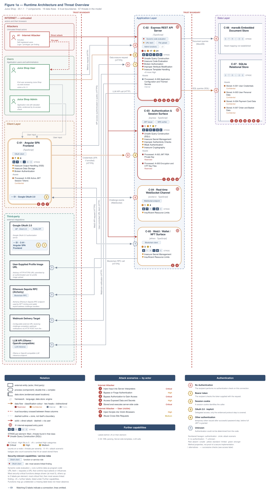</picture>

**Build pipeline**, not drawn in this runtime view: GitHub Actions, GitLab CI. ⑧ A2 · Supply-Chain / Build Attacker → [Figure 1b](#figure-1b).

Role access and finding assignments are listed in [Identified Actors](#identified-actors).

**Actor grouping.** Regular self-registered users are grouped with anonymous internet attackers because registration is open. Each finding retains its login and privilege requirements.

<a id="figure-1b"></a>

**Figure 1b - Supply Chain and Build**

Juice Shop builds in GitHub Actions, GitLab CI. Figure 1b shows the inputs, build systems and release artifacts the repository evidences, with 10 findings attached to them. The highlighted path follows 🟠 [F-016](#f-016) — Lockfile disabled for npm installs as far as the repository evidences it. The control assessment is in [§6.11](#611-operations-runtime-and-supply-chain-controls).

<picture><source media="(prefers-color-scheme: dark)" srcset="threat-model-juice-shop-thorough-v0.6.0b5.figure1b-dark.svg">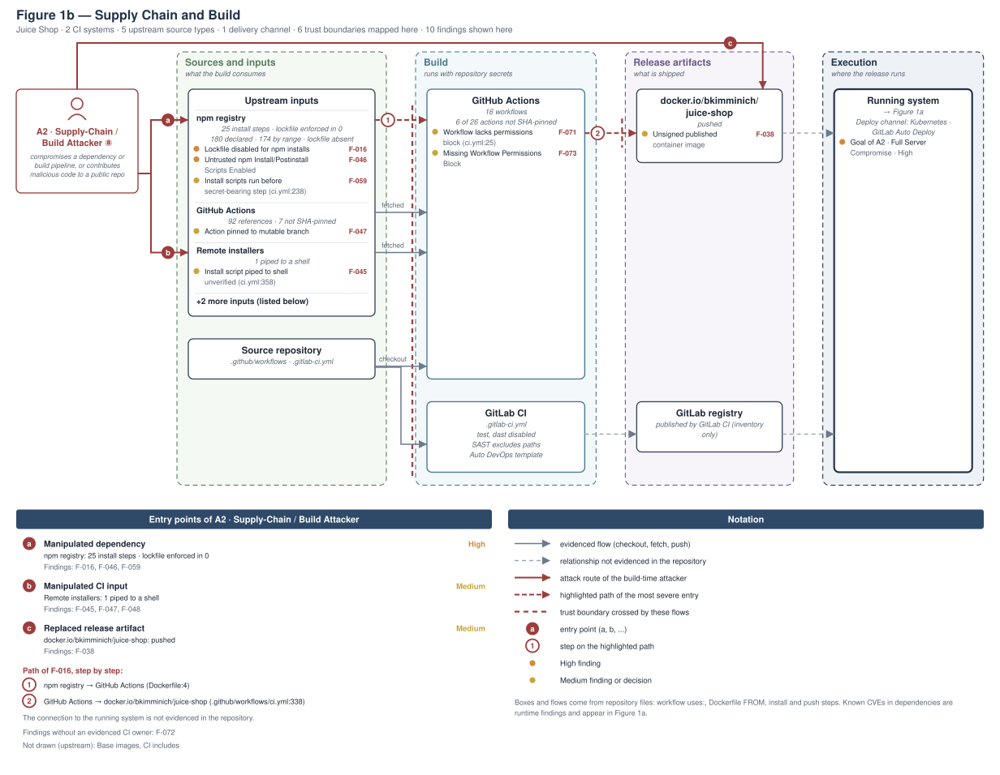</picture>

**Figure 2 - Attack Routes and Impact**

Each numbered route names one example finding from the corresponding Top Threats group with its access prerequisite, the register weakness it is linked to, and the group's potential business harm, which depends on deployment and affected assets. W-IDs in parentheses link the example to an existing weakness. The attack step, affected component and technical consequence are listed in the findings register. Red arrows indicate attacks; dashed red arrows involve a victim; grey arrows lead to potential harm.

<picture><source media="(prefers-color-scheme: dark)" srcset="threat-model-juice-shop-thorough-v0.6.0b5.figure2-dark.svg">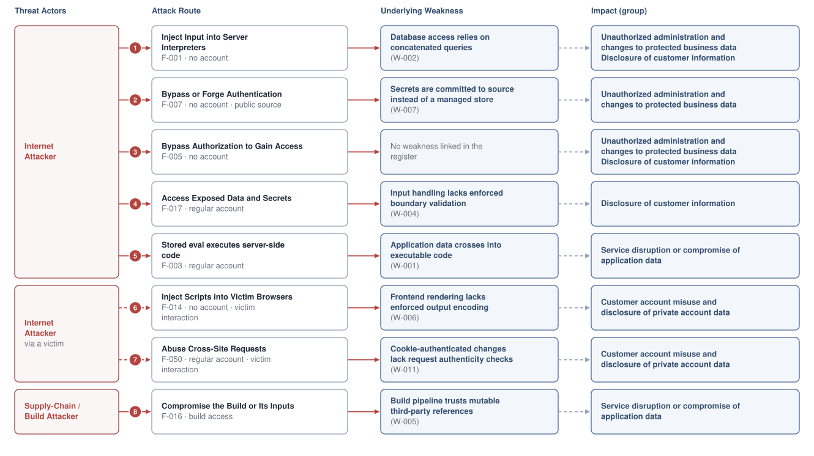</picture>

**Threat actors.** The actors below drive the numbered attack paths in the figures above. The **Juice Shop User** is the *victim* of client-side attacks (XSS / CSRF), not an attacker. Figure 2 marks victim interaction on the applicable attack routes.

- **Juice Shop User** — legitimate end user; target of client-side attacks; target of ⑥ Output Encoding / Cross-Site Scripting, ⑦ CSRF / Permissive CORS.
- **Internet Attacker** — can self-register a regular account; drives ① Insecure Query Construction & Data Access, ② Hardcoded Secrets & Weak Cryptography, ③ Broken Authorization & Access Control, ④ Sensitive File & Secret Exposure, ⑤ Remote Code Execution (unsafe eval), ⑦ CSRF / Permissive CORS.
- **Supply-Chain / Build Attacker** — compromises a dependency or build pipeline, or contributes malicious code to a public repo; drives ⑧ Build Pipeline & Dependency Integrity.

**8 structural threats**, grouped by weakness class - each row is one threat, not one finding. *Threat Description* states the general architectural weakness (STRIDE in brackets); *Findings* lists the concrete instances, each linked to [§8 Findings Register](#8-findings-register) with its component; *Risk & Impact* combines severity with business consequence.

| # | Threat Description | Findings (→ Component) | Risk & Impact | Fix |
|---|------------------------------------|------------------------------------------------|------------------------------------|--------|
| <a id="path-injection"></a>① | **Insecure Query Construction & Data Access** _(T·I)_<br/>User-supplied values are interpolated into SQL and NoSQL queries without parameterization, letting attackers alter query logic or extract arbitrary rows. | <span style="white-space:nowrap">🔴&nbsp;[F-001](#f-001)</span> - SQL injection in login query <span style="white-space:nowrap">→&nbsp;[C-03](#c-03)</span>&nbsp;Authentication & Session Surface<br/><span style="white-space:nowrap">🔴&nbsp;[F-002](#f-002)</span> - SQL injection request data interpolated into a SQL string <span style="white-space:nowrap">→&nbsp;[C-02](#c-02)</span>&nbsp;Express REST API Server<br/><span style="white-space:nowrap">🟠&nbsp;[F-019](#f-019)</span> - Input in executable NoSQL predicate <span style="white-space:nowrap">→&nbsp;[C-02](#c-02)</span>&nbsp;Express REST API Server<br/><span style="white-space:nowrap">🟠&nbsp;[F-020](#f-020)</span> - Input in executable NoSQL predicate <span style="white-space:nowrap">→&nbsp;[C-02](#c-02)</span>&nbsp;Express REST API Server<br/><span style="white-space:nowrap">🟠&nbsp;[F-029](#f-029)</span> - XXE in uploaded XML parsing <span style="white-space:nowrap">→&nbsp;[C-02](#c-02)</span>&nbsp;Express REST API Server<br/><span style="white-space:nowrap">🟠&nbsp;[F-021](#f-021)</span> - Input compiled as template source <span style="white-space:nowrap">→&nbsp;[C-02](#c-02)</span>&nbsp;Express REST API Server | 🔴 **Critical**<br/>Full Admin Takeover · Customer Data Exfiltration | <span style="white-space:nowrap">● [M-080](#m-080)</span> — Preserve SQL injection for training challenges; parameterize only in production forks<br/><span style="white-space:nowrap">● [M-081](#m-081)</span> — Parameterize the product search query |
| <a id="path-auth-bypass"></a>② | **Hardcoded Secrets & Weak Cryptography** _(S·E)_<br/>Session tokens are signed with a key committed to the repository and verified without an algorithm allowlist, so forged tokens are accepted on all protected routes. | <span style="white-space:nowrap">🟠&nbsp;[F-007](#f-007)</span> - Hardcoded `RS256` JWT private key <span style="white-space:nowrap">→&nbsp;[C-03](#c-03)</span>&nbsp;Authentication & Session Surface<br/><span style="white-space:nowrap">🟠&nbsp;[F-008](#f-008)</span> - JWT decode used without signature verification <span style="white-space:nowrap">→&nbsp;[C-03](#c-03)</span>&nbsp;Authentication & Session Surface<br/><span style="white-space:nowrap">🟠&nbsp;[F-009](#f-009)</span> - Insecure JWT Verification <span style="white-space:nowrap">→&nbsp;[C-03](#c-03)</span>&nbsp;Authentication & Session Surface<br/><span style="white-space:nowrap">🟠&nbsp;[F-011](#f-011)</span> - JWT Accepted Without Signature Verification <span style="white-space:nowrap">→&nbsp;[C-02](#c-02)</span>&nbsp;Express REST API Server<br/><span style="white-space:nowrap">🟠&nbsp;[F-025](#f-025)</span> - Unsalted `MD5` password hashing <span style="white-space:nowrap">→&nbsp;[C-03](#c-03)</span>&nbsp;Authentication & Session Surface<br/><span style="white-space:nowrap">🟠&nbsp;[F-031](#f-031)</span> - Hardcoded BIP39 wallet mnemonic in source <span style="white-space:nowrap">→&nbsp;[C-05](#c-05)</span>&nbsp;Web3 / Wallet / NFT Surface<br/><span style="white-space:nowrap">🟡&nbsp;[F-042](#f-042)</span> - Unsalted static-key HMAC for security answers <span style="white-space:nowrap">→&nbsp;[C-02](#c-02)</span>&nbsp;Express REST API Server<br/><span style="white-space:nowrap">🟠&nbsp;[F-084](#f-084)</span> - Token flow accepts a stolen bearer token without <span style="white-space:nowrap">→&nbsp;[C-01](#c-01)</span>&nbsp;Angular SPA Frontend | 🟠 **High**<br/>Full Admin Takeover | <span style="white-space:nowrap">◕ [M-108](#m-108)</span> — Move cryptographic keys to a managed secret store<br/><span style="white-space:nowrap">◕ [M-095](#m-095)</span> — Manual review: verify JWT decode used without signature verification |
| <a id="path-privilege-escalation"></a>③ | **Broken Authorization & Access Control** _(E·I)_<br/>Request payloads reach object-binding and route handlers without ownership or role checks, allowing callers to assign themselves elevated privileges or modify any user's data. | <span style="white-space:nowrap">🔴&nbsp;[F-004](#f-004)</span> - Insecure Direct Object Reference <span style="white-space:nowrap">→&nbsp;[C-02](#c-02)</span>&nbsp;Express REST API Server<br/><span style="white-space:nowrap">🔴&nbsp;[F-005](#f-005)</span> - Mass assignment of role on user registration <span style="white-space:nowrap">→&nbsp;[C-02](#c-02)</span>&nbsp;Express REST API Server<br/><span style="white-space:nowrap">🟠&nbsp;[F-033](#f-033)</span> - Sensitive Routes Registered Without Authentication Middleware <span style="white-space:nowrap">→&nbsp;[C-02](#c-02)</span>&nbsp;Express REST API Server<br/><span style="white-space:nowrap">🟠&nbsp;[F-034](#f-034)</span> - Unauthenticated product update <span style="white-space:nowrap">→&nbsp;[C-02](#c-02)</span>&nbsp;Express REST API Server<br/><span style="white-space:nowrap">🟡&nbsp;[F-070](#f-070)</span> - User list without admin check <span style="white-space:nowrap">→&nbsp;[C-03](#c-03)</span>&nbsp;Authentication & Session Surface<br/><span style="white-space:nowrap">🟡&nbsp;[F-088](#f-088)</span> - User downloads another customer's personal data export <span style="white-space:nowrap">→&nbsp;[C-02](#c-02)</span>&nbsp;Express REST API Server<br/><span style="white-space:nowrap">🟡&nbsp;[F-089](#f-089)</span> - Order placed <span style="white-space:nowrap">→&nbsp;[C-02](#c-02)</span>&nbsp;Express REST API Server | 🔴 **Critical**<br/>Full Admin Takeover · Customer Data Exfiltration | <span style="white-space:nowrap">● [M-082](#m-082)</span> — Replace client-supplied UserId with session identity in WHERE clauses<br/><span style="white-space:nowrap">● [M-106](#m-106)</span> — Allowlist client-controlled fields |
| <a id="path-sensitive-data-exposure"></a>④ | **Sensitive File & Secret Exposure** _(I)_<br/>Unauthenticated endpoints return full user records, access logs, and file contents, disclosing credentials and personal data without any server-side authorization check. | <span style="white-space:nowrap">🟠&nbsp;[F-017](#f-017)</span> - Path traversal filesystem access from request input <span style="white-space:nowrap">→&nbsp;[C-02](#c-02)</span>&nbsp;Express REST API Server<br/><span style="white-space:nowrap">🟠&nbsp;[F-023](#f-023)</span> - Password hash and TOTP secret in JWT payload <span style="white-space:nowrap">→&nbsp;[C-03](#c-03)</span>&nbsp;Authentication & Session Surface<br/><span style="white-space:nowrap">🟠&nbsp;[F-024](#f-024)</span> - Reset response returns full user record <span style="white-space:nowrap">→&nbsp;[C-03](#c-03)</span>&nbsp;Authentication & Session Surface<br/><span style="white-space:nowrap">🟠&nbsp;[F-026](#f-026)</span> - Unauthenticated memories API exposes user records <span style="white-space:nowrap">→&nbsp;[C-02](#c-02)</span>&nbsp;Express REST API Server<br/><span style="white-space:nowrap">🟠&nbsp;[F-027](#f-027)</span> - Public directory listing of access logs <span style="white-space:nowrap">→&nbsp;[C-02](#c-02)</span>&nbsp;Express REST API Server<br/><span style="white-space:nowrap">🟠&nbsp;[F-030](#f-030)</span> - SSRF <span style="white-space:nowrap">→&nbsp;[C-02](#c-02)</span>&nbsp;Express REST API Server<br/><span style="white-space:nowrap">🟠&nbsp;[F-018](#f-018)</span> - Zip Slip archive extraction <span style="white-space:nowrap">→&nbsp;[C-02](#c-02)</span>&nbsp;Express REST API Server<br/><span style="white-space:nowrap">🟡&nbsp;[F-040](#f-040)</span> - Open redirect <span style="white-space:nowrap">→&nbsp;[C-02](#c-02)</span>&nbsp;Express REST API Server<br/><span style="white-space:nowrap">🟡&nbsp;[F-060](#f-060)</span> - Development error handler returns stack traces <span style="white-space:nowrap">→&nbsp;[C-02](#c-02)</span>&nbsp;Express REST API Server | 🟠 **High**<br/>Customer Data Exfiltration | <span style="white-space:nowrap">◕ [M-084](#m-084)</span> — Confine data-erasure layout path within an allowed base directory<br/><span style="white-space:nowrap">◕ [M-118](#m-118)</span> — Stop exposing internal information to clients (🟠 [F-023](#f-023) — Password hash and TOTP secret in JWT payload) |
| <a id="path-remote-code-execution"></a>⑤ | **Remote Code Execution (unsafe eval)** _(E)_<br/>Attacker-controlled strings reach a JavaScript evaluation function, running arbitrary code in the server process. | <span style="white-space:nowrap">🔴&nbsp;[F-003](#f-003)</span> - Server-side eval of stored username <span style="white-space:nowrap">→&nbsp;[C-02](#c-02)</span>&nbsp;Express REST API Server<br/><span style="white-space:nowrap">🟠&nbsp;[F-021](#f-021)</span> - Input compiled as template source <span style="white-space:nowrap">→&nbsp;[C-02](#c-02)</span>&nbsp;Express REST API Server | 🔴 **Critical**<br/>Full Server Compromise | <span style="white-space:nowrap">● [M-105](#m-105)</span> — Remove server-side evaluation of untrusted input<br/><span style="white-space:nowrap">◕ [M-087](#m-087)</span> — Remove dynamic template compilation of user-controlled input |
| <a id="path-cross-site-scripting"></a>⑥ | **Output Encoding / Cross-Site Scripting** _(T·I)_<br/>Reflected search parameters and stored user content are rendered as HTML without encoding, letting injected scripts run in other users' browsers and steal their session tokens. | <span style="white-space:nowrap">🟠&nbsp;[F-012](#f-012)</span> - Stored XSS of feedback comment <span style="white-space:nowrap">→&nbsp;[C-01](#c-01)</span>&nbsp;Angular SPA Frontend<br/><span style="white-space:nowrap">🟠&nbsp;[F-013](#f-013)</span> - Stored XSS of user email in admin panel <span style="white-space:nowrap">→&nbsp;[C-01](#c-01)</span>&nbsp;Angular SPA Frontend<br/><span style="white-space:nowrap">🟠&nbsp;[F-014](#f-014)</span> - Reflected DOM XSS <span style="white-space:nowrap">→&nbsp;[C-01](#c-01)</span>&nbsp;Angular SPA Frontend<br/><span style="white-space:nowrap">🟠&nbsp;[F-022](#f-022)</span> - JWT session token stored in `localStorage` <span style="white-space:nowrap">→&nbsp;[C-01](#c-01)</span>&nbsp;Angular SPA Frontend<br/><span style="white-space:nowrap">🟠&nbsp;[F-083](#f-083)</span> - Session token stored in web-accessible client <span style="white-space:nowrap">→&nbsp;[C-01](#c-01)</span>&nbsp;Angular SPA Frontend<br/><span style="white-space:nowrap">🟡&nbsp;[F-043](#f-043)</span> - Product description trusted as HTML <span style="white-space:nowrap">→&nbsp;[C-01](#c-01)</span>&nbsp;Angular SPA Frontend<br/><span style="white-space:nowrap">🟡&nbsp;[F-044](#f-044)</span> - Order ID from tracking API trusted as HTML <span style="white-space:nowrap">→&nbsp;[C-01](#c-01)</span>&nbsp;Angular SPA Frontend | 🟠 **High**<br/>Customer Session Hijack | <span style="white-space:nowrap">◕ [M-112](#m-112)</span> — Encode output instead of bypassing the framework sanitizer (🟠 [F-012](#f-012) — Stored XSS of feedback comment)<br/><span style="white-space:nowrap">◕ [M-113](#m-113)</span> — Bind user email as text |
| <a id="path-cross-site-request-forgery"></a>⑦ | **CSRF / Permissive CORS** _(S·T)_<br/>a permissive CORS policy plus missing anti-CSRF tokens let any external page issue authenticated state-changing requests in the victim's session. | <span style="white-space:nowrap">🟡&nbsp;[F-035](#f-035)</span> - OAuth implicit flow without state check <span style="white-space:nowrap">→&nbsp;[C-01](#c-01)</span>&nbsp;Angular SPA Frontend<br/><span style="white-space:nowrap">🟡&nbsp;[F-050](#f-050)</span> - CSRF on cookie-authenticated profile update <span style="white-space:nowrap">→&nbsp;[C-02](#c-02)</span>&nbsp;Express REST API Server | 🟡 **Medium**<br/>Customer Session Hijack | <span style="white-space:nowrap">◑ [M-128](#m-128)</span> — Add anti-CSRF protection to state-changing requests (🟡 [F-035](#f-035) — OAuth implicit flow without state check)<br/><span style="white-space:nowrap">◑ [M-142](#m-142)</span> — Add CSRF protection and SameSite cookie |
| <a id="path-supply-chain"></a>⑧ | **Build Pipeline & Dependency Integrity** _(T·E)_<br/>CI pipelines reference third-party actions and base images by mutable tags and pipe install scripts directly to a shell, allowing build-time code substitution by an upstream maintainer.<br/>Path through the build: [Figure 1b](#figure-1b) · controls: [§6.11](#611-operations-runtime-and-supply-chain-controls) | <span style="white-space:nowrap">🟠&nbsp;[F-016](#f-016)</span> - Lockfile disabled for npm installs <span style="white-space:nowrap">→&nbsp;[C-08](#c-08)</span>&nbsp;CI/CD Pipeline<br/><span style="white-space:nowrap">🟡&nbsp;[F-045](#f-045)</span> - Install script piped to shell unverified <span style="white-space:nowrap">→&nbsp;[C-08](#c-08)</span>&nbsp;CI/CD Pipeline<br/><span style="white-space:nowrap">🟠&nbsp;[F-046](#f-046)</span> - Untrusted npm Install/Postinstall Scripts Enabled <span style="white-space:nowrap">→&nbsp;[C-08](#c-08)</span>&nbsp;CI/CD Pipeline<br/><span style="white-space:nowrap">🟡&nbsp;[F-047](#f-047)</span> - Action pinned to mutable branch <span style="white-space:nowrap">→&nbsp;[C-08](#c-08)</span>&nbsp;CI/CD Pipeline<br/><span style="white-space:nowrap">🟡&nbsp;[F-048](#f-048)</span> - Base image pulled by mutable tag <span style="white-space:nowrap">→&nbsp;[C-08](#c-08)</span>&nbsp;CI/CD Pipeline<br/><span style="white-space:nowrap">🟡&nbsp;[F-038](#f-038)</span> - Unsigned published container image <span style="white-space:nowrap">→&nbsp;[C-08](#c-08)</span>&nbsp;CI/CD Pipeline<br/><span style="white-space:nowrap">🟡&nbsp;[F-059](#f-059)</span> - Install scripts run before secret-bearing step <span style="white-space:nowrap">→&nbsp;[C-08](#c-08)</span>&nbsp;CI/CD Pipeline<br/><span style="white-space:nowrap">🟡&nbsp;[F-071](#f-071)</span> - Workflow lacks permissions block <span style="white-space:nowrap">→&nbsp;[C-08](#c-08)</span>&nbsp;CI/CD Pipeline<br/><span style="white-space:nowrap">🟡&nbsp;[F-072](#f-072)</span> - Container Runs as Root <span style="white-space:nowrap">→&nbsp;[C-08](#c-08)</span>&nbsp;CI/CD Pipeline<br/><span style="white-space:nowrap">🟡&nbsp;[F-073](#f-073)</span> - Missing Workflow Permissions Block <span style="white-space:nowrap">→&nbsp;[C-08](#c-08)</span>&nbsp;CI/CD Pipeline | 🟠 **High**<br/>Full Server Compromise | <span style="white-space:nowrap">◕ [M-115](#m-115)</span> — Commit lockfiles and install from them<br/><span style="white-space:nowrap">◕ [M-090](#m-090)</span> — Use npm ci `--ignore-scripts` in `Dockerfile` and audit required postinstalls |

_STRIDE: S spoofing · T tampering · R repudiation · I information disclosure · D denial of service · E elevation of privilege. Risk, findings, components, impact and Fix are derived deterministically; only the one-line weakness description is authored._

**Verified attack chains.** 9 fully viable ([AC-B-001](#ac-b-001), [AC-B-002](#ac-b-002), [AC-T-004](#ac-t-004), [AC-T-006](#ac-t-006), [AC-B-007](#ac-b-007), [AC-B-003](#ac-b-003), [AC-T-001](#ac-t-001), [AC-B-005](#ac-b-005), [AC-B-006](#ac-b-006)). These chains combine individual findings into end-to-end exploitation paths verified step-by-step against the code - see [§9 Abuse Cases](#9-abuse-cases) for the per-step breakdown and blocking mitigations.

### AI / LLM Exposure

This system embeds an LLM/AI surface (Express REST API Server); the risks below are architectural - they follow from how untrusted input reaches the model's prompt, tools, and outputs. See **[§6 Security Architecture](#6-security-architecture)** for the per-control detail.


- **[LLM02](https://genai.owasp.org/llmrisk/llm02/) Sensitive Information Disclosure** — The LLM surface can return sensitive data — internal secrets, other users' data, or privileged context — to an attacker who crafts the right conversational input. _([C-02](#c-02) — Express REST API Server)_
  - ↳ 🟠 [F-011](#f-011) — JWT Accepted Without Signature Verification

- **[LLM06](https://genai.owasp.org/llmrisk/llm06/) Excessive Agency** — The LLM is granted tool/function-calling authority without a secondary authorization boundary, so a manipulated model turn can invoke privileged actions on the user's behalf. _([C-02](#c-02) — Express REST API Server)_
  - ↳ 🟠 [F-011](#f-011) — JWT Accepted Without Signature Verification
  - ↳ 🟡 [F-051](#f-051) — LLM coupon tool lacks server-side discount bound

- **[LLM01](https://genai.owasp.org/llmrisk/llm01/) Prompt Injection** — Untrusted user input reaches the LLM prompt/context without sufficient trust separation, letting an attacker override system instructions, redirect tool calls, or coerce unintended model behaviour. _([C-02](#c-02) — Express REST API Server)_
  - ↳ 🟡 [F-051](#f-051) — LLM coupon tool lacks server-side discount bound

- **[LLM05](https://genai.owasp.org/llmrisk/llm05/) Improper Output Handling** — LLM-generated output flows into a downstream sink (browser, shell, query, eval) without validation or encoding, turning a model completion into an injection vector. _([C-02](#c-02) — Express REST API Server)_
  - ↳ 🟡 [F-051](#f-051) — LLM coupon tool lacks server-side discount bound

- **[LLM07](https://genai.owasp.org/llmrisk/llm07/) System Prompt Leakage** — The system prompt — carrying internal policy, tool rules, or secrets — is extractable through conversational manipulation, exposing the tool capability surface and internal business logic encoded in it. _([C-02](#c-02) — Express REST API Server)_
  - ↳ 🟡 [F-061](#f-061) — Confidential business rule in LLM system prompt

- **[LLM10](https://genai.owasp.org/llmrisk/llm10/) Unbounded Consumption** — The LLM endpoint imposes no authentication, rate, or quota boundary, so any client can drive unbounded model invocations — uncontrolled provider cost and denial of service for legitimate users. _([C-02](#c-02) — Express REST API Server)_
  - ↳ 🟡 [F-067](#f-067) — Unbounded LLM chat consumption

### Operational Strengths

Operational controls rated Adequate or Partial - grouped into broad clusters (full per-control breakdown in [§6](#6-security-architecture)). Clusters demoted to Weak by open Critical/High findings appear in [§6](#6-security-architecture) instead, not here.

<table style="table-layout:fixed;width:100%">
<colgroup><col width="20%" style="width:20%"><col width="33%" style="width:33%"><col width="47%" style="width:47%"></colgroup>
<thead><tr><th>Strength</th><th>What's in Place</th><th>Effectiveness</th></tr></thead>
<tbody>
<tr><td style="overflow-wrap:break-word"><strong>Container &amp; Supply-Chain Hardening</strong></td><td style="overflow-wrap:break-word"><em>Build-time and runtime hardening - minimal base image, non-root execution, dependency inventory.</em><br/>HTTPS / TLS Termination<br/>Third-Party CI Action Pinning</td><td style="overflow-wrap:break-word">⚠️ Partial - Coverage incomplete - see <a href="#7-weakness-register">§7</a> control assessment.</td></tr>
</tbody>
</table>


**Bottom line:** These controls narrow specific attack surfaces but none eliminates a Critical finding on its own.

---

<a id="critical-attack-chain"></a><a id="critical-attack-tree"></a><a id="critical-findings-by-root-cause"></a>
## Critical Findings by Root Cause

4 of 5 Critical findings trace back to 3 root causes; fixing a root cause addresses every finding linked to it. 1 has no root cause linked yet.

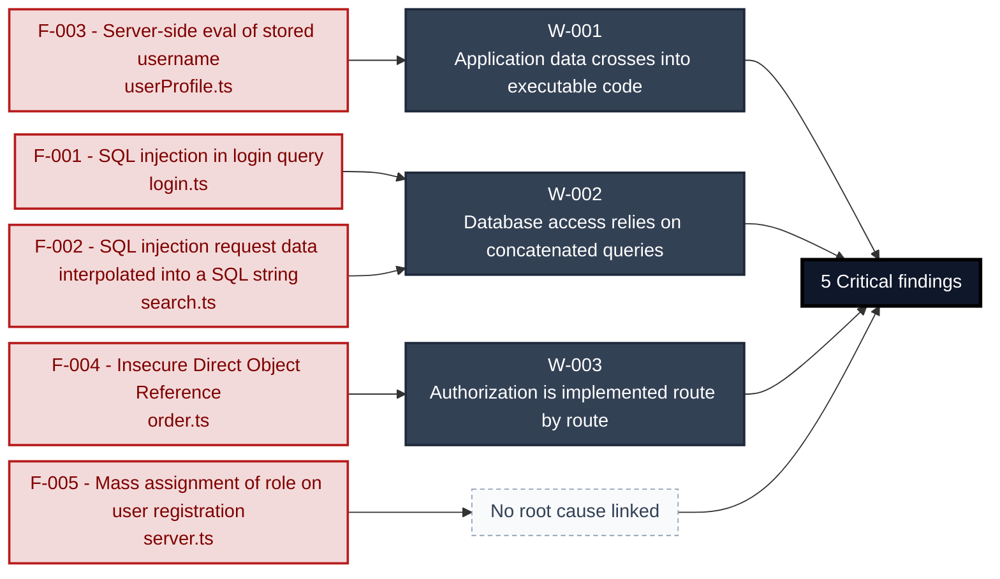

**Structural fixes** (full detail in [§7 Weakness Register](#7-weakness-register)):

- **[W-001](#w-001)** — Replace evaluation of application values with a data parser or a fixed set of operations whose arguments remain data _(closes [F-003](#f-003))_
- **[W-002](#w-002)** — Provide one parameterised repository or query-builder path and prohibit application-value interpolation in database queries _(closes [F-001](#f-001), [F-002](#f-002))_
- **[W-003](#w-003)** — Enforce authorization through a shared server-side policy layer and make ownership and tenant scope mandatory inputs to data access _(closes [F-004](#f-004))_
- **No root cause linked** — [F-005](#f-005): see the [§8 Findings Register](#8-findings-register)

---

## 1. System Overview

**Repository:** `https://github.com/juice-shop/juice-shop.git`

### Scope

This threat model covers 8 components of juice-shop2: **Angular SPA Frontend**, **Express REST API Server**, **Authentication & Session Surface**, **Real-time WebSocket Channel**, **Web3 / Wallet / NFT Surface**, **marsdb Embedded Document Store**, **SQLite Relational Store**, **CI/CD Pipeline**.

All 8 modeled components were analysed with full STRIDE.

**Out of scope:** third-party hosted dependencies, browser runtime, operating-system kernel, and the underlying network infrastructure.

**Basis:** An automated, AI-assisted threat model built from the repository's source code and configuration - static analysis only, no dynamic or penetration testing. It describes the system as built, not as designed.

---

<a id="identified-actors"></a>
### Identified Actors

Figure 1a draws **Internet Attacker** as attacker and **Juice Shop User** and **Juice Shop Admin** as legitimate roles of Juice Shop. [Figure 1b](#figure-1b) draws **Supply-Chain / Build Attacker** and the build it attacks. Each row gives that actor's access and the findings attributed to it.

| Actor | Type | Access | Scenarios | Attributed findings |
|----------------------|---------------|----------------------|--------------|-------------------|
| A1 · Internet Attacker | Attacker | can self-register a regular account | ① ② ③ ④ ⑤ ⑥ ⑦ | 🔴 5 · 🟠 24 · 🟡 23 |
| A2 · Supply-Chain / Build Attacker | Attacker | compromises a dependency or build pipeline, or contributes malicious code to a public repo · [Figure 1b](#figure-1b) | ⑧ | 🟠 2 · 🟡 8 |
| Juice Shop User | Role (victim) | End user accessing Juice Shop via web<br/>browser. May be anonymous or authenticated;<br/>when self-registration is open, anonymous<br/>reaches authenticated in seconds. | ⑥ ⑦ | - |
| Juice Shop Admin | Privileged role | Application role with elevated rights,<br/>evidenced by its access check. | - | - |

---

### Trust Boundaries

Canonical boundary crossings. **Assumption & verdict** names the condition that makes each crossing safe and whether this report still supports it, judged one condition at a time - which conditions apply follows from the direction of the crossing.

<table style="table-layout:fixed;width:100%">
<colgroup><col width="6%" style="width:6%"><col width="25%" style="width:25%"><col width="11%" style="width:11%"><col width="15%" style="width:15%"><col width="25%" style="width:25%"><col width="18%" style="width:18%"></colgroup>
<thead><tr><th>ID</th><th>Boundary / crossing</th><th>Exposure</th><th>Kind</th><th>Assumption &amp; verdict</th><th>Linked findings</th></tr></thead>
<tbody>
<tr><td style="white-space:nowrap"><a id="tb-1"></a>tb-1</td><td style="overflow-wrap:break-word"><strong>external → Express REST API Server</strong><br/>Control: security.isAuthorized() expressJwt middleware</td><td>🌐 <strong>External</strong></td><td style="overflow-wrap:break-word">network</td><td style="overflow-wrap:break-word">Every protected route is registered behind security.isAuthorized() before its handler executes.<br/>Validation: <strong>broken</strong> · 6 related · <a href="#66-input-boundary-validation-controls">§6.6</a><br/>Authentication: <strong>broken</strong> · <a href="#62-identity-and-authentication-controls">§6.2</a><br/>Authorization: in doubt · 3 related · <a href="#64-authorization-controls">§6.4</a></td><td style="overflow-wrap:break-word"><em>Validation</em><br/>🔴 <a href="#f-003">F-003</a><br/>🔴 <a href="#f-005">F-005</a><br/><em>Authentication</em><br/>🟠 <a href="#f-009">F-009</a><br/>🟠 <a href="#f-034">F-034</a><br/><em>Unattributed</em><br/>🔴 <a href="#f-004">F-004</a></td></tr>
<tr><td style="white-space:nowrap"><a id="tb-2"></a>tb-2</td><td style="overflow-wrap:break-word"><strong>external → Authentication &amp;amp; Session Surface</strong><br/>Control: none identified · Also covers: Real-time WebSocket Channel, Web3 / Wallet / NFT Surface</td><td>🌐 <strong>External</strong></td><td style="overflow-wrap:break-word">network</td><td style="overflow-wrap:break-word">Every credential submission is type-checked before the query runs; a JWT is issued only after a matching user row is found.<br/>Validation: <strong>broken</strong> · <a href="#66-input-boundary-validation-controls">§6.6</a><br/>Authentication: <strong>broken</strong> · 7 related · <a href="#62-identity-and-authentication-controls">§6.2</a><br/>Authorization: in doubt · 1 related · <a href="#64-authorization-controls">§6.4</a></td><td style="overflow-wrap:break-word"><em>Validation</em><br/>🔴 <a href="#f-001">F-001</a><br/><em>Authentication</em><br/>🟡 <a href="#f-041">F-041</a><br/><em>Unattributed</em><br/>🟡 <a href="#f-036">F-036</a></td></tr>
<tr><td style="white-space:nowrap"><a id="tb-3"></a>tb-3</td><td style="overflow-wrap:break-word"><strong>external → CI/CD Pipeline</strong><br/>Control: SHA-pinned action references</td><td>🌐 <strong>External</strong></td><td style="overflow-wrap:break-word">build pipeline · operator</td><td style="overflow-wrap:break-word">Every third-party GitHub Action is pinned to an immutable commit SHA.<br/>Validation: <strong>broken</strong> · 3 related · <a href="#66-input-boundary-validation-controls">§6.6</a><br/>Authentication: <em>not examined</em> · <a href="#62-identity-and-authentication-controls">§6.2</a><br/>Authorization: in doubt · 1 related · <a href="#64-authorization-controls">§6.4</a></td><td style="overflow-wrap:break-word"><em>Validation</em><br/>🟡 <a href="#f-047">F-047</a></td></tr>
<tr><td style="white-space:nowrap"><a id="tb-4"></a>tb-4</td><td style="overflow-wrap:break-word"><strong>external → CI/CD Pipeline</strong><br/>Control: none identified</td><td>🌐 <strong>External</strong></td><td style="overflow-wrap:break-word">build pipeline · operator</td><td style="overflow-wrap:break-word">Container base images are pulled at a content-addressed digest that is fixed before the build runs.<br/>Validation: <strong>broken</strong> · 4 related · <a href="#66-input-boundary-validation-controls">§6.6</a><br/>Authentication: <em>not examined</em> · <a href="#62-identity-and-authentication-controls">§6.2</a><br/>Authorization: in doubt · 1 related · <a href="#64-authorization-controls">§6.4</a></td><td style="overflow-wrap:break-word"><em>Validation</em><br/>🟡 <a href="#f-048">F-048</a></td></tr>
<tr><td style="white-space:nowrap"><a id="tb-5"></a>tb-5</td><td style="overflow-wrap:break-word"><strong>external → CI/CD Pipeline</strong><br/>Control: none identified</td><td>🌐 <strong>External</strong></td><td style="overflow-wrap:break-word">build pipeline · operator</td><td style="overflow-wrap:break-word">All npm packages are installed from lockfile-resolved versions using a strict install command.<br/>Validation: <strong>broken</strong> · 3 related · <a href="#66-input-boundary-validation-controls">§6.6</a><br/>Authentication: <em>not examined</em> · <a href="#62-identity-and-authentication-controls">§6.2</a><br/>Authorization: in doubt · 1 related · <a href="#64-authorization-controls">§6.4</a></td><td style="overflow-wrap:break-word"><em>Validation</em><br/>🟠 <a href="#f-016">F-016</a></td></tr>
<tr><td style="white-space:nowrap"><a id="tb-6"></a>tb-6</td><td style="overflow-wrap:break-word"><strong>external → CI/CD Pipeline</strong><br/>Control: none identified</td><td>🌐 <strong>External</strong></td><td style="overflow-wrap:break-word">build pipeline · operator</td><td style="overflow-wrap:break-word">The fetched install script is verified for integrity before it is piped to the shell.<br/>Validation: <strong>broken</strong> · 3 related · <a href="#66-input-boundary-validation-controls">§6.6</a><br/>Authentication: <em>not examined</em> · <a href="#62-identity-and-authentication-controls">§6.2</a><br/>Authorization: in doubt · 1 related · <a href="#64-authorization-controls">§6.4</a></td><td style="overflow-wrap:break-word"><em>Validation</em><br/>🟡 <a href="#f-045">F-045</a></td></tr>
<tr><td style="white-space:nowrap"><a id="tb-7"></a>tb-7</td><td style="overflow-wrap:break-word"><strong>external → CI/CD Pipeline</strong><br/>Control: none identified</td><td>🌐 <strong>External</strong></td><td style="overflow-wrap:break-word">build pipeline · operator</td><td style="overflow-wrap:break-word">The included GitLab CI template is pinned to a reviewed version before execution on the runner.<br/>Validation: in doubt · 4 related · <a href="#66-input-boundary-validation-controls">§6.6</a><br/>Authentication: <em>not examined</em> · <a href="#62-identity-and-authentication-controls">§6.2</a><br/>Authorization: in doubt · 1 related · <a href="#64-authorization-controls">§6.4</a></td><td style="overflow-wrap:break-word">-</td></tr>
<tr><td style="white-space:nowrap"><a id="tb-8"></a>tb-8</td><td style="overflow-wrap:break-word"><strong>Express REST API Server → SQLite Relational Store</strong><br/>Control: Sequelize ORM parameterized queries</td><td>🔒 <strong>Internal</strong></td><td style="overflow-wrap:break-word">in-process · data-access</td><td style="overflow-wrap:break-word">Every query reaches SQLite through Sequelize parameter binding without interpolated user input.<br/>Query construction: <strong>broken</strong> · <a href="#65-query-construction-and-data-access-controls">§6.5</a></td><td style="overflow-wrap:break-word"><em>Query construction</em><br/>🔴 <a href="#f-001">F-001</a><br/>🔴 <a href="#f-002">F-002</a></td></tr>
<tr><td style="white-space:nowrap"><a id="tb-9"></a>tb-9</td><td style="overflow-wrap:break-word"><strong>Express REST API Server → marsdb Embedded Document Store</strong><br/>Control: marsdb Collection query API</td><td>🔒 <strong>Internal</strong></td><td style="overflow-wrap:break-word">in-process · data-access</td><td style="overflow-wrap:break-word">Every document query uses MarsDB Collection API without string-concatenated user input in filter expressions.<br/>Query construction: <strong>broken</strong> · <a href="#65-query-construction-and-data-access-controls">§6.5</a></td><td style="overflow-wrap:break-word"><em>Query construction</em><br/>🟠 <a href="#f-019">F-019</a><br/>🟠 <a href="#f-020">F-020</a></td></tr>
<tr><td style="white-space:nowrap"><a id="tb-10"></a>tb-10</td><td style="overflow-wrap:break-word"><strong>Express REST API Server → external</strong><br/>Control: none identified</td><td>↗ <strong>Egress</strong></td><td style="overflow-wrap:break-word">network · operator</td><td style="overflow-wrap:break-word">Nothing attacker-controlled reaches an external provider URL or payload without sanitization.<br/>Egress content: <em>not examined</em><br/>Egress destination: <strong>broken</strong> · <a href="#610-file-parser-and-outbound-request-controls">§6.10</a><br/>Response trust: <strong>broken</strong></td><td style="overflow-wrap:break-word"><em>Egress destination</em><br/>🟠 <a href="#f-030">F-030</a><br/><em>Response trust</em><br/>🟡 <a href="#f-051">F-051</a></td></tr>
<tr><td style="white-space:nowrap"><a id="tb-11"></a>tb-11</td><td style="overflow-wrap:break-word"><strong>CI/CD Pipeline → external</strong><br/>Control: none identified</td><td>↗ <strong>Egress</strong></td><td style="overflow-wrap:break-word">build pipeline · operator</td><td style="overflow-wrap:break-word">Only the deterministically built application image is pushed; no unreviewed layer can reach the public registry.<br/>Egress content: <em>not examined</em><br/>Egress destination: <em>not examined</em> · <a href="#610-file-parser-and-outbound-request-controls">§6.10</a><br/>Response trust: <strong>broken</strong></td><td style="overflow-wrap:break-word"><em>Response trust</em><br/>🟡 <a href="#f-038">F-038</a></td></tr>
<tr><td style="white-space:nowrap"><a id="tb-12"></a>tb-12</td><td style="overflow-wrap:break-word"><strong>Web3 / Wallet / NFT Surface → external</strong><br/>Control: none identified</td><td>↗ <strong>Egress</strong></td><td style="overflow-wrap:break-word">network · operator</td><td style="overflow-wrap:break-word">Only validated wallet addresses and NFT contract calls are sent to the Alchemy RPC endpoint.<br/><em>No finding contradicts it.</em></td><td style="overflow-wrap:break-word">-</td></tr>
</tbody>
</table>

_Exposure, most exposed first: ⚠ Review (endpoints unresolved) · 🌐 External (reached from outside the model) · ◐ Unverified (crossing not confirmed) · 🔒 Internal (both ends modelled) · ↗ Egress (reaches outside the model)._

_Kind - the crossing mechanism (build pipeline, in-process, network), then after `·` what changes across it: data-origin, identity, operator, privilege, tenant. Shown alone, nothing changes._

_Conditions - **inbound**: validation, authentication, authorization · **outbound**: egress content, egress destination, response trust (replies are untrusted input) · **internal**: query construction (data never becomes program text), authentication, authorization._

_Verdict per condition - **broken**: a linked finding proves the gap · in doubt: related findings, none linked here · not examined: nothing bears on it. `N related` counts further findings on the same condition. Linked findings sit under the condition they break, or under _Unattributed_. A link raises effective severity only at a confirmed internet ingress; the finding's own severity stays unchanged._

_All boundaries share source: derived from inspected repository evidence; confidence: confirmed; status: resolved._

---

## 2. Architecture Diagrams

### 2.1 System Context

Who uses and attacks Juice Shop, and which external systems it exchanges data with. Solid arrows name the data a flow carries; dashed red arrows are attack routes. Actors carry the names Figure 1 uses (C4 Level 1).

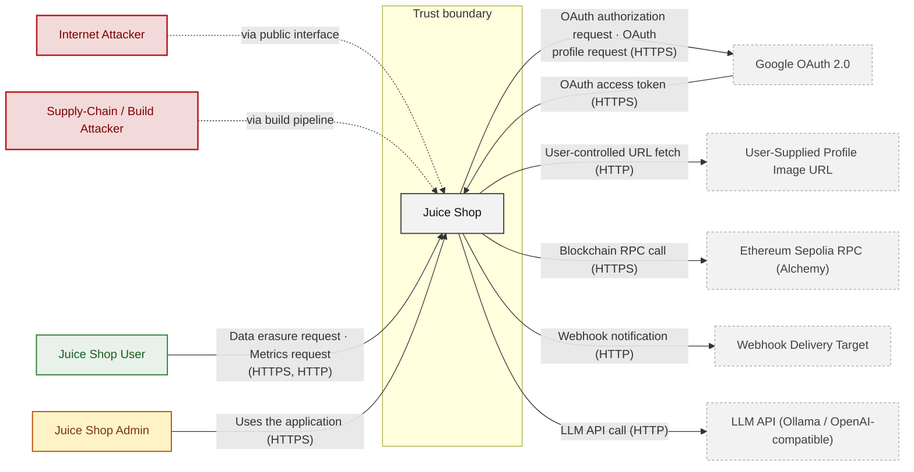

**Key takeaway:** Juice Shop serves Juice Shop User and Juice Shop Admin and depends on Google OAuth 2.0, User-Supplied Profile Image URL, Ethereum Sepolia RPC (Alchemy), Webhook Delivery Target and LLM API (Ollama / OpenAI-compatible); Internet Attacker and Supply-Chain / Build Attacker attack it.

### 2.2 Container Architecture

How the system decomposes into deployable units. Each box is a separate runtime process or service container; arrows show synchronous request paths between them. Components with ≥3 Critical findings carry a red border, ≥2 High amber (C4 Level 2).

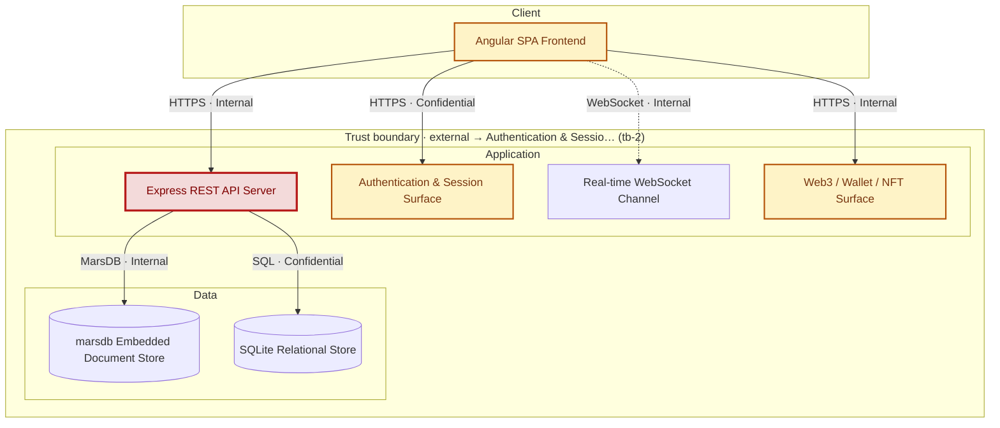

*Trust boundaries not drawn above: Express REST API Server → SQLite Relational Store (tb-8), Express REST API Server → marsdb Embedded Document Store (tb-9), Express REST API Server → external (tb-10), Web3 / Wallet / NFT Surface → external (tb-12), +2 more - every boundary is listed in [§1 Trust Boundaries](#trust-boundaries).*

**Key takeaway:** The system decomposes into 1 client, 4 application and 2 data unit(s); Express REST API Server carries the most Critical findings (4) and bounds the worst-case blast radius. The build plane (CI/CD Pipeline) is shown in [Figure 1b](#figure-1b).

### 2.3 Components

How each component is reached, what it handles, how many threats hit it, and how effective the controls evidenced on it are. The component table below holds source paths and linked threats per `C-NN`; per-finding evidence is in [§8 Findings Register](#8-findings-register).

<!-- detail-table -->
| Component | Inbound flows | Data handled | Threats | Controls: worst effectiveness per domain |
|----------------------|----------------------|----------------------|----------------------|----------------------|
| [C-01](#c-01) · Angular SPA Frontend | 2 authentication unknown<br/>1 authenticated (oauth2) | Confidential · credentials | 11 (🟠 7 · 🟡 4) | 🔴 Unsafe: Session, Output encoding |
| [C-02](#c-02) · Express REST API Server | 2 unauthenticated<br/>2 authenticated (bearer, cookie) | Confidential · payment-data, personal-data | 43 (🔴 5 · 🟠 17 · 🟡 21) | 🔴 Unsafe: Input / query (2)<br/>🟠 Weak: AuthZ (3) |
| [C-03](#c-03) · Authentication &amp; Session Surface | 1 unauthenticated<br/>1 authenticated (other) | Confidential · credentials, secrets | 15 (🔴 1 · 🟠 7 · 🟡 7) | 🔴 Unsafe: AuthN (2), Session (3), Input /<br/>query, Secrets / crypto (2), Supply chain<br/>🟡 Partial: AuthZ |
| [C-04](#c-04) · Real-time WebSocket Channel | 1 unauthenticated | Internal | 5 (🟠 1 · 🟡 4) | – |
| [C-05](#c-05) · Web3 / Wallet / NFT Surface | 1 authentication unknown | Internal | 4 (🟠 3 · 🟡 1) | – |
| [C-06](#c-06) · marsdb Embedded Document Store | 1 unauthenticated | Internal · personal-data | none | – |
| [C-07](#c-07) · SQLite Relational Store | 1 unauthenticated | Confidential · credentials, payment-data,<br/>personal-data | none | – |
| [C-08](#c-08) · CI/CD Pipeline | none modeled | – | 10 (🟠 2 · 🟡 8) | 🟠 Weak: Supply chain (2) |
| System-wide: evidence not tied to one<br/>component | – | – | – | 🔴 Unsafe: AuthN (3), Output encoding<br/>🔴 Missing: AuthZ (2), Supply chain (2)<br/>🟡 Partial: Transport, Logging |

*🔴 **Unsafe**: relied upon but defeated or trivially bypassable - fix it · 🔴 **Missing**: never built - add it · 🟠 **Weak**: present, with exploitable gaps · 🟡 **Partial**: covers some surfaces, meaningful gaps remain · 🟢 **Adequate**: present and sound. A control counts for the component whose paths hold its implementation evidence; a domain without an evidenced control is not listed; (n) counts the controls behind a rating. Threat counts use the Figure 1 attribution; [§6](#6-security-architecture) holds the full assessment.*

**Key takeaway:** 3 components have at least one control rated Unsafe or Missing (C-01, C-02, C-03); 4 components have no component-specific control (C-04, C-05, C-06, C-07); 10 controls apply system-wide.

| ID | Name | Type | Key Paths | Linked Threats |
|----|----------------------|-----------|--------------------------------------|------------------------------------------------|
| <a id="c-01"></a><a id="angular-spa"></a><span style="white-space:nowrap">C-01</span> | Angular SPA Frontend | client | `frontend/src/app/**/*.ts`<br/>`frontend/src/app/**/*.html`<br/>`frontend/src/hacking-instructor/**/*.ts` | 🟠 [F-006](#f-006) — OAuth password derived from email<br/>🟠 [F-012](#f-012) — Stored XSS of feedback comment<br/>🟠 [F-013](#f-013) — Stored XSS of user email in admin panel<br/>🟠 [F-014](#f-014) — Reflected DOM XSS<br/>🟠 [F-022](#f-022) — JWT session token stored in localStorage<br/>🟠 [F-083](#f-083) — Session token stored in web-accessible client<br/>🟠 [F-084](#f-084) — Token flow accepts a stolen bearer token without<br/>🟡 [F-035](#f-035) — OAuth implicit flow without state check<br/>🟡 [F-043](#f-043) — Product description trusted as HTML<br/>🟡 [F-044](#f-044) — Order ID from tracking API trusted as HTML<br/>🟡 [F-058](#f-058) — Test account password embedded in SPA bundle |
| <a id="c-02"></a><a id="express-api"></a><span style="white-space:nowrap">C-02</span> | Express REST API Server | application | `server.ts`<br/>`app.ts`<br/>`routes/*.ts`<br/>`lib/*.ts`<br/>`lib/startup/*.ts` | 🔴 [F-002](#f-002) — SQL injection request data interpolated into a SQL string<br/>🔴 [F-003](#f-003) — Server-side eval of stored username<br/>🔴 [F-004](#f-004) — Insecure Direct Object Reference<br/>🔴 [F-005](#f-005) — Mass assignment of role on user registration<br/>🟠 [F-011](#f-011) — JWT Accepted Without Signature Verification<br/>🟠 [F-017](#f-017) — Path traversal filesystem access from request input<br/>🟠 [F-018](#f-018) — Zip Slip archive extraction<br/>🟠 [F-019](#f-019) — Input in executable NoSQL predicate<br/>🟠 [F-020](#f-020) — Input in executable NoSQL predicate<br/>🟠 [F-021](#f-021) — Input compiled as template source<br/>🟠 [F-026](#f-026) — Unauthenticated memories API exposes user records<br/>🟠 [F-027](#f-027) — Public directory listing of access logs<br/>🟠 [F-028](#f-028) — Passwords sent in GET query string<br/>🟠 [F-029](#f-029) — XXE in uploaded XML parsing<br/>🟠 [F-030](#f-030) — SSRF<br/>🟠 [F-033](#f-033) — Sensitive Routes Registered Without Authentication Middleware<br/>🟠 [F-034](#f-034) — Unauthenticated product update<br/>🟡 [F-039](#f-039) — Rate-limit client IP spoofable<br/>🟡 [F-040](#f-040) — Open redirect<br/>🟡 [F-042](#f-042) — Unsalted static-key HMAC for security answers<br/>🟡 [F-049](#f-049) — Unauthenticated coupon format allows forgery<br/>🟡 [F-050](#f-050) — CSRF on cookie-authenticated profile update<br/>🟡 [F-051](#f-051) — LLM coupon tool lacks server-side discount bound<br/>🟡 [F-052](#f-052) — Unvalidated wallet top-up amount<br/>🟡 [F-054](#f-054) — Raw markup persisted in Product description<br/>🟡 [F-055](#f-055) — Raw markup persisted in User<br/>🟡 [F-060](#f-060) — Development error handler returns stack traces<br/>🟡 [F-061](#f-061) — Confidential business rule in LLM system prompt<br/>🟡 [F-065](#f-065) — B2B order data evaluated as code with 2s budget<br/>🟡 [F-066](#f-066) — Synchronous YAML/XML parsing blocks event loop<br/>🟡 [F-067](#f-067) — Unbounded LLM chat consumption<br/>🟡 [F-074](#f-074) — Deluxe role granted without payment<br/>🟡 [F-085](#f-085) — User bypasses a required approval<br/>🟡 [F-088](#f-088) — User downloads another customer's personal data export<br/>🟡 [F-089](#f-089) — Order placed |
| <a id="c-03"></a><a id="auth"></a><span style="white-space:nowrap">C-03</span> | Authentication & Session Surface | application | `routes/login.ts`<br/>`routes/saveLoginIp.ts`<br/>`lib/insecurity.ts`<br/>`lib/startup/registerWebsocketEvents.ts`<br/>`routes/2fa.ts` | 🔴 [F-001](#f-001) — SQL injection in login query<br/>🟠 [F-007](#f-007) — Hardcoded RS256 JWT private key<br/>🟠 [F-008](#f-008) — JWT decode used without signature verification<br/>🟠 [F-009](#f-009) — Insecure JWT Verification<br/>🟠 [F-010](#f-010) — Security-question password reset<br/>🟠 [F-023](#f-023) — Password hash and TOTP secret in JWT payload<br/>🟠 [F-024](#f-024) — Reset response returns full user record<br/>🟠 [F-025](#f-025) — Unsalted MD5 password hashing<br/>🟡 [F-036](#f-036) — Unlimited login attempts<br/>🟡 [F-037](#f-037) — JWT sessions not revocable server-side<br/>🟡 [F-056](#f-056) — Login IP taken from client header<br/>🟡 [F-057](#f-057) — No audit logging of authentication events<br/>🟡 [F-064](#f-064) — Unbounded in-memory token map<br/>🟡 [F-070](#f-070) — User list without admin check<br/>🟡 [F-086](#f-086) — User keeps |
| <a id="c-04"></a><a id="realtime-channel"></a><span style="white-space:nowrap">C-04</span> | Real-time WebSocket Channel | application | `lib/challengeUtils.ts`<br/>`lib/startup/registerWebsocketEvents.ts` | 🟠 [F-032](#f-032) — Quadratic regex on socket payload<br/>🟡 [F-041](#f-041) — Unauthenticated WebSocket Channel<br/>🟡 [F-053](#f-053) — Client-reported challenge verification trusted<br/>🟡 [F-062](#f-062) — CTF flags replayed to every new socket<br/>🟡 [F-087](#f-087) — Challenge completion score inflated |
| <a id="c-05"></a><a id="web3-nft"></a><span style="white-space:nowrap">C-05</span> | Web3 / Wallet / NFT Surface | application | `routes/checkKeys.ts`<br/>`routes/nftMint.ts`<br/>`routes/redirect.ts`<br/>`routes/web3Wallet.ts` | 🟠 [F-031](#f-031) — Hardcoded BIP39 wallet mnemonic in source<br/>🟠 [F-068](#f-068) — Unbounded wallet Set growth from anonymous POSTs<br/>🟠 [F-069](#f-069) — Leaked RPC WebSocket providers on error reset |
| <a id="c-06"></a><a id="marsdb-store"></a><span style="white-space:nowrap">C-06</span> | marsdb Embedded Document Store | data | `data/mongodb.ts` | - |
| <a id="c-07"></a><a id="sqlite-store"></a><span style="white-space:nowrap">C-07</span> | SQLite Relational Store | data | `models/*.ts` | - |
| <a id="c-08"></a><a id="ci-cd-pipeline"></a><span style="white-space:nowrap">C-08</span> | CI/CD Pipeline | application | `.github/workflows/*.yml`<br/>`Dockerfile`<br/>`docker-compose*.yml`<br/>`package.json`<br/>`frontend/package.json` | 🟠 [F-016](#f-016) — Lockfile disabled for npm installs<br/>🟠 [F-046](#f-046) — Untrusted npm Install/Postinstall Scripts Enabled<br/>🟡 [F-038](#f-038) — Unsigned published container image<br/>🟡 [F-045](#f-045) — Install script piped to shell unverified<br/>🟡 [F-047](#f-047) — Action pinned to mutable branch<br/>🟡 [F-048](#f-048) — Base image pulled by mutable tag<br/>🟡 [F-059](#f-059) — Install scripts run before secret-bearing step<br/>🟡 [F-071](#f-071) — Workflow lacks permissions block<br/>🟡 [F-072](#f-072) — Container Runs as Root<br/>🟡 [F-073](#f-073) — Missing Workflow Permissions Block |

> **Legend:** `-->` synchronous request/response (REST, HTTPS, gRPC) · `-.->` asynchronous / event-driven (WebSocket, queue, pub-sub) · **red border** ≥ 3 Critical threats on the component · **amber border** ≥ 2 High threats

---

## 3. Attack Walkthroughs

This section walks through how the highest-risk findings are exploited - one short walkthrough per Critical, each with attack steps, a focused sequence diagram, and the primary mitigation. Which root cause each Critical traces back to is in [Critical Findings by Root Cause](#critical-findings-by-root-cause); full per-finding context (severity rationale, assets, detection signals) is in the [§8 Findings Register](#8-findings-register).

### 3.1 Insecure Direct Object Reference in Order

**Source:** 🔴 [F-004](#f-004) — `routes/order.ts:150`

Severity **Critical** ([CWE-639](https://cwe.mitre.org/data/definitions/639.html)). STRIDE: Tampering. See [§8 F-004](#f-004) for the full register row.

**Attack Steps**

1. An attacker crafts a request that reaches the code at `routes/order.ts:150`.
2. A signed-in attacker puts another user's ID into the owner field of the request (`req.body.UserId` and the like); the query trusts it instead of the session identity, so the attacker reads or changes every other user's records - horizontal privilege escalation across all accounts.

**Sequence Diagram**

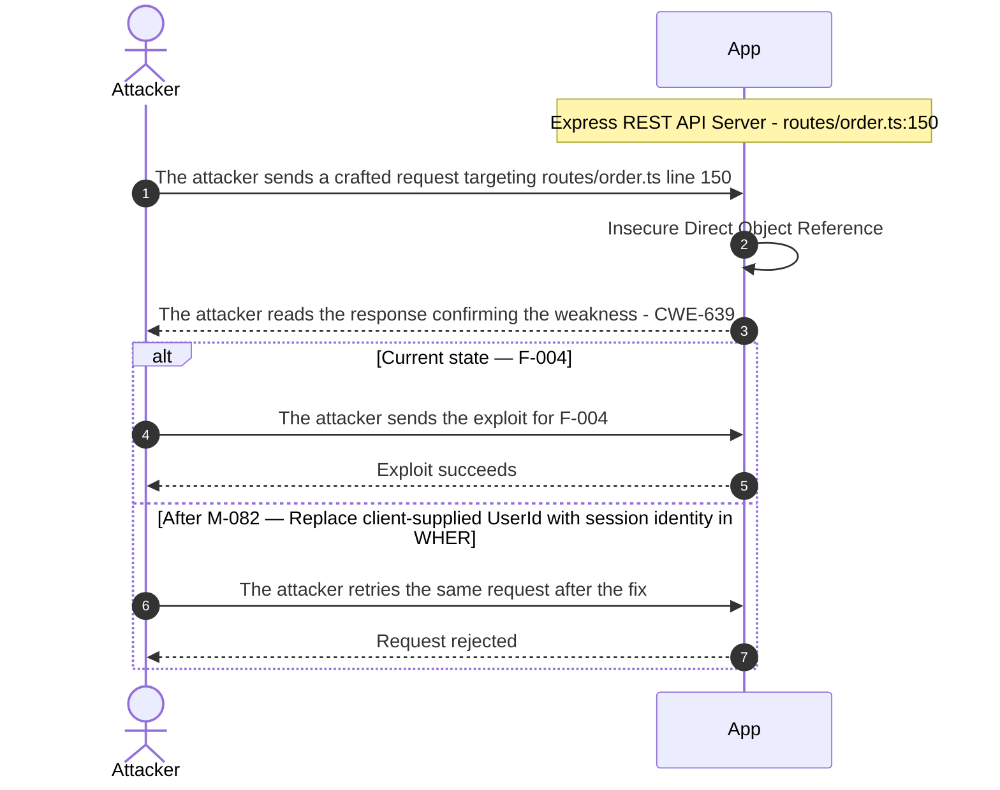

**Key takeaway:** Until ● [M-082](#m-082) (Replace client-supplied UserId with session identity in WHERE clauses) lands, 🔴 [F-004](#f-004) — Insecure Direct Object Reference is exploitable at `routes/order.ts:150` (Critical-severity, [CWE-639](https://cwe.mitre.org/data/definitions/639.html)).

**Defense in Depth**

- Primary mitigation: ● [M-082](#m-082) (Replace client-supplied UserId with session identity in WHERE clauses)
- Defence in depth: ◑ [M-094](#m-094) (Manual review: verify Insecure Direct Object Reference)

### 3.2 Server-side eval of stored username in User Profile

**Source:** 🔴 [F-003](#f-003) — `routes/userProfile.ts:61`

Severity **Critical** ([CWE-94](https://cwe.mitre.org/data/definitions/94.html)). STRIDE: Tampering. See [§8 F-003](#f-003) for the full register row.

**Attack Steps**

1. I log in and POST `/profile` with a username wrapped in #{...} containing JavaScript.
2. I request GET `/profile`, which evaluates the stored expression on the server.
3. The expression runs with the Node\.js process privileges and can read or modify server data.

**Sequence Diagram**

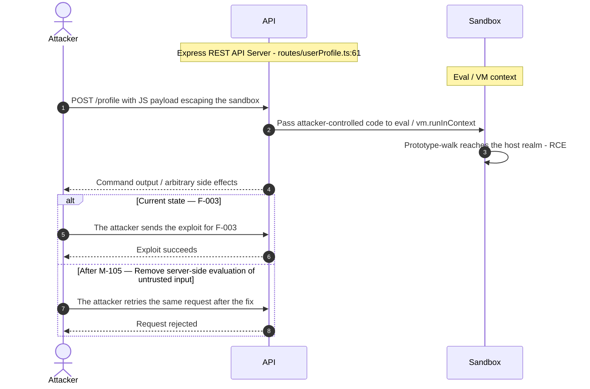

**Key takeaway:** Until ● [M-105](#m-105) (Remove server-side evaluation of untrusted input) lands, 🔴 [F-003](#f-003) — Server-side eval of stored username is exploitable at `routes/userProfile.ts:61` (Critical-severity, [CWE-94](https://cwe.mitre.org/data/definitions/94.html)).

**Defense in Depth**

- Primary mitigation: ● [M-105](#m-105) (Remove server-side evaluation of untrusted input)

### 3.3 Mass assignment of role on user registration in Express REST API Server

**Source:** 🔴 [F-005](#f-005) — `server.ts:501`

Severity **Critical** ([CWE-915](https://cwe.mitre.org/data/definitions/915.html)). STRIDE: Elevation of Privilege. See [§8 F-005](#f-005) for the full register row.

**Attack Steps**

1. I POST `/api/Users` with email, password, `passwordRepeat` and role set to admin.
2. I log in with the new account and receive a JWT carrying role admin.
3. I use admin-only functions with that session.

**Sequence Diagram**

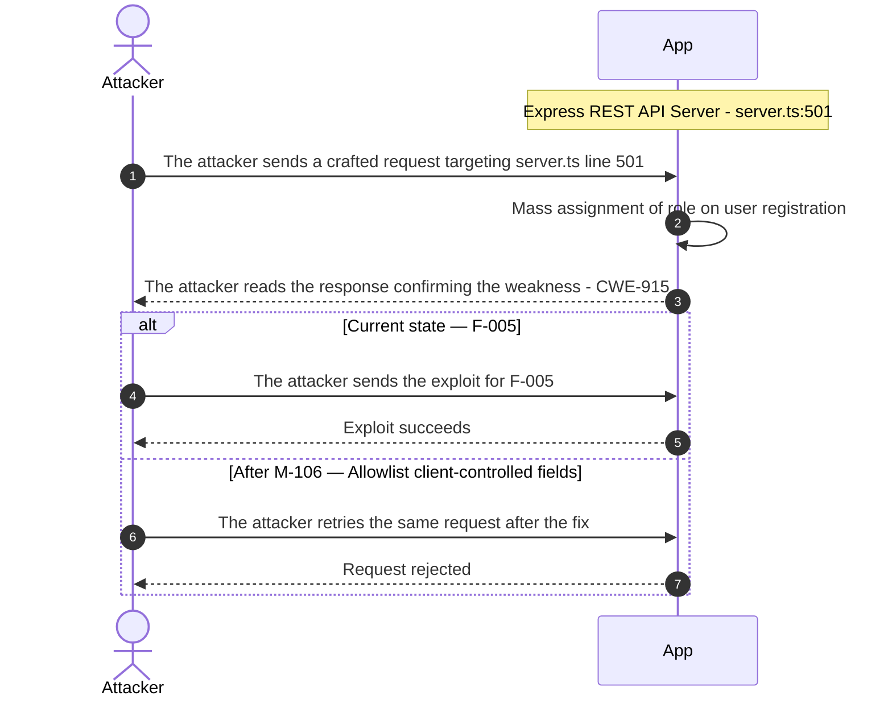

**Key takeaway:** Until ● [M-106](#m-106) (Allowlist client-controlled fields) lands, 🔴 [F-005](#f-005) — Mass assignment of role on user registration is exploitable at `server.ts:501` (Critical-severity, [CWE-915](https://cwe.mitre.org/data/definitions/915.html)).

**Defense in Depth**

- Primary mitigation: ● [M-106](#m-106) (Allowlist client-controlled fields)

### 3.4 SQL injection request data interpolated into a SQL string in Search

**Source:** 🔴 [F-002](#f-002) — `routes/search.ts:23`

Severity **Critical** ([CWE-89](https://cwe.mitre.org/data/definitions/89.html)). STRIDE: Tampering. See [§8 F-002](#f-002) for the full register row.

**Attack Steps**

1. Find the request parameter that reaches the raw query at `routes/search.ts:23`.
2. Interpolating request-controlled text into a SQL statement lets an attacker alter the query - exfiltrating or modifying arbitrary rows, bypassing authentication, or escalating to full database control.

**Sequence Diagram**

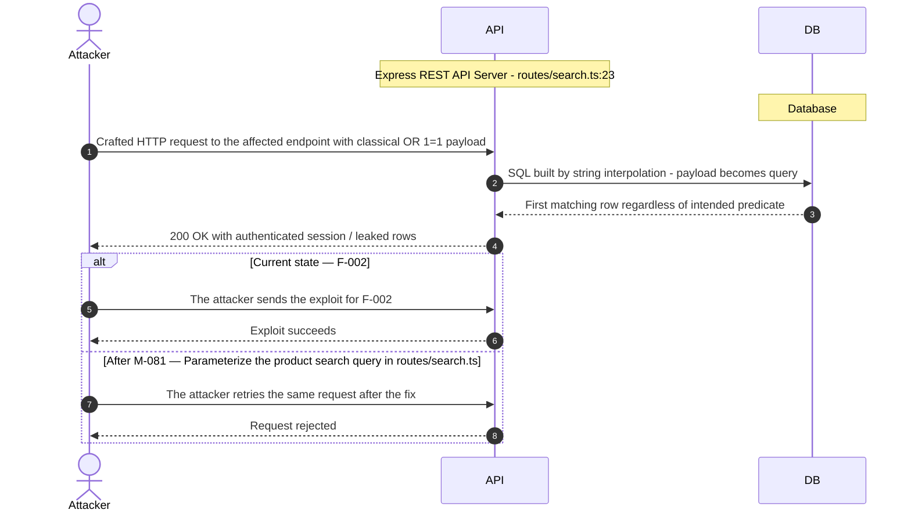

**Key takeaway:** Until ● [M-081](#m-081) (Parameterize the product search query) lands, 🔴 [F-002](#f-002) — SQL injection request data interpolated into a SQL string is exploitable at `routes/search.ts:23` (Critical-severity, [CWE-89](https://cwe.mitre.org/data/definitions/89.html)).

**Defense in Depth**

- Primary mitigation: ● [M-081](#m-081) (Parameterize the product search query)

### 3.5 SQL injection in login query

**Source:** 🔴 [F-001](#f-001) — `routes/login.ts:34`

Severity **Critical** ([CWE-89](https://cwe.mitre.org/data/definitions/89.html)). STRIDE: Tampering. See [§8 F-001](#f-001) for the full register row.

**Attack Steps**

1. I send POST `/rest/user/login` with email set to a target address followed by '-- and any password.
2. The injected quote closes the email literal and the comment drops the password check in the SELECT.
3. I receive a signed session token for the target account and use it on protected APIs.

**Sequence Diagram**

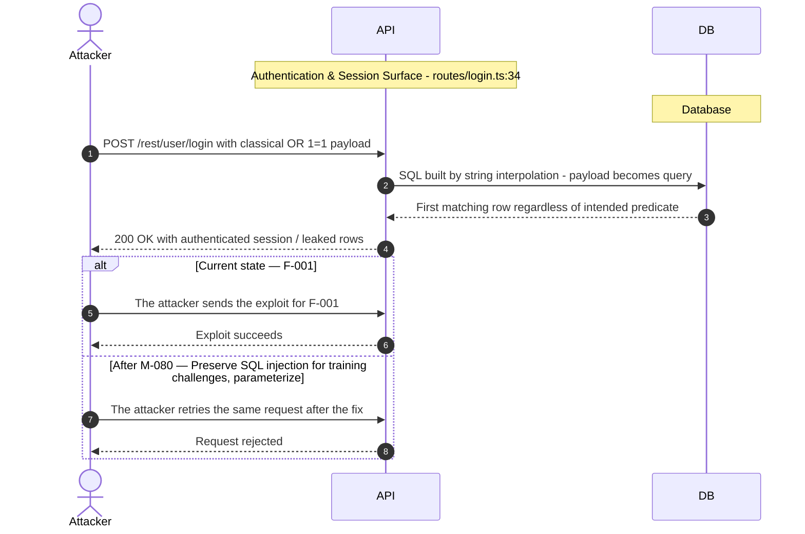

**Key takeaway:** Until ● [M-080](#m-080) (Preserve SQL injection for training challenges; parameterize only in production forks) lands, 🔴 [F-001](#f-001) — SQL injection in login query is exploitable at `routes/login.ts:34` (Critical-severity, [CWE-89](https://cwe.mitre.org/data/definitions/89.html)).

**Defense in Depth**

- Primary mitigation: ● [M-080](#m-080) (Preserve SQL injection for training challenges; parameterize only in production forks)

<!-- generated:walkthrough_renderer -->

---

## 4. Assets

Information assets and the classification level that drives the Confidentiality / Integrity / Availability targets used in [§8 Findings Register](#8-findings-register) risk scoring.

<table style="table-layout:fixed;width:100%">
<colgroup><col width="22%" style="width:22%"><col width="13%" style="width:13%"><col width="32%" style="width:32%"><col width="33%" style="width:33%"></colgroup>
<thead><tr><th>Asset</th><th>Classification</th><th>Description</th><th>Linked Threats</th></tr></thead>
<tbody>
<tr><td style="overflow-wrap:break-word">JWT RSA Private Key</td><td>Restricted</td><td>1024-bit RSA private key hardcoded as a string literal in <code>lib/insecurity.ts:21</code>. Used to sign all <code>RS256</code> JWTs. Because the key is in the source repository, any reader can forge valid tokens for any user including admin accounts.</td><td style="overflow-wrap:break-word">🟠 <a href="#f-007">F-007</a> — Hardcoded RS256 JWT private key<br/>🟠 <a href="#f-008">F-008</a> — JWT decode used without signature verification<br/>🟠 <a href="#f-009">F-009</a> — Insecure JWT Verification<br/>🟠 <a href="#f-017">F-017</a> — Path traversal filesystem access from request input<br/>🟠 <a href="#f-018">F-018</a> — Zip Slip archive extraction<br/>🟠 <a href="#f-023">F-023</a> — Password hash and TOTP secret in JWT payload<br/>🟠 <a href="#f-024">F-024</a> — Reset response returns full user record<br/>🟠 <a href="#f-031">F-031</a> — Hardcoded BIP39 wallet mnemonic in source<br/>🟡 <a href="#f-037">F-037</a> — JWT sessions not revocable server-side<br/>🟡 <a href="#f-049">F-049</a> — Unauthenticated coupon format allows forgery<br/>🟡 <a href="#f-058">F-058</a> — Test account password embedded in SPA bundle<br/>🟡 <a href="#f-064">F-064</a> — Unbounded in-memory token map<br/>🟡 <a href="#f-086">F-086</a> — User keeps</td></tr>
<tr><td style="overflow-wrap:break-word">Encryption and CTF Key Files</td><td>Restricted</td><td>Repository-committed key files including <code>encryptionkeys/jwt.pub</code> (RSA public key), <code>encryptionkeys/premium.key</code>, and <code>ctf.key</code> at the repo root. These are used for JWT verification, premium content, and CTF configuration. Exposure allows token and challenge verification bypass.</td><td style="overflow-wrap:break-word">-</td></tr>
<tr><td style="overflow-wrap:break-word">User Credentials</td><td>Confidential</td><td>User email addresses and <code>MD5</code>-hashed passwords stored in the SQLite Users table. Login query concatenates these into raw SQL, making them reachable via SQL injection. <code>MD5</code> is not a password hashing algorithm.</td><td style="overflow-wrap:break-word">🔴 <a href="#f-001">F-001</a> — SQL injection in login query<br/>🔴 <a href="#f-002">F-002</a> — SQL injection request data interpolated into a SQL string<br/>🟠 <a href="#f-006">F-006</a> — OAuth password derived from email<br/>🟠 <a href="#f-012">F-012</a> — Stored XSS of feedback comment<br/>🟠 <a href="#f-013">F-013</a> — Stored XSS of user email in admin panel<br/>🟠 <a href="#f-014">F-014</a> — Reflected DOM XSS<br/>🟠 <a href="#f-023">F-023</a> — Password hash and TOTP secret in JWT payload<br/>🟠 <a href="#f-025">F-025</a> — Unsalted MD5 password hashing<br/>🟠 <a href="#f-028">F-028</a> — Passwords sent in GET query string<br/>🟡 <a href="#f-036">F-036</a> — Unlimited login attempts<br/>🟡 <a href="#f-042">F-042</a> — Unsalted static-key HMAC for security answers<br/>🟡 <a href="#f-043">F-043</a> — Product description trusted as HTML<br/>🟡 <a href="#f-044">F-044</a> — Order ID from tracking API trusted as HTML<br/>🟡 <a href="#f-055">F-055</a> — Raw markup persisted in User<br/>🟡 <a href="#f-058">F-058</a> — Test account password embedded in SPA bundle</td></tr>
<tr><td style="overflow-wrap:break-word">User Personal Data</td><td>Confidential</td><td>User profiles including email, delivery addresses, security Q&amp;A answers, and profile images. Stored in SQLite via Sequelize models. Accessible via the data export endpoint and subject to IDOR due to missing ownership checks on address and basket routes.</td><td style="overflow-wrap:break-word">🔴 <a href="#f-001">F-001</a> — SQL injection in login query<br/>🔴 <a href="#f-002">F-002</a> — SQL injection request data interpolated into a SQL string<br/>🔴 <a href="#f-003">F-003</a> — Server-side eval of stored username<br/>🔴 <a href="#f-004">F-004</a> — Insecure Direct Object Reference<br/>🔴 <a href="#f-005">F-005</a> — Mass assignment of role on user registration<br/>🟠 <a href="#f-012">F-012</a> — Stored XSS of feedback comment<br/>🟠 <a href="#f-013">F-013</a> — Stored XSS of user email in admin panel<br/>🟠 <a href="#f-014">F-014</a> — Reflected DOM XSS<br/>🟠 <a href="#f-021">F-021</a> — Input compiled as template source<br/>🟠 <a href="#f-023">F-023</a> — Password hash and TOTP secret in JWT payload<br/>🟠 <a href="#f-024">F-024</a> — Reset response returns full user record<br/>🟠 <a href="#f-026">F-026</a> — Unauthenticated memories API exposes user records<br/>🟠 <a href="#f-030">F-030</a> — SSRF<br/>🟠 <a href="#f-033">F-033</a> — Sensitive Routes Registered Without Authentication Middleware<br/>🟠 <a href="#f-034">F-034</a> — Unauthenticated product update<br/>🟡 <a href="#f-042">F-042</a> — Unsalted static-key HMAC for security answers<br/>🟡 <a href="#f-043">F-043</a> — Product description trusted as HTML<br/>🟡 <a href="#f-044">F-044</a> — Order ID from tracking API trusted as HTML<br/>🟡 <a href="#f-050">F-050</a> — CSRF on cookie-authenticated profile update<br/>🟡 <a href="#f-055">F-055</a> — Raw markup persisted in User<br/>🟡 <a href="#f-070">F-070</a> — User list without admin check<br/>🟡 <a href="#f-088">F-088</a> — User downloads another customer's personal data export<br/>🟡 <a href="#f-089">F-089</a> — Order placed</td></tr>
<tr><td style="overflow-wrap:break-word">Payment Card Data</td><td>Confidential</td><td>User payment card records stored in the Cards/Wallet tables. Processed by the wallet and payment routes. Subject to IDOR because card and address endpoints have missing authorization checks per route projection.</td><td style="overflow-wrap:break-word">🔴 <a href="#f-001">F-001</a> — SQL injection in login query<br/>🔴 <a href="#f-002">F-002</a> — SQL injection request data interpolated into a SQL string<br/>🔴 <a href="#f-004">F-004</a> — Insecure Direct Object Reference<br/>🟠 <a href="#f-012">F-012</a> — Stored XSS of feedback comment<br/>🟠 <a href="#f-013">F-013</a> — Stored XSS of user email in admin panel<br/>🟠 <a href="#f-014">F-014</a> — Reflected DOM XSS<br/>🟠 <a href="#f-026">F-026</a> — Unauthenticated memories API exposes user records<br/>🟠 <a href="#f-031">F-031</a> — Hardcoded BIP39 wallet mnemonic in source<br/>🟠 <a href="#f-033">F-033</a> — Sensitive Routes Registered Without Authentication Middleware<br/>🟠 <a href="#f-034">F-034</a> — Unauthenticated product update<br/>🟡 <a href="#f-043">F-043</a> — Product description trusted as HTML<br/>🟡 <a href="#f-044">F-044</a> — Order ID from tracking API trusted as HTML<br/>🟡 <a href="#f-052">F-052</a> — Unvalidated wallet top-up amount<br/>🟠 <a href="#f-068">F-068</a> — Unbounded wallet Set growth from anonymous POSTs<br/>🟡 <a href="#f-070">F-070</a> — User list without admin check<br/>🟡 <a href="#f-074">F-074</a> — Deluxe role granted without payment<br/>🟡 <a href="#f-088">F-088</a> — User downloads another customer's personal data export<br/>🟡 <a href="#f-089">F-089</a> — Order placed</td></tr>
<tr><td style="overflow-wrap:break-word">Active JWT Session Tokens</td><td>Confidential</td><td>Live <code>RS256</code> JWT bearer tokens issued by the auth component. Stored in browser <code>localStorage</code>, making them accessible to any JavaScript on the same origin. Tokens have a 6-hour expiry; they authenticate all REST API requests.</td><td style="overflow-wrap:break-word">🟠 <a href="#f-007">F-007</a> — Hardcoded RS256 JWT private key<br/>🟠 <a href="#f-008">F-008</a> — JWT decode used without signature verification<br/>🟠 <a href="#f-009">F-009</a> — Insecure JWT Verification<br/>🟠 <a href="#f-011">F-011</a> — JWT Accepted Without Signature Verification<br/>🟠 <a href="#f-012">F-012</a> — Stored XSS of feedback comment<br/>🟠 <a href="#f-013">F-013</a> — Stored XSS of user email in admin panel<br/>🟠 <a href="#f-014">F-014</a> — Reflected DOM XSS<br/>🟠 <a href="#f-022">F-022</a> — JWT session token stored in localStorage<br/>🟡 <a href="#f-035">F-035</a> — OAuth implicit flow without state check<br/>🟡 <a href="#f-037">F-037</a> — JWT sessions not revocable server-side<br/>🟡 <a href="#f-038">F-038</a> — Unsigned published container image<br/>🟡 <a href="#f-043">F-043</a> — Product description trusted as HTML<br/>🟡 <a href="#f-044">F-044</a> — Order ID from tracking API trusted as HTML<br/>🟡 <a href="#f-049">F-049</a> — Unauthenticated coupon format allows forgery<br/>🟡 <a href="#f-050">F-050</a> — CSRF on cookie-authenticated profile update<br/>🟠 <a href="#f-083">F-083</a> — Session token stored in web-accessible client<br/>🟠 <a href="#f-084">F-084</a> — Token flow accepts a stolen bearer token without<br/>🟡 <a href="#f-086">F-086</a> — User keeps</td></tr>
<tr><td style="overflow-wrap:break-word">Order and Basket Data</td><td>Confidential</td><td>Customer orders, basket contents, and order history including product selections and delivery status. Stored in SQLite. Basket and order-history routes have missing authorization checks, enabling cross-user data access.</td><td style="overflow-wrap:break-word">🔴 <a href="#f-001">F-001</a> — SQL injection in login query<br/>🔴 <a href="#f-002">F-002</a> — SQL injection request data interpolated into a SQL string<br/>🔴 <a href="#f-004">F-004</a> — Insecure Direct Object Reference<br/>🔴 <a href="#f-005">F-005</a> — Mass assignment of role on user registration<br/>🟠 <a href="#f-017">F-017</a> — Path traversal filesystem access from request input<br/>🟠 <a href="#f-019">F-019</a> — Input in executable NoSQL predicate<br/>🟠 <a href="#f-020">F-020</a> — Input in executable NoSQL predicate<br/>🟠 <a href="#f-033">F-033</a> — Sensitive Routes Registered Without Authentication Middleware<br/>🟠 <a href="#f-034">F-034</a> — Unauthenticated product update<br/>🟡 <a href="#f-065">F-065</a> — B2B order data evaluated as code with 2s budget<br/>🟡 <a href="#f-070">F-070</a> — User list without admin check<br/>🟡 <a href="#f-085">F-085</a> — User bypasses a required approval<br/>🟡 <a href="#f-088">F-088</a> — User downloads another customer's personal data export<br/>🟡 <a href="#f-089">F-089</a> — Order placed</td></tr>
<tr><td style="overflow-wrap:break-word">Application Configuration and Themed Secrets</td><td>Internal</td><td>YAML configuration files under config/ (<code>default.yml</code>, <code>ctf.yml</code>, <code>unsafe.yml</code> and 10+ themed variants). May carry seeded admin passwords, JWT secrets, or CTF-specific settings. Not content-inspected in recon but present at a known path.</td><td style="overflow-wrap:break-word">🔴 <a href="#f-001">F-001</a> — SQL injection in login query<br/>🔴 <a href="#f-002">F-002</a> — SQL injection request data interpolated into a SQL string<br/>🟠 <a href="#f-012">F-012</a> — Stored XSS of feedback comment<br/>🟠 <a href="#f-013">F-013</a> — Stored XSS of user email in admin panel<br/>🟠 <a href="#f-014">F-014</a> — Reflected DOM XSS<br/>🟠 <a href="#f-025">F-025</a> — Unsalted MD5 password hashing<br/>🟡 <a href="#f-036">F-036</a> — Unlimited login attempts<br/>🟡 <a href="#f-037">F-037</a> — JWT sessions not revocable server-side<br/>🟡 <a href="#f-042">F-042</a> — Unsalted static-key HMAC for security answers<br/>🟡 <a href="#f-043">F-043</a> — Product description trusted as HTML<br/>🟡 <a href="#f-044">F-044</a> — Order ID from tracking API trusted as HTML</td></tr>
</tbody>
</table>

---

## 5. Attack Surface

Network-reachable entry points classified by authentication requirement. Each row links to the threat(s) referenced in its **Notes** column. The **Risk** column reflects the highest-severity linked finding. Entry points with no linked finding are still listed when they sit on a sensitive surface (authentication, registration, management) or look like a missing-auth/authz suspect - marked **⚑ Review** in Notes.

### 5.1 Unauthenticated Entry Points (66)

<table style="table-layout:fixed;width:100%">
<colgroup><col width="9%" style="width:9%"><col width="30%" style="width:30%"><col width="14%" style="width:14%"><col width="47%" style="width:47%"></colgroup>
<thead><tr><th>Method</th><th>Route</th><th>Risk</th><th>Notes</th></tr></thead>
<tbody>
<tr><td>POST</td><td style="overflow-wrap:anywhere"><code>/api/Users</code></td><td>🔴 Critical</td><td>🔴 <a href="#f-005">F-005</a> — Mass assignment of role on user registration<br/>User registration — open self-registration, missing auth</td></tr>
<tr><td>POST</td><td style="overflow-wrap:anywhere"><code>/rest/user/login</code></td><td>🔴 Critical</td><td>🔴 <a href="#f-001">F-001</a> — SQL injection in login query<br/>🟠 <a href="#f-023">F-023</a> — Password hash and TOTP secret in JWT payload<br/>🟡 <a href="#f-036">F-036</a> — Unlimited login attempts<br/>Public by design</td></tr>
<tr><td>GET</td><td style="overflow-wrap:anywhere"><code>/rest/products/search</code></td><td>🔴 Critical</td><td>🔴 <a href="#f-002">F-002</a> — SQL injection request data interpolated into a SQL string</td></tr>
<tr><td>POST</td><td style="overflow-wrap:anywhere"><code>/file-upload</code></td><td>🟠 High</td><td>🟠 <a href="#f-018">F-018</a> — Zip Slip archive extraction<br/>🟠 <a href="#f-029">F-029</a> — XXE in uploaded XML parsing<br/>🟡 <a href="#f-066">F-066</a> — Synchronous YAML/XML parsing blocks event loop<br/>File upload with no authentication; YAML/ZIP parsed in vm context</td></tr>
<tr><td>POST</td><td style="overflow-wrap:anywhere"><code>/rest/2fa/verify</code></td><td>🟠 High</td><td>🟠 <a href="#f-011">F-011</a> — JWT Accepted Without Signature Verification<br/>🟠 <a href="#f-024">F-024</a> — Reset response returns full user record<br/>2FA TOTP verification — public-by-design authentication step</td></tr>
<tr><td>POST</td><td style="overflow-wrap:anywhere"><code>/rest/memories</code></td><td>🟠 High</td><td>🟠 <a href="#f-026">F-026</a> — Unauthenticated memories API exposes user records<br/>Memory upload endpoint; missing auth suspected</td></tr>
<tr><td>POST</td><td style="overflow-wrap:anywhere"><code>/rest/user/reset-password</code></td><td>🟠 High</td><td>🟠 <a href="#f-010">F-010</a> — Security-question password reset<br/>🟠 <a href="#f-024">F-024</a> — Reset response returns full user record<br/>🟡 <a href="#f-039">F-039</a> — Rate-limit client IP spoofable<br/>Public by design</td></tr>
<tr><td>POST</td><td style="overflow-wrap:anywhere"><code>/rest/web3/submitKey</code></td><td>🟠 High</td><td>🟠 <a href="#f-031">F-031</a> — Hardcoded BIP39 wallet mnemonic in source<br/>Web3 key submission — missing auth</td></tr>
<tr><td>POST</td><td style="overflow-wrap:anywhere"><code>/​rest/​web3/​walletExploitAddress</code></td><td>🟠 High</td><td>🟠 <a href="#f-068">F-068</a> — Unbounded wallet Set growth from anonymous POSTs<br/>Wallet exploit address — missing auth; blockchain RPC call</td></tr>
<tr><td>GET</td><td style="overflow-wrap:anywhere"><code>/rest/memories</code></td><td>🟠 High</td><td>🟠 <a href="#f-026">F-026</a> — Unauthenticated memories API exposes user records</td></tr>
<tr><td>GET</td><td style="overflow-wrap:anywhere"><code>/rest/track-order/:id</code></td><td>🟠 High</td><td>🟠 <a href="#f-020">F-020</a> — Input in executable NoSQL predicate</td></tr>
<tr><td>GET</td><td style="overflow-wrap:anywhere"><code>/rest/user/change-password</code></td><td>🟠 High</td><td>🟠 <a href="#f-027">F-027</a> — Public directory listing of access logs<br/>🟠 <a href="#f-028">F-028</a> — Passwords sent in GET query string<br/>🟡 <a href="#f-037">F-037</a> — JWT sessions not revocable server-side</td></tr>
<tr><td>GET</td><td style="overflow-wrap:anywhere"><code>/rest/user/security-question</code></td><td>🟠 High</td><td>🟠 <a href="#f-010">F-010</a> — Security-question password reset</td></tr>
<tr><td>GET</td><td style="overflow-wrap:anywhere"><code>/rest/web3/nftMintListen</code></td><td>🟠 High</td><td>🟠 <a href="#f-069">F-069</a> — Leaked RPC WebSocket providers on error reset</td></tr>
<tr><td>POST</td><td style="overflow-wrap:anywhere"><code>/rest/chat</code></td><td>🟡 Medium</td><td>🟡 <a href="#f-051">F-051</a> — LLM coupon tool lacks server-side discount bound<br/>🟡 <a href="#f-061">F-061</a> — Confidential business rule in LLM system prompt<br/>🟡 <a href="#f-067">F-067</a> — Unbounded LLM chat consumption<br/>LLM chat endpoint, missing auth suspected, untrusted input relayed to LLM</td></tr>
<tr><td>POST</td><td style="overflow-wrap:anywhere"><code>/rest/deluxe-membership</code></td><td>🟡 Medium</td><td>🟡 <a href="#f-074">F-074</a> — Deluxe role granted without payment<br/>Deluxe membership purchase — missing auth, privilege escalation path</td></tr>
<tr><td>POST</td><td style="overflow-wrap:anywhere"><code>/rest/user/data-export</code></td><td>🟡 Medium</td><td>🟡 <a href="#f-088">F-088</a> — User downloads another customer's personal data export<br/>Data export — missing auth; captcha bypass path</td></tr>
<tr><td>PUT</td><td style="overflow-wrap:anywhere"><code>/rest/wallet/balance</code></td><td>🟡 Medium</td><td>🟡 <a href="#f-052">F-052</a> — Unvalidated wallet top-up amount<br/>Wallet balance update — missing auth, financial state mutation</td></tr>
<tr><td>GET</td><td style="overflow-wrap:anywhere"><code>/redirect</code></td><td>🟡 Medium</td><td>🟡 <a href="#f-040">F-040</a> — Open redirect</td></tr>
<tr><td>GET</td><td style="overflow-wrap:anywhere"><code>/rest/deluxe-membership</code></td><td>🟡 Medium</td><td>🟡 <a href="#f-074">F-074</a> — Deluxe role granted without payment</td></tr>
<tr><td>GET</td><td style="overflow-wrap:anywhere"><code>/rest/saveLoginIp</code></td><td>🟡 Medium</td><td>🟡 <a href="#f-056">F-056</a> — Login IP taken from client header</td></tr>
<tr><td>GET</td><td style="overflow-wrap:anywhere"><code>/rest/wallet/balance</code></td><td>🟡 Medium</td><td>🟡 <a href="#f-052">F-052</a> — Unvalidated wallet top-up amount</td></tr>
<tr><td>GET</td><td style="overflow-wrap:anywhere"><code>/​this/​page/​is/​hidden/​behind/​an/​incredibly/​high/​paywall/​that/​could/​only/​be/​unlocked/​by/​sending/​1btc/​to/​us</code></td><td>🟡 Medium</td><td>🟡 <a href="#f-087">F-087</a> — Challenge completion score inflated</td></tr>
<tr><td>POST</td><td style="overflow-wrap:anywhere"><code>/api/Addresss</code></td><td>-</td><td>Address creation - missing auth<br/><em>⚑ Review: no auth guard detected</em></td></tr>
<tr><td>PUT</td><td style="overflow-wrap:anywhere"><code>/api/Addresss/:id</code></td><td>-</td><td>Address update - missing auth, input used directly in query<br/><em>⚑ Review: no auth guard detected</em></td></tr>
<tr><td>DELETE</td><td style="overflow-wrap:anywhere"><code>/api/Addresss/:id</code></td><td>-</td><td>Address deletion - authenticated but missing authz<br/><em>⚑ Review: no auth guard detected</em></td></tr>
<tr><td>POST</td><td style="overflow-wrap:anywhere"><code>/api/Cards</code></td><td>-</td><td>Card creation - missing auth check at <code>insecurity.ts</code> middleware<br/><em>⚑ Review: no auth guard detected</em></td></tr>
<tr><td>DELETE</td><td style="overflow-wrap:anywhere"><code>/api/Cards/:id</code></td><td>-</td><td>Card deletion - authenticated but missing authz<br/><em>⚑ Review: no auth guard detected</em></td></tr>
<tr><td>POST</td><td style="overflow-wrap:anywhere"><code>/api/Feedbacks</code></td><td>-</td><td>Feedback creation - missing auth, captcha eval sink downstream<br/><em>⚑ Review: no auth guard detected</em></td></tr>
<tr><td>GET</td><td style="overflow-wrap:anywhere"><code>/metrics</code></td><td>-</td><td>Management: Prometheus metrics endpoint, no authentication<br/><em>⚑ Review: no auth guard detected</em></td></tr>
<tr><td>GET</td><td style="overflow-wrap:anywhere"><code>/​rest/​admin/​application-​configuration</code></td><td>-</td><td>Management: exposes full application configuration to unauthenticated callers<br/><em>⚑ Review: no auth guard detected</em></td></tr>
<tr><td>GET</td><td style="overflow-wrap:anywhere"><code>/​rest/​admin/​application-​version</code></td><td>-</td><td>Management: exposes application version to unauthenticated callers<br/><em>⚑ Review: no auth guard detected</em></td></tr>
<tr><td>PUT</td><td style="overflow-wrap:anywhere"><code>/​rest/​continue-​code-​findIt/​apply/​:​continueCode</code></td><td>-</td><td>Continue-code <code>findIt</code> apply - missing auth, progress manipulation<br/><em>⚑ Review: no auth guard detected</em></td></tr>
<tr><td>PUT</td><td style="overflow-wrap:anywhere"><code>/​rest/​continue-​code-​fixIt/​apply/​:​continueCode</code></td><td>-</td><td>Continue-code <code>fixIt</code> apply - missing auth, progress manipulation<br/><em>⚑ Review: no auth guard detected</em></td></tr>
<tr><td>PUT</td><td style="overflow-wrap:anywhere"><code>/​rest/​continue-​code/​apply/​:​continueCode</code></td><td>-</td><td>Continue-code apply - missing auth, progress manipulation<br/><em>⚑ Review: no auth guard detected</em></td></tr>
<tr><td>PUT</td><td style="overflow-wrap:anywhere"><code>/rest/products/:id/reviews</code></td><td>-</td><td>Product review creation - missing auth, NoSQL injection downstream<br/><em>⚑ Review: no auth guard detected</em></td></tr>
<tr><td>POST</td><td style="overflow-wrap:anywhere"><code>/rest/web3/walletNFTVerify</code></td><td>-</td><td>NFT wallet verify - missing auth; blockchain RPC call<br/><em>⚑ Review: no auth guard detected</em></td></tr>
<tr><td>POST</td><td style="overflow-wrap:anywhere"><code>/snippets/fixes</code></td><td>-</td><td>Code fix submission - missing auth; YAML parsed from user-influenced filename<br/><em>⚑ Review: no auth guard detected</em></td></tr>
<tr><td>POST</td><td style="overflow-wrap:anywhere"><code>/snippets/verdict</code></td><td>-</td><td>Code snippet verdict - missing auth; YAML parsed from user-influenced filename<br/><em>⚑ Review: no auth guard detected</em></td></tr>
</tbody>
</table>

_27 further entry point(s) in this category carry no linked finding and no elevated review signal, and are not listed individually (66 total). The complete route inventory is available in `.route-inventory.json` and, when exported, `pentest-tasks-juice-shop-thorough-v0.6.0b5.yaml`._

### 5.2 Authenticated Entry Points (40)

<table style="table-layout:fixed;width:100%">
<colgroup><col width="9%" style="width:9%"><col width="30%" style="width:30%"><col width="14%" style="width:14%"><col width="47%" style="width:47%"></colgroup>
<thead><tr><th>Method</th><th>Route</th><th>Risk</th><th>Notes</th></tr></thead>
<tbody>
<tr><td>GET</td><td style="overflow-wrap:anywhere"><code>/api/Users</code></td><td>🔴 Critical</td><td>🔴 <a href="#f-005">F-005</a> — Mass assignment of role on user registration</td></tr>
<tr><td>GET</td><td style="overflow-wrap:anywhere"><code>/profile</code></td><td>🔴 Critical</td><td>🔴 <a href="#f-003">F-003</a> — Server-side eval of stored username<br/>🟠 <a href="#f-030">F-030</a> — SSRF<br/>🟡 <a href="#f-050">F-050</a> — CSRF on cookie-authenticated profile update</td></tr>
<tr><td>POST</td><td style="overflow-wrap:anywhere"><code>/profile</code></td><td>🔴 Critical</td><td>🔴 <a href="#f-003">F-003</a> — Server-side eval of stored username<br/>🟠 <a href="#f-030">F-030</a> — SSRF<br/>🟡 <a href="#f-050">F-050</a> — CSRF on cookie-authenticated profile update<br/>Authorization not confirmed (review)</td></tr>
<tr><td>DELETE</td><td style="overflow-wrap:anywhere"><code>/api/Products/:id</code></td><td>🟠 High</td><td>🟠 <a href="#f-034">F-034</a> — Unauthenticated product update<br/>Authorization not confirmed (review)</td></tr>
<tr><td>PUT</td><td style="overflow-wrap:anywhere"><code>/api/Products/:id</code></td><td>🟠 High</td><td>🟠 <a href="#f-034">F-034</a> — Unauthenticated product update<br/>Authorization not confirmed (review)</td></tr>
<tr><td>POST</td><td style="overflow-wrap:anywhere"><code>/api/Products</code></td><td>🟠 High</td><td>🟠 <a href="#f-034">F-034</a> — Unauthenticated product update<br/>Authorization not confirmed (review)</td></tr>
<tr><td>POST</td><td style="overflow-wrap:anywhere"><code>/profile/image/file</code></td><td>🟠 High</td><td>🟠 <a href="#f-030">F-030</a> — SSRF<br/>Authorization not confirmed (review)</td></tr>
<tr><td>POST</td><td style="overflow-wrap:anywhere"><code>/profile/image/url</code></td><td>🟠 High</td><td>🟠 <a href="#f-030">F-030</a> — SSRF<br/>Authorization not confirmed (review)</td></tr>
<tr><td>GET</td><td style="overflow-wrap:anywhere"><code>/rest/basket/:id</code></td><td>🟡 Medium</td><td>🟡 <a href="#f-049">F-049</a> — Unauthenticated coupon format allows forgery<br/>🟡 <a href="#f-089">F-089</a> — Order placed<br/>Basket get — IDOR risk; missing ownership check</td></tr>
<tr><td>PUT</td><td style="overflow-wrap:anywhere"><code>/​rest/​basket/​:​id/​coupon/​:​coupon</code></td><td>🟡 Medium</td><td>🟡 <a href="#f-049">F-049</a> — Unauthenticated coupon format allows forgery<br/>Coupon apply — authenticated but missing authz</td></tr>
<tr><td>POST</td><td style="overflow-wrap:anywhere"><code>/b2b/v2/orders</code></td><td>🟡 Medium</td><td>🟡 <a href="#f-065">F-065</a> — B2B order data evaluated as code with 2s budget<br/>Authorization not confirmed (review)</td></tr>
<tr><td>GET</td><td style="overflow-wrap:anywhere"><code>/​rest/​user/​authentication-​details</code></td><td>🟡 Medium</td><td>🟡 <a href="#f-070">F-070</a> — User list without admin check</td></tr>
<tr><td>PUT</td><td style="overflow-wrap:anywhere"><code>/api/BasketItems/:id</code></td><td>-</td><td>Basket item update - authenticated but missing ownership authz check<br/><em>⚑ Review: no authz guard detected</em></td></tr>
<tr><td>PUT</td><td style="overflow-wrap:anywhere"><code>/api/Cards/:id</code></td><td>-</td><td>Card update - authenticated but missing authz<br/><em>⚑ Review: no authz guard detected</em></td></tr>
<tr><td>PUT</td><td style="overflow-wrap:anywhere"><code>/api/Feedbacks/:id</code></td><td>-</td><td>Feedback update - authenticated but missing authz; direct object reference<br/><em>⚑ Review: no authz guard detected</em></td></tr>
<tr><td>DELETE</td><td style="overflow-wrap:anywhere"><code>/api/Quantitys/:id</code></td><td>-</td><td>Quantity delete - authenticated but missing authz<br/><em>⚑ Review: no authz guard detected</em></td></tr>
<tr><td>PUT</td><td style="overflow-wrap:anywhere"><code>/api/Recycles/:id</code></td><td>-</td><td>Authorization not confirmed (review)<br/><em>⚑ Review: no authz guard detected</em></td></tr>
<tr><td>DELETE</td><td style="overflow-wrap:anywhere"><code>/api/Recycles/:id</code></td><td>-</td><td>Authorization not confirmed (review)<br/><em>⚑ Review: no authz guard detected</em></td></tr>
<tr><td>POST</td><td style="overflow-wrap:anywhere"><code>/rest/2fa/disable</code></td><td>-</td><td>Public by design<br/><em>⚑ Review: auth/token endpoint</em></td></tr>
<tr><td>POST</td><td style="overflow-wrap:anywhere"><code>/rest/2fa/setup</code></td><td>-</td><td>Public by design<br/><em>⚑ Review: auth/token endpoint</em></td></tr>
<tr><td>GET</td><td style="overflow-wrap:anywhere"><code>/rest/2fa/status</code></td><td>-</td><td>Public by design<br/><em>⚑ Review: auth/token endpoint</em></td></tr>
<tr><td>POST</td><td style="overflow-wrap:anywhere"><code>/rest/basket/:id/checkout</code></td><td>-</td><td>Basket checkout - authenticated but missing ownership authz<br/><em>⚑ Review: no authz guard detected</em></td></tr>
<tr><td>PUT</td><td style="overflow-wrap:anywhere"><code>/​rest/​order-​history/​:​id/​delivery-​status</code></td><td>-</td><td>Order delivery status update - bearer authenticated but missing authz; admin-only action<br/><em>⚑ Review: no authz guard detected</em></td></tr>
</tbody>
</table>

_17 further entry point(s) in this category carry no linked finding and no elevated review signal, and are not listed individually (40 total). The complete route inventory is available in `.route-inventory.json` and, when exported, `pentest-tasks-juice-shop-thorough-v0.6.0b5.yaml`._

---

## 6. Security Architecture

This chapter is organized by security-control category. Findings are listed only where the affected control is described.

_Cataloged controls: 31 total - 0 adequate, 6 partial, 9 weak, 13 unsafe, 3 missing._

**How to read the verdicts.** Every control category (and every sub-control below it) carries exactly one status. The two red verdicts do **not** mean the same thing - this is the distinction that decides what you have to do about a finding:

| Status | Meaning | What it asks of you |
|----------|------------------------------------|------------------------|
| 🟢 Adequate | Control is present and sound | Nothing - keep it |
| 🟡 Partial | Present, but with meaningful gaps | Close the gap |
| 🟠 Weak | Present, but has exploitable gaps | Strengthen it |
| 🔴 Unsafe | **Present and relied upon, but defeated /<br/>trivially bypassable** | **Fix the existing control** |
| 🔴 Missing | **Control was never built** | **Add the control** |
| - | Not applicable to this codebase | - |

So "🔴 Unsafe" on a control category does *not* mean the control is absent - it means the control exists but does not hold (e.g. an `MD5` password hash, a raw-SQL query path, a hardcoded signing key). "🔴 Missing" is reserved for controls that were never built (e.g. no `Content-Security-Policy` header).

### 6.1 Security Control Overview

<!-- §6.1 MECHANICAL-FROZEN — DO NOT EDIT (overview table is pregenerator-owned) -->

| Control category | Verdict | Main reason |
|----------------------|---------|------------------------------------|
| [6.2 Identity and Authentication Controls](#62-identity-and-authentication-controls) | 🔴 Unsafe | 11 findings; catalogued controls are present<br/>but defeated (e.g. Password-Based Login,<br/>TOTP Second-Factor Authentication). |
| [6.3 Session and Token Controls](#63-session-and-token-controls) | 🔴 Unsafe | 4 findings; catalogued controls are present<br/>but defeated (e.g. Session Token Issuance<br/>(JWT Based), JWT Client Storage and Theft<br/>Resistance). |
| [6.4 Authorization Controls](#64-authorization-controls) | 🔴 Missing | 8 findings; required controls not in place<br/>(e.g. Route Authentication Middleware,<br/>Object-Level Ownership Checks (BOLA)). |
| [6.5 Query Construction and Data Access Controls](#65-query-construction-and-data-access-controls) | 🔴 Unsafe | 4 findings; catalogued controls are present<br/>but defeated (e.g. Parameterized Database<br/>Queries (SQLite / Sequelize), Document Query<br/>Construction (MarsDB)). |
| [6.6 Input Boundary Validation Controls](#66-input-boundary-validation-controls) | 🟠 Weak | 7 findings; catalogued controls are weak<br/>(e.g. Centralized Input Schema Validation). |
| [6.7 Output Encoding and Rendering Controls](#67-output-encoding-and-rendering-controls) | 🔴 Unsafe | 7 findings; catalogued controls are present<br/>but defeated (e.g. Angular Output Encoding<br/>(DomSanitizer)). |
| [6.8 Browser and Cross-Origin Controls](#68-browser-and-cross-origin-controls) | 🟠 Weak | 2 findings; catalogued controls are weak<br/>(e.g. CORS Policy). |
| [6.9 Cryptography Secrets and Data Protection](#69-cryptography-secrets-and-data-protection) | 🔴 Unsafe | 2 findings; catalogued controls are present<br/>but defeated (e.g. Password Hashing<br/>Algorithm, Secrets and Credentials in Source<br/>Code). |
| [6.10 File Parser and Outbound Request Controls](#610-file-parser-and-outbound-request-controls) | 🔴 Unsafe | 11 findings; catalogued controls are present<br/>but defeated (e.g. XML External Entity (XXE)<br/>Prevention). |
| [6.11 Operations Runtime and Supply Chain Controls](#611-operations-runtime-and-supply-chain-controls) | 🔴 Missing | 12 findings; required controls not in place<br/>(e.g. Security Event Logging, Authentication<br/>Library Currency). |
| [6.12 Real-time and Not Applicable Controls](#612-real-time-and-not-applicable-controls) | 🔴 Missing | Required controls not in place (e.g.<br/>WebSocket Connection Authentication). |

<!-- §6.1 MECHANICAL-FROZEN END -->

### 6.2 Identity and Authentication Controls

<a id="ctrl-identity-and-authentication-controls"></a>

**Dependent crossings:**

- [tb-1](#tb-1) - external → Express REST API Server (assumption broken)
  - 🟠 [F-009](#f-009) — Insecure JWT Verification
  - 🟠 [F-034](#f-034) — Unauthenticated product update
- [tb-2](#tb-2) - external → Authentication & Session Surface (assumption broken)
  - 🟡 [F-041](#f-041) — Unauthenticated WebSocket Channel


**Systemic weaknesses:** [W-010](#w-010)
**Verdict:** 🔴 Unsafe

<!-- The line below is mechanically derived from the controls table — LLM must not re-author it. -->
**Controls covered:**

- [6.2.1 Password-Based Login](#621-password-based-login)
- [6.2.2 TOTP Second-Factor Authentication](#622-totp-second-factor-authentication)
- [6.2.3 User Registration](#623-user-registration)
- [6.2.4 Password Reset](#624-password-reset)
- [6.2.5 Social Login](#625-social-login)

**Implemented controls:** Password-Based Login, TOTP Second-Factor Authentication, User Registration, Password Reset, Social Login (OAuth / OIDC).

**Assessment:** All five authentication flows in this application have exploitable weaknesses: the login query is injectable, the OAuth adapter derives credentials deterministically from the email address, TOTP enrollment is optional and not enforced, and the password-reset mechanism relies on guessable security questions. Each successful flow issues a session JWT; the signing, validation, storage, and revocation of that token are described in [§6.3 Session and Token Controls](#63-session-and-token-controls).

<!-- §6.2 AUTH-MECHANISMS-FROZEN — deterministic inventory, pregenerator-owned. DO NOT EDIT. -->
**Authentication mechanisms (at a glance).** Every authentication mechanism detected on the application, its effective status, where it is assessed, and its linked findings. Controls are catalogued by domain, so JWT/session handling is assessed under [§6.3 Session and Token Controls](#63-session-and-token-controls) and password hashing under [§6.9 Cryptography Secrets and Data Protection](#69-cryptography-secrets-and-data-protection).

| Mechanism | Status | Assessed in | Findings |
|----------------------|---------|-----------|------------------------------------------------|
| User registration | 🔴 Unsafe | [§6.2](#62-identity-and-authentication-controls) | 🔴 [F-005](#f-005) — Mass assignment of role on user registration<br/>🟠 [F-032](#f-032) — Quadratic regex on socket payload — `registerWebsocketEvents.ts:46`<br/>[W-003](#w-003) — Authorization is implemented route by route<br/>🟡 [F-053](#f-053) — Client-reported challenge verification trusted — `registerWebsocketEvents.ts:41`<br/>🟡 [F-062](#f-062) — CTF flags replayed to every new socket — `registerWebsocketEvents.ts:30`<br/>🟡 [F-087](#f-087) — Challenge completion score inflated — `registerWebsocketEvents.ts:50` |
| Password login | 🔴 Unsafe | [§6.2](#62-identity-and-authentication-controls) | - |
| Password reset / change | 🔴 Unsafe | [§6.2](#62-identity-and-authentication-controls) | 🟠 [F-010](#f-010) — Security-question password reset |
| Password storage (hashing) | 🔴 Unsafe | [§6.9](#69-cryptography-secrets-and-data-protection) | 🟠 [F-023](#f-023) — Password hash and TOTP secret in JWT payload — `routes/login.ts:24`<br/>[W-014](#w-014) — Security-sensitive data uses weak cryptographic primitives |
| JWT / bearer-token session | 🔴 Unsafe | [§6.3](#63-session-and-token-controls) | [W-007](#w-007) — Secrets are committed to source instead of a managed store<br/>🟠 [F-008](#f-008) — JWT decode used without signature verification — `lib/insecurity.ts:56`<br/>🟠 [F-009](#f-009) — Insecure JWT Verification<br/>🟠 [F-011](#f-011) — JWT Accepted Without Signature Verification<br/>[W-008](#w-008) — Browser scripts retain reusable session credentials<br/>🟠 [F-023](#f-023) — Password hash and TOTP secret in JWT payload — `routes/login.ts:24` |
| Session-token storage | 🟠 High | [§6.3](#63-session-and-token-controls) | [W-008](#w-008) — Browser scripts retain reusable session credentials<br/>🟠 [F-083](#f-083) — Session token stored in web-accessible client — `request.interceptor.ts:13` |
| Multi-factor authentication (TOTP / 2FA) | 🟡 Partial | [§6.2](#62-identity-and-authentication-controls) | 🟠 [F-023](#f-023) — Password hash and TOTP secret in JWT payload — `routes/login.ts:24` |
| OAuth / OIDC federated login | 🔴 Unsafe | [§6.2](#62-identity-and-authentication-controls) | 🟠 [F-006](#f-006) — OAuth password derived from email — `oauth.component.ts:30`<br/>🟡 [F-035](#f-035) — OAuth implicit flow without state check — `oauth.component.ts:28` |

<!-- §6.2 AUTH-MECHANISMS-FROZEN END -->

**Findings in this category without a control:**

- 🟡 [F-036](#f-036) — Unlimited login attempts
- 🟡 [F-041](#f-041) — Unauthenticated WebSocket Channel
- 🟡 [F-049](#f-049) — Unauthenticated coupon format allows forgery
- 🟠 [F-084](#f-084) — Token flow accepts a stolen bearer token without

<a id="password-based-login"></a>
#### 6.2.1 Password-Based Login

**Status:** 🔴 Unsafe - the login SQL query is built by string interpolation, allowing authentication bypass via injection without supplying a valid password.

<!-- Model implementation note (facts for the intro): routes/login.ts:34 (raw SQL with interpolated email and password fields) -->
`routes/login.ts` verifies credentials by querying the `Users` table via `models.sequelize.query()`. Before the query, the password is hashed at `lib/insecurity.ts:41` with `MD5`; both the email and the hash are then interpolated directly into the query string.

The diagram shows the intended positive password-login path, from credential submission through database lookup to token issuance:

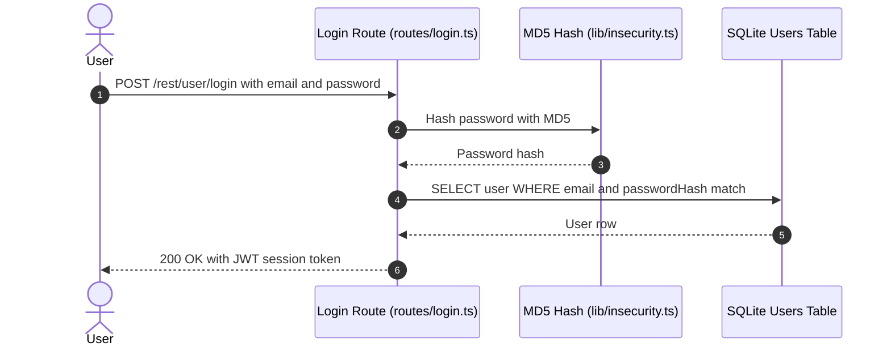

**Security assessment**

Two independent weaknesses sit on the login path:

- SQL injection: the query at `routes/login.ts:34` interpolates `req.body.email` into raw SQL; submitting `' OR '1'='1` as the email returns the first user row (the seeded admin account) without a password.
- Weak hashing: passwords are pre-hashed with unsalted `MD5` before interpolation; any database dump obtained through injection immediately yields recoverable plaintexts.

**Relevant findings**

- None linked to this control; see the other findings of this category.

<a id="totp-second-factor-authentication"></a>
#### 6.2.2 TOTP Second-Factor Authentication

**Status:** 🟡 Partial - TOTP verification is implemented but enrollment is optional; users whose `totpSecret` is empty silently bypass the second-factor gate.

<!-- Model implementation note (facts for the intro): routes/2fa.ts, routes/login.ts:37 -->
TOTP is available as an opt-in second factor via `routes/2fa.ts`. After a successful password check, a short-lived `tmpToken` is issued; the user then submits a TOTP code to `/rest/2fa/verify` to receive the full session JWT.

The diagram shows the intended two-step login path when TOTP is enrolled:

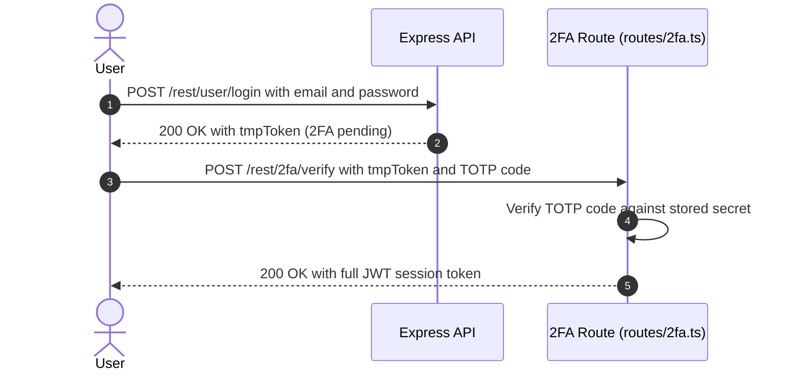

**Security assessment**

- Enrollment is not enforced: `routes/login.ts:37` checks `if (user.totpSecret !== '')` before requiring a second factor; accounts - including administrators - with an empty `totpSecret` skip 2FA entirely.
- The TOTP secret is included in the JWT payload (🟠 [F-023](#f-023) — Password hash and TOTP secret in JWT payload), exposing it to any party who reads or decodes the session token.

**Relevant findings**

- None linked to this control; see the other findings of this category.

<a id="user-registration"></a>
#### 6.2.3 User Registration

**Status:** 🔴 Unsafe - `POST /api/Users` maps all supplied JSON fields onto the Sequelize `User` model, allowing a caller to set `role: admin` and self-elevate to administrator.

<!-- Model implementation note (facts for the intro): Present at POST /api/Users -->
New accounts are created at `POST /api/Users`. The route accepts a JSON body and writes it to the `Users` table via the Sequelize `User` model without restricting which fields a caller may supply.

The diagram shows the intended self-registration path:

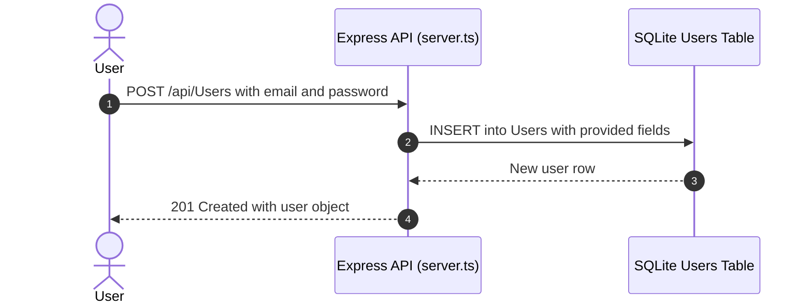

**Security assessment**

The registration endpoint has several weaknesses:

- Mass assignment: the endpoint does not allowlist accepted fields, so a caller can include `role: "admin"` in the request body to self-assign administrator privilege (🔴 [F-005](#f-005) — Mass assignment of role on user registration).
- A quadratic regex in `registerWebsocketEvents.ts:46` is reachable during socket-based registration flows, enabling a ReDoS denial-of-service attack (🟠 [F-032](#f-032) — Quadratic regex on socket payload).
- Several routes triggered by registration events are registered without authentication middleware (🟠 [F-033](#f-033) — Sensitive Routes Registered Without Authentication Middleware).
- Server-side challenge completion can be triggered by a client-supplied flag via the socket path (🟡 [F-053](#f-053) — Client-reported challenge verification trusted).
- CTF challenge flags are broadcast to every socket that connects on registration (🟡 [F-062](#f-062) — CTF flags replayed to every new socket).
- Challenge completion scores are inflatable via the socket registration path (🟡 [F-087](#f-087) — Challenge completion score inflated).

**Relevant findings**

- 🔴 [F-005](#f-005) — Mass assignment of role on user registration — mass assignment of the `role` field enables self-promotion to administrator on registration.
- 🟠 [F-032](#f-032) — Quadratic regex on socket payload — a quadratic regex on the socket registration payload enables ReDoS from an unauthenticated caller.
- 🟠 [F-033](#f-033) — Sensitive Routes Registered Without Authentication Middleware — sensitive routes reachable via registration flows lack authentication middleware.
- 🟡 [F-053](#f-053) — Client-reported challenge verification trusted — the server trusts a client-reported challenge flag, allowing score manipulation from any socket.
- 🟡 [F-062](#f-062) — CTF flags replayed to every new socket — CTF flags are broadcast to every connecting socket, leaking challenge state to new registrants.
- 🟡 [F-087](#f-087) — Challenge completion score inflated — challenge completion scores can be inflated via the WebSocket registration event path.

<a id="password-reset"></a>
#### 6.2.4 Password Reset

**Status:** 🔴 Unsafe - password reset authenticates users with a security-question answer that is trivially guessable from public social-media profiles.

<!-- Model implementation note (facts for the intro): Present at POST /rest/user/reset-password -->
Password reset is handled at `POST /rest/user/reset-password`. The flow prompts for an answer to the user's pre-chosen security question; a matching answer allows a password change without any out-of-band verification token or time-limited link.

The diagram shows the intended reset path using a security question:

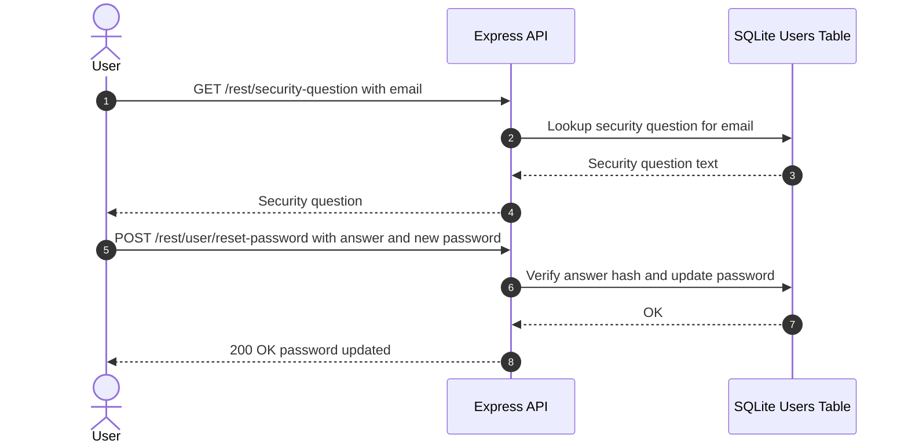

**Security assessment**

- The security-question model is inherently weak; answers to common questions (mother's maiden name, birth city) are publicly inferable from social networks (🟠 [F-010](#f-010) — Security-question password reset).
- Security answers are hashed with an unsalted static-key HMAC (🟠 [F-024](#f-024) — Reset response returns full user record), reducing offline cracking effort after a database dump.
- Additional weaknesses in the reset path are captured by 🟠 [F-069](#f-069) — Leaked RPC WebSocket providers on error reset.

**Relevant findings**

- 🟠 [F-010](#f-010) — Security-question password reset — security-question answers are publicly inferable, allowing account takeover without any credential knowledge.
- 🟠 [F-024](#f-024) — Reset response returns full user record — the unsalted static HMAC used for answer hashing reduces offline cracking effort after a database dump.
- 🟠 [F-069](#f-069) — Leaked RPC WebSocket providers on error reset — additional weakness in the password-reset path further weakens the recovery flow.

<a id="social-login"></a><a id="social-login-oauth-oidc"></a>
#### 6.2.5 Social Login

**Status:** 🔴 Unsafe - the OAuth adapter uses an implicit flow with no CSRF state parameter and derives the local password deterministically from the returned email address.

<!-- Model implementation note (facts for the intro): Present at frontend/src/app/oauth -->
The OAuth flow is implemented in the Angular frontend as a frontend identity adapter, not a server-side authorization-code flow. `oauth.component.ts` reads the access token from the redirect URL, calls Google's userinfo endpoint via `UserService.oauthLogin()`, derives a local password from the returned email, creates a local user if absent, and then calls the local `/rest/user/login` endpoint.

The diagram shows how the frontend OAuth adapter ultimately enters the local login flow:

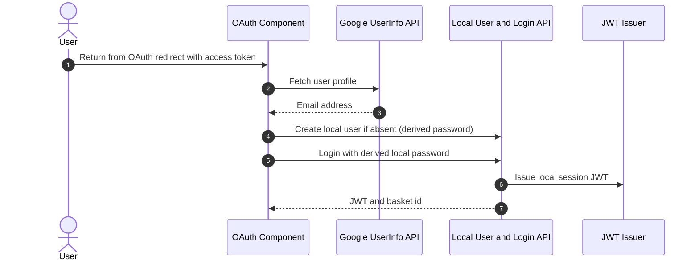

**Security assessment**

This is not a full server-side OAuth control - it uses OAuth as a frontend identity hint and then converts the profile into a deterministic local-password login:

- The implicit flow issues an access token directly to the redirect URI with no `state` parameter, making it vulnerable to CSRF token injection (🟡 [F-035](#f-035) — OAuth implicit flow without state check).
- The derived local password is deterministically computed from the email address; anyone who knows a user's Google email can derive the password and log in without going through OAuth (🟠 [F-006](#f-006) — OAuth password derived from email).

**Relevant findings**

- 🟠 [F-006](#f-006) — OAuth password derived from email — the derived local password can be computed from the email address alone, bypassing the OAuth gate entirely.
- 🟡 [F-035](#f-035) — OAuth implicit flow without state check — the missing `state` parameter in the implicit flow enables CSRF-based token injection.

### 6.3 Session and Token Controls

<a id="ctrl-session-and-token-controls"></a>

**Dependent crossings:**

- [tb-1](#tb-1) - external → Express REST API Server (assumption broken)
  - 🟠 [F-009](#f-009) — Insecure JWT Verification
  - 🟠 [F-034](#f-034) — Unauthenticated product update
- [tb-2](#tb-2) - external → Authentication & Session Surface (assumption broken)
  - 🟡 [F-041](#f-041) — Unauthenticated WebSocket Channel


**Systemic weaknesses:** [W-008](#w-008)
**Verdict:** 🔴 Unsafe

<!-- The line below is mechanically derived from the controls table — LLM must not re-author it. -->
**Controls covered:**

- [6.3.1 Session Token Issuance](#631-session-token-issuance)
- [6.3.2 JWT Client Storage and Theft Resistance](#632-jwt-client-storage-and-theft-resistance)
- [6.3.3 JWT Algorithm Whitelisting](#633-jwt-algorithm-whitelisting)
- [6.3.4 Server-Side Token Revocation](#634-server-side-token-revocation)
- [6.3.5 JWT Signing Key Management](#635-jwt-signing-key-management)

**Implemented controls:** Session Token Issuance (JWT Based), JWT Client Storage and Theft Resistance, JWT Algorithm Whitelisting, Server-Side Token Revocation, JWT Signing Key Management.

**Assessment:** This application uses a single locally-signed token format (commonly called JWT) for every authenticated session, regardless of the login flow in [§6.2](#62-identity-and-authentication-controls) that established it. The sub-sections below trace one token through its lifecycle: signing on issuance, validation on every protected request, storage in the browser, manual revocation, and time-based expiry. Every stage of this lifecycle has exploitable weaknesses: the signing key is committed to source, no algorithm restriction is enforced, tokens are stored in `localStorage`, and revocation state is lost on process restart.

**Findings in this category without a control:**

- 🟠 [F-022](#f-022) — JWT session token stored in localStorage
- 🟡 [F-037](#f-037) — JWT sessions not revocable server-side
- 🟠 [F-083](#f-083) — Session token stored in web-accessible client
- 🟡 [F-086](#f-086) — User keeps

<a id="session-token-issuance"></a><a id="session-token-issuance-jwt-based"></a>
#### 6.3.1 Session Token Issuance

**Status:** 🔴 Unsafe - `RS256`-signed JWTs are issued with a private key that is committed as a plaintext literal in source, defeating the trust basis for all issued tokens.

<!-- Model implementation note (facts for the intro): lib/insecurity.ts:21 (private key literal), lib/insecurity.ts:52-54 (isAuthorized, authorize), package.json:express-jwt@0.1.3, package.json:jsonwebtoken@0.4.0 -->
`RS256`-signed JWTs are issued by `lib/insecurity.ts`. The `authorize()` function at `lib/insecurity.ts:52-54` signs a payload containing the user record with the RSA private key and returns the token to the caller.

The diagram shows the intended token issuance path, where `RS256` signing is meant to provide a verifiable trust anchor:

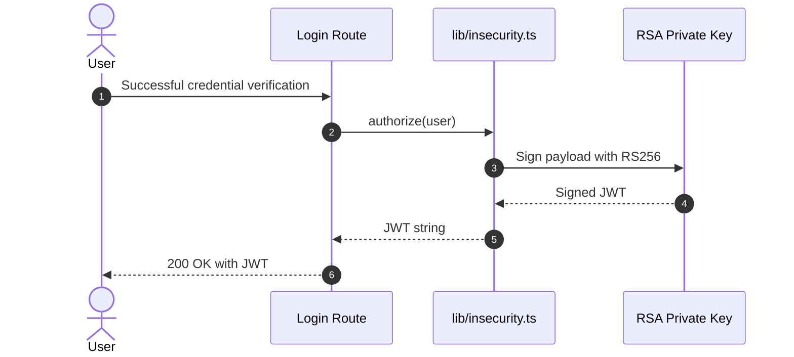

**Security assessment**

<!-- Model assessment (facts the narrative must not contradict): RS256 signing is configured at lib/insecurity.ts:54. However, the RSA private key is a hardcoded literal at lib/insecurity.ts:21, committed to version control; any reader of source history can forge tokens. The verification path uses expressJwt 0.1.3 (pre-algorithm-pinning era) with only the public key supplied — no algorithm restriction in the expressJwt config prevents algorithm confusion (e.g., 'none' or HS256 with the public key as HMAC secret). jsonwebtoken 0.4.0 predates the 2022 CVEs but lacks modern safeguards. -->

The JWT trust model is defeated before tokens reach the browser:

- The RSA private key is a hardcoded literal at `lib/insecurity.ts:21`; anyone with repository read access - including CI systems and third-party tooling - can forge tokens for any user or role.
- `express-jwt` 0.1.3 is initialized with only the public key as the `secret` parameter; no `algorithms` constraint prevents `HS256` confusion attacks using the public key.
- `jsonwebtoken` 0.4.0 predates `CVE-2022-23529` and lacks the strict header validation added in later releases.

**Relevant findings**

- None linked to this control; see the other findings of this category.

<a id="jwt-client-storage-and-theft-resistance"></a>
#### 6.3.2 JWT Client Storage and Theft Resistance

**Status:** 🔴 Unsafe - the JWT is written to `localStorage`, making it readable by any same-origin JavaScript and unconditionally extractable via any of the confirmed XSS sinks.

<!-- Model implementation note (facts for the intro): frontend/src/app/login/login.component.ts:101 (localStorage.setItem), frontend/src/app/Services/request.interceptor.ts:16 (reads token from localStorage for Authorization header) -->
`login.component.ts:101` stores the received JWT in `localStorage` via `localStorage.setItem('token', ...)`. `request.interceptor.ts:16` then reads the token from `localStorage` and injects it into the `Authorization` header of every outgoing API request.

**Security assessment**

<!-- Model assessment (facts the narrative must not contradict): The JWT is written to localStorage at frontend/src/app/login/login.component.ts:101 (localStorage.setItem('token', ...)). localStorage is readable by any same-origin JavaScript, making the token unconditionally extractable via any XSS payload. There is no HttpOnly cookie path. -->

`localStorage` is accessible to any script running in the same origin. There is no `HttpOnly` cookie path that would isolate the token from JavaScript access. Any of the eight confirmed XSS sinks in [§6.7](#67-output-encoding-and-rendering-controls) can extract the stored token and exfiltrate it to an attacker-controlled endpoint.

**Relevant findings**

- None linked to this control; see the other findings of this category.

<a id="jwt-algorithm-whitelisting"></a>
#### 6.3.3 JWT Algorithm Whitelisting

**Status:** 🟠 Weak - `expressJwt` is initialized without an `algorithms` restriction, leaving the verification path open to algorithm-confusion attacks using the committed public key.

<!-- Model implementation note (facts for the intro): lib/insecurity.ts:52 (expressJwt({secret: publicKey}) — no algorithm option) -->
JWT verification is applied to protected routes via `lib/insecurity.ts:52`, where `expressJwt({secret: publicKey})` wraps the incoming token check. The public key is sourced from `encryptionkeys/jwt.pub`.

**Security assessment**

<!-- Model assessment (facts the narrative must not contradict): expressJwt at lib/insecurity.ts:52 is initialized with only the publicKey as secret — no algorithms restriction is passed. With jsonwebtoken 0.4.0, an attacker who knows the public key can attempt an HS256 confusion attack using the public key as the HMAC secret. The library version predates the CVE-2022-23529 fix. -->

No `algorithms` field is passed to `expressJwt`. With `jsonwebtoken` 0.4.0, an attacker who holds the public key (committed to `encryptionkeys/jwt.pub`) can sign a token with `alg: HS256` using the public key as the HMAC secret; the server accepts it because no algorithm is pinned server-side. This library version also predates the `CVE-2022-23529` fix that added stricter header validation.

**Relevant findings**

- None linked to this control; see the other findings of this category.

<a id="server-side-token-revocation"></a>
#### 6.3.4 Server-Side Token Revocation

**Status:** 🟠 Weak - revocation state is held in an in-memory `tokenMap` that is lost on every process restart, leaving stolen tokens valid until natural expiry.

<!-- Model implementation note (facts for the intro): lib/insecurity.ts:70-90 (authenticatedUsers.tokenMap in-memory store) -->
Issued JWTs are tracked in `authenticatedUsers.tokenMap`, an in-memory object at `lib/insecurity.ts:70-77`. Routes call `security.authenticatedUsers.put(token, user)` on each successful login to register the token.

**Security assessment**

<!-- Model assessment (facts the narrative must not contradict): Issued JWTs are tracked in an in-memory tokenMap (lib/insecurity.ts:70-77). This map is lost on process restart with no persistent revocation store. A stolen token with 6 hours of remaining validity cannot be revoked across a restart, and horizontal scaling would leave separate maps per instance. -->

The `tokenMap` is process-scoped and not persisted. A stolen token with remaining validity cannot be invalidated after a server restart. Horizontal scaling would produce separate maps per instance with no cross-node revocation path, allowing a stolen token to remain valid indefinitely on nodes that have not seen it.

**Relevant findings**

- None linked to this control; see the other findings of this category.

<a id="jwt-signing-key-management"></a>
#### 6.3.5 JWT Signing Key Management

**Status:** 🔴 Unsafe - the RSA private key used to sign all JWTs is committed as a plaintext literal in `lib/insecurity.ts`, meaning git history permanently exposes it regardless of source-level patches.

<!-- Model implementation note (facts for the intro): lib/insecurity.ts:21 (private key literal in source), encryptionkeys/jwt.pub (public key on disk) -->
JWT signing relies on an RSA key pair. The public key is stored in `encryptionkeys/jwt.pub`; the private key is embedded as a hardcoded string literal at `lib/insecurity.ts:21` directly in the source file committed to version control.

**Security assessment**

<!-- Model assessment (facts the narrative must not contradict): The RSA private key used to sign all JWTs is a hardcoded literal string at lib/insecurity.ts:21 and is committed to version control. Any person with repository read access can forge valid signed JWTs. Key rotation requires a code change and redeployment; there is no mechanism to invalidate existing tokens after rotation. -->

The private key committed to version control cannot be remediated by patching source alone - it remains in git history and must be treated as permanently compromised. Key rotation requires a code change and redeployment; there is no out-of-band key-rotation path and no mechanism to invalidate tokens signed with the old key after rotation.

**Relevant findings**

- None linked to this control; see the other findings of this category.

### 6.4 Authorization Controls

<a id="ctrl-authorization-controls"></a>

**Dependent crossings:**

- [tb-1](#tb-1) - external → Express REST API Server (assumption not confirmed)
  - 🟠 [F-033](#f-033) — Sensitive Routes Registered Without Authentication Middleware
  - 🟡 [F-088](#f-088) — User downloads another customer's personal data export
  - 🟡 [F-089](#f-089) — Order placed
- [tb-2](#tb-2) - external → Authentication & Session Surface (assumption not confirmed)
  - 🟡 [F-070](#f-070) — User list without admin check
- [tb-3](#tb-3) - external → CI/CD Pipeline (assumption not confirmed)
  - 🟡 [F-073](#f-073) — Missing Workflow Permissions Block
- [tb-4](#tb-4) - external → CI/CD Pipeline (assumption not confirmed)
  - 🟡 [F-073](#f-073) — Missing Workflow Permissions Block
- [tb-5](#tb-5) - external → CI/CD Pipeline (assumption not confirmed)
  - 🟡 [F-073](#f-073) — Missing Workflow Permissions Block
- [tb-6](#tb-6) - external → CI/CD Pipeline (assumption not confirmed)
  - 🟡 [F-073](#f-073) — Missing Workflow Permissions Block
- [tb-7](#tb-7) - external → CI/CD Pipeline (assumption not confirmed)
  - 🟡 [F-073](#f-073) — Missing Workflow Permissions Block


**Systemic weaknesses:** [W-003](#w-003), [W-011](#w-011), [W-013](#w-013)
**Verdict:** 🔴 Missing

<!-- The line below is mechanically derived from the controls table — LLM must not re-author it. -->
**Controls covered:**

- [6.4.1 Route Authentication Middleware](#641-route-authentication-middleware)
- [6.4.2 Object-Level Ownership Checks](#642-object-level-ownership-checks)
- [6.4.3 Centralized Authorization Policy](#643-centralized-authorization-policy)
- [6.4.4 Management Endpoint Access Control](#644-management-endpoint-access-control)
- [6.4.5 Database Principal Separation](#645-database-principal-separation)
- [6.4.6 Prometheus Metrics Endpoint Access Control](#646-prometheus-metrics-endpoint-access-control)

**Implemented controls:** Route Authentication Middleware, Object-Level Ownership Checks (BOLA), Centralized Authorization Policy, Management Endpoint Access Control, Prometheus Metrics Endpoint Access Control.

**Assessment:** No centralized authorization policy exists. Authentication middleware (`security.isAuthorized()`) is applied inconsistently - several state-changing routes lack it entirely, including `POST /file-upload`. Object-level ownership is not verified on any route: basket, card, and address operations accept any authenticated token regardless of which user's resource is addressed. Admin operations have no confirmed `isAdmin` claim check.

**Findings in this category without a control:**

- 🔴 [F-004](#f-004) — Insecure Direct Object Reference
- 🔴 [F-005](#f-005) — Mass assignment of role on user registration
- 🟠 [F-033](#f-033) — Sensitive Routes Registered Without Authentication Middleware
- 🟠 [F-034](#f-034) — Unauthenticated product update
- 🟡 [F-053](#f-053) — Client-reported challenge verification trusted
- 🟡 [F-070](#f-070) — User list without admin check
- 🟡 [F-088](#f-088) — User downloads another customer's personal data export
- 🟡 [F-089](#f-089) — Order placed

<a id="route-authentication-middleware"></a>
#### 6.4.1 Route Authentication Middleware

**Status:** 🟡 Partial - `security.isAuthorized()` is applied to many routes, but `POST /file-upload` and several other state-changing paths are registered without an authentication gate.

<!-- Model implementation note (facts for the intro): lib/insecurity.ts:52 (isAuthorized), server.ts:356 (middleware application), server.ts:309 (file-upload — authn absent) -->
`lib/insecurity.ts:52` exports `isAuthorized()`, an `expressJwt`-backed middleware. `server.ts:356` applies it as a shared middleware for most protected routes via `app.use(security.isAuthorized())`.

**Security assessment**

<!-- Model assessment (facts the narrative must not contradict): security.isAuthorized() (expressJwt wrapper) is applied to many protected routes per server.ts:356. However, POST /file-upload at server.ts:309 is registered without this middleware (authn=absent). Several other state-changing routes have authn=unknown, indicating the middleware coverage is not verified to be complete. -->

The middleware is applied inconsistently rather than as a default-deny baseline. `POST /file-upload` at `server.ts:309` is registered without `isAuthorized()`, allowing unauthenticated file uploads. Several additional state-changing routes carry `authn=unknown` in the architecture scan, meaning coverage cannot be confirmed as complete.

**Relevant findings**

- None linked to this control; see the other findings of this category.

<a id="object-level-ownership-checks"></a><a id="object-level-ownership-checks-bola"></a>
#### 6.4.2 Object-Level Ownership Checks

**Status:** 🟠 Weak - JWT middleware confirms a caller is authenticated but does not verify that the authenticated user owns the addressed resource, enabling horizontal privilege escalation on basket, card, and address operations.

<!-- Model implementation note (facts for the intro): server.ts:371,389,390,426,429,433,440,441,450,451,603,625 -->
Sequelize models for `BasketItem`, `Card`, `Address`, and `Product` back the data-access layer. Routes such as `GET /rest/basket/:id` (`server.ts:603`) and `PUT /api/Cards/:id` (`server.ts:440`) require a valid JWT but accept any resource ID supplied in the URL.

**Security assessment**

<!-- Model assessment (facts the narrative must not contradict): JWT middleware is present on basket, card, address, and product mutation routes (authn=middleware_present) but no ownership check verifying that the authenticated subject owns the addressed resource ID has been detected. Routes such as GET /rest/basket/:id (server.ts:603) and PUT /api/Cards/:id (server.ts:440) accept any authenticated token regardless of the token's UserId claim. -->

No route in the codebase has been confirmed to compare the authenticated `UserId` claim in the JWT against the owner of the resource identified by the URL parameter. An attacker with any valid session token can read or modify another user's basket, payment card, or delivery address by substituting the target's resource ID.

**Relevant findings**

- None linked to this control; see the other findings of this category.

<a id="centralized-authorization-policy"></a>
#### 6.4.3 Centralized Authorization Policy

**Status:** 🟠 Weak - authorization is implemented per-route on an ad-hoc basis with no RBAC or ABAC policy engine; admin-only operations lack a confirmed `isAdmin` claim check.

<!-- Model implementation note (facts for the intro): server.ts (multiple lines per architecture coverage ARCH-AUTHZ-001 signals) -->
Route-level `isAuthorized()` middleware blocks unauthenticated callers on most endpoints. Admin operations are registered in `server.ts` alongside regular user operations using the same middleware.

**Security assessment**

<!-- Model assessment (facts the narrative must not contradict): No centralized authorization framework (RBAC/ABAC policy engine) exists. Authorization is implemented per-route if at all; 18+ sensitive method registrations in server.ts carry authz=unknown (lines 371,389,390,426,429,433,440,441,450,451,605,612,613,614,625,627,633,634). Admin operations do not have a verified isAdmin claim check. -->

No central policy engine enforces role boundaries. Over 18 sensitive route registrations in `server.ts` carry `authz=unknown` (lines 371, 389, 390, 426, 429, 433, 440, 441, 450, 451, 605, 612, 613, 614, 625, 627, 633, 634). There is no confirmed server-side check for an `isAdmin` claim on any administrative endpoint.

**Relevant findings**

- None linked to this control; see the other findings of this category.

<a id="management-endpoint-access-control"></a>
#### 6.4.4 Management Endpoint Access Control

**Status:** 🟠 Weak - `GET /rest/admin/application-version`, `GET /rest/admin/application-configuration`, and `GET /metrics` have unverified authentication state and are reachable by unauthenticated callers.

<!-- Model implementation note (facts for the intro): server.ts:606,607,676,729 -->
Administrative REST endpoints exposing version and configuration data are registered at `server.ts:606-607`. The Prometheus metrics endpoint is registered at `server.ts:676` and `server.ts:729`.

**Security assessment**

<!-- Model assessment (facts the narrative must not contradict): GET /rest/admin/application-version and GET /rest/admin/application-configuration (server.ts:606-607) as well as GET /metrics (server.ts:676,729) have authn=unknown in the architecture scan. The Prometheus metrics endpoint exposes process, memory, and request statistics to unauthenticated callers. -->

Both the admin configuration endpoints and the Prometheus metrics endpoint carry `authn=unknown` in the architecture scan. The metrics endpoint exposes process-level statistics (CPU, memory, per-route HTTP request rates) to anonymous callers, aiding timing analysis and resource-exhaustion planning.

**Relevant findings**

- None linked to this control; see the other findings of this category.

<a id="database-principal-separation"></a>
#### 6.4.5 Database Principal Separation

**Status:** 🔴 Missing - a single Sequelize connection handles all operations from seed data creation to user-facing queries; no scoped or read-only principal limits the blast radius of an injection.

This control is not evidenced in the repository.

**Security assessment**

<!-- Model assessment (facts the narrative must not contradict): A single SQLite connection via Sequelize handles all read and write operations including administrative seed data creation, user record management, and order processing. There is no read-only or scoped connection pool for unprivileged queries. An injection that reaches this connection can read or modify any table. -->

A single SQLite connection via Sequelize performs administrative seed operations, user record management, and order processing. No read-only or scoped connection pool exists for unprivileged queries. An injection that reaches this shared connection can read or modify any table - including administrative accounts, payment records, and wallet balances.

**Relevant findings**

- None linked to this control; see the other findings of this category.

<a id="prometheus-metrics-endpoint-access-control"></a>
#### 6.4.6 Prometheus Metrics Endpoint Access Control

**Status:** 🟠 Weak - `GET /metrics` is registered without authentication middleware and exposes process-level runtime statistics to anonymous callers.

<!-- Model implementation note (facts for the intro): server.ts:676,729 -->
`GET /metrics` is served by `express-prom-bundle` and registered at `server.ts:676` and `server.ts:729`.

**Security assessment**

<!-- Model assessment (facts the narrative must not contradict): GET /metrics is registered without authentication middleware at server.ts:676 and 729. The endpoint exposes process-level metrics (CPU, memory, HTTP request rates) to anonymous callers. This aids reconnaissance for timing attacks and resource exhaustion. -->

Without authentication middleware on `/metrics`, any caller retrieves process CPU, memory, and per-route HTTP request rate data. This information aids reconnaissance for timing attacks and capacity-exhaustion planning against the application.

**Relevant findings**

- None linked to this control; see the other findings of this category.

### 6.5 Query Construction and Data Access Controls

<a id="ctrl-query-construction-and-data-access-controls"></a>

**Dependent crossings:**

- [tb-8](#tb-8) - Express REST API Server → SQLite Relational Store (assumption broken)
  - 🔴 [F-001](#f-001) — SQL injection in login query
  - 🔴 [F-002](#f-002) — SQL injection request data interpolated into a SQL string
- [tb-9](#tb-9) - Express REST API Server → marsdb Embedded Document Store (assumption broken)
  - 🟠 [F-019](#f-019) — Input in executable NoSQL predicate
  - 🟠 [F-020](#f-020) — Input in executable NoSQL predicate


**Systemic weaknesses:** [W-002](#w-002)
**Verdict:** 🔴 Unsafe

<!-- The line below is mechanically derived from the controls table — LLM must not re-author it. -->
**Controls covered:**

- [6.5.1 Parameterized Database Queries](#651-parameterized-database-queries)
- [6.5.2 Document Query Construction](#652-document-query-construction)

**Implemented controls:** Parameterized Database Queries (SQLite / Sequelize), Document Query Construction (MarsDB).

**Assessment:** Sequelize ORM backs most relational data access and provides implicit parameterization by default. Two critical paths bypass this: the login route constructs raw SQL via string template interpolation, and the product-review route builds a MarsDB `$where` expression from string concatenation. Both represent unconditional injection sinks at the data-access boundary.

**Findings in this category without a control:**

- 🔴 [F-001](#f-001) — SQL injection in login query
- 🔴 [F-002](#f-002) — SQL injection request data interpolated into a SQL string
- 🟠 [F-019](#f-019) — Input in executable NoSQL predicate
- 🟠 [F-020](#f-020) — Input in executable NoSQL predicate

<a id="parameterized-database-queries"></a><a id="parameterized-database-queries-sqlite-sequelize"></a>
#### 6.5.1 Parameterized Database Queries

**Status:** 🔴 Unsafe - `models.sequelize.query()` at `routes/login.ts:34` constructs a raw SQL string from attacker-controlled input, bypassing Sequelize's parameterization on the login path.

<!-- Model implementation note (facts for the intro): routes/login.ts:34 (raw SQL injection sink), models/index.ts:33 (Sequelize baseline for other routes) -->
Sequelize ORM models back most relational data access and pass bound parameters to SQLite by default. The login route calls `models.sequelize.query()` directly with a template-literal-constructed string rather than using the ORM model layer or the Sequelize parameterized query API.

**Security assessment**

<!-- Model assessment (facts the narrative must not contradict): Sequelize ORM is used for most queries and provides implicit parameterization. The login path bypasses this: models.sequelize.query() at routes/login.ts:34 constructs a raw SQL string using template literals with req.body.email and req.body.password (MD5-hashed but attacker-controlled before hashing) directly interpolated. This is an unconditional SQL injection sink. -->

The login query bypasses all ORM-level parameterization. The vulnerable login lookup is built as a raw SQL string:

```ts
models.sequelize.query(`SELECT * FROM Users WHERE email = '${req.body.email}' AND password = '${req.body.password}'`)
```

- Submitting `' OR '1'='1` as the email field returns the first user row (the seeded admin account) without supplying a password.
- The password is pre-hashed with `MD5` at `lib/insecurity.ts:41` before interpolation, but the hash operation does not prevent injection of the email field.

**Relevant findings**

- None linked to this control; see the other findings of this category.

<a id="document-query-construction"></a><a id="document-query-construction-marsdb"></a>
#### 6.5.2 Document Query Construction

**Status:** 🔴 Unsafe - `routes/showProductReviews.ts:36` builds a MarsDB `$where` expression via string concatenation with user-supplied input; MarsDB evaluates `$where` as JavaScript, enabling arbitrary code execution in the query engine.

<!-- Model implementation note (facts for the intro): routes/showProductReviews.ts:36 (NoSQL injection sink via \$where) -->
Product reviews are stored in MarsDB (`data/mongodb.ts`). Queries against this document store run through `routes/showProductReviews.ts`, which constructs the selector passed to MarsDB.

**Security assessment**

<!-- Model assessment (facts the narrative must not contradict): routes/showProductReviews.ts:36 builds a MarsDB \$where expression via string concatenation with user-supplied input. MarsDB evaluates \$where as JavaScript, so an attacker who controls this value can execute arbitrary JS in the query engine context. -->

MarsDB evaluates `$where` clauses as JavaScript expressions. The review query at `routes/showProductReviews.ts:36` concatenates user-supplied input into the `$where` string without sanitization. An attacker who controls this value can execute arbitrary JavaScript in the query engine's context, reaching server-side objects and the filesystem through the Node\.js runtime.

**Relevant findings**

- None linked to this control; see the other findings of this category.

### 6.6 Input Boundary Validation Controls

<a id="ctrl-input-boundary-validation-controls"></a>

**Dependent crossings:**

- [tb-1](#tb-1) - external → Express REST API Server (assumption broken)
  - 🔴 [F-003](#f-003) — Server-side eval of stored username
  - 🔴 [F-005](#f-005) — Mass assignment of role on user registration
- [tb-2](#tb-2) - external → Authentication & Session Surface (assumption broken)
  - 🔴 [F-001](#f-001) — SQL injection in login query
- [tb-3](#tb-3) - external → CI/CD Pipeline (assumption broken)
  - 🟡 [F-047](#f-047) — Action pinned to mutable branch
- [tb-4](#tb-4) - external → CI/CD Pipeline (assumption broken)
  - 🟡 [F-048](#f-048) — Base image pulled by mutable tag
- [tb-5](#tb-5) - external → CI/CD Pipeline (assumption broken)
  - 🟠 [F-016](#f-016) — Lockfile disabled for npm installs
- [tb-6](#tb-6) - external → CI/CD Pipeline (assumption broken)
  - 🟡 [F-045](#f-045) — Install script piped to shell unverified
- [tb-7](#tb-7) - external → CI/CD Pipeline (assumption not confirmed)
  - 🟠 [F-016](#f-016) — Lockfile disabled for npm installs
  - 🟡 [F-045](#f-045) — Install script piped to shell unverified
  - 🟡 [F-047](#f-047) — Action pinned to mutable branch
  - +1 more

**Verdict:** 🟠 Weak

<!-- The line below is mechanically derived from the controls table — LLM must not re-author it. -->
**Controls covered:**

- [6.6.1 Centralized Input Schema Validation](#661-centralized-input-schema-validation)

**Implemented controls:** Centralized Input Schema Validation.

**Assessment:** Input validation at the entry point is limited to whitespace trimming for email and password fields at `server.ts:411-413`. No schema validator (Zod, Joi, `express-validator`, or equivalent) is present in `package.json`. The majority of API request fields pass raw attacker-controlled values to downstream handlers, relying on those handlers to enforce type, range, and format constraints.

**Findings in this category without a control:**

- 🟡 [F-051](#f-051) — LLM coupon tool lacks server-side discount bound
- 🟡 [F-052](#f-052) — Unvalidated wallet top-up amount
- 🟡 [F-064](#f-064) — Unbounded in-memory token map
- 🟡 [F-065](#f-065) — B2B order data evaluated as code with 2s budget
- 🟡 [F-066](#f-066) — Synchronous YAML/XML parsing blocks event loop
- 🟡 [F-067](#f-067) — Unbounded LLM chat consumption
- 🟠 [F-068](#f-068) — Unbounded wallet Set growth from anonymous POSTs

<a id="centralized-input-schema-validation"></a>
#### 6.6.1 Centralized Input Schema Validation

**Status:** 🟡 Partial - only whitespace trimming is applied at the entry point; no allowlist-based schema validator protects the remaining request fields from type, range, or format abuse.

<!-- Model implementation note (facts for the intro): server.ts:411-413 (trim only), no schema validator library detected in package.json -->
`server.ts:411-413` applies `String.prototype.trim()` to email and password before they reach route handlers. No JSON schema validation middleware is applied globally or per-route.

**Security assessment**

<!-- Model assessment (facts the narrative must not contradict): Only whitespace trimming is applied at the entry point (server.ts:411-413 for email/password). No JSON schema validator, Zod, Joi, or similar allowlist-based framework has been detected. Type and range checks are absent on the majority of API request fields, leaving downstream handlers to handle raw attacker-controlled input. -->

Type and range checks are absent on the vast majority of API request fields. Without a schema validator:

- Integer fields (quantities, resource IDs) can be submitted as strings, objects, or arrays.
- Fields that should be bounded (email length, file names, redirect URLs) have no server-side length or format restriction.
- Downstream handlers receive raw input that may trigger ReDoS via catastrophic backtracking, buffer issues, or logic-level abuse.

**Relevant findings**

- None linked to this control; see the other findings of this category.

### 6.7 Output Encoding and Rendering Controls


**Systemic weaknesses:** [W-006](#w-006)
**Verdict:** 🔴 Unsafe

<!-- The line below is mechanically derived from the controls table — LLM must not re-author it. -->
**Controls covered:**

- [6.7.1 Angular Output Encoding](#671-angular-output-encoding)

**Implemented controls:** Angular Output Encoding (DomSanitizer).

**Assessment:** Angular's default template escaping is deliberately bypassed in 8 components via `DomSanitizer.bypassSecurityTrustHtml()`. The bypassed components render attacker-reachable data - search query, product description, user email, feedback text, IP address, order ID - as trusted HTML, creating confirmed stored and reflected XSS sinks across the application.

**Findings in this category without a control:**

- 🟠 [F-012](#f-012) — Stored XSS of feedback comment
- 🟠 [F-013](#f-013) — Stored XSS of user email in admin panel
- 🟠 [F-014](#f-014) — Reflected DOM XSS
- 🟡 [F-043](#f-043) — Product description trusted as HTML
- 🟡 [F-044](#f-044) — Order ID from tracking API trusted as HTML
- 🟡 [F-054](#f-054) — Raw markup persisted in Product description
- 🟡 [F-055](#f-055) — Raw markup persisted in User

<a id="angular-output-encoding"></a><a id="angular-output-encoding-domsanitizer"></a>
#### 6.7.1 Angular Output Encoding

**Status:** 🔴 Unsafe - `DomSanitizer.bypassSecurityTrustHtml()` is called with attacker-reachable data in 8 components, disabling Angular's built-in HTML escaping and creating confirmed XSS sinks throughout the application.

<!-- Model implementation note (facts for the intro): frontend/src/app/search-result/search-result.component.ts:110,143; about/about.component.ts:119; last-login-ip/last-login-ip.component.ts:39; administration/administration.component.ts:73,91; data-export/data-export.component.ts:57; track-result/track-result.component.ts:48 -->
Angular's template engine escapes HTML by default. `DomSanitizer.bypassSecurityTrustHtml()` opts a specific string out of this protection and renders it as raw HTML in the DOM. Multiple Angular components call this API with data sourced from user-controlled fields.

**Security assessment**

<!-- Model assessment (facts the narrative must not contradict): Angular's DomSanitizer.bypassSecurityTrustHtml() disables the framework's built-in HTML escaping. It is called with attacker-reachable data in 8 components: search-result (search query and product description), about (feedback comments), last-login-ip (IP address from JWT claim), administration (user email, feedback), data-export (CAPTCHA image), and track-result (order ID). These are confirmed stored and reflected XSS sinks. -->

Eight components bypass Angular's output encoding with attacker-reachable content. This trusted-HTML call in `search-result.component.ts` demonstrates the pattern:

```ts
this.sanitizer.bypassSecurityTrustHtml(product.description)
```

Confirmed sinks and their sources:

- Search result and product description (`search-result.component.ts:110,143`) - search query and product database field.
- About page (`about.component.ts:119`) - user-submitted feedback comments (stored XSS).
- Last-login IP (`last-login-ip.component.ts:39`) - IP address sourced from JWT claim.
- Administration panel (`administration.component.ts:73,91`) - user email and feedback text (stored XSS).
- Data export (`data-export.component.ts:57`) - CAPTCHA image field.
- Order tracking (`track-result.component.ts:48`) - order ID.

**Relevant findings**

- None linked to this control; see the other findings of this category.

### 6.8 Browser and Cross-Origin Controls


**Systemic weaknesses:** [W-011](#w-011)
**Verdict:** 🟠 Weak

<!-- The line below is mechanically derived from the controls table — LLM must not re-author it. -->
**Controls covered:**

- [6.8.1 CORS Policy](#681-cors-policy)

**Implemented controls:** CORS Policy.

**Assessment:** CORS is configured for the `Socket.IO` server using a hardcoded `localhost:4200` origin that is invalid for any non-development deployment. No Content Security Policy (CSP) header is emitted, leaving the browser without a second line of defence against the XSS sinks confirmed in [§6.7](#67-output-encoding-and-rendering-controls).

**Findings in this category without a control:**

- 🟡 [F-035](#f-035) — OAuth implicit flow without state check
- 🟡 [F-050](#f-050) — CSRF on cookie-authenticated profile update

<a id="cors-policy"></a>
#### 6.8.1 CORS Policy

**Status:** 🟠 Weak - the `Socket.IO` server's CORS origin is hardcoded to `http://localhost:4200`, which is invalid in production and leaves the WebSocket channel either broken or relying on permissive fallback defaults.

<!-- Model implementation note (facts for the intro): lib/startup/registerWebsocketEvents.ts:20 (cors origin: 'http://localhost:4200') -->
The `Socket.IO` server at `lib/startup/registerWebsocketEvents.ts:20` initialises the server with `cors: { origin: 'http://localhost:4200' }`. HTTP CORS for the REST API is handled separately.

**Security assessment**

<!-- Model assessment (facts the narrative must not contradict): The Socket.IO server configures CORS origin as the hardcoded literal 'http://localhost:4200' (lib/startup/registerWebsocketEvents.ts:20). In production deployment this value is incorrect and would either break legitimate WebSocket connections or be overridden by permissive defaults. No evidence of runtime-configurable CORS for production origins. -->

The hardcoded `localhost` origin cannot match a production hostname. In any deployed environment this misconfiguration either blocks legitimate WebSocket connections or is silently overridden by a permissive fallback. No runtime-configurable CORS policy for production origins has been detected in the codebase.

**Relevant findings**

- None linked to this control; see the other findings of this category.

### 6.9 Cryptography Secrets and Data Protection


**Systemic weaknesses:** [W-007](#w-007), [W-014](#w-014)
**Verdict:** 🔴 Unsafe

<!-- The line below is mechanically derived from the controls table — LLM must not re-author it. -->
**Controls covered:**

- [6.9.1 Password Hashing Algorithm](#691-password-hashing-algorithm)
- [6.9.2 Secrets and Credentials in Source Code](#692-secrets-and-credentials-in-source-code)
- [6.9.3 HTTPS / TLS Termination](#693-https--tls-termination)

**Implemented controls:** Password Hashing Algorithm, Secrets and Credentials in Source Code, HTTPS / TLS Termination.

**Assessment:** Three distinct secrets are committed to version control - the RSA private key, an HMAC key, and a BIP39 mnemonic - and passwords are stored with unsalted `MD5`, a fast hash with no work factor. The combination means both signing-key material and credential recovery are immediately achievable from a repository clone or a database dump.

**Findings in this category without a control:**

- 🟠 [F-007](#f-007) — Hardcoded RS256 JWT private key
- 🟠 [F-031](#f-031) — Hardcoded BIP39 wallet mnemonic in source

<a id="password-hashing-algorithm"></a>
#### 6.9.1 Password Hashing Algorithm

**Status:** 🔴 Unsafe - passwords are hashed with unsalted `MD5`, a fast hash with no work factor; precomputed rainbow tables immediately recover most passwords from a database dump.

<!-- Model implementation note (facts for the intro): lib/insecurity.ts:41 (hash = (data) => crypto.createHash('md5')...) -->
Passwords are hashed before storage in the `Users` table. The algorithm is defined in `lib/insecurity.ts:41` and applied to every credential before it is written or compared during login.

**Security assessment**

<!-- Model assessment (facts the narrative must not contradict): lib/insecurity.ts:41 hashes passwords with MD5 (no salt): crypto.createHash('md5').update(data).digest('hex'). MD5 is a fast, non-salted hash; precomputed rainbow tables covering common passwords defeat it. A database dump of the Users table immediately exposes most credentials. -->

`lib/insecurity.ts:41` hashes passwords with `crypto.createHash('md5').update(data).digest('hex')`. `MD5` operates at billions of hashes per second on commodity hardware; there is no per-user salt and no work factor. Precomputed rainbow tables covering common passwords defeat the protection immediately, and a database dump obtained through any of the confirmed SQL injection paths exposes most plaintext passwords without any cracking effort.

**Relevant findings**

- None linked to this control; see the other findings of this category.

<a id="secrets-and-credentials-in-source-code"></a>
#### 6.9.2 Secrets and Credentials in Source Code

**Status:** 🔴 Unsafe - three high-entropy secrets are committed as plaintext literals and remain in git history regardless of source-level patches.

<!-- Model implementation note (facts for the intro): lib/insecurity.ts:21 (RSA private key), lib/insecurity.ts:42 (HMAC hardcoded key), routes/checkKeys.ts:10 (BIP39 mnemonic) -->
Cryptographic key material for JWT signing (RSA) and HMAC operations, plus a BIP39 mnemonic, are embedded as string literals at `lib/insecurity.ts:21`, `lib/insecurity.ts:42`, and `routes/checkKeys.ts:10`.

**Security assessment**

<!-- Model assessment (facts the narrative must not contradict): Three high-entropy secrets are committed to source: the RSA private key (lib/insecurity.ts:21), the HMAC key 'pa4qacea4VK9t9nGv7yZtwmj' (lib/insecurity.ts:42), and a BIP39 mnemonic phrase (routes/checkKeys.ts:10). These values are present in git history and cannot be removed by patching source alone without rewriting history. -->

Three secrets are committed to source and present in git history:

- The RSA private key at `lib/insecurity.ts:21` enables arbitrary JWT forgery for any user or role.
- The HMAC key at `lib/insecurity.ts:42` is used for security-answer hashing; knowing this key enables pre-computation of answer hashes for any input without brute force.
- The BIP39 mnemonic at `routes/checkKeys.ts:10` exposes wallet key derivation material.

Patching the source files alone does not remediate this exposure - the values remain in git history and require a full history rewrite combined with credential rotation.

**Relevant findings**

- None linked to this control; see the other findings of this category.

<a id="https-tls-termination"></a>
#### 6.9.3 HTTPS / TLS Termination

**Status:** 🟡 Partial - no TLS configuration is present in the repository; whether TLS is applied at a reverse proxy cannot be determined from source evidence alone.

<!-- Model implementation note (facts for the intro): No TLS configuration in server.ts or Dockerfile; deployment-dependent -->
`server.ts` listens on plain HTTP via Express. No TLS key, certificate, or `https.createServer()` configuration is present. Both SQLite and MarsDB are embedded in-process, so no database transport TLS applies.

**Security assessment**

<!-- Model assessment (facts the narrative must not contradict): No TLS configuration is present in the repository source. The application listens on plain HTTP. Whether TLS is terminated at a reverse proxy or load balancer cannot be determined from repository evidence alone. SQLite and MarsDB are embedded in-process, so no database transport TLS applies. -->

Whether TLS termination occurs upstream (reverse proxy, load balancer) cannot be confirmed from repository evidence alone. If the application is exposed directly over HTTP, session tokens transmitted in the `Authorization` header and any credentials submitted to login or registration endpoints are visible to network intermediaries.

**Relevant findings**

- None linked to this control; see the other findings of this category.

### 6.10 File Parser and Outbound Request Controls

<a id="ctrl-file-parser-and-outbound-request-controls"></a>

**Dependent crossings:**

- [tb-10](#tb-10) - Express REST API Server → external (assumption broken)
  - 🟠 [F-030](#f-030) — SSRF


**Systemic weaknesses:** [W-001](#w-001), [W-004](#w-004)
**Verdict:** 🔴 Unsafe

<!-- The line below is mechanically derived from the controls table — LLM must not re-author it. -->
**Controls covered:**

- [6.10.1 XML External Entity (XXE) Prevention](#6101-xml-external-entity-xxe-prevention)

**Implemented controls:** XML External Entity (XXE) Prevention.

**Assessment:** The XML parser explicitly enables external entity resolution via `XML_PARSE_NOENT` and `XML_PARSE_DTDLOAD`, creating a confirmed XXE path to arbitrary server-side file reads. Multiple additional file-handling routes (upload, archive extraction, URL redirect) lack adequate containment controls.

**Findings in this category without a control:**

- 🔴 [F-003](#f-003) — Server-side eval of stored username
- 🟠 [F-017](#f-017) — Path traversal filesystem access from request input
- 🟠 [F-018](#f-018) — Zip Slip archive extraction
- 🟠 [F-021](#f-021) — Input compiled as template source
- 🟠 [F-023](#f-023) — Password hash and TOTP secret in JWT payload
- 🟠 [F-024](#f-024) — Reset response returns full user record
- 🟠 [F-026](#f-026) — Unauthenticated memories API exposes user records
- 🟠 [F-027](#f-027) — Public directory listing of access logs
- 🟠 [F-029](#f-029) — XXE in uploaded XML parsing
- 🟠 [F-030](#f-030) — SSRF
- 🟡 [F-040](#f-040) — Open redirect

<a id="xml-external-entity-xxe-prevention"></a>
#### 6.10.1 XML External Entity (XXE) Prevention

**Status:** 🔴 Unsafe - the `libxmljs2` parser is configured with `XML_PARSE_NOENT` and `XML_PARSE_DTDLOAD` explicitly enabled, making external entity resolution an intentional and unconditional capability.

<!-- Model implementation note (facts for the intro): lib/xml.ts:29-35 (intentional XXE, XML_PARSE_NOENT|XML_PARSE_DTDLOAD) -->
XML input is parsed in `lib/xml.ts:35` using `libxmljs2.parseXmlString()`. The parse options are configured at the call site and control whether DTD loading and entity expansion are performed.

**Security assessment**

<!-- Model assessment (facts the narrative must not contradict): lib/xml.ts:35 parses XML with ParseOption.XML_PARSE_NOENT and XML_PARSE_DTDLOAD explicitly enabled, making the parser resolve external entities. The comment at line 29 confirms this is intentional for challenge purposes. An attacker submitting a crafted XML body can read arbitrary server-side files reachable by the process. -->

`lib/xml.ts:35` enables `ParseOption.XML_PARSE_NOENT` and `XML_PARSE_DTDLOAD` explicitly. A source comment at line 29 confirms this is intentional for challenge purposes. An attacker who submits a crafted XML body containing an external entity reference (e.g., pointing at `/etc/passwd` or application configuration files) can read arbitrary files reachable by the process user.

**Relevant findings**

- None linked to this control; see the other findings of this category.

### 6.11 Operations Runtime and Supply Chain Controls

**Build path.** [Figure 1b](#figure-1b) shows the inputs, build systems and release artifacts that Juice Shop evidences.

Highlighted path of 🟠 [F-016](#f-016) — Lockfile disabled for npm installs: npm registry → GitHub Actions → docker.io/bkimminich/juice-shop. The path stops where the evidence ends.

**Attack entries:**

- **Manipulated dependency**
  - 🟠 [F-016](#f-016) — Lockfile disabled for npm installs
  - 🟠 [F-046](#f-046) — Untrusted npm Install/Postinstall Scripts Enabled
  - 🟡 [F-059](#f-059) — Install scripts run before secret-bearing step
- **Manipulated CI input**
  - 🟡 [F-045](#f-045) — Install script piped to shell unverified
  - 🟡 [F-047](#f-047) — Action pinned to mutable branch
  - 🟡 [F-048](#f-048) — Base image pulled by mutable tag
- **Replaced release artifact**
  - 🟡 [F-038](#f-038) — Unsigned published container image

**Not attributable to a build step:**

- 🟡 [F-072](#f-072) — Container Runs as Root


**Systemic weaknesses:** [W-005](#w-005)
**Verdict:** 🔴 Missing

<!-- The line below is mechanically derived from the controls table — LLM must not re-author it. -->
**Controls covered:**

- [6.11.1 Security Event Logging](#6111-security-event-logging)
- [6.11.2 Authentication Library Currency](#6112-authentication-library-currency)
- [6.11.3 Third-Party CI Action Pinning](#6113-third-party-ci-action-pinning)
- [6.11.4 GitHub Actions Workflow Permissions](#6114-github-actions-workflow-permissions)
- [6.11.5 Build pipeline and dependency controls](#6115-build-pipeline-and-dependency-controls)

**Implemented controls:** Security Event Logging, Authentication Library Currency, Third-Party CI Action Pinning, GitHub Actions Workflow Permissions.

**Assessment:** Security-relevant event logging is scoped to gamification events rather than security monitoring. Core JWT libraries (`express-jwt` 0.1.3, `jsonwebtoken` 0.4.0) are severely outdated and affected by known critical CVEs. Lockfiles are excluded from version control, CI installs from live registries without integrity verification, and base images use mutable tags.

**Findings in this category without a control:**

- 🟡 [F-038](#f-038) — Unsigned published container image
- 🟡 [F-045](#f-045) — Install script piped to shell unverified
- 🟡 [F-057](#f-057) — No audit logging of authentication events
- 🟡 [F-059](#f-059) — Install scripts run before secret-bearing step
- 🟡 [F-060](#f-060) — Development error handler returns stack traces
- 🟡 [F-071](#f-071) — Workflow lacks permissions block
- 🟡 [F-072](#f-072) — Container Runs as Root
- 🟡 [F-073](#f-073) — Missing Workflow Permissions Block

<a id="security-event-logging"></a>
#### 6.11.1 Security Event Logging

**Status:** 🟡 Partial - login IP addresses and challenge-solve events are recorded for the gamification layer, but structured security-event logging for authentication failures, access-control violations, and injection probes is absent.

<!-- Model implementation note (facts for the intro): routes/saveLoginIp.ts (login IP for challenges), lib/challengeUtils.ts (challenge events) -->
`routes/saveLoginIp.ts` records the remote IP on each login attempt, and `lib/challengeUtils.ts` emits challenge-completion events. Both are part of the challenge-tracking subsystem.

**Security assessment**

<!-- Model assessment (facts the narrative must not contradict): The application records challenge-solve events and login attempts as part of the gamification system. Structured security event logging (failed auth attempts, access-control violations, injection attempts) to an external sink has not been confirmed. IP tracking at routes/saveLoginIp.ts is present but scoped to challenge detection, not security monitoring. -->

The recorded events serve the gamification layer, not security operations. There is no confirmed structured-logging path for security-relevant events (authentication failures, authorization denials, injection probe patterns) to an external SIEM or log aggregator. An active attack on the login or file-upload endpoints would generate no security alert.

**Relevant findings**

- None linked to this control; see the other findings of this category.

<a id="authentication-library-currency"></a>
#### 6.11.2 Authentication Library Currency

**Status:** 🟠 Weak - `express-jwt` 0.1.3 and `jsonwebtoken` 0.4.0 are severely outdated and affected by known critical CVEs; `marsdb` is abandoned with no upstream maintenance.

<!-- Model implementation note (facts for the intro): package.json:express-jwt@0.1.3, package.json:jsonwebtoken@0.4.0, data/mongodb.ts (marsdb) -->
JWT validation relies on `express-jwt` and `jsonwebtoken` as declared in `package.json`. Document-store access uses `marsdb` (`data/mongodb.ts`).

**Security assessment**

<!-- Model assessment (facts the narrative must not contradict): express-jwt 0.1.3 (current: ~8.4) and jsonwebtoken 0.4.0 (current: ~9.x) are severely outdated. jsonwebtoken 0.4.0 is affected by CVE-2022-23529 (critical) and CVE-2022-23540/23541; express-jwt 0.1.3 predates algorithm-restriction APIs. marsdb 0.6.x is an abandoned library with no upstream maintenance. -->

Three critical library-currency gaps:

- `jsonwebtoken` 0.4.0 (current: ~9.x) is affected by `CVE-2022-23529` (critical) and `CVE-2022-23540`/23541; it lacks the algorithm-restriction enforcement added in later releases.
- `express-jwt` 0.1.3 (current: ~8.4) predates the `algorithms` option that prevents algorithm-confusion attacks; the version mismatch amplifies the algorithm-whitelisting gap in [§6.3.3](#633-jwt-algorithm-whitelisting).
- `marsdb` 0.6.x is an unmaintained library with no security patch history and no migration path from the vendor.

**Relevant findings**

- None linked to this control; see the other findings of this category.

<a id="third-party-ci-action-pinning"></a>
#### 6.11.3 Third-Party CI Action Pinning

**Status:** 🟡 Partial - `ci.yml` pins the three main actions to commit SHAs, but `image_actions.yml` and one coverage step use mutable branch references or version tags.

<!-- Model implementation note (facts for the intro): .github/workflows/ci.yml:29,74,113 (SHA-pinned); .github/workflows/image_actions.yml:33,42; .github/workflows/ci.yml:188 -->
`.github/workflows/ci.yml` pins `actions/checkout`, `actions/setup-node`, and `actions/upload-artifact` to full commit SHAs at lines 29, 74, and 113. Other workflow files use less deterministic references.

**Security assessment**

<!-- Model assessment (facts the narrative must not contradict): Main ci.yml pins critical actions to SHA at lines 29, 74, 113. However, image_actions.yml:33 uses calibreapp/image-actions@main (mutable branch ref), image_actions.yml:42 uses peter-evans/create-pull-request@v8 (mutable tag), and ci.yml:188 uses coverallsapp/github-action@v2 (mutable tag). A compromised upstream account could inject malicious code into these workflows. -->

Three mutable references remain:

- `image_actions.yml:33` uses `calibreapp/image-actions@main` (branch reference, mutable).
- `image_actions.yml:42` uses `peter-evans/create-pull-request@v8` (version tag, mutable).
- `ci.yml:188` uses `coverallsapp/github-action@v2` (version tag, mutable).

A compromised upstream account on any of these repositories could inject malicious code into CI workflows without any change to this repository.

**Relevant findings**

- 🟡 [F-047](#f-047) — Action pinned to mutable branch — mutable CI action references allow a compromised upstream to inject malicious build steps into this pipeline.

<a id="github-actions-workflow-permissions"></a>
#### 6.11.4 GitHub Actions Workflow Permissions

**Status:** 🟠 Weak - `ci.yml` omits a top-level `permissions: {}` block, causing workflows to run with GitHub's default broad write permissions on repository contents and pull requests.

<!-- Model implementation note (facts for the intro): .github/workflows/ci.yml (no top-level permissions block) -->
GitHub Actions workflows default to broad write permissions unless a `permissions` key is declared at the workflow or job level. `.github/workflows/ci.yml` manages build, test, and release steps without restricting the token scope.

**Security assessment**

<!-- Model assessment (facts the narrative must not contradict): ci.yml has no top-level permissions block, causing workflows to run with default write access to repository contents, issues, and pull requests. Least-privilege principle requires a top-level permissions: {} block with only job-level overrides. This enables a compromised step to write to protected branches or create issues. -->

Without a top-level `permissions: {}` block, every job in `ci.yml` inherits write access to repository contents, issues, and pull requests. A compromised build step or a script injection via an untrusted workflow input could write to protected branches, create pull requests, or modify repository content.

**Relevant findings**

- None linked to this control; see the other findings of this category.

<a id="build-pipeline-and-dependency-controls"></a>
#### 6.11.5 Build pipeline and dependency controls

**Status:** 🔴 Missing - gaps in Lockfile hygiene, CI install integrity, Base image pinning, Install scripts

<!-- Model implementation note (facts for the intro): In place: Automated SCA scanning, Static analysis (SAST) -->
Dependencies are declared in `package.json` and installed during CI. Automated SCA scanning (`.gitlab-ci.yml:2`) and CodeQL static analysis (`.github/workflows/codeql-analysis.yml:36`) are active in the pipeline.

- **Automated SCA scanning** — 🟢 Adequate. Automated SCA scanning present: `.gitlab-ci.yml:2`.
- **Automated dependency updates** — Not evidenced in the repository; it may run outside it (GitHub App, default setup, organization policy, agent).
- **Lockfile hygiene** — 🔴 Missing. Lockfile hygiene not detected in the repository (.gitignore:10, `.npmrc:1`). → 🟠 [F-016](#f-016) — Lockfile disabled for npm installs
- **CI install integrity** — 🔴 Missing. CI installs dependencies by resolving versions at install time: `.github/workflows/ci.yml:36`, `.github/workflows/ci.yml:38`, `.github/workflows/ci.yml:51`.
- **Base image pinning** — 🔴 Missing. Base images use no tag or a mutable tag: `Dockerfile:1`, `Dockerfile:22`, `test/smoke/Dockerfile:1`. → 🟡 [F-048](#f-048) — Base image pulled by mutable tag
- **Install scripts** — 🟠 Weak. A build step executes code fetched from an external URL: `.github/workflows/ci.yml:358`. → 🟠 [F-046](#f-046) — Untrusted npm Install/Postinstall Scripts Enabled
- **Static analysis (SAST)** — 🟢 Adequate. Static analysis runs in CI: `.github/workflows/codeql-analysis.yml:36`, `.gitlab-ci.yml:2`.

**Security assessment**

Gaps: Lockfile hygiene (Missing), CI install integrity (Missing), Base image pinning (Missing), Install scripts (Weak). Not evidenced in the repository: Automated dependency updates.

**Relevant findings**

- 🟠 [F-016](#f-016) — Lockfile disabled for npm installs — lockfiles excluded from version control allow dependency resolution to diverge between builds, enabling dependency confusion attacks.
- 🟡 [F-048](#f-048) — Base image pulled by mutable tag — mutable base image tags mean a Docker build may silently pull a different image layer than the one tested.
- 🟠 [F-046](#f-046) — Untrusted npm Install/Postinstall Scripts Enabled — a CI step fetches and executes code from an external URL, allowing a compromised remote to inject arbitrary commands into the build.

### 6.12 Real-time and Not Applicable Controls

**Verdict:** 🔴 Missing

<!-- The line below is mechanically derived from the controls table — LLM must not re-author it. -->
**Controls covered:**

- [6.12.1 WebSocket Connection Authentication](#6121-websocket-connection-authentication)

<!-- Mechanically derived: every control of this category is Missing. Renderer must not rewrite the line below. -->
**Implemented controls:** No control in this category is evidenced in the repository.

**Assessment:** The `Socket.IO` server accepts connections without any authentication check. Challenge-completion broadcasts and client-triggered server events are reachable by any anonymous caller who opens a WebSocket connection to the endpoint.

<a id="websocket-connection-authentication"></a>
#### 6.12.1 WebSocket Connection Authentication

**Status:** 🔴 Missing - the `Socket.IO` server accepts all connections without verifying a JWT or any other credential; any client can receive event broadcasts and attempt to trigger server-side actions.

This control is not evidenced in the repository.

**Security assessment**

<!-- Model assessment (facts the narrative must not contradict): The Socket.IO server at lib/startup/registerWebsocketEvents.ts:20 accepts connections without any authentication check. Any origin can connect and receive challenge-completion broadcasts or attempt to trigger server-side events. The component description confirms: 'Missing authentication check on socket connection.' -->

`lib/startup/registerWebsocketEvents.ts:20` initialises the `Socket.IO` server with only a CORS origin setting and no authentication middleware or connection-handshake token check. Any anonymous caller can connect, receive all broadcast events (including challenge-completion flags), and attempt to emit events that trigger server-side score or challenge mutations.

**Relevant findings**

- None.

### 6.13 Defense-in-Depth Summary

<!-- §6.13 FORMAT — NEVER a table, at most 120 words, no file:line. Two short bullet lists: **What holds** (the individual positive controls that exist, strongest first, e.g. distroless runtime image, RS256 algorithm choice) and **Repair first** (the control-boundary repairs that would restore layered defense, each with its mitigation link [M-NNN](#m-nnn)). Do NOT emit a Markdown table — `| header |` lines under §6.13 are a contract violation. -->

**What holds**

- `RS256` algorithm choice for JWT signing (correct algorithm, even though the key is committed to source)
- Automated SCA scanning (`.gitlab-ci.yml`) and CodeQL SAST active in CI
- SHA-pinned GitHub Actions steps for the three main CI actions in `ci.yml`
- Sequelize ORM parameterizes most database queries by default

**Repair first**

- Replace raw SQL in the login route with Sequelize parameterized queries (● [M-080](#m-080) (Preserve SQL injection for training challenges; parameterize only in production forks))
- Rotate the RSA private key out of source and load it from an environment secret (● [M-082](#m-082) (Replace client-supplied UserId with session identity in WHERE clauses), ● [M-105](#m-105) (Remove server-side evaluation of untrusted input))
- Move JWT storage from `localStorage` to `HttpOnly` cookies (● [M-081](#m-081) (Parameterize the product search query))
- Add `algorithms: ['RS256']` to the `expressJwt` configuration (◕ [M-108](#m-108) (Move cryptographic keys to a managed secret store))
- Enforce TOTP enrollment for all privileged accounts (◑ [M-083](#m-083) (Use `jwt.verify` with explicit algorithms instead of `jwt.decode`))

---

<a id="weakness-register"></a>
## 7. Weakness Register

Systemic control gaps behind the findings, ordered by severity (W-001 = most severe). Each weakness names the missing, home-grown, or misused control, the findings that evidence it, the components it spans, and its remediation. A weakness may also rest on observed unsafe practice or an absent architectural control with no confirmed exploit - only confirmed findings carry a CVSS score.

- 🔴 **Critical** · [W-001](#w-001) - Application data crosses into executable code · confirmed · 1 finding · 1 component
- 🔴 **Critical** · [W-002](#w-002) - Database access relies on concatenated queries · confirmed · 2 findings · 2 components
- 🔴 **Critical** · [W-003](#w-003) - Authorization is implemented route by route · confirmed · 4 findings · 3 components
- 🟠 **High** · [W-004](#w-004) - Input handling lacks enforced boundary validation · confirmed · 2 findings · 1 component
- 🟠 **High** · [W-005](#w-005) - Build pipeline trusts mutable third-party references · confirmed · 4 findings · 1 component
- 🟠 **High** · [W-006](#w-006) - Frontend rendering lacks enforced output encoding · confirmed · 5 findings · 1 component
- 🟠 **High** · [W-007](#w-007) - Secrets are committed to source instead of a managed store · confirmed · 2 findings · 2 components
- 🟠 **High** · [W-008](#w-008) - Browser scripts retain reusable session credentials · confirmed · 1 finding · 1 component
- 🟠 **High** · [W-009](#w-009) - Document-database queries take their structure from application values · observed-practice · 2 findings · 1 component
- 🟡 **Medium** · [W-010](#w-010) - Endpoints are reachable without enforced authentication · confirmed · 1 finding · 1 component
- 🟡 **Medium** · [W-011](#w-011) - Cookie-authenticated changes lack request authenticity checks · confirmed · 1 finding · 1 component
- 🟡 **Medium** · [W-012](#w-012) - Application data crosses into template source · observed-practice · 1 finding · 1 component
- 🟡 **Medium** · [W-013](#w-013) - Admin route guard trusts unverified JWT role (`frontend/src/app/app.guard.ts:54`) · observed-practice · 0 findings · 1 component
- 🟡 **Medium** · [W-014](#w-014) - Security-sensitive data uses weak cryptographic primitives · observed-practice · 2 findings · 2 components

<a id="w-001"></a>
### W-001 — Application data crosses into executable code

🔴 **Critical** · implementation weakness · confirmed · 1 finding

An interpreter evaluates application values as code. The affected path mixes data processing with executable program construction instead of constraining callers to predefined operations.

**Confirmed findings:**

- 🔴 [F-003](#f-003) — Server-side eval of stored username

**Affected components:** [C-02](#c-02)

**Remediation:**

- **Structural** — replace evaluation of application values with a data parser or a fixed set of operations whose arguments remain data
- **Tactical** — ● [M-105](#m-105) — Remove server-side evaluation of untrusted input

<a id="w-002"></a>
### W-002 — Database access relies on concatenated queries

🔴 **Critical** · design weakness · confirmed · 2 findings

Database queries are assembled from application values instead of passing those values through an enforced parameterised data-access path. This leaves every call site responsible for preserving query structure.

**Architectural anti-pattern - Raw SQL string interpolation.** Multiple routes concatenate request parameters directly into SQL statements rather than using parameterized queries; a single unauthenticated request is sufficient to bypass authentication or read arbitrary rows.

**Confirmed findings:**

- 🔴 [F-001](#f-001) — SQL injection in login query
- 🔴 [F-002](#f-002) — SQL injection request data interpolated into a SQL string

**Practice sites:**

- `routes/login.ts:34`
- `routes/search.ts:23`

**Architecture evidence:** Parameterized Queries, ORM / Repository Layer, Source evidence (`routes/vulnCodeSnippet.ts:46`)

**Affected components:** [C-03](#c-03), [C-02](#c-02)

**Remediation:**

- **Structural** — provide one parameterised repository or query-builder path and prohibit application-value interpolation in database queries
- **Tactical** — ● [M-080](#m-080) — Preserve SQL injection for training challenges; parameterize only in production forks, ● [M-081](#m-081) — Parameterize the product search query

<a id="w-003"></a>
### W-003 — Authorization is implemented route by route

🔴 **Critical** · design weakness · confirmed · 4 findings

Authorization depends on per-handler checks instead of a policy boundary that consistently enforces role, ownership, and tenant scope. New routes can bypass protection by omitting a local check.

**Architectural anti-pattern - Missing server-side authorization layer.** Authorization is enforced inconsistently at individual route level rather than through a shared middleware layer, leaving multiple state-changing endpoints reachable without authentication or ownership checks.

**Confirmed findings:**

- 🔴 [F-004](#f-004) — Insecure Direct Object Reference
- 🟠 [F-033](#f-033) — Sensitive Routes Registered Without Authentication Middleware
- 🟠 [F-034](#f-034) — Unauthenticated product update
- 🟡 [F-070](#f-070) — User list without admin check

**Architecture evidence:** Centralised AuthZ Policy, Role / Scope Enforcement, Ownership Check, Source evidence (`server.ts:371`), Source evidence (`server.ts:389`), Source evidence (`server.ts:390`) (+66 more)

**Affected components:** [C-03](#c-03), [C-08](#c-08), [C-02](#c-02)

**Remediation:**

- **Structural** — enforce authorization through a shared server-side policy layer and make ownership and tenant scope mandatory inputs to data access
- **Tactical** — ● [M-082](#m-082) — Replace client-supplied UserId with session identity in WHERE clauses, ◑ [M-094](#m-094) — Manual review: verify Insecure Direct Object Reference, ◕ [M-089](#m-089) — Add authentication middleware to state-changing upload routes in `server.ts`, ◕ [M-127](#m-127) — Require admin authorization for product updates, ◑ [M-160](#m-160) — Require admin role

<a id="w-004"></a>
### W-004 — Input handling lacks enforced boundary validation

🟠 **High** · design weakness · confirmed · 2 findings

Request handlers do not validate input against one enforced server-side schema or allowlist at the boundary - validation is either absent on the vulnerable parameters or limited to rejecting selected bad patterns (a blacklist). New encodings and unanticipated input forms can therefore reach downstream parsers or interpreters.

**Confirmed findings:**

- 🟠 [F-017](#f-017) — Path traversal filesystem access from request input
- 🟠 [F-018](#f-018) — Zip Slip archive extraction

**Architecture evidence:** Schema Validation, Allowlist Validation, Source evidence (`server.ts:204`), Source evidence (`server.ts:246`), Source evidence (`server.ts:411`), Source evidence (`server.ts:412`) (+4 more)

**Affected components:** [C-02](#c-02)

**Remediation:**

- **Structural** — enforce server-side schemas and domain-specific allowlists before input reaches parsing, persistence, or command construction
- **Tactical** — ◕ [M-084](#m-084) — Confine data-erasure layout path within an allowed base directory, ◕ [M-116](#m-116) — Constrain file paths to a safe base directory

<a id="w-005"></a>
### W-005 — Build pipeline trusts mutable third-party references

🟠 **High** · design weakness · confirmed · 4 findings

CI/CD workflows resolve third-party actions and other build dependencies to mutable tags or branches instead of immutable commit digests, so a retagged or compromised upstream runs inside the pipeline with its token and secret scope.

**Confirmed findings:**

- 🟠 [F-016](#f-016) — Lockfile disabled for npm installs
- 🟡 [F-047](#f-047) — Action pinned to mutable branch
- 🟡 [F-048](#f-048) — Base image pulled by mutable tag
- 🟡 [F-059](#f-059) — Install scripts run before secret-bearing step

**Architecture evidence:** Commit-SHA Action Pinning, Dependency Provenance Verification, Source evidence (`.github/workflows/image_actions.yml:33`), Source evidence (`.github/workflows/image_actions.yml:42`), Source evidence (`.github/workflows/ci.yml:188`)

**Affected components:** [C-08](#c-08)

**Remediation:**

- **Structural** — pin every third-party action and build dependency to an immutable commit SHA (or a vetted internal mirror) and enforce SHA-pinning in CI
- **Tactical** — ◕ [M-115](#m-115) — Commit lockfiles and install from them, ◑ [M-139](#m-139) — Pin third-party dependencies to immutable versions (🟠 [F-047](#f-047) — Action pinned to mutable branch), ◑ [M-140](#m-140) — Set least-privilege CI workflow permissions, ◑ [M-150](#m-150) — Disable dependency install scripts in secret-bearing CI jobs

<a id="w-006"></a>
### W-006 — Frontend rendering lacks enforced output encoding

🟠 **High** · design weakness · confirmed · 5 findings

Browser rendering paths write HTML or DOM content directly without one enforced contextual-encoding or sanitisation boundary. Safety depends on each individual component using the right API.

**Confirmed findings:**

- 🟠 [F-014](#f-014) — Reflected DOM XSS

**Practice sites:**

- 🟠 [F-012](#f-012) — Stored XSS of feedback comment
- 🟠 [F-013](#f-013) — Stored XSS of user email in admin panel
- 🟡 [F-043](#f-043) — Product description trusted as HTML
- 🟡 [F-044](#f-044) — Order ID from tracking API trusted as HTML
- `frontend/src/app/last-login-ip/last-login-ip.component.ts:39`
- `frontend/src/app/about/about.component.ts:119`
- `frontend/src/app/administration/administration.component.ts:73`
- `frontend/src/app/administration/administration.component.ts:91`
- `frontend/src/app/data-export/data-export.component.ts:57`
- `frontend/src/app/last-login-ip/last-login-ip.component.ts:39`

**Architecture evidence:** Template Autoescape, Output Encoding, Content Security Policy, Source evidence (`frontend/src/app/about/about.component.ts:119`), Source evidence (`frontend/src/app/last-login-ip/last-login-ip.component.ts:39`), Source evidence (`frontend/src/app/administration/administration.component.ts:73`) (+5 more)

**Affected components:** [C-01](#c-01)

**Remediation:**

- **Structural** — use framework-safe rendering by default and isolate any required raw HTML behind one reviewed sanitisation and Trusted Types policy
- **Tactical** — ◕ [M-114](#m-114) — Encode output instead of bypassing the framework sanitizer (🟠 [F-014](#f-014) — Reflected DOM XSS), ◕ [M-112](#m-112) — Encode output instead of bypassing the framework sanitizer (🟠 [F-012](#f-012) — Stored XSS of feedback comment), ◕ [M-113](#m-113) — Bind user email as text, ◑ [M-136](#m-136) — Stop trusting product descriptions as HTML, ◑ [M-100](#m-100) — Manual review: verify Order ID from tracking API trusted as HTML, ◑ [M-137](#m-137) — Render tracked order ID as text

<a id="w-007"></a>
### W-007 — Secrets are committed to source instead of a managed store

🟠 **High** · design weakness · confirmed · 2 findings

Cryptographic keys, credentials, and other high-entropy secrets are embedded as literals in source or config rather than resolved at runtime from a managed secret store, so anyone with repository read access obtains reusable signing material and credentials.

**Architectural anti-pattern - Secrets hardcoded in source.** The RSA private key used to sign session tokens and a BIP39 wallet mnemonic are committed to the repository, giving any reader the ability to forge tokens or derive wallet credentials without deployment access.

**Confirmed findings:**

- 🟠 [F-007](#f-007) — Hardcoded RS256 JWT private key
- 🟠 [F-031](#f-031) — Hardcoded BIP39 wallet mnemonic in source

**Architecture evidence:** Managed Secret Store, Runtime Secret Injection, Source evidence (`routes/checkKeys.ts:10`), Source evidence (`lib/insecurity.ts:21`)

**Affected components:** [C-03](#c-03), [C-05](#c-05)

**Remediation:**

- **Structural** — move every secret to a managed secret store or injected environment configuration, rotate the exposed values, and add secret-scanning to CI
- **Tactical** — ◕ [M-108](#m-108) — Move cryptographic keys to a managed secret store, ◕ [M-125](#m-125) — Move secrets to a managed secret store

<a id="w-008"></a>
### W-008 — Browser scripts retain reusable session credentials

🟠 **High** · implementation weakness · confirmed · 1 finding

Browser code retains reusable authentication credentials in script-readable storage. Script execution in the same origin can obtain the credentials and reuse the authenticated session.

**Architectural anti-pattern - SPA without BFF.** The Angular SPA stores the session token in `localStorage` where any same-origin script can read it; without a Backend-for-Frontend holding the token in an HttpOnly cookie, every XSS finding is an automatic session hijack.

**Confirmed findings:**

- 🟠 [F-022](#f-022) — JWT session token stored in localStorage

**Affected components:** [C-01](#c-01)

**Remediation:**

- **Structural** — move reusable credentials behind a server-managed session boundary and keep browser-visible state free of reusable authentication secrets
- **Tactical** — ◑ [M-117](#m-117) — Store session tokens in HttpOnly, Secure cookies (🟠 [F-022](#f-022) — JWT session token stored in localStorage)

<a id="w-009"></a>
### W-009 — Document-database queries take their structure from application values

🟠 **High** · implementation weakness · observed-practice · 2 findings

Document-store queries take operators or JavaScript predicates from application values instead of fixed query structures with typed values. Callers can change what a query selects, for example through injected operators or evaluated expressions.

**Practice sites:**

- 🟠 [F-019](#f-019) — Input in executable NoSQL predicate
- 🟠 [F-020](#f-020) — Input in executable NoSQL predicate

**Affected components:** [C-02](#c-02)

**Remediation:**

- **Structural** — build document queries from fixed operator structures, coerce request values to the expected scalar types, and disable server-side JavaScript evaluation in the database
- **Tactical** — ◕ [M-085](#m-085) — Replace \$where with typed equality predicate, ◕ [M-086](#m-086) — Replace \$where with typed equality predicate

<a id="w-010"></a>
### W-010 — Endpoints are reachable without enforced authentication

🟡 **Medium** · design weakness · confirmed · 1 finding

Sensitive API routes and real-time channels are exposed without an enforced authentication check at the endpoint boundary. Access control depends on each handler (or the caller) remembering to require a session, so an unauthenticated client can reach privileged operations directly.

**Confirmed findings:**

- 🟡 [F-041](#f-041) — Unauthenticated WebSocket Channel

**Architecture evidence:** Route Authentication Middleware, Server-Side Session Enforcement, Source evidence (`server.ts:309`), Source evidence (`server.ts:312`), Source evidence (`server.ts:402`), Source evidence (`server.ts:404`) (+4 more)

**Affected components:** [C-04](#c-04)

**Remediation:**

- **Structural** — enforce authentication centrally at the routing and channel boundary so every exposed endpoint requires a verified session unless explicitly marked public
- **Tactical** — ◑ [M-134](#m-134) — Require authentication on every exposed endpoint (🟠 [F-041](#f-041) — Unauthenticated WebSocket Channel)

<a id="w-011"></a>
### W-011 — Cookie-authenticated changes lack request authenticity checks

🟡 **Medium** · implementation weakness · confirmed · 1 finding

A state-changing operation accepts ambient browser credentials without an enforced check that the authenticated user initiated the request. The affected mutation path lacks a request-authenticity boundary.

**Confirmed findings:**

- 🟡 [F-050](#f-050) — CSRF on cookie-authenticated profile update

**Affected components:** [C-02](#c-02)

**Remediation:**

- **Structural** — enforce framework CSRF protection or validated origin and anti-CSRF tokens on every mutation that accepts ambient browser credentials
- **Tactical** — ◑ [M-142](#m-142) — Add CSRF protection and SameSite cookie

<a id="w-012"></a>
### W-012 — Application data crosses into template source

🟡 **Medium** · implementation weakness · observed-practice · 1 finding

Template construction treats application values as template source. Rendering can therefore interpret data as template instructions.

**Architectural anti-pattern - Server-side eval of untrusted input.** User-controlled strings stored in the database are later passed to JavaScript evaluation functions on the server, collapsing the boundary between data and executable code across the application tier.

**Practice sites:**

- 🟠 [F-021](#f-021) — Input compiled as template source

**Affected components:** [C-02](#c-02)

**Remediation:**

- **Structural** — compile fixed templates and pass application values only through their data-binding interface
- **Tactical** — ◕ [M-087](#m-087) — Remove dynamic template compilation of user-controlled input, ◑ [M-097](#m-097) — Manual review: verify Input compiled as template source

<a id="w-013"></a>
### W-013 — Admin route guard trusts unverified JWT role (frontend/src/app/app.guard.ts:54)

🟡 **Medium** · implementation weakness · observed-practice

**Practice sites:**

- `frontend/src/app/app.guard.ts:54`

**Affected components:** [C-01](#c-01)

<a id="w-014"></a>
### W-014 — Security-sensitive data uses weak cryptographic primitives

🟡 **Medium** · implementation weakness · observed-practice · 2 findings

Password, token, or integrity protection uses a weak hash, predictable random source, or insufficient work factor. The application may use a standard library, but the selected primitive does not provide the required security property.

**Practice sites:**

- 🟠 [F-025](#f-025) — Unsalted MD5 password hashing
- 🟡 [F-042](#f-042) — Unsalted static-key HMAC for security answers

**Affected components:** [C-03](#c-03), [C-02](#c-02)

**Remediation:**

- **Structural** — standardise on a password KDF, a CSPRNG for secrets, and modern authenticated cryptographic primitives with centrally reviewed parameters
- **Tactical** — ◕ [M-088](#m-088) — Preserve MD5 hashing for training challenges; replace only in production forks, ◑ [M-135](#m-135) — Hash passwords with a strong, salted algorithm

---

## 8. Findings Register

Findings are grouped by severity (Critical → High → Medium → Low); within a tier they are ordered by attack vektor (Repo-Read → Internet-Anon → Internet-User → Victim-Required). Every finding card shows **Severity · Component · Location**, **Issue**, **Fix**, and **Classification** (with external CWE / OWASP links). **Evidence**, **Root cause**, violated requirements, the weakness, and the trust boundary gap appear when they apply.

**Risk Distribution:** 🔴 Critical: 5 · 🟠 High: 33 · 🟡 Medium: 41 · 🟢 Low: n/a · **Total findings: 79**
*This register counts every finding card below. The Management Summary's risk distribution (Total: 67) counts folded insecure-practice sites under their weakness and adds each design risk once.*
**STRIDE Coverage:** Spoofing: 15 · Tampering: 29 · Repudiation: 2 · Information Disclosure: 17 · Denial of Service: 7 · Elevation of Privilege: 9

The root causes and the fixes to do first are summarized in **Remediation Priorities** in the Management Summary; evidence-backed weaknesses are documented in the [Weakness Register](#weakness-register).

**Findings index:**<br/>🔴 [F-001](#f-001) — SQL injection in login query<br/>🔴 [F-002](#f-002) — SQL injection request data interpolated into a SQL string<br/>🔴 [F-003](#f-003) — Server-side eval of stored username<br/>🔴 [F-004](#f-004) — Insecure Direct Object Reference<br/>🔴 [F-005](#f-005) — Mass assignment of role on user registration<br/>🟠 [F-006](#f-006) — OAuth password derived from email<br/>🟠 [F-007](#f-007) — Hardcoded RS256 JWT private key<br/>🟠 [F-008](#f-008) — JWT decode used without signature verification<br/>🟠 [F-009](#f-009) — Insecure JWT Verification<br/>🟠 [F-010](#f-010) — Security-question password reset<br/>🟠 [F-011](#f-011) — JWT Accepted Without Signature Verification<br/>🟠 [F-012](#f-012) — Stored XSS of feedback comment<br/>🟠 [F-013](#f-013) — Stored XSS of user email in admin panel<br/>🟠 [F-014](#f-014) — Reflected DOM XSS<br/>🟠 [F-016](#f-016) — Lockfile disabled for npm installs<br/>🟠 [F-017](#f-017) — Path traversal filesystem access from request input<br/>🟠 [F-018](#f-018) — Zip Slip archive extraction<br/>🟠 [F-019](#f-019) — Input in executable NoSQL predicate<br/>🟠 [F-020](#f-020) — Input in executable NoSQL predicate<br/>🟠 [F-021](#f-021) — Input compiled as template source<br/>🟠 [F-022](#f-022) — JWT session token stored in localStorage<br/>🟠 [F-023](#f-023) — Password hash and TOTP secret in JWT payload<br/>🟠 [F-024](#f-024) — Reset response returns full user record<br/>🟠 [F-025](#f-025) — Unsalted MD5 password hashing<br/>🟠 [F-026](#f-026) — Unauthenticated memories API exposes user records<br/>🟠 [F-027](#f-027) — Public directory listing of access logs<br/>🟠 [F-028](#f-028) — Passwords sent in GET query string<br/>🟠 [F-029](#f-029) — XXE in uploaded XML parsing<br/>🟠 [F-030](#f-030) — SSRF<br/>🟠 [F-031](#f-031) — Hardcoded BIP39 wallet mnemonic in source<br/>🟠 [F-032](#f-032) — Quadratic regex on socket payload<br/>🟠 [F-033](#f-033) — Sensitive Routes Registered Without Authentication Middleware<br/>🟠 [F-034](#f-034) — Unauthenticated product update<br/>🟠 [F-046](#f-046) — Untrusted npm Install/Postinstall Scripts Enabled<br/>🟠 [F-068](#f-068) — Unbounded wallet Set growth from anonymous POSTs<br/>🟠 [F-069](#f-069) — Leaked RPC WebSocket providers on error reset<br/>🟠 [F-083](#f-083) — Session token stored in web-accessible client<br/>🟠 [F-084](#f-084) — Token flow accepts a stolen bearer token without<br/>🟡 [F-035](#f-035) — OAuth implicit flow without state check<br/>🟡 [F-036](#f-036) — Unlimited login attempts<br/>🟡 [F-037](#f-037) — JWT sessions not revocable server-side<br/>🟡 [F-038](#f-038) — Unsigned published container image<br/>🟡 [F-039](#f-039) — Rate-limit client IP spoofable<br/>🟡 [F-040](#f-040) — Open redirect<br/>🟡 [F-041](#f-041) — Unauthenticated WebSocket Channel<br/>🟡 [F-042](#f-042) — Unsalted static-key HMAC for security answers<br/>🟡 [F-043](#f-043) — Product description trusted as HTML<br/>🟡 [F-044](#f-044) — Order ID from tracking API trusted as HTML<br/>🟡 [F-045](#f-045) — Install script piped to shell unverified<br/>🟡 [F-047](#f-047) — Action pinned to mutable branch<br/>🟡 [F-048](#f-048) — Base image pulled by mutable tag<br/>🟡 [F-049](#f-049) — Unauthenticated coupon format allows forgery<br/>🟡 [F-050](#f-050) — CSRF on cookie-authenticated profile update<br/>🟡 [F-051](#f-051) — LLM coupon tool lacks server-side discount bound<br/>🟡 [F-052](#f-052) — Unvalidated wallet top-up amount<br/>🟡 [F-053](#f-053) — Client-reported challenge verification trusted<br/>🟡 [F-054](#f-054) — Raw markup persisted in Product description<br/>🟡 [F-055](#f-055) — Raw markup persisted in User<br/>🟡 [F-056](#f-056) — Login IP taken from client header<br/>🟡 [F-057](#f-057) — No audit logging of authentication events<br/>🟡 [F-058](#f-058) — Test account password embedded in SPA bundle<br/>🟡 [F-059](#f-059) — Install scripts run before secret-bearing step<br/>🟡 [F-060](#f-060) — Development error handler returns stack traces<br/>🟡 [F-061](#f-061) — Confidential business rule in LLM system prompt<br/>🟡 [F-062](#f-062) — CTF flags replayed to every new socket<br/>🟡 [F-064](#f-064) — Unbounded in-memory token map<br/>🟡 [F-065](#f-065) — B2B order data evaluated as code with 2s budget<br/>🟡 [F-066](#f-066) — Synchronous YAML/XML parsing blocks event loop<br/>🟡 [F-067](#f-067) — Unbounded LLM chat consumption<br/>🟡 [F-070](#f-070) — User list without admin check<br/>🟡 [F-071](#f-071) — Workflow lacks permissions block<br/>🟡 [F-072](#f-072) — Container Runs as Root<br/>🟡 [F-073](#f-073) — Missing Workflow Permissions Block<br/>🟡 [F-074](#f-074) — Deluxe role granted without payment<br/>🟡 [F-085](#f-085) — User bypasses a required approval<br/>🟡 [F-086](#f-086) — User keeps<br/>🟡 [F-087](#f-087) — Challenge completion score inflated<br/>🟡 [F-088](#f-088) — User downloads another customer's personal data export<br/>🟡 [F-089](#f-089) — Order placed

<a id="th-01"></a><a id="th-05"></a><a id="th-06"></a><a id="th-02"></a><a id="th-03"></a><a id="th-04"></a><a id="th-07"></a><a id="th-08"></a><a id="th-09"></a><a id="th-10"></a><a id="th-11"></a><a id="th-12"></a><a id="th-14"></a><a id="th-17"></a><a id="th-15"></a><a id="th-16"></a><a id="th-18"></a>

### 🔴 Critical (5)

<a id="t-001"></a><a id="f-001"></a>
#### F-001 · SQL injection in login query

**Severity:** 🔴 Critical  ·  **Component:** [C-03](#c-03) - Authentication & Session Surface  ·  **Location:** `routes/login.ts:34`

**Weakness:** [W-002](#w-002) - Database access relies on concatenated queries

**Trust boundary gap:** [tb-2](#tb-2) 🌐 External - external → Authentication &amp; Session Surface · Validation: The internet-supplied email field reaches the credential query without type or format validation at the authentication entry.<br>[tb-8](#tb-8) - Express REST API Server → SQLite Relational Store · Query construction: User input is interpolated into a raw SQLite query instead of Sequelize parameter binding.

**Issue:** An attacker posts an email such as admin@juice-`sh.op`'-- to POST `/rest/user/login`; line 34 interpolates `req.body.email` into the raw SELECT, the comment removes the password predicate, and `afterLogin()` issues a signed JWT for the matched user. Unauthenticated login as any user including admin, plus UNION-based reading of the Users table with `MD5` password hashes and TOTP secrets.

**Evidence:** ✓ verified - `sequelize.query` at line 34 builds SQL with template literals from `req.body.email` and the password hash, with no replacements or bind parameters.

```typescript
  31 │
  32 │   return (req: Request, res: Response, next: NextFunction) => {
  33 │     verifyPreLoginChallenges(req) // vuln-code-snippet hide-line
→ 34 │     models.sequelize.query(`SELECT * FROM Users WHERE email = '${req.body.email || ''}' AND password = '${security.hash(req.body.password || '')}' AND deletedAt IS NULL`, { model: UserModel, plain: true }) // vuln-code-snippet vuln-line loginAdminChallenge loginBenderChallenge loginJimChallenge
  35 │       .then((authenticatedUser) => { // vuln-code-snippet neutral-line loginAdminChallenge loginBenderChallenge loginJimChallenge
  36 │         const user = utils.queryResultToJson(authenticatedUser)
  37 │         if (user.data?.id && user.data.totpSecret !== '') {
```

**Fix:** Switch all SQL execution to parameterised queries or ORM-bound parameters → ● [M-080](#m-080) — Preserve SQL injection for training challenges; parameterize only in production forks

**Classification:** Injection · STRIDE: Tampering · [CWE-89](https://cwe.mitre.org/data/definitions/89.html) · [OWASP A05:2025](https://owasp.org/Top10/2025/A05_2025-Injection/) · walkthrough [Walkthrough §3.5](#35-sql-injection-in-login-query)

<a id="t-002"></a><a id="f-002"></a>
#### F-002 · SQL injection request data interpolated into a SQL string

**Severity:** 🔴 Critical  ·  **Component:** [C-02](#c-02) - Express REST API Server  ·  **Location:** `routes/search.ts:23`

**Weakness:** [W-002](#w-002) - Database access relies on concatenated queries

**Trust boundary gap:** [tb-8](#tb-8) - Express REST API Server → SQLite Relational Store · Query construction: Query parameter is concatenated into raw SQL instead of using Sequelize parameter binding.

**Issue:** Interpolating request-controlled text into a SQL statement lets an attacker alter the query - exfiltrating or modifying arbitrary rows, bypassing authentication, or escalating to full database control.

**Evidence:** ✓ verified

```typescript
  20 │   return (req: Request, res: Response, next: NextFunction) => {
  21 │     let criteria: any = req.query.q === 'undefined' ? '' : req.query.q ?? ''
  22 │     criteria = (criteria.length <= 200) ? criteria : criteria.substring(0, 200)
→ 23 │     models.sequelize.query(`SELECT * FROM Products WHERE ((name LIKE '%${criteria}%' OR description LIKE '%${criteria}%') AND deletedAt IS NULL) ORDER BY name`) // vuln-code-snippet vuln-line unionSqlInjectionChallenge dbSchemaChallenge
  24 │       .then(([products]: any) => {
  25 │         const dataString = JSON.stringify(products)
  26 │         if (challengeUtils.notSolved(challenges.unionSqlInjectionChallenge)) { // vuln-code-snippet hide-start
```

**Fix:** Switch all SQL execution to parameterised queries or ORM-bound parameters → ● [M-081](#m-081) — Parameterize the product search query

**Classification:** Injection · STRIDE: Tampering · [CWE-89](https://cwe.mitre.org/data/definitions/89.html) · [OWASP A05:2025](https://owasp.org/Top10/2025/A05_2025-Injection/) · walkthrough [Walkthrough §3.4](#34-sql-injection-request-data-interpolated-into-a-sql-string-in-search)

<a id="t-004"></a><a id="f-004"></a>
#### F-004 · Insecure Direct Object Reference

**Severity:** 🔴 Critical - verified attack-chain keystone in AC-B-001 (User reads or changes data of another user or tenant); see [§9](#9-abuse-cases)  ·  **Component:** [C-02](#c-02) - Express REST API Server  ·  **Location:** Multiple locations (26)

**Weakness:** [W-003](#w-003) - Authorization is implemented route by route

**Trust boundary gap:** [tb-1](#tb-1) 🌐 External - external → Express REST API Server · Authorization: Object reference (user id) is not checked against the authenticated subject.

**Instances (26):** `routes/order.ts`: 150; `routes/basketItems.ts`: 68; `routes/basket.ts`: 19; `routes/dataExport.ts`: 33, 26; `routes/address.ts`: 11, 18, 29 … (+18 more)

**Issue:** A signed-in attacker puts another user's ID into the owner field of the request (`req.body.UserId` and the like); the query trusts it instead of the session identity, so the attacker reads or changes every other user's records - horizontal privilege escalation across all accounts.

**Evidence:** ◌ ambiguous

```typescript
routes/order.ts
  147 │             if (req.body.orderDetails && req.body.orderDetails.paymentId === 'wallet') {
  148 │               const wallet = await WalletModel.findOne({ where: { UserId: req.body.UserId } })
  149 │               if ((wallet != null) && wallet.balance >= totalPrice) {
→ 150 │                 await WalletModel.decrement({ balance: totalPrice }, { where: { UserId: req.body.UserId } })
  151 │               } else {
  152 │                 next(new Error('Insufficient wallet balance.'))
  153 │                 return
```

**Fix:** Tie every object lookup to the requesting user's identity and reject cross-tenant references → ● [M-082](#m-082) — Replace client-supplied UserId with session identity in WHERE clauses · ◑ [M-094](#m-094) — Manual review: verify Insecure Direct Object Reference

**Classification:** Broken Access Control · STRIDE: Tampering · [CWE-639](https://cwe.mitre.org/data/definitions/639.html) · [OWASP A01:2025](https://owasp.org/Top10/2025/A01_2025-Broken_Access_Control/) · walkthrough [Walkthrough §3.1](#31-insecure-direct-object-reference-in-order)

<a id="t-005"></a><a id="f-005"></a>
#### F-005 · Mass assignment of role on user registration

**Severity:** 🔴 Critical - reaches a privileged operation on an unauthenticated endpoint; verified attack-chain keystone in AC-T-004 (Privilege Escalation via Mass-Assignment on Registration), AC-B-002 (User gains more rights than intended); see [§9](#9-abuse-cases)  ·  **Component:** [C-02](#c-02) - Express REST API Server  ·  **Location:** Multiple locations (2)

**Trust boundary gap:** [tb-1](#tb-1) 🌐 External - external → Express REST API Server · Validation: Registration body reaches the model without schema validation at the internet-to-API boundary.

**Instances (2):** `server.ts`: 501; `models/user.ts`: 97

**Issue:** An anonymous attacker registers through POST `/api/Users` and includes "role":"admin" in the JSON body. The `finale.resource` auto-generates the create endpoint for UserModel with no writable-attribute allow-list, and the pre-handlers at `server.ts:408-422` only trim fields, so the new account is persisted with the admin role.

Unauthenticated creation of administrator accounts with full control over application data.

**Evidence:** ✓ verified - `server.ts:501` creates REST endpoints for every model including User with only `excludeAttributes` for output; no input attribute filtering exists on create.

```typescript
server.ts
  498 │   ]
  499 │
  500 │   for (const { name, exclude, model, include } of autoModels) {
→ 501 │     const resource = finale.resource({
  502 │       model,
  503 │       endpoints: [`/api/${name}s`, `/api/${name}s/:id`],
  504 │       excludeAttributes: exclude,
```

**Fix:** ● [M-106](#m-106) — Allowlist client-controlled fields

**Classification:** Broken Access Control · STRIDE: Elevation of Privilege · [CWE-915](https://cwe.mitre.org/data/definitions/915.html) · [OWASP A01:2025](https://owasp.org/Top10/2025/A01_2025-Broken_Access_Control/) · walkthrough [Walkthrough §3.3](#33-mass-assignment-of-role-on-user-registration-in-express-rest-api-server)

<a id="t-003"></a><a id="f-003"></a>
#### F-003 · Server-side eval of stored username

**Severity:** 🔴 Critical - verified attack-chain keystone in AC-T-006 (Remote Code Execution via Server-Side Injection); see [§9](#9-abuse-cases)  ·  **Component:** [C-02](#c-02) - Express REST API Server  ·  **Location:** `routes/userProfile.ts:61`

**Weakness:** [W-001](#w-001) - Application data crosses into executable code

**Trust boundary gap:** [tb-1](#tb-1) 🌐 External - external → Express REST API Server · Validation: Request body reaches business logic without schema validation, violating the validation leg of the internet-to-API boundary.

**Issue:** An authenticated user sets their username via POST `/profile` to a value wrapped in #{...}. `updateUserProfile()` persists it unchanged at `routes/updateUserProfile.ts:38`, and when the user loads GET `/profile`, `getUserProfile()` strips the wrapper and passes the remainder to `eval()`, running attacker-chosen JavaScript in the server process.

Server-side code execution with access to the SQLite database, password hashes, uploaded files and the application filesystem.

**Evidence:** ✓ verified - `routes/userProfile.ts:61` calls `eval(code)` where code is derived from the stored username, which `routes/updateUserProfile.ts:38` writes from `req.body.username` without validation.

```typescript
  58 │         if (!code) {
  59 │           throw new Error('Username is null')
  60 │         }
→ 61 │         username = eval(code) // eslint-disable-line no-eval
  62 │       } catch (err) {
  63 │         username = '\\' + username
  64 │       }
```

**Fix:** Replace runtime code generation (eval/Function/template render) with a data-only execution path → ● [M-105](#m-105) — Remove server-side evaluation of untrusted input

**Classification:** Code Execution via Unsafe Deserialization or Eval · STRIDE: Tampering · [CWE-94](https://cwe.mitre.org/data/definitions/94.html) · [OWASP A08:2025](https://owasp.org/Top10/2025/A08_2025-Software_or_Data_Integrity_Failures/) · walkthrough [Walkthrough §3.2](#32-server-side-eval-of-stored-username-in-user-profile)

### 🟠 High (33)

<a id="t-007"></a><a id="f-007"></a>
#### F-007 · Hardcoded RS256 JWT private key

**Severity:** 🟠 High _(raw Critical)_  ·  **Component:** [C-03](#c-03) - Authentication & Session Surface  ·  **Location:** `lib/insecurity.ts:21`

**Weakness:** [W-007](#w-007) - Secrets are committed to source instead of a managed store

**Issue:** An attacker copies the RSA private key literal from `lib/insecurity.ts:21` in the public source, signs a JWT whose data claim names the admin user with role admin, and sends it as a Bearer token; `isAuthorized()` verifies it against the matching public key and accepts the forged identity. Anyone with repository access mints valid tokens for any user or role, giving full account takeover and admin access across every route guarded by `isAuthorized()`; this is the declared root credential of the token trust chain.

**Evidence:** ✓ verified - `privateKey` is a string literal at line 21 and `authorize()` at line 54 signs every session token with it, so key possession equals token-minting authority.

**Fix:** Move the cryptographic key out of source control into a managed secret store and rotate it → ◕ [M-108](#m-108) — Move cryptographic keys to a managed secret store

**Classification:** Cryptographic Failures · STRIDE: Spoofing · [CWE-321](https://cwe.mitre.org/data/definitions/321.html) · [OWASP A04:2025](https://owasp.org/Top10/2025/A04_2025-Cryptographic_Failures/)

<a id="t-031"></a><a id="f-031"></a>
#### F-031 · Hardcoded BIP39 wallet mnemonic in source

**Severity:** 🟠 High  ·  **Component:** [C-05](#c-05) - Web3 / Wallet / NFT Surface  ·  **Location:** `routes/checkKeys.ts:10`

**Weakness:** [W-007](#w-007) - Secrets are committed to source instead of a managed store

**Issue:** An attacker reads the public repository or the shipped server bundle, copies the 12-word mnemonic literal, derives the private key with any BIP39 wallet and takes full control of the Ethereum wallet, then submits that key to `/rest/web3/submitKey`. Anyone with source access controls the wallet derived from the mnemonic (any funds or tokens on it) and can solve the key-submission check without discovering the key; the secret cannot be rotated without a code change.

**Evidence:** ✓ verified - `routes/checkKeys.ts:10` assigns a literal 12-word BIP39 mnemonic, and line 11 derives the HD wallet and private key from it at runtime, so the reusable secret ships in version control and every deployment.

```typescript
   8 │     try {
   9 │       const { HDNodeWallet } = await import('ethers')
→ 10 │       const mnemonic = 'purpose betray marriage blame crunch monitor spin slide donate sport lift clutch'
  11 │       const mnemonicWallet = HDNodeWallet.fromPhrase(mnemonic)
  12 │       const privateKey = mnemonicWallet.privateKey
```

**Fix:** Move the credential out of source control into a secret store and rotate it → ◕ [M-125](#m-125) — Move secrets to a managed secret store

**Classification:** Cryptographic Failures · STRIDE: Information Disclosure · [CWE-798](https://cwe.mitre.org/data/definitions/798.html) · [OWASP A04:2025](https://owasp.org/Top10/2025/A04_2025-Cryptographic_Failures/)

<a id="t-006"></a><a id="f-006"></a>
#### F-006 · OAuth password derived from email

**Severity:** 🟠 High  ·  **Component:** [C-01](#c-01) - Angular SPA Frontend  ·  **Location:** `frontend/src/app/oauth/oauth.component.ts:30`

**Issue:** An attacker who knows the email of a Google-OAuth-registered user computes `btoa(reversed email)`, submits it with that email to the normal login form, and receives the victim's session token because the SPA registered the account with exactly that password. Full account takeover of every OAuth-created account, including access to its orders, addresses, payment data, and basket in the training shop.

**Evidence:** ✓ verified - `oauth.component.ts:30` sets password = `btoa(profile.email reversed)` and saves the user with it at :31; login at :46 authenticates with the same derived value, so the credential is a deterministic function of the public email.

```typescript
  28 │     this.userService.oauthLogin(this.parseRedirectUrlParams().access_token).subscribe({
  29 │       next: (profile: any) => {
→ 30 │         const password = btoa(profile.email.split('').reverse().join(''))
  31 │         this.userService.save({ email: profile.email, password, passwordRepeat: password }).subscribe({
  32 │           next: () => {
```

**Fix:** ◕ [M-107](#m-107) — Remove email-derived password from OAuth registration

**Classification:** OAuth / OIDC Misconfiguration · STRIDE: Spoofing · [CWE-1391](https://cwe.mitre.org/data/definitions/1391.html) · [OWASP A07:2025](https://owasp.org/Top10/2025/A07_2025-Authentication_Failures/)

<a id="t-008"></a><a id="f-008"></a>
#### F-008 · JWT decode used without signature verification

**Severity:** 🟠 High  ·  **Component:** [C-03](#c-03) - Authentication & Session Surface  ·  **Location:** `lib/insecurity.ts:56`

**Issue:** Decode-only flows let an attacker construct a token with any claims (admin, `sub=victim`, scope=*) - no key material required.

**Evidence:** ◌ ambiguous

```typescript
  54 │ export const authorize = (user = {}) => jwt.sign(user, privateKey, { expiresIn: '6h', algorithm: 'RS256' })
  55 │ export const verify = (token: string) => token ? (jws.verify as ((token: string, secret: string) => boolean))(token, publicKey) : false
→ 56 │ export const decode = (token: string) => { return jws.decode(token)?.payload }
  57 │
  58 │ export const sanitizeHtml = (html: string) => sanitizeHtmlLib(html)
```

**Fix:** ◕ [M-095](#m-095) — Manual review: verify JWT decode used without signature verification · ◑ [M-109](#m-109) — Enforce JWT signature and algorithm verification (🟠 [F-008](#f-008) — JWT decode used without signature verification)

**Classification:** Supply-Chain Integrity · STRIDE: Spoofing · [CWE-345](https://cwe.mitre.org/data/definitions/345.html) · [OWASP A03:2025](https://owasp.org/Top10/2025/A03_2025-Software_Supply_Chain_Failures/)

<a id="t-009"></a><a id="f-009"></a>
#### F-009 · Insecure JWT Verification

**Severity:** 🟠 High _(raw Critical)_  ·  **Component:** [C-03](#c-03) - Authentication & Session Surface  ·  **Location:** Multiple locations (4)

**Trust boundary gap:** [tb-1](#tb-1) 🌐 External - external → Express REST API Server · Authentication: Forged JWT is accepted by the authentication middleware guarding the internet-to-API crossing.

**Instances (4):** `lib/insecurity.ts`: 52, 53, 189; `routes/verify.ts`: 120

**Issue:** An attacker crafts a JWT with a header algorithm of none or `HS256` keyed with the public key from `encryptionkeys/jwt.pub`; `isAuthorized()` at line 52 passes only the public key to `express-jwt` 0.1.3 and `verify()` at line 55 calls `jws.verify(token, publicKey)` with no algorithm, so the token header selects the verification algorithm and a forged role or user claim reaches consumers such as `isAccounting()` at line 156. A forged token impersonates any user or the accounting/admin role on every protected route and in the 2FA `tmpToken` exchange at `routes/2fa.ts:20`, bypassing password and second factor.

**Evidence:** ✓ verified - Line 52 configures `expressJwt` with only secret: `publicKey` and no algorithms option; line 55 calls `jws.verify` with two arguments, leaving algorithm choice to the attacker-supplied header; `package.json` pins `express-jwt` 0.1.3 and jsonwebtoken 0.4.0.

```typescript
lib/insecurity.ts
  50 │ }
  51 │
→ 52 │ export const isAuthorized = () => expressJwt(({ secret: publicKey }) as any)
  53 │ export const denyAll = () => expressJwt({ secret: '' + Math.random() } as any)
  54 │ export const authorize = (user = {}) => jwt.sign(user, privateKey, { expiresIn: '6h', algorithm: 'RS256' })
```

**Fix:** Pin the signature algorithm explicitly and reject `alg:none` and unknown algorithms → ◕ [M-110](#m-110) — Pin RS256 algorithm in JWT verification

**Classification:** Broken Authentication · STRIDE: Spoofing · [CWE-347](https://cwe.mitre.org/data/definitions/347.html) · [OWASP A07:2025](https://owasp.org/Top10/2025/A07_2025-Authentication_Failures/)

<a id="t-010"></a><a id="f-010"></a>
#### F-010 · Security-question password reset

**Severity:** 🟠 High - verified attack-chain keystone in AC-B-003 (User takes over another account); see [§9](#9-abuse-cases)  ·  **Component:** [C-03](#c-03) - Authentication & Session Surface  ·  **Location:** Multiple locations (2)

**Instances (2):** `routes/resetPassword.ts`: 41, 10

**Issue:** An attacker submits a victim email plus a researched or guessed security answer to POST `/rest/user/reset-password`; line 41 compares only `hmac(answer)` to the stored answer and line 44 sets the attacker's chosen password without any out-of-band token or current-session proof. Answers such as pet or maiden names are discoverable through OSINT, so the attacker takes over the account and can lock out the owner.

**Evidence:** ✓ verified - The reset decision at line 41 depends solely on the knowledge-based answer, then `user.update({ password: newPassword })` at line 44 changes the credential.

```typescript
routes/resetPassword.ts
  39 │         }]
  40 │       })
→ 41 │       if ((data != null) && security.hmac(answer) === data.answer) {
  42 │         const user = await UserModel.findByPk(data.UserId)
  43 │         if (user) {
```

**Fix:** ◑ [M-111](#m-111) — Replace security-question reset with emailed token

**Classification:** Broken Authentication · STRIDE: Spoofing · [CWE-640](https://cwe.mitre.org/data/definitions/640.html) · [OWASP A07:2025](https://owasp.org/Top10/2025/A07_2025-Authentication_Failures/)

<a id="t-011"></a><a id="f-011"></a>
#### F-011 · JWT Accepted Without Signature Verification

**Severity:** 🟠 High  ·  **Component:** [C-02](#c-02) - Express REST API Server  ·  **Location:** Multiple locations (2)

**Instances (2):** `routes/chat.ts`: 45; `routes/verify.ts`: 114

**Issue:** Decode-only flows let an attacker construct a token with any claims (admin, `sub=victim`, scope=*) - no key material required.

**Evidence:** ◌ ambiguous

```typescript
routes/verify.ts
  112 │   const token = utils.jwtFrom(req)
  113 │   if (token) {
→ 114 │     const decoded = jws.decode(token) ? jwt.decode(token) : null
  115 │
  116 │     if (decoded === null || typeof decoded === 'string') {
```

**Fix:** ◑ [M-083](#m-083) — Use jwt.verify with explicit algorithms instead of jwt.decode · ◕ [M-096](#m-096) — Manual review: verify JWT Accepted Without Signature Verification

**Classification:** Supply-Chain Integrity · STRIDE: Spoofing · [CWE-345](https://cwe.mitre.org/data/definitions/345.html) · [OWASP A03:2025](https://owasp.org/Top10/2025/A03_2025-Software_Supply_Chain_Failures/)

<a id="t-018"></a><a id="f-018"></a>
#### F-018 · Zip Slip archive extraction

**Severity:** 🟠 High  ·  **Component:** [C-02](#c-02) - Express REST API Server  ·  **Location:** `routes/fileUpload.ts:34`

**Weakness:** [W-004](#w-004) - Input handling lacks enforced boundary validation

**Issue:** An anonymous attacker uploads a ZIP to POST `/file-upload` (no auth middleware at `server.ts:309`) whose entry names contain ../ sequences. `extractZipBuffer()` resolves the path and only checks that it contains the application root (`routes/fileUpload.ts:33`), then writes the entry, overwriting any file under the application directory such as served frontend assets or ftp documents.

Unauthenticated overwrite of application files, enabling defacement or script injection into assets served to all users.

**Evidence:** ✓ verified - `routes/fileUpload.ts:34` writes 'uploads/complaints/' + `entry.path`; the guard at line 33 accepts any path inside the process working directory.

```typescript
  32 │     challengeUtils.solveIf(challenges.fileWriteChallenge, () => { return absolutePath === path.resolve('ftp/legal.md') })
  33 │     if (absolutePath.includes(path.resolve('.'))) {
→ 34 │       await pipeline(entry.stream(), fs.createWriteStream('uploads/complaints/' + fileName))
  35 │     }
  36 │   }
```

**Fix:** Resolve and normalise every constructed path and reject anything that escapes the intended base directory → ◕ [M-116](#m-116) — Constrain file paths to a safe base directory

**Classification:** Insecure File Handling · STRIDE: Tampering · [CWE-22](https://cwe.mitre.org/data/definitions/22.html) · [OWASP A06:2025](https://owasp.org/Top10/2025/A06_2025-Insecure_Design/)

<a id="t-019"></a><a id="f-019"></a>
#### F-019 · Input in executable NoSQL predicate

**Severity:** 🟠 High  ·  **Component:** [C-02](#c-02) - Express REST API Server  ·  **Location:** `routes/showProductReviews.ts:36`

**Weakness:** [W-009](#w-009) - Document-database queries take their structure from application values

**Trust boundary gap:** [tb-9](#tb-9) - Express REST API Server → marsdb Embedded Document Store · Query construction: Path parameter is concatenated into a MarsDB \$where filter expression.

**Issue:** Request input read reaches an executable expression. Observed path conditions: const id = !`utils.isChallengeEnabled(challenges.noSqlCommandChallenge)` ? The unsafe path is observed; attacker control, access prerequisites, and active configuration require verification.

**Evidence:** ✓ verified

```typescript
  34 │     const t0 = new Date().getTime()
  35 │
→ 36 │     db.reviewsCollection.find({ $where: 'this.product == ' + id }).then((reviews: Review[]) => {
  37 │       const t1 = new Date().getTime()
  38 │       challengeUtils.solveIf(challenges.noSqlCommandChallenge, () => { return (t1 - t0) > 2000 })
```

**Fix:** Replace string concatenation in query operators with parameter binding → ◕ [M-085](#m-085) — Replace \$where with typed equality predicate

**Classification:** Injection · STRIDE: Tampering · [CWE-943](https://cwe.mitre.org/data/definitions/943.html) · [OWASP A05:2025](https://owasp.org/Top10/2025/A05_2025-Injection/)

<a id="t-020"></a><a id="f-020"></a>
#### F-020 · Input in executable NoSQL predicate

**Severity:** 🟠 High  ·  **Component:** [C-02](#c-02) - Express REST API Server  ·  **Location:** `routes/trackOrder.ts:18`

**Weakness:** [W-009](#w-009) - Document-database queries take their structure from application values

**Trust boundary gap:** [tb-9](#tb-9) - Express REST API Server → marsdb Embedded Document Store · Query construction: Path parameter is string-concatenated into a MarsDB \$where filter expression.

**Issue:** Request input read reaches an executable expression. Observed path conditions: const id = !`utils.isChallengeEnabled(challenges.reflectedXssChallenge)` ? The unsafe path is observed; attacker control, access prerequisites, and active configuration require verification.

**Evidence:** ✓ verified

```typescript
  16 │
  17 │     challengeUtils.solveIf(challenges.reflectedXssChallenge, () => { return utils.contains(id, '<iframe src="javascript:alert(`xss`)">') })
→ 18 │     db.ordersCollection.find({ $where: `this.orderId === '${id}'` }).then((order: any) => {
  19 │       const result = utils.queryResultToJson(order)
  20 │       challengeUtils.solveIf(challenges.noSqlOrdersChallenge, () => { return result.data.length > 1 })
```

**Fix:** Replace string concatenation in query operators with parameter binding → ◕ [M-086](#m-086) — Replace \$where with typed equality predicate

**Classification:** Injection · STRIDE: Tampering · [CWE-943](https://cwe.mitre.org/data/definitions/943.html) · [OWASP A05:2025](https://owasp.org/Top10/2025/A05_2025-Injection/)

<a id="t-022"></a><a id="f-022"></a>
#### F-022 · JWT session token stored in localStorage

**Severity:** 🟠 High  ·  **Component:** [C-01](#c-01) - Angular SPA Frontend  ·  **Location:** `frontend/src/app/login/login.component.ts:101`

**Weakness:** [W-008](#w-008) - Browser scripts retain reusable session credentials

**Issue:** An attacker who gets any script running in the shop origin (for example through the XSS sinks in this SPA) reads `localStorage.token` or the script-written token cookie and replays it as a Bearer token to act as the victim. Any same-origin script can exfiltrate the session JWT, the declared sensitive asset, turning every XSS into full session hijack for its token lifetime.

**Evidence:** ✓ verified - `login.component.ts:101` writes `authentication.token` to `localStorage` and :104 writes it to a cookie via `cookieService.put` (script-set, so it cannot be HttpOnly); `oauth.component.ts:50-51` does the same; `request.interceptor.ts:16` reads it back for every request; `login.component.ts:120` also stores the 2FA `tmpToken` in `localStorage`.

**Fix:** ◑ [M-117](#m-117) — Store session tokens in HttpOnly, Secure cookies (🟠 [F-022](#f-022) — JWT session token stored in localStorage)

**Classification:** Insecure Client-Side Storage · STRIDE: Information Disclosure · [CWE-922](https://cwe.mitre.org/data/definitions/922.html) · [OWASP A04:2025](https://owasp.org/Top10/2025/A04_2025-Cryptographic_Failures/)

<a id="t-023"></a><a id="f-023"></a>
#### F-023 · Password hash and TOTP secret in JWT payload

**Severity:** 🟠 High  ·  **Component:** [C-03](#c-03) - Authentication & Session Surface  ·  **Location:** `routes/login.ts:24`

**Issue:** An attacker who obtains any session token, for example from browser storage via XSS, base64-decodes it and reads the user's `MD5` password hash and TOTP secret, because login embeds the full SELECT * user row as the data claim at line 24 and 2FA login does the same at `routes/2fa.ts:42`. A single leaked token yields a crackable password hash and the TOTP seed, letting the attacker log in again and generate valid second-factor codes after the token expires.

**Evidence:** ✓ verified - `authenticatedUser` = { data: user } at line 23 holds every Users column from the SELECT * at line 34, and `security.authorize(authenticatedUser)` at line 24 signs it into an unencrypted JWT returned to the client.

**Fix:** Restrict the response to the minimum fields needed and never echo secrets → ◕ [M-118](#m-118) — Stop exposing internal information to clients (🟠 [F-023](#f-023) — Password hash and TOTP secret in JWT payload)

**Classification:** Error Information Disclosure · STRIDE: Information Disclosure · [CWE-200](https://cwe.mitre.org/data/definitions/200.html) · [OWASP A02:2025](https://owasp.org/Top10/2025/A02_2025-Security_Misconfiguration/)

<a id="t-024"></a><a id="f-024"></a>
#### F-024 · Reset response returns full user record

**Severity:** 🟠 High  ·  **Component:** [C-03](#c-03) - Authentication & Session Surface  ·  **Location:** `routes/resetPassword.ts:46`

**Issue:** An unauthenticated attacker who resets a victim's password with a guessed security answer receives the serialized user model at line 46, including the TOTP secret, and uses it to generate codes that pass `/rest/2fa/verify` for the account. The password reset reveals the second-factor seed, so 2FA does not protect an account whose security answer is guessable.

**Evidence:** ✓ verified - `res.json({ user: updatedUser })` at line 46 serializes the Sequelize model returned by `user.update()` without attribute filtering.

**Fix:** Restrict the response to the minimum fields needed and never echo secrets → ◕ [M-119](#m-119) — Return minimal status from password reset

**Classification:** Error Information Disclosure · STRIDE: Information Disclosure · [CWE-200](https://cwe.mitre.org/data/definitions/200.html) · [OWASP A02:2025](https://owasp.org/Top10/2025/A02_2025-Security_Misconfiguration/)

<a id="t-025"></a><a id="f-025"></a>
#### F-025 · Unsalted MD5 password hashing

**Severity:** 🟠 High  ·  **Component:** [C-03](#c-03) - Authentication & Session Surface  ·  **Location:** Multiple locations (2)

**Weakness:** [W-014](#w-014) - Security-sensitive data uses weak cryptographic primitives

**Instances (2):** `lib/insecurity.ts`: 41; `models/user.ts`: 76

**Issue:** An attacker extracts `Users.password` values, for example through the UNION-capable SQL injection at `routes/login.ts:34` or a leaked JWT payload, and recovers plaintext passwords with rainbow tables because `hash()` at line 41 is a single unsalted `MD5`. Exposed hashes convert directly into plaintext credentials usable for account takeover here and on other services where users reuse passwords.

**Evidence:** ✓ verified - `hash()` at line 41 returns `crypto.createHash('md5').update(data).digest('hex')`; `routes/login.ts:34` and `routes/2fa.ts:107` compare passwords using this function.

**Fix:** Replace the broken hash with a salted password-hashing function (bcrypt/Argon2id) → ◕ [M-088](#m-088) — Preserve MD5 hashing for training challenges; replace only in production forks

**Classification:** Cryptographic Failures · STRIDE: Information Disclosure · [CWE-916](https://cwe.mitre.org/data/definitions/916.html) · [OWASP A04:2025](https://owasp.org/Top10/2025/A04_2025-Cryptographic_Failures/)

<a id="t-026"></a><a id="f-026"></a>
#### F-026 · Unauthenticated memories API exposes user records

**Severity:** 🟠 High  ·  **Component:** [C-02](#c-02) - Express REST API Server  ·  **Location:** `routes/memory.ts:24`

**Issue:** An anonymous attacker calls GET `/rest/memories`, which `server.ts:630` registers without authentication. `getMemories()` runs `MemoryModel.findAll({ include: [UserModel] })` without an attributes restriction, returning every memory together with its owner's user record.

Disclosure of user account fields such as email and stored password hash for every user who posted a memory.

**Evidence:** ◌ ambiguous - `routes/memory.ts:24` includes the full associated UserModel in an unauthenticated response.

```typescript
  22 │ export function getMemories () {
  23 │   return async (req: Request, res: Response, next: NextFunction) => {
→ 24 │     const memories = await MemoryModel.findAll({ include: [UserModel] })
  25 │     res.status(200).json({ status: 'success', data: memories })
  26 │   }
```

**Fix:** ◑ [M-098](#m-098) — Manual review: verify Unauthenticated memories API exposes user records · ◕ [M-120](#m-120) — Restrict included user attributes and require auth

**Classification:** Error Information Disclosure · STRIDE: Information Disclosure · [CWE-359](https://cwe.mitre.org/data/definitions/359.html) · [OWASP A02:2025](https://owasp.org/Top10/2025/A02_2025-Security_Misconfiguration/)

<a id="t-027"></a><a id="f-027"></a>
#### F-027 · Public directory listing of access logs

**Severity:** 🟠 High  ·  **Component:** [C-02](#c-02) - Express REST API Server  ·  **Location:** `server.ts:281`

**Issue:** An anonymous attacker browses `/support/logs`, which `server.ts:281` serves with `serveIndex` over the logs directory and `server.ts:283` serves file contents without authentication. The morgan combined log records full request URLs, including GET `/rest/user/change-password` query strings with passwords.

Disclosure of other users' request history, IPs and credentials appearing in URLs, plus the JWT public key and FTP documents.

**Evidence:** ✓ verified - `server.ts:281` mounts `serveIndex('logs')` with no auth middleware; `/ftp` and `/encryptionkeys` are listed the same way.

```typescript
  279 │
  280 │   /* /logs directory browsing */ // vuln-code-snippet neutral-line accessLogDisclosureChallenge
→ 281 │   app.use('/support/logs', serveIndexMiddleware, serveIndex('logs', { icons: true, view: 'details' })) // vuln-code-snippet vuln-line accessLogDisclosureChallenge
  282 │   app.use('/support/logs', verify.accessControlChallenges()) // vuln-code-snippet hide-line
  283 │   app.use('/support/logs/:file', serveLogFiles()) // vuln-code-snippet vuln-line accessLogDisclosureChallenge
```

**Fix:** ◕ [M-121](#m-121) — Disable public directory listings

**Classification:** Unauthenticated Management Plane · STRIDE: Information Disclosure · [CWE-548](https://cwe.mitre.org/data/definitions/548.html) · [OWASP A01:2025](https://owasp.org/Top10/2025/A01_2025-Broken_Access_Control/)

<a id="t-028"></a><a id="f-028"></a>
#### F-028 · Passwords sent in GET query string

**Severity:** 🟠 High  ·  **Component:** [C-02](#c-02) - Express REST API Server  ·  **Location:** `server.ts:597`

**Issue:** Every password change is a GET `/rest/user/change-password?current=`..&`new=`..&`repeat=`.. (`server.ts:597`, `routes/changePassword.ts:14-17`).

The URL is written to the morgan access log (`server.ts:338`), browser history and proxies, so an attacker who reads the publicly listed logs obtains current and new passwords. Plaintext credential exposure through logs and intermediaries, enabling account takeover.

**Evidence:** ✓ verified - `server.ts:597` registers change-password as `app.get` and `routes/changePassword.ts` reads passwords from query parameters.

```typescript
  595 │   /* Custom Restful API */
  596 │   app.post('/rest/user/login', login())
→ 597 │   app.get('/rest/user/change-password', utils.asyncHandler(changePassword()))
  598 │   app.post('/rest/user/reset-password', utils.asyncHandler(resetPassword()))
  599 │   app.get('/rest/user/security-question', utils.asyncHandler(securityQuestion()))
```

**Fix:** ◕ [M-122](#m-122) — Move password change to POST body in `server.ts` and

**Classification:** Cryptographic Failures · STRIDE: Information Disclosure · [CWE-598](https://cwe.mitre.org/data/definitions/598.html) · [OWASP A04:2025](https://owasp.org/Top10/2025/A04_2025-Cryptographic_Failures/)

<a id="t-029"></a><a id="f-029"></a>
#### F-029 · XXE in uploaded XML parsing

**Severity:** 🟠 High  ·  **Component:** [C-02](#c-02) - Express REST API Server  ·  **Location:** `lib/xml.ts:35`

**Issue:** An anonymous attacker uploads an .xml file to POST `/file-upload` declaring an external entity that references a local file. `handleXmlUpload()` passes the content to `parseXmlString()`, which enables `XML_PARSE_NOENT` and `XML_PARSE_DTDLOAD` with host filesystem input providers registered, and the expanded document is echoed back in the 410 error message (`routes/fileUpload.ts:79`).

Unauthenticated read of server files readable by the Node\.js process, such as configuration and key material.

**Evidence:** ✓ verified - `lib/xml.ts:35` sets NOENT|DTDLOAD parse options and `lib/xml.ts:22` registers filesystem input providers; `routes/fileUpload.ts:79` returns up to 400 chars of the parsed output.

```typescript
  33 │ export async function parseXmlString (data: string, timeoutMs = 2000): Promise<string> {
  34 │   const libxml2 = await loadLibxml2()
→ 35 │   const option = libxml2.ParseOption.XML_PARSE_NOENT | libxml2.ParseOption.XML_PARSE_DTDLOAD | libxml2.ParseOption.XML_PARSE_NOBLANKS | libxml2.ParseOption.XML_PARSE_NOCDATA
  36 │   const sandbox = { libxml2, data, option }
  37 │   vm.createContext(sandbox)
```

**Fix:** Disable external entity resolution on every XML parser and reject DOCTYPE declarations → ◕ [M-123](#m-123) — Disable XML external entity (XXE) resolution

**Classification:** Insecure File Handling · STRIDE: Information Disclosure · [CWE-611](https://cwe.mitre.org/data/definitions/611.html) · [OWASP A06:2025](https://owasp.org/Top10/2025/A06_2025-Insecure_Design/)

<a id="t-032"></a><a id="f-032"></a>
#### F-032 · Quadratic regex on socket payload

**Severity:** 🟠 High  ·  **Component:** [C-04](#c-04) - Real-time WebSocket Channel  ·  **Location:** `lib/startup/registerWebsocketEvents.ts:46`

**Issue:** An anonymous attacker emits 'verifySvgInjectionChallenge' with a long string (up to Socket\.IO's default 1 MB buffer) that never contains '../../..'; the unanchored leading '.*' backtracks from every start offset, blocking the single Node\.js event loop and stalling the whole shop for all users. One message blocks the event loop for an extrapolated tens of minutes at 1 MB, making every HTTP and socket endpoint of the application unavailable; repeated messages sustain the outage.

**Evidence:** ✓ verified - Line 46 runs /.*\.\.\/\.\.\/\.\.[\w/-]*?\`/redirect.../` via data?.match on raw client data with no length check; the Server at line 20 sets no `maxHttpBufferSize`. A local node run measured 49 ms at 5,000 chars, 165 ms at 10,000 and 829 ms at 20,000, confirming quadratic growth.

```typescript
  44 │
  45 │     socket.on('verifySvgInjectionChallenge', (data: any) => {
→ 46 │       challengeUtils.solveIf(challenges.svgInjectionChallenge, () => { return data?.match(/.*\.\.\/\.\.\/\.\.[\w/-]*?\/redirect\?to=https?:\/\/cataas.com\/cat.*/) && security.isRedirectAllowed(data) })
  47 │     })
  48 │
```

**Fix:** ◕ [M-126](#m-126) — Bound and anchor the SVG-injection regex

**Classification:** Denial of Service · STRIDE: Denial of Service · [CWE-1333](https://cwe.mitre.org/data/definitions/1333.html) · [OWASP A06:2025](https://owasp.org/Top10/2025/A06_2025-Insecure_Design/)

<a id="t-033"></a><a id="f-033"></a>
#### F-033 · Sensitive Routes Registered Without Authentication Middleware

**Severity:** 🟠 High  ·  **Component:** [C-02](#c-02) - Express REST API Server  ·  **Location:** Multiple locations (18)

**Weakness:** [W-003](#w-003) - Authorization is implemented route by route

**Instances (18):** `server.ts`: 310, 311, 408, 420, 421, 422, 438, 441 … (+10 more)

**Issue:** The route registration carries no authentication marker, so an anonymous attacker may call this state-changing operation on a sensitive resource directly, unless a downstream check the scanner cannot see stops it.

**Evidence:** ✓ verified

```typescript
server.ts
  308 │   /* File Upload */
  309 │   app.post('/file-upload', uploadToMemory.single('file'), ensureFileIsPassed, metrics.observeFileUploadMetricsMiddleware(), checkUploadSize, checkFileType, handleZipFileUpload, handleXmlUpload, handleYamlUpload)
→ 310 │   app.post('/profile/image/file', uploadToMemory.single('file'), ensureFileIsPassed, metrics.observeFileUploadMetricsMiddleware(), utils.asyncHandler(profileImageFileUpload()))
  311 │   app.post('/profile/image/url', uploadToMemory.single('file'), utils.asyncHandler(profileImageUrlUpload()))
  312 │   app.post('/rest/memories', uploadToDisk.single('image'), ensureFileIsPassed, security.appendUserId(), metrics.observeFileUploadMetricsMiddleware(), utils.asyncHandler(addMemory()))
```

**Fix:** ◕ [M-089](#m-089) — Add authentication middleware to state-changing upload routes in `server.ts`

**Classification:** Broken Access Control · STRIDE: Elevation of Privilege · [CWE-862](https://cwe.mitre.org/data/definitions/862.html) · [OWASP A01:2025](https://owasp.org/Top10/2025/A01_2025-Broken_Access_Control/)

<a id="t-034"></a><a id="f-034"></a>
#### F-034 · Unauthenticated product update

**Severity:** 🟠 High - verified attack-chain keystone in AC-B-007 (User misuses a privileged function for another purpose); see [§9](#9-abuse-cases)  ·  **Component:** [C-02](#c-02) - Express REST API Server  ·  **Location:** `server.ts:369`

**Weakness:** [W-003](#w-003) - Authorization is implemented route by route

**Trust boundary gap:** [tb-1](#tb-1) 🌐 External - external → Express REST API Server · Authentication: State-changing generated route is not registered behind `isAuthorized()`.

**Issue:** An anonymous attacker sends PUT `/api/Products/:id` with a new description or price. `server.ts:369` guards only POST `/api/Products`, the PUT guard is commented out, and finale's generated update endpoint applies the change, letting the attacker alter catalog content shown to every user, including HTML in descriptions.

Integrity loss of product catalog and prices, and stored content injection into pages of all customers.

**Evidence:** ✓ verified - `server.ts:369` registers `isAuthorized()` for POST only; no middleware is registered for PUT `/api/Products/:id` before finale at `server.ts:481`.

```typescript
  367 │     .delete(security.denyAll())
  368 │   /* Products: Only GET is allowed in order to view products */ // vuln-code-snippet neutral-line changeProductChallenge
→ 369 │   app.post('/api/Products', security.isAuthorized()) // vuln-code-snippet neutral-line changeProductChallenge
  370 │   // app.put('/api/Products/:id', security.isAuthorized()) // vuln-code-snippet vuln-line changeProductChallenge
  371 │   app.delete('/api/Products/:id', security.denyAll())
```

**Fix:** ◕ [M-127](#m-127) — Require admin authorization for product updates

**Classification:** Broken Access Control · STRIDE: Elevation of Privilege · [CWE-862](https://cwe.mitre.org/data/definitions/862.html) · [OWASP A01:2025](https://owasp.org/Top10/2025/A01_2025-Broken_Access_Control/)

<a id="t-068"></a><a id="f-068"></a>
#### F-068 · Unbounded wallet Set growth from anonymous POSTs

**Severity:** 🟠 High  ·  **Component:** [C-05](#c-05) - Web3 / Wallet / NFT Surface  ·  **Location:** `routes/web3Wallet.ts:16`

**Issue:** An unauthenticated attacker scripts many POSTs to `/rest/web3/walletExploitAddress`, each with a large unique `walletAddress` string; every value is added to the process-wide `walletsConnected` Set and is only removed when a matching on-chain ContractExploited event arrives, so heap usage grows until the Node process slows or crashes. Sustained requests exhaust server memory and degrade or crash the shared Express process, taking down every other shop function.

**Evidence:** ✓ verified - `routes/web3Wallet.ts:15-16` adds `req.body.walletAddress` to a module-level Set before any validation, with no type/length check, size cap, eviction, authentication or rate limit (`server.ts:645` registers the route without middleware).

```typescript
  14 │   return async (req: Request, res: Response) => {
  15 │     const metamaskAddress = req.body.walletAddress
→ 16 │     walletsConnected.add(metamaskAddress)
  17 │     try {
  18 │       if (!isEventListenerCreated) {
```

**Fix:** Bound the request rate and the per-request resource budget on this endpoint → ◕ [M-158](#m-158) — Validate and bound walletsConnected

**Classification:** Denial of Service · STRIDE: Denial of Service · [CWE-770](https://cwe.mitre.org/data/definitions/770.html) · [OWASP A06:2025](https://owasp.org/Top10/2025/A06_2025-Insecure_Design/)

<a id="t-069"></a><a id="f-069"></a>
#### F-069 · Leaked RPC WebSocket providers on error reset

**Severity:** 🟠 High  ·  **Component:** [C-05](#c-05) - Web3 / Wallet / NFT Surface  ·  **Location:** `routes/nftMint.ts:21`

**Issue:** When the Alchemy RPC socket errors (for example `ALCHEMY_API_KEY` is unset or invalid), the onerror handler resets `isEventListenerCreated` without destroying the provider; an anonymous attacker then repeatedly calls GET `/rest/web3/nftMintListen` so each call opens another WebSocketProvider and contract listener that is never closed. Accumulating sockets, timers and listeners exhaust file descriptors and memory in the shared server process and generate outbound connection floods against the RPC provider, which can also burn the Alchemy API quota.

**Evidence:** ✓ verified - `routes/nftMint.ts:18` creates a new WebSocketProvider per call while the flag is false and line 21 sets `isEventListenerCreated`=false on error without `provider.destroy()`; `routes/web3Wallet.ts:20-23` repeats the pattern; neither route has authentication or rate limiting (`server.ts:643`, 645).

```typescript
  19 │         provider.websocket.onerror = (error: any) => {
  20 │           logger.error(`WebSocket error (NFT Mint Listener): ${error.message || error}`)
→ 21 │           isEventListenerCreated = false
  22 │         }
  23 │         const contract = new Contract(nftAddress, nftABI, provider as any)
```

**Fix:** ◕ [M-159](#m-159) — Destroy failed providers and serialize listener creation in `nftMint.ts` and `web3Wallet.ts`

**Classification:** Denial of Service · STRIDE: Denial of Service · [CWE-772](https://cwe.mitre.org/data/definitions/772.html) · [OWASP A06:2025](https://owasp.org/Top10/2025/A06_2025-Insecure_Design/)

<a id="t-084"></a><a id="f-084"></a>
#### F-084 · Token flow accepts a stolen bearer token without

**Severity:** 🟠 High - verified attack-chain contributor in AC-T-001 (Account Takeover via XSS + Token Hijacking); see [§9](#9-abuse-cases)  ·  **Component:** [C-01](#c-01) - Angular SPA Frontend  ·  **Location:** `frontend/src/app/login/login.component.ts:148`

**Issue:** Exfiltrated token accepted for a new session; absence of token binding / PKCE removes the last server-side revocation opportunity.

**Evidence:** ✓ verified

```typescript
  146 │
  147 │   googleLogin () {
→ 148 │     this.windowRefService.nativeWindow.location.replace(`${oauthProviderUrl}?client_id=${this.clientId}&response_type=token&scope=email&redirect_uri=${this.redirectUri}`)
  149 │   }
  150 │ }
```

**Fix:** Strengthen authentication: enforce a vetted JWT verifier with explicit algorithm, MFA where appropriate → ◕ [M-164](#m-164) — Harden the authentication flow

**Classification:** Broken Authentication · STRIDE: Spoofing · [CWE-287](https://cwe.mitre.org/data/definitions/287.html) · [OWASP A07:2025](https://owasp.org/Top10/2025/A07_2025-Authentication_Failures/)

<a id="t-017"></a><a id="f-017"></a>
#### F-017 · Path traversal filesystem access from request input

**Severity:** 🟠 High  ·  **Component:** [C-02](#c-02) - Express REST API Server  ·  **Location:** `routes/dataErasure.ts:104`

**Weakness:** [W-004](#w-004) - Input handling lacks enforced boundary validation

**Issue:** A request-controlled path with `../` can read arbitrary files (`/etc/passwd`, source, secrets) or write outside the intended root.

**Evidence:** ✓ verified

```typescript
  102 │
  103 │       if (req.body.layout) {
→ 104 │         const filePath: string = path.resolve(req.body.layout).toLowerCase()
  105 │         const isForbiddenFile: boolean = (filePath.includes('ftp') || filePath.includes('ctf.key') || filePath.includes('encryptionkeys'))
  106 │         if (!isForbiddenFile) {
```

**Fix:** Resolve and normalise every constructed path and reject anything that escapes the intended base directory → ◕ [M-084](#m-084) — Confine data-erasure layout path within an allowed base directory

**Classification:** Insecure File Handling · STRIDE: Tampering · [CWE-22](https://cwe.mitre.org/data/definitions/22.html) · [OWASP A06:2025](https://owasp.org/Top10/2025/A06_2025-Insecure_Design/)

<a id="t-021"></a><a id="f-021"></a>
#### F-021 · Input compiled as template source

**Severity:** 🟠 High  ·  **Component:** [C-02](#c-02) - Express REST API Server  ·  **Location:** `routes/userProfile.ts:87`

**Weakness:** [W-012](#w-012) - Application data crosses into template source

**Issue:** Persisted record read reaches an executable expression. Observed path conditions: if (username) {. The unsafe path is observed; attacker control, access prerequisites, and active configuration require verification.

**Evidence:** ◌ ambiguous

```typescript
  85 │     try {
  86 │       const pug = (await import('pug')).default
→ 87 │       const fn = pug.compile(template)
  88 │       const CSP = `img-src 'self' ${user?.profileImage}; script-src 'self' 'unsafe-eval'`
  89 │
```

**Fix:** ◕ [M-087](#m-087) — Remove dynamic template compilation of user-controlled input · ◑ [M-097](#m-097) — Manual review: verify Input compiled as template source

**Classification:** Injection · STRIDE: Tampering · [CWE-1336](https://cwe.mitre.org/data/definitions/1336.html) · [OWASP A05:2025](https://owasp.org/Top10/2025/A05_2025-Injection/)

<a id="t-030"></a><a id="f-030"></a>
#### F-030 · SSRF

**Severity:** 🟠 High  ·  **Component:** [C-02](#c-02) - Express REST API Server  ·  **Location:** `routes/profileImageUrlUpload.ts:24`

**Trust boundary gap:** [tb-10](#tb-10) - Express REST API Server → external · Egress destination: User-supplied URL is fetched server-side, violating the outbound destination allow-list assumption.

**Issue:** An authenticated user POSTs `/profile/image/url` with `imageUrl` pointing at an internal service or cloud metadata address. `profileImageUrlUpload()` calls `fetch(url)` with no scheme or host allow-list and writes the response body to a publicly served file under assets/public/images/uploads/`<id>`.jpg, so the attacker downloads the internal response.

Read access to internal HTTP services and metadata endpoints reachable from the server.

**Evidence:** ✓ verified - `routes/profileImageUrlUpload.ts:19` takes `req.body.imageUrl` and line 24 fetches it unchanged; line 29 stores the body under the public uploads directory.

```typescript
  22 │       if (loggedInUser) {
  23 │         try {
→ 24 │           const response = await fetch(url)
  25 │           if (!response.ok || !response.body) {
  26 │             throw new Error('url returned a non-OK status code or an empty body')
```

**Fix:** Validate the URL scheme + host against an explicit allow-list before issuing outbound requests → ◕ [M-124](#m-124) — Validate and allowlist outbound request targets

**Classification:** Server-Side Request Forgery · STRIDE: Information Disclosure · [CWE-918](https://cwe.mitre.org/data/definitions/918.html) · [OWASP A01:2025](https://owasp.org/Top10/2025/A01_2025-Broken_Access_Control/)

<a id="t-083"></a><a id="f-083"></a>
#### F-083 · Session token stored in web-accessible client

**Severity:** 🟠 High - verified attack-chain keystone in AC-T-001 (Account Takeover via XSS + Token Hijacking); see [§9](#9-abuse-cases)  ·  **Component:** [C-01](#c-01) - Angular SPA Frontend  ·  **Location:** `frontend/src/app/Services/request.interceptor.ts:13`

**Issue:** Token exfiltrated from local/session storage via the Step 1 payload.

**Evidence:** ✓ verified

**Fix:** ◕ [M-163](#m-163) — Store session tokens in HttpOnly cookies

**Classification:** Insecure Client-Side Storage · STRIDE: Information Disclosure · [CWE-922](https://cwe.mitre.org/data/definitions/922.html) · [OWASP A04:2025](https://owasp.org/Top10/2025/A04_2025-Cryptographic_Failures/)

<a id="t-012"></a><a id="f-012"></a>
#### F-012 · Stored XSS of feedback comment

**Severity:** 🟠 High  ·  **Component:** [C-01](#c-01) - Angular SPA Frontend  ·  **Location:** `frontend/src/app/about/about.component.ts:119`

**Weakness:** [W-006](#w-006) - Frontend rendering lacks enforced output encoding

**Issue:** An attacker submits customer feedback whose comment contains HTML; the About page slideshow and the admin feedback table mark every stored comment trusted and render it via [`innerHTML`], so the payload runs for every visitor and for administrators. Script runs in visitors' and administrators' sessions and can exfiltrate their JWTs from `localStorage`.

**Evidence:** ✓ verified - `contact.component.ts:81` sends user-controlled feedback text; `about.component.ts:116-119` wraps feedbacks[i].comment in HTML and calls `bypassSecurityTrustHtml`, rendered via [`innerHTML`] at `about.component.html:51`; `administration.component.ts:91` does the same for the admin table. Any server-side sanitization of the comment is outside this component and unverified.

```typescript
  117 │             feedbacks[i].comment
  118 │           }</p><div class="feedback-stars">(${this.stars[feedbacks[i].rating]})</div></figcaption>`
→ 119 │           feedbacks[i].comment = this.sanitizer.bypassSecurityTrustHtml(
  120 │             feedbacks[i].comment
  121 │           )
```

**Fix:** Output-encode untrusted strings at every sink and remove all `bypassSecurityTrustHtml` calls → ◕ [M-112](#m-112) — Encode output instead of bypassing the framework sanitizer (🟠 [F-012](#f-012) — Stored XSS of feedback comment)

**Classification:** Cross-Site Scripting (XSS) · STRIDE: Tampering · [CWE-79](https://cwe.mitre.org/data/definitions/79.html) · [OWASP A05:2025](https://owasp.org/Top10/2025/A05_2025-Injection/)

<a id="t-013"></a><a id="f-013"></a>
#### F-013 · Stored XSS of user email in admin panel

**Severity:** 🟠 High  ·  **Component:** [C-01](#c-01) - Angular SPA Frontend  ·  **Location:** `frontend/src/app/administration/administration.component.ts:73`

**Weakness:** [W-006](#w-006) - Frontend rendering lacks enforced output encoding

**Issue:** An attacker registers or updates an account whose email contains an HTML payload; when an administrator opens the administration page, `findAllUsers()` interpolates the raw email into an HTML string marked trusted and the payload runs in the admin's session. Script in the administrator's browser can read the admin JWT from `localStorage`, giving the attacker admin-level access to the shop.

**Evidence:** ✓ verified - `administration.component.ts:73` builds `<span ...>${user.email}</span>` from API data and passes it to `bypassSecurityTrustHtml`; `administration.component.html:26` binds it to [`innerHTML`]. The registration form only applies client-side `Validators.email`; server-side persistence and validation of the email are outside this component and unverified.

```typescript
  71 │         this.userDataSourceHidden = users
  72 │         for (const user of this.userDataSource) {
→ 73 │           user.email = this.sanitizer.bypassSecurityTrustHtml(`<span class="${this.doesUserHaveAnActiveSession(user) ? 'confirmation' : 'error'}">${user.email}</span>`)
  74 │         }
  75 │         this.userDataSource = new MatTableDataSource(this.userDataSource)
```

**Fix:** Output-encode untrusted strings at every sink and remove all `bypassSecurityTrustHtml` calls → ◕ [M-113](#m-113) — Bind user email as text

**Classification:** Cross-Site Scripting (XSS) · STRIDE: Tampering · [CWE-79](https://cwe.mitre.org/data/definitions/79.html) · [OWASP A05:2025](https://owasp.org/Top10/2025/A05_2025-Injection/)

<a id="t-014"></a><a id="f-014"></a>
#### F-014 · Reflected DOM XSS

**Severity:** 🟠 High - verified attack-chain keystone in AC-T-001 (Account Takeover via XSS + Token Hijacking); see [§9](#9-abuse-cases)  ·  **Component:** [C-01](#c-01) - Angular SPA Frontend  ·  **Location:** `frontend/src/app/search-result/search-result.component.ts:143`

**Weakness:** [W-006](#w-006) - Frontend rendering lacks enforced output encoding

**Issue:** An attacker sends a victim a link like /#`/search?q`=`<iframe src="javascript:...">`; `filterTable()` reads q, marks it trusted with `bypassSecurityTrustHtml`, and the template renders it via [`innerHTML`], running attacker script that reads the JWT from `localStorage`. Script execution in the shop origin lets the attacker steal the victim's JWT session token (stored in `localStorage`) and act as the victim, including admins.

**Evidence:** ✓ verified - `search-result.component.ts:136` reads route query param q, :143 passes it unchanged to `bypassSecurityTrustHtml`, and `search-result.component.html:11` binds `searchValue` to [`innerHTML`].

```typescript
  141 │       }) // vuln-code-snippet hide-end
  142 │       this.dataSource.filter = queryParam.toLowerCase()
→ 143 │       this.searchValue = this.sanitizer.bypassSecurityTrustHtml(queryParam) // vuln-code-snippet vuln-line localXssChallenge xssBonusChallenge
  144 │       if (this.gridDataSourceSubscription) {
  145 │         this.gridDataSourceSubscription.unsubscribe()
```

**Fix:** Output-encode untrusted strings at every sink and remove all `bypassSecurityTrustHtml` calls → ◕ [M-114](#m-114) — Encode output instead of bypassing the framework sanitizer (🟠 [F-014](#f-014) — Reflected DOM XSS)

**Classification:** Cross-Site Scripting (XSS) · STRIDE: Tampering · [CWE-79](https://cwe.mitre.org/data/definitions/79.html) · [OWASP A05:2025](https://owasp.org/Top10/2025/A05_2025-Injection/)

<a id="t-016"></a><a id="f-016"></a>
#### F-016 · Lockfile disabled for npm installs

**Severity:** 🟠 High  ·  **Component:** [C-08](#c-08) - CI/CD Pipeline  ·  **Location:** Multiple locations (2)

**Weakness:** [W-005](#w-005) - Build pipeline trusts mutable third-party references

**Trust boundary gap:** [tb-5](#tb-5) 🌐 External - external → CI/CD Pipeline · Validation: The npm registry to CI install crossing assumes lockfile-resolved installs; `package-lock=false` makes every install resolve fresh from the registry.

**Instances (2):** `.npmrc`: 1; `package-lock.json`

**Issue:** An attacker who publishes a malicious version of any transitive dependency within a declared semver range has it resolved fresh by every CI `npm install` (`ci.yml:51`, `ci.yml:238`) and by the image build (`Dockerfile:5`), because `.npmrc` disables lockfile generation and `package-lock.json` is gitignored. A poisoned dependency ships inside the published Docker image and release archives and executes in every downstream deployment, with no lockfile diff to reveal the change.

**Evidence:** ✓ verified - `.npmrc:1` and frontend/.npmrc:1 set `package-lock=false`, .gitignore:10 ignores `package-lock.json`, and no lockfile is tracked in git; CI and `Dockerfile` use `npm install`, not `npm ci`. Global CLI installs (`ci.yml:236` `@angular/cli`, `release.yml:40` `grunt-cli`) are also unversioned.

```
.npmrc
→ 1 │ package-lock=false
```

**Fix:** ◕ [M-115](#m-115) — Commit lockfiles and install from them

**Classification:** Supply-Chain Integrity · STRIDE: Tampering · [CWE-829](https://cwe.mitre.org/data/definitions/829.html) · [OWASP A03:2025](https://owasp.org/Top10/2025/A03_2025-Software_Supply_Chain_Failures/)

<a id="t-046"></a><a id="f-046"></a>
#### F-046 · Untrusted npm Install/Postinstall Scripts Enabled

**Severity:** 🟠 High  ·  **Component:** [C-08](#c-08) - CI/CD Pipeline  ·  **Location:** Multiple locations (2)

**Instances (2):** `Dockerfile`: 4; `package.json`: 56

**Issue:** Dependency Install Scripts Run at Build Time: Without `--ignore-scripts`, any compromised dependency publisher can execute postinstall code at build time.

**Evidence:** ✓ verified

```dockerfile
Dockerfile
  2 │ COPY . /juice-shop
  3 │ WORKDIR /juice-shop
→ 4 │ RUN npm install -g typescript@^6.0.3
  5 │ RUN npm install --omit=dev
  6 │ RUN npm dedupe --omit=dev
```

**Fix:** ◕ [M-090](#m-090) — Use npm ci --ignore-scripts in `Dockerfile` and audit required postinstalls

**Classification:** Supply-Chain Integrity · STRIDE: Tampering · [CWE-506](https://cwe.mitre.org/data/definitions/506.html) · [OWASP A03:2025](https://owasp.org/Top10/2025/A03_2025-Software_Supply_Chain_Failures/)

### 🟡 Medium (41)

<a id="t-058"></a><a id="f-058"></a>
#### F-058 · Test account password embedded in SPA bundle

**Severity:** 🟡 Medium  ·  **Component:** [C-01](#c-01) - Angular SPA Frontend  ·  **Location:** `frontend/src/app/login/login.component.ts:62`

**Issue:** An attacker downloads the public JavaScript bundle, extracts `testingUsername` and `testingPassword` from LoginComponent, and tries them against the login endpoint. If the test account exists in a deployment, anyone reading the bundle can log in as it; at minimum a credential pair is published to every visitor.

**Evidence:** ✓ verified - `login.component.ts:61-62` hard-code 'testing@juice-`sh.op`' / 'IamU**** (17 chars)' as public component fields; no other SPA code uses them, so they ship only as disclosed data. Whether the pair authenticates on a deployment is decided server-side and is unverified.

**Fix:** ◑ [M-149](#m-149) — Remove secrets from source code

**Classification:** Error Information Disclosure · STRIDE: Information Disclosure · [CWE-540](https://cwe.mitre.org/data/definitions/540.html) · [OWASP A02:2025](https://owasp.org/Top10/2025/A02_2025-Security_Misconfiguration/)

<a id="t-036"></a><a id="f-036"></a>
#### F-036 · Unlimited login attempts

**Severity:** 🟡 Medium  ·  **Component:** [C-03](#c-03) - Authentication & Session Surface  ·  **Location:** Multiple locations (2)

**Trust boundary gap:** [tb-2](#tb-2) 🌐 External - external → Authentication &amp; Session Surface · Authentication: The internet-facing login query at this line is reached repeatedly without any attempt bound at the authentication crossing.

**Instances (2):** `routes/login.ts`: 34; `server.ts`: 596

**Issue:** An attacker scripts password-guessing or credential-stuffing requests against POST `/rest/user/login`; the handler runs the credential query at line 34 on every request with no attempt counter, lockout, or delay, and the route is registered without the `rateLimit` used on 2FA and reset routes. Weak or reused passwords on any account, including seeded administrative users, are discovered by brute force, giving account takeover.

**Evidence:** ◌ ambiguous - The login handler contains no throttling logic and a zero-hit search for `rateLimit` in `routes/login.ts` confirms no local limiter; `server.ts:596` registers `login()` without one.

**Fix:** Apply rate limiting and lock-out thresholds on authentication endpoints → ◑ [M-099](#m-099) — Manual review: verify Unlimited login attempts · ◑ [M-129](#m-129) — Rate-limit and lock out repeated authentication attempts (🟡 [F-036](#f-036) — Unlimited login attempts)

**Classification:** Broken Authentication · STRIDE: Spoofing · [CWE-307](https://cwe.mitre.org/data/definitions/307.html) · [OWASP A07:2025](https://owasp.org/Top10/2025/A07_2025-Authentication_Failures/)

<a id="t-037"></a><a id="f-037"></a>
#### F-037 · JWT sessions not revocable server-side

**Severity:** 🟡 Medium  ·  **Component:** [C-03](#c-03) - Authentication & Session Surface  ·  **Location:** `lib/insecurity.ts:54`

**Issue:** An attacker who steals a session token keeps using it for up to six hours after the victim logs out or changes the password, because `authorize()` at line 54 issues 6h tokens, `isAuthorized()` checks only signature and expiry, and `updateAuthenticatedUsers()` at line 191 re-admits any validly signed token into the in-memory map. Logout and password change do not terminate a hijacked session, extending account takeover windows.

**Evidence:** ✓ verified - Token lifetime is fixed at `expiresIn` 6h at line 54; no denylist or token version is consulted in `isAuthorized()` at line 52, and line 191 re-registers unseen valid tokens.

**Fix:** ◑ [M-130](#m-130) — Add token revocation check to isAuthorized

**Classification:** Broken Authentication · STRIDE: Spoofing · [CWE-613](https://cwe.mitre.org/data/definitions/613.html) · [OWASP A07:2025](https://owasp.org/Top10/2025/A07_2025-Authentication_Failures/)

<a id="t-039"></a><a id="f-039"></a>
#### F-039 · Rate-limit client IP spoofable

**Severity:** 🟡 Medium  ·  **Component:** [C-02](#c-02) - Express REST API Server  ·  **Location:** `server.ts:342`

**Issue:** An attacker brute-forcing security answers rotates a forged X-Forwarded-For header on each request to `/rest/user/reset-password`. `app.enable('trust proxy')` makes `req.ip` the attacker-supplied left-most header value, and the `rateLimit` `keyGenerator` falls back to that ip, so every request gets a fresh rate-limit bucket.

Removes the only brute-force control on security-answer password resets, enabling account takeover.

**Evidence:** ✓ verified - `server.ts:342` enables trust proxy unconditionally and `server.ts:346` keys the limiter on headers['X-Forwarded-For'] ?? ip.

**Fix:** ◑ [M-132](#m-132) — Restrict trust proxy to known proxy addresses

**Classification:** Broken Authentication · STRIDE: Spoofing · [CWE-348](https://cwe.mitre.org/data/definitions/348.html) · [OWASP A07:2025](https://owasp.org/Top10/2025/A07_2025-Authentication_Failures/)

<a id="t-041"></a><a id="f-041"></a>
#### F-041 · Unauthenticated WebSocket Channel

**Severity:** 🟡 Medium - elevated to High because verified finding evidence ties the weakness to confirmed internet ingress tb-2  ·  **Component:** [C-04](#c-04) - Real-time WebSocket Channel  ·  **Location:** Multiple locations (3)

**Weakness:** [W-010](#w-010) - Endpoints are reachable without enforced authentication

**Trust boundary gap:** [tb-2](#tb-2) 🌐 External - external → Authentication &amp; Session Surface · Authentication: The WebSocket upgrade crosses the internet boundary without the authentication leg that the boundary assumes for the HTTP authentication surface.<br>_⬆ Confirmed internet ingress at tb-2 raised this finding: Medium → High._

**Instances (3):** `lib/startup/registerWebsocketEvents.ts`: 33, 23, 36

**Issue:** An anonymous attacker opens a raw Socket\.IO client to the shop's HTTP listener; the connection handler accepts it without any token or session check, so the attacker acts as a legitimate player client, receives every challenge-solved notification and can emit the verify* and notification events that mutate server-side challenge state. Any network client gains read access to solved-challenge notifications and write access to the challenge-verification and notification handlers, corrupting scoreboard integrity for the instance.

**Evidence:** ✓ verified - `io.on('connection')` at line 23 registers handlers for every socket with no auth middleware (no `io.use` or handshake check); the only option on the Server at line 20 is a CORS origin, which constrains browser polling requests but not non-browser WebSocket clients.

**Fix:** ◑ [M-134](#m-134) — Require authentication on every exposed endpoint (🟡 [F-041](#f-041) — Unauthenticated WebSocket Channel)

**Classification:** Unauthenticated Management Plane · STRIDE: Spoofing · [CWE-306](https://cwe.mitre.org/data/definitions/306.html) · [OWASP A01:2025](https://owasp.org/Top10/2025/A01_2025-Broken_Access_Control/)

<a id="t-042"></a><a id="f-042"></a>
#### F-042 · Unsalted static-key HMAC for security answers

**Severity:** 🟡 Medium  ·  **Component:** [C-02](#c-02) - Express REST API Server  ·  **Location:** `models/securityAnswer.ts:45`

**Weakness:** [W-014](#w-014) - Security-sensitive data uses weak cryptographic primitives

**Issue:** An attacker who obtains the SecurityAnswers rows (for example through a database read) brute-forces the low-entropy answers offline because the setter stores HMAC-SHA256 under one static key with no per-row salt or work factor, then uses a recovered answer in password reset to take over the victim account. Recovered security answers let the attacker reset passwords and impersonate users, including administrators, compromising the account records this store holds.

**Evidence:** ✓ verified - The answer setter at `models/securityAnswer.ts:45` persists `security.hmac(answer)`; `lib/insecurity.ts:42` shows that hmac is HMAC-SHA256 with a single embedded key, so equal answers produce equal digests and guesses cost one hash each.

**Fix:** Replace the broken hash with a salted password-hashing function (bcrypt/Argon2id) → ◑ [M-135](#m-135) — Hash passwords with a strong, salted algorithm

**Classification:** Cryptographic Failures · STRIDE: Spoofing · [CWE-916](https://cwe.mitre.org/data/definitions/916.html) · [OWASP A04:2025](https://owasp.org/Top10/2025/A04_2025-Cryptographic_Failures/)

<a id="t-051"></a><a id="f-051"></a>
#### F-051 · LLM coupon tool lacks server-side discount bound

**Severity:** 🟡 Medium  ·  **Component:** [C-02](#c-02) - Express REST API Server  ·  **Location:** `routes/chat.ts:179`

**Trust boundary gap:** [tb-10](#tb-10) - Express REST API Server → external · Response trust: Model-chosen tool arguments returned by the external LLM provider are used without validation.

**Issue:** LLM01 Prompt Injection / LLM05 / LLM06: an anonymous user crafts chat messages that persuade the model to call `generateCoupon` with a large discount. The tool schema accepts any number, and `execute()` issues a valid coupon via `security.generateCoupon`; the 10% cap and eligibility rules exist only as system-prompt text.

Users obtain coupons of arbitrary discount that `applyCoupon` accepts at checkout, reducing order totals.

**Evidence:** ✓ verified - `routes/chat.ts:179` defines discount as `z.number()` with the maximum only in the description; `routes/chat.ts:184` mints the coupon with no eligibility or range check.

**Fix:** ◑ [M-143](#m-143) — Enforce coupon eligibility and range in generateCoupon tool

**Classification:** Injection · STRIDE: Tampering · [CWE-1284](https://cwe.mitre.org/data/definitions/1284.html) · [OWASP A05:2025](https://owasp.org/Top10/2025/A05_2025-Injection/)

<a id="t-053"></a><a id="f-053"></a>
#### F-053 · Client-reported challenge verification trusted

**Severity:** 🟡 Medium  ·  **Component:** [C-04](#c-04) - Real-time WebSocket Channel  ·  **Location:** `lib/startup/registerWebsocketEvents.ts:41`

**Issue:** An attacker emits 'verifyLocalXssChallenge' with the literal iframe payload string, 'verifySvgInjectionChallenge' with a matching redirect URL, or 'verifyCloseNotificationsChallenge' with any two-element array; the server marks the challenges solved and persists them via `challenge.save()` without ever observing the exploit. Scoreboard and challenge-progress integrity is lost: any client can persist solved state, triggering CTF flags, the solutions webhook (`lib/challengeUtils.ts:39-40`) and broadcasts without performing the exercise.

**Evidence:** ✓ verified - Lines 41, 46 and 50 decide challenge completion solely from the event payload the client sends; `solveIf` then calls `solve()`, which writes `challenge.solved=true` at `lib/challengeUtils.ts:30-31`.

**Fix:** ◑ [M-145](#m-145) — Enforce authorization on the server

**Classification:** Broken Access Control · STRIDE: Tampering · [CWE-602](https://cwe.mitre.org/data/definitions/602.html) · [OWASP A01:2025](https://owasp.org/Top10/2025/A01_2025-Broken_Access_Control/)

<a id="t-054"></a><a id="f-054"></a>
#### F-054 · Raw markup persisted in Product description

**Severity:** 🟡 Medium  ·  **Component:** [C-02](#c-02) - Express REST API Server  ·  **Location:** `models/product.ts:55`

**Issue:** An attacker able to write products submits a description containing HTML; while `restfulXssChallenge` is enabled the setter skips `sanitizeSecure` and stores the markup verbatim, so it is served to every shopper who loads that product. Unsanitized product descriptions reach every customer view of the catalog, enabling script execution against many users if any renderer trusts the stored HTML.

**Evidence:** ◌ ambiguous - `models/product.ts:45-55` bypasses `sanitizeSecure` when the challenge is enabled and calls `setDataValue` with the raw description. The rendering sink and the write-path authorization lie outside this component and are not proven here.

**Fix:** ◑ [M-101](#m-101) — Manual review: verify Raw markup persisted in Product description · ◑ [M-146](#m-146) — Apply sanitizeSecure unconditionally in the Product description setter

**Classification:** Cross-Site Scripting (XSS) · STRIDE: Tampering · [CWE-116](https://cwe.mitre.org/data/definitions/116.html) · [OWASP A05:2025](https://owasp.org/Top10/2025/A05_2025-Injection/)

<a id="t-055"></a><a id="f-055"></a>
#### F-055 · Raw markup persisted in User

**Severity:** 🟡 Medium  ·  **Component:** [C-02](#c-02) - Express REST API Server  ·  **Location:** `models/user.ts:70`

**Issue:** An attacker registers or updates a user with HTML in the email field; while `persistedXssUserChallenge` is enabled the email setter skips `sanitizeSecure` and stores the value unchanged, and the username setter uses the bypassable `sanitizeLegacy` regex, so attacker markup is persisted for every consumer that renders user records. Persisted attacker markup in Users rows can execute in any view that renders it without escaping, e.g. an administrator user list, exposing that viewer's session.

**Evidence:** ◌ ambiguous - `models/user.ts:60-70` stores email without sanitization when the challenge is enabled, and `models/user.ts:49` applies `sanitizeLegacy`, a single-pass regex that nested tags defeat. The browser sink lies outside this component and is not proven here.

**Fix:** ◑ [M-102](#m-102) — Manual review: verify Raw markup persisted in User · ◑ [M-147](#m-147) — Apply sanitizeSecure unconditionally in User email and username setters

**Classification:** Cross-Site Scripting (XSS) · STRIDE: Tampering · [CWE-116](https://cwe.mitre.org/data/definitions/116.html) · [OWASP A05:2025](https://owasp.org/Top10/2025/A05_2025-Injection/)

<a id="t-060"></a><a id="f-060"></a>
#### F-060 · Development error handler returns stack traces

**Severity:** 🟡 Medium  ·  **Component:** [C-02](#c-02) - Express REST API Server  ·  **Location:** `server.ts:682`

**Issue:** An attacker triggers errors such as malformed JSON, invalid SQL from search, or a rejected upload; `errorhandler()` registered unconditionally renders the stack trace, file paths and the Express version in the response, and upload handlers add parsed file content to error messages. Disclosure of internal paths, library versions, SQL statements and parser output that aid further attacks.

**Evidence:** ✓ verified - `server.ts:682` installs the errorhandler development middleware regardless of `NODE_ENV`; `server.ts:730` adds the Express version to its title.

**Fix:** Replace developer error pages with a generic message in production responses → ◑ [M-151](#m-151) — Return generic error messages to clients

**Classification:** Error Information Disclosure · STRIDE: Information Disclosure · [CWE-209](https://cwe.mitre.org/data/definitions/209.html) · [OWASP A02:2025](https://owasp.org/Top10/2025/A02_2025-Security_Misconfiguration/)

<a id="t-061"></a><a id="f-061"></a>
#### F-061 · Confidential business rule in LLM system prompt

**Severity:** 🟡 Medium  ·  **Component:** [C-02](#c-02) - Express REST API Server  ·  **Location:** `routes/chat.ts:105`

**Issue:** LLM07 System Prompt Leakage: an anonymous user asks the chatbot to repeat its instructions. `buildSystemPrompt()` embeds a confidential 15% courtesy-discount escalation rule, and the model can disclose it because nothing outside the prompt protects it.

Disclosure of internal discount policy that users can then invoke to obtain discounts.

**Evidence:** ✓ verified - `routes/chat.ts:105` includes text marked CONFIDENTIAL - INTERNAL ONLY in the system prompt sent for every unauthenticated chat.

**Fix:** ◑ [M-152](#m-152) — Remove confidential policy text from system prompt

**Classification:** Error Information Disclosure · STRIDE: Information Disclosure · [CWE-497](https://cwe.mitre.org/data/definitions/497.html) · [OWASP A02:2025](https://owasp.org/Top10/2025/A02_2025-Security_Misconfiguration/)

<a id="t-062"></a><a id="f-062"></a>
#### F-062 · CTF flags replayed to every new socket

**Severity:** 🟡 Medium  ·  **Component:** [C-04](#c-04) - Real-time WebSocket Channel  ·  **Location:** `lib/startup/registerWebsocketEvents.ts:30`

**Issue:** An anonymous attacker connects to a shared instance and immediately receives every stored 'challenge solved' notification, each carrying the CTF flag computed by `utils.ctfFlag`, then submits those flags as their own on the CTF platform. Flags earned by other players and per-instance solve progress disclose to any unauthenticated client, undermining CTF scoring integrity on shared deployments.

**Evidence:** ✓ verified - Line 30 emits every entry of the global notifications cache to each new socket; `lib/challengeUtils.ts:52` and :66 put the flag in each notification and :75 broadcasts new ones with `io.emit` to all clients.

**Fix:** ◑ [M-153](#m-153) — Stop broadcasting CTF flags to unauthenticated sockets

**Classification:** Error Information Disclosure · STRIDE: Information Disclosure · [CWE-201](https://cwe.mitre.org/data/definitions/201.html) · [OWASP A02:2025](https://owasp.org/Top10/2025/A02_2025-Security_Misconfiguration/)

<a id="t-066"></a><a id="f-066"></a>
#### F-066 · Synchronous YAML/XML parsing blocks event loop

**Severity:** 🟡 Medium  ·  **Component:** [C-02](#c-02) - Express REST API Server  ·  **Location:** `routes/fileUpload.ts:109`

**Issue:** An anonymous attacker repeatedly uploads small YAML alias-expansion or XML entity-expansion documents to POST `/file-upload`. `handleYamlUpload()` runs `yaml.load` inside `vm.runInContext` with a 2000 ms timeout (and `parseXmlString` does the same at `lib/xml.ts:38`); the synchronous parse occupies the single Node\.js event loop for up to two seconds per request.

A low request rate stalls all API traffic for all users.

**Evidence:** ✓ verified - `routes/fileUpload.ts:109` executes `yaml.load` synchronously with a 2 s vm timeout on unauthenticated input; no rate limit applies to `/file-upload`.

**Fix:** Bound the request rate and the per-request resource budget on this endpoint → ◑ [M-156](#m-156) — Bound parser and decompression resource limits

**Classification:** Denial of Service · STRIDE: Denial of Service · [CWE-400](https://cwe.mitre.org/data/definitions/400.html) · [OWASP A06:2025](https://owasp.org/Top10/2025/A06_2025-Insecure_Design/)

<a id="t-067"></a><a id="f-067"></a>
#### F-067 · Unbounded LLM chat consumption

**Severity:** 🟡 Medium  ·  **Component:** [C-02](#c-02) - Express REST API Server  ·  **Location:** `routes/chat.ts:203`

**Issue:** LLM10 Unbounded Consumption: an anonymous client floods POST `/rest/chat` (no auth or rate limit, `server.ts:638`) with long message histories. `chat()` forwards the client-supplied messages array to `streamText` with up to 10 tool steps and no `maxOutputTokens`, message-count or size limit, so each request consumes provider tokens and server connections.

Provider cost exhaustion and chatbot unavailability for all users.

**Evidence:** ✓ verified - `routes/chat.ts:191` takes `req.body.messages` unbounded and `routes/chat.ts:203` calls `streamText` without token caps; `server.ts:638` registers the route without throttling.

**Fix:** Bound the request rate and the per-request resource budget on this endpoint → ◑ [M-157](#m-157) — Cap tokens, history and request rate

**Classification:** Denial of Service · STRIDE: Denial of Service · [CWE-770](https://cwe.mitre.org/data/definitions/770.html) · [OWASP A06:2025](https://owasp.org/Top10/2025/A06_2025-Insecure_Design/)

<a id="t-085"></a><a id="f-085"></a>
#### F-085 · User bypasses a required approval

**Severity:** 🟡 Medium  ·  **Component:** [C-02](#c-02) - Express REST API Server  ·  **Location:** `routes/likeProductReviews.ts:31`

**Issue:** The open question 'Does the process require separation between requester and approver?' cannot be resolved from code alone. The product review system has no formal approval workflow: liking a review (`routes/likeProductReviews.ts:31`) only prevents double-liking but not self-liking, and any authenticated user can edit any review (`routes/updateProductReviews.ts:17-20`) without ownership enforcement.

Whether 'liking' constitutes a required approval gate is a business policy determination the code does not encode.

**Evidence:** ◌ ambiguous

**Fix:** ◑ [M-104](#m-104) — Manual review: verify User bypasses a required approval · ◑ [M-165](#m-165) — Enforce independent approval and invalidate approvals when the approved content changes

**Classification:** Injection · STRIDE: Tampering · [CWE-840](https://cwe.mitre.org/data/definitions/840.html) · [OWASP A05:2025](https://owasp.org/Top10/2025/A05_2025-Injection/)

<a id="t-086"></a><a id="f-086"></a>
#### F-086 · User keeps

**Severity:** 🟡 Medium - verified attack-chain keystone in AC-B-006 (User keeps using a withdrawn right); see [§9](#9-abuse-cases)  ·  **Component:** [C-03](#c-03) - Authentication & Session Surface  ·  **Location:** `lib/insecurity.ts:156`

**Issue:** Role checks (`isAccounting`, `isDeluxe`, `isCustomer`) and the `authenticatedUsers.tokenMap` read exclusively from the JWT token payload, never from the database. No token revocation list or blacklist exists.

The 6-hour lifetime is hardcoded with no documented policy accepting it as an explicit revocation delay, so the exclusion does not apply.

**Evidence:** ✓ verified

**Fix:** ◑ [M-166](#m-166) — Re-check current roles and account status when a session or token is used

**Classification:** Broken Authentication · STRIDE: Elevation of Privilege · [CWE-613](https://cwe.mitre.org/data/definitions/613.html) · [OWASP A07:2025](https://owasp.org/Top10/2025/A07_2025-Authentication_Failures/)

<a id="t-087"></a><a id="f-087"></a>
#### F-087 · Challenge completion score inflated

**Severity:** 🟡 Medium - verified attack-chain keystone in MODEL-AC-001 (Challenge completion score inflated via unauthenticated WebSocket event); see [§9](#9-abuse-cases)  ·  **Component:** [C-04](#c-04) - Real-time WebSocket Channel  ·  **Location:** `lib/startup/registerWebsocketEvents.ts:50`

**Issue:** The server registers a 'verifyCloseNotificationsChallenge' WebSocket event that checks only `Array.isArray(data)` && `data.length` > 1; any unauthenticated socket can emit this event with a trivial payload (e.g. [1,2]) to trigger `challengeUtils.solveIf` and mark the challenge solved. No authentication or session check is applied to any WebSocket event handler.

Other verify events (`verifyLocalXssChallenge`, `verifySvgInjectionChallenge`) require knowledge of specific payloads and are harder to abuse; the `closeNotifications` case has no such protection.

**Evidence:** ✓ verified

**Fix:** ◑ [M-167](#m-167) — Require authentication on every exposed endpoint (🟡 [F-087](#f-087) — Challenge completion score inflated)

**Classification:** Unauthenticated Management Plane · STRIDE: Tampering · [CWE-306](https://cwe.mitre.org/data/definitions/306.html) · [OWASP A01:2025](https://owasp.org/Top10/2025/A01_2025-Broken_Access_Control/)

<a id="t-088"></a><a id="f-088"></a>
#### F-088 · User downloads another customer's personal data export

**Severity:** 🟡 Medium - verified attack-chain keystone in MODEL-AC-002 (User downloads another customer's personal data export); see [§9](#9-abuse-cases)  ·  **Component:** [C-02](#c-02) - Express REST API Server  ·  **Location:** `routes/dataExport.ts:26`

**Issue:** The memories query in the data export uses `req.body.UserId` (attacker-controlled) instead of the authenticated user's own id (`loggedInUser.data.id`). An authenticated user can retrieve another user's memories by supplying a different UserId in the request body.

Orders and reviews are scoped to the authenticated user's email, but the memories portion of the export is unscoped.

**Evidence:** ✓ verified

**Fix:** Tie every object lookup to the requesting user's identity and reject cross-tenant references → ◑ [M-168](#m-168) — Enforce object-level (ownership) authorization (🟡 [F-088](#f-088) — User downloads another customer's personal data export)

**Classification:** Broken Access Control · STRIDE: Information Disclosure · [CWE-639](https://cwe.mitre.org/data/definitions/639.html) · [OWASP A01:2025](https://owasp.org/Top10/2025/A01_2025-Broken_Access_Control/)

<a id="t-049"></a><a id="f-049"></a>
#### F-049 · Unauthenticated coupon format allows forgery

**Severity:** 🟡 Medium  ·  **Component:** [C-02](#c-02) - Express REST API Server  ·  **Location:** `lib/insecurity.ts:99`

**Issue:** An attacker z85-encodes the string '<current MMMYY>-99' and applies it via PUT `/rest/basket/:id/coupon/:coupon`. `generateCoupon()` produces coupons by plain encoding with no secret, and `discountFromCoupon()` trusts any value whose decoded month matches. Arbitrary discounts up to 99% on orders.

**Evidence:** ✓ verified - `lib/insecurity.ts:99` returns `z85.encode(month + '-' + discount)` and `lib/insecurity.ts:106-112` accepts any correctly formatted decode.

**Fix:** ◑ [M-141](#m-141) — Verify token signatures before trusting claims

**Classification:** Supply-Chain Integrity · STRIDE: Tampering · [CWE-345](https://cwe.mitre.org/data/definitions/345.html) · [OWASP A03:2025](https://owasp.org/Top10/2025/A03_2025-Software_Supply_Chain_Failures/)

<a id="t-052"></a><a id="f-052"></a>
#### F-052 · Unvalidated wallet top-up amount

**Severity:** 🟡 Medium - verified attack-chain keystone in AC-B-005 (User exceeds a limit or a one-time entitlement); see [§9](#9-abuse-cases)  ·  **Component:** [C-02](#c-02) - Express REST API Server  ·  **Location:** `routes/wallet.ts:27`

**Issue:** An authenticated user calls PUT `/rest/wallet/balance` with any of their card ids and an arbitrary balance value. `addWalletBalance()` only checks that the card belongs to the user and then increments the wallet by `req.body.balance` without charging the card or bounding the amount.

Users credit unlimited wallet funds and pay for orders and deluxe membership with them.

**Evidence:** ✓ verified - `routes/wallet.ts:27` calls `WalletModel.increment({ balance: req.body.balance })` with the raw request value.

**Fix:** ◑ [M-144](#m-144) — Validate and settle wallet top-ups

**Classification:** Injection · STRIDE: Tampering · [CWE-1284](https://cwe.mitre.org/data/definitions/1284.html) · [OWASP A05:2025](https://owasp.org/Top10/2025/A05_2025-Injection/)

<a id="t-056"></a><a id="f-056"></a>
#### F-056 · Login IP taken from client header

**Severity:** 🟡 Medium  ·  **Component:** [C-03](#c-03) - Authentication & Session Surface  ·  **Location:** `routes/saveLoginIp.ts:18`

**Issue:** An authenticated attacker calls GET `/rest/saveLoginIp` with a forged True-Client-IP header; line 18 takes the header value over the socket address and line 32 persists it as the account's `lastLoginIp`, so the recorded origin of the session is attacker-chosen. The stored login IP used for user and admin review is falsifiable, undermining attribution of sessions and hiding attacker origin.

**Evidence:** ✓ verified - `lastLoginIp` is read from `req.headers['true-client-ip']` at line 18 and only falls back to `req.socket.remoteAddress` when the header is absent; when `httpHeaderXssChallenge` is enabled the value is stored unsanitized.

**Fix:** ◑ [M-091](#m-091) — Gate login IP source on challenge state; use socket address when challenge is disabled

**Classification:** Missing Audit Logging & Accountability · STRIDE: Repudiation · [CWE-348](https://cwe.mitre.org/data/definitions/348.html) · [OWASP A09:2025](https://owasp.org/Top10/2025/A09_2025-Security_Logging_and_Alerting_Failures/)

<a id="t-064"></a><a id="f-064"></a>
#### F-064 · Unbounded in-memory token map

**Severity:** 🟡 Medium  ·  **Component:** [C-03](#c-03) - Authentication & Session Surface  ·  **Location:** `lib/insecurity.ts:74`

**Issue:** An attacker logs in repeatedly with a registered account, or replays many validly signed tokens, and each new token is added to `authenticatedUsers.tokenMap` at line 74 with no eviction on expiry, so process memory grows until the Node\.js server degrades or crashes. Memory exhaustion takes the single application process offline for all users.

**Evidence:** ✓ verified - `put()` at line 74 stores every issued token with the full user object; login, 2FA, and `updateAuthenticatedUsers` (line 191) call it, and no code removes entries.

**Fix:** Bound the request rate and the per-request resource budget on this endpoint → ◑ [M-154](#m-154) — Bound and expire authenticatedUsers token map

**Classification:** Denial of Service · STRIDE: Denial of Service · [CWE-770](https://cwe.mitre.org/data/definitions/770.html) · [OWASP A06:2025](https://owasp.org/Top10/2025/A06_2025-Insecure_Design/)

<a id="t-065"></a><a id="f-065"></a>
#### F-065 · B2B order data evaluated as code with 2s budget

**Severity:** 🟡 Medium  ·  **Component:** [C-02](#c-02) - Express REST API Server  ·  **Location:** `routes/b2bOrder.ts:23`

**Issue:** An authenticated user posts to `/b2b/v2/orders` with `orderLinesData` containing a non-terminating expression. `b2bOrder()` evaluates it through notevil inside `vm.runInContext` with a 2000 ms timeout, blocking the event loop for the full timeout on every request.

Repeated requests from one account make the whole API unresponsive.

**Evidence:** ✓ verified - `routes/b2bOrder.ts:23` runs `safeEval(orderLinesData)` synchronously on request body content.

**Fix:** Bound the request rate and the per-request resource budget on this endpoint → ◑ [M-155](#m-155) — Rate-limit expensive requests and bound input size

**Classification:** Denial of Service · STRIDE: Denial of Service · [CWE-400](https://cwe.mitre.org/data/definitions/400.html) · [OWASP A06:2025](https://owasp.org/Top10/2025/A06_2025-Insecure_Design/)

<a id="t-070"></a><a id="f-070"></a>
#### F-070 · User list without admin check

**Severity:** 🟡 Medium  ·  **Component:** [C-03](#c-03) - Authentication & Session Surface  ·  **Location:** `routes/authenticatedUsers.ts:12`

**Weakness:** [W-003](#w-003) - Authorization is implemented route by route

**Issue:** A low-privilege customer calls GET `/rest/user/authentication-details` with their own token; `retrieveUserList()` at line 12 returns every user's email, role, `deluxeToken`, `lastLoginIp`, and last login time because the handler performs no role check and the route is guarded only by `isAuthorized()`. Any registered user enumerates all accounts and identifies admin and accounting targets for credential attacks, an administrative capability exposed to customers.

**Evidence:** ✓ verified - `UserModel.findAll()` at line 12 runs for any caller, and lines 24-29 spread `user.dataValues` while masking only password and `totpSecret`.

**Fix:** ◑ [M-160](#m-160) — Require admin role

**Classification:** Broken Access Control · STRIDE: Elevation of Privilege · [CWE-862](https://cwe.mitre.org/data/definitions/862.html) · [OWASP A01:2025](https://owasp.org/Top10/2025/A01_2025-Broken_Access_Control/)

<a id="t-074"></a><a id="f-074"></a>
#### F-074 · Deluxe role granted without payment

**Severity:** 🟡 Medium  ·  **Component:** [C-02](#c-02) - Express REST API Server  ·  **Location:** `routes/deluxe.ts:43`

**Issue:** An authenticated customer POSTs `/rest/deluxe-membership` with `paymentMode` set to any value other than 'wallet' or 'card'. `upgradeToDeluxe()` skips both payment branches and assigns the deluxe role and token. Free privilege upgrade to deluxe pricing and features.

**Evidence:** ✓ verified - `routes/deluxe.ts:24` and :34 only handle the two named modes; line 43 updates the role unconditionally afterwards.

**Fix:** ◑ [M-162](#m-162) — Require successful payment before deluxe upgrade

**Classification:** Broken Access Control · STRIDE: Elevation of Privilege · [CWE-841](https://cwe.mitre.org/data/definitions/841.html) · [OWASP A01:2025](https://owasp.org/Top10/2025/A01_2025-Broken_Access_Control/)

<a id="t-089"></a><a id="f-089"></a>
#### F-089 · Order placed

**Severity:** 🟡 Medium - verified attack-chain keystone in MODEL-AC-003 (Order placed using another customer's saved payment card); see [§9](#9-abuse-cases)  ·  **Component:** [C-02](#c-02) - Express REST API Server  ·  **Location:** `routes/order.ts:166`

**Issue:** `placeOrder()` at `/rest/basket/:id/checkout` takes `paymentId` from `req.body.orderDetails.paymentId` and stores it in the order record without any check that the card belongs to the authenticated user (`req.body.UserId` derived from JWT). An authenticated attacker can reference any card ID from any user in the checkout request body and the order will be stored referencing that card.

**Evidence:** ✓ verified

**Fix:** Tie every object lookup to the requesting user's identity and reject cross-tenant references → ◑ [M-169](#m-169) — Enforce object-level (ownership) authorization (🟡 [F-089](#f-089) — Order placed)

**Classification:** Broken Access Control · STRIDE: Tampering · [CWE-639](https://cwe.mitre.org/data/definitions/639.html) · [OWASP A01:2025](https://owasp.org/Top10/2025/A01_2025-Broken_Access_Control/)

<a id="t-035"></a><a id="f-035"></a>
#### F-035 · OAuth implicit flow without state check

**Severity:** 🟡 Medium  ·  **Component:** [C-01](#c-01) - Angular SPA Frontend  ·  **Location:** `frontend/src/app/oauth/oauth.component.ts:28`

**Issue:** An attacker sends a victim a link to the shop ending in #`access_token`=<attacker Google token>; the oauth route matches any fragment containing `access_token`, the SPA logs the victim into the attacker's shop account, and payment cards or addresses the victim enters land in the attacker's account. Login CSRF: the victim unknowingly acts inside an attacker-controlled account, exposing data they enter (addresses, cards, complaints) to the attacker.

**Evidence:** ✓ verified - `login.component.ts:148` starts the flow with `response_type=token` and no state or nonce; `app.routing.ts:286` routes any URL containing #`access_token`= to OAuthComponent, and `oauth.component.ts:28` consumes the fragment token without comparing any stored state.

**Fix:** Enforce a same-origin or signed CSRF token on every state-changing endpoint → ◑ [M-128](#m-128) — Add anti-CSRF protection to state-changing requests (🟡 [F-035](#f-035) — OAuth implicit flow without state check)

**Classification:** Cross-Site Request Forgery (CSRF) · STRIDE: Spoofing · [CWE-352](https://cwe.mitre.org/data/definitions/352.html) · [OWASP A01:2025](https://owasp.org/Top10/2025/A01_2025-Broken_Access_Control/)

<a id="t-040"></a><a id="f-040"></a>
#### F-040 · Open redirect

**Severity:** 🟡 Medium  ·  **Component:** [C-02](#c-02) - Express REST API Server  ·  **Location:** Multiple locations (2)

**Instances (2):** `lib/insecurity.ts`: 136; `routes/redirect.ts`: 19

**Issue:** An attacker sends victims a link to `/redirect?to`=`https://evil.example/?x=https://github.com/juice-shop/juice-shop`. `isRedirectAllowed()` accepts any URL that merely contains an allow-listed entry (`url.includes` at `lib/insecurity.ts:136`), and `performRedirect()` redirects the browser to the attacker host under the shop's domain.

Trusted-domain phishing links that land users on attacker pages for credential capture.

**Evidence:** ✓ verified - `lib/insecurity.ts:136` uses `url.includes(allowedUrl)` instead of exact or prefix-with-boundary matching; `routes/redirect.ts:19` calls `res.redirect(toUrl)` on that result.

**Fix:** ◑ [M-133](#m-133) — Validate redirect targets against an allowlist

**Classification:** Open Redirect · STRIDE: Spoofing · [CWE-601](https://cwe.mitre.org/data/definitions/601.html) · [OWASP A01:2025](https://owasp.org/Top10/2025/A01_2025-Broken_Access_Control/)

<a id="t-043"></a><a id="f-043"></a>
#### F-043 · Product description trusted as HTML

**Severity:** 🟡 Medium  ·  **Component:** [C-01](#c-01) - Angular SPA Frontend  ·  **Location:** `frontend/src/app/search-result/search-result.component.ts:110`

**Weakness:** [W-006](#w-006) - Frontend rendering lacks enforced output encoding

**Issue:** An attacker able to change a product description through the product API stores HTML with script; `trustProductDescription()` marks every description trusted and the product details dialog renders it via [`innerHTML`] for each shopper who opens the product. Persistent script in the shop origin can steal shoppers' JWTs from `localStorage`.

**Evidence:** ✓ verified - `search-result.component.ts:110` passes each API product description to `bypassSecurityTrustHtml`; `product-details.component.html:16` binds the description to [`innerHTML`]. Who can write product descriptions is decided server-side and is unverified here.

**Fix:** Output-encode untrusted strings at every sink and remove all `bypassSecurityTrustHtml` calls → ◑ [M-136](#m-136) — Stop trusting product descriptions as HTML

**Classification:** Cross-Site Scripting (XSS) · STRIDE: Tampering · [CWE-79](https://cwe.mitre.org/data/definitions/79.html) · [OWASP A05:2025](https://owasp.org/Top10/2025/A05_2025-Injection/)

<a id="t-044"></a><a id="f-044"></a>
#### F-044 · Order ID from tracking API trusted as HTML

**Severity:** 🟡 Medium  ·  **Component:** [C-01](#c-01) - Angular SPA Frontend  ·  **Location:** `frontend/src/app/track-result/track-result.component.ts:48`

**Weakness:** [W-006](#w-006) - Frontend rendering lacks enforced output encoding

**Issue:** An attacker sends a victim a /#`/track-result`?id=`<payload>` link; the SPA sends id to the order-tracking API and wraps the returned `orderId` in <code> marked trusted, so if the API echoes the id the payload runs in the victim's browser. Reflected script execution in the shop origin can exfiltrate the victim's JWT from `localStorage`.

**Evidence:** ◌ ambiguous - `track-result.component.ts:45` reads query param id, :46 sends it to `trackOrderService.find`, and :48 interpolates `results.data[0].orderId` into HTML passed to `bypassSecurityTrustHtml`. Whether the server echoes the unknown id unchanged is outside this component and unverified.

**Fix:** Output-encode untrusted strings at every sink and remove all `bypassSecurityTrustHtml` calls → ◑ [M-100](#m-100) — Manual review: verify Order ID from tracking API trusted as HTML · ◑ [M-137](#m-137) — Render tracked order ID as text

**Classification:** Cross-Site Scripting (XSS) · STRIDE: Tampering · [CWE-79](https://cwe.mitre.org/data/definitions/79.html) · [OWASP A05:2025](https://owasp.org/Top10/2025/A05_2025-Injection/)

<a id="t-050"></a><a id="f-050"></a>
#### F-050 · CSRF on cookie-authenticated profile update

**Severity:** 🟡 Medium  ·  **Component:** [C-02](#c-02) - Express REST API Server  ·  **Location:** `routes/updateUserProfile.ts:17`

**Weakness:** [W-011](#w-011) - Cookie-authenticated changes lack request authenticity checks

**Issue:** An attacker hosts a page that auto-submits a form POST to `/profile`. `updateUserProfile()` authenticates solely by the token cookie, the cookie is set without SameSite at `lib/insecurity.ts:192`, and no CSRF token is checked, so a logged-in victim's username is changed by the attacker's page.

Unauthorized modification of victim profile data; a crafted username is then evaluated on profile view (see eval finding).

**Evidence:** ✓ verified - `routes/updateUserProfile.ts:17` trusts `req.cookies.token` and line 38 updates username with no CSRF token or Origin check.

**Fix:** Enforce a same-origin or signed CSRF token on every state-changing endpoint → ◑ [M-142](#m-142) — Add CSRF protection and SameSite cookie

**Classification:** Cross-Site Request Forgery (CSRF) · STRIDE: Tampering · [CWE-352](https://cwe.mitre.org/data/definitions/352.html) · [OWASP A01:2025](https://owasp.org/Top10/2025/A01_2025-Broken_Access_Control/)

<a id="t-038"></a><a id="f-038"></a>
#### F-038 · Unsigned published container image

**Severity:** 🟡 Medium  ·  **Component:** [C-08](#c-08) - CI/CD Pipeline  ·  **Location:** Multiple locations (2)

**Trust boundary gap:** [tb-11](#tb-11) - CI/CD Pipeline → external · Response trust: The image push crossing to Docker Hub carries no signature, so consumers cannot verify that only pipeline-built images were published.

**Instances (2):** `.github/workflows/release.yml`: 86; `.github/workflows/*.yml`

**Issue:** An attacker who obtains the long-lived `DOCKERHUB_TOKEN` (`release.yml:77`) pushes a backdoored bkimminich/juice-shop tag; because the pipeline neither signs images nor publishes a verifiable signature, downstream users cannot distinguish the forged image from one built by this pipeline. Users who pull the public image run attacker-controlled code on their training hosts with no cryptographic way to detect publisher impersonation.

**Evidence:** ✓ verified - `release.yml:86` and `ci.yml:338` push multi-arch images with docker/build-push-action using username/password login; no cosign, sigstore, or attestation step exists in any workflow (zero-hit search).

**Fix:** ◑ [M-131](#m-131) — Sign and verify release artifacts

**Classification:** Supply-Chain Integrity · STRIDE: Spoofing · [CWE-345](https://cwe.mitre.org/data/definitions/345.html) · [OWASP A03:2025](https://owasp.org/Top10/2025/A03_2025-Software_Supply_Chain_Failures/)

<a id="t-045"></a><a id="f-045"></a>
#### F-045 · Install script piped to shell unverified

**Severity:** 🟡 Medium - elevated to High because verified finding evidence ties the weakness to confirmed internet ingress tb-6  ·  **Component:** [C-08](#c-08) - CI/CD Pipeline  ·  **Location:** `.github/workflows/ci.yml:358`

**Trust boundary gap:** [tb-6](#tb-6) 🌐 External - external → CI/CD Pipeline · Validation: The remote install script crossing assumes integrity verification before execution; the script is piped straight to sh.<br>_⬆ Confirmed internet ingress at tb-6 raised this finding: Medium → High._

**Issue:** An attacker who controls the content served at `cli-assets.heroku.com/install.sh` gets arbitrary code executed in the heroku job, which then invokes the installed CLI with `HEROKU_API_KEY` to deploy master to the production juice-shop app. A tampered installer can replace the heroku binary, capture the Heroku API key, and alter the deployed public demo instances.

**Evidence:** ✓ verified - `ci.yml:358` runs `curl https://cli-assets.heroku.com/install.sh | sh` with no checksum or signature check (zero hits for sha256sum/shasum/gpg in `ci.yml`); `ci.yml:371` passes `secrets.HEROKU_API_KEY` to the deploy step in the same job.

**Fix:** ◑ [M-138](#m-138) — Install the Heroku CLI from a pinned, checksum-verified artifact

**Classification:** Supply-Chain Integrity · STRIDE: Tampering · [CWE-494](https://cwe.mitre.org/data/definitions/494.html) · [OWASP A03:2025](https://owasp.org/Top10/2025/A03_2025-Software_Supply_Chain_Failures/)

<a id="t-047"></a><a id="f-047"></a>
#### F-047 · Action pinned to mutable branch

**Severity:** 🟡 Medium - elevated to High because verified finding evidence ties the weakness to confirmed internet ingress tb-3  ·  **Component:** [C-08](#c-08) - CI/CD Pipeline  ·  **Location:** Multiple locations (3)

**Weakness:** [W-005](#w-005) - Build pipeline trusts mutable third-party references

**Trust boundary gap:** [tb-3](#tb-3) 🌐 External - external → CI/CD Pipeline · Validation: The external GitHub Actions crossing assumes every action is SHA-pinned; this reference resolves a mutable branch at run time.<br>_⬆ Confirmed internet ingress at tb-3 raised this finding: Medium → High._

**Instances (3):** `.github/workflows/image_actions.yml`: 33; `.github/workflows/ci.yml`: 188; `.github/workflows/codeql-analysis.yml`: 23

**Issue:** An attacker who gains push access to calibreapp/image-actions commits malicious code to its main branch; the next image-change push to master or develop runs it with the repository `GITHUB_TOKEN` passed as `githubToken`. Third-party code chosen by another repository's owner runs with a token that can write contents and pull requests, allowing commits or workflow changes in juice-shop.

**Evidence:** ✓ verified - `image_actions.yml:33` uses calibreapp/image-actions@main and passes `secrets.GITHUB_TOKEN` at line 35; lines 30 and 42 use tag refs @v6 and @v8. `ci.yml:188` passes `GITHUB_TOKEN` to coverallsapp/github-action@v2 and `codeql-analysis.yml:23` uses github/codeql-action/init@v3.

**Fix:** ◑ [M-139](#m-139) — Pin third-party dependencies to immutable versions (🟡 [F-047](#f-047) — Action pinned to mutable branch)

**Classification:** Supply-Chain Integrity · STRIDE: Tampering · [CWE-829](https://cwe.mitre.org/data/definitions/829.html) · [OWASP A03:2025](https://owasp.org/Top10/2025/A03_2025-Software_Supply_Chain_Failures/)

<a id="t-048"></a><a id="f-048"></a>
#### F-048 · Base image pulled by mutable tag

**Severity:** 🟡 Medium - elevated to High because verified finding evidence ties the weakness to confirmed internet ingress tb-4  ·  **Component:** [C-08](#c-08) - CI/CD Pipeline  ·  **Location:** Multiple locations (3)

**Weakness:** [W-005](#w-005) - Build pipeline trusts mutable third-party references

**Trust boundary gap:** [tb-4](#tb-4) 🌐 External - external → CI/CD Pipeline · Validation: The base image pull crossing assumes a content-addressed digest; the runtime stage resolves a mutable tag at build time.<br>_⬆ Confirmed internet ingress at tb-4 raised this finding: Medium → High._

**Instances (3):** `Dockerfile`: 22, 1; `test/smoke/Dockerfile`: 1

**Issue:** An attacker who replaces the gcr.io/distroless/nodejs24-debian13 or node:24 tag content gets that layer built into every bkimminich/juice-shop image the docker jobs push, because the `Dockerfile` references tags instead of digests. A substituted runtime base layer would run inside every published Juice Shop container without any change in this repository.

**Evidence:** ✓ verified - `Dockerfile:1` uses FROM node:24 and `Dockerfile:22` uses FROM gcr.io/distroless/nodejs24-debian13 without @sha256 digests; `test/smoke/Dockerfile:1` uses FROM alpine.

**Fix:** ◑ [M-140](#m-140) — Set least-privilege CI workflow permissions

**Classification:** Supply-Chain Integrity · STRIDE: Tampering · [CWE-1357](https://cwe.mitre.org/data/definitions/1357.html) · [OWASP A03:2025](https://owasp.org/Top10/2025/A03_2025-Software_Supply_Chain_Failures/)

<a id="t-057"></a><a id="f-057"></a>
#### F-057 · No audit logging of authentication events

**Severity:** 🟡 Medium  ·  **Component:** [C-03](#c-03) - Authentication & Session Surface  ·  **Location:** Multiple locations (3)

**Instances (3):** `routes/login.ts`: 26, 24; `routes/chat.ts`: 184

**Issue:** An attacker who logs in through SQL injection, resets a password via security question, or disables 2FA leaves no server-side record, because the login, reset, and 2FA handlers issue tokens and change credentials without writing any security log entry. Account takeovers, password resets, and 2FA disablement cannot be attributed or reconstructed during incident response.

**Evidence:** ◌ ambiguous - Token issuance at `routes/login.ts:26` and credential changes at `routes/resetPassword.ts:44` and `routes/2fa.ts:163` run with no logger call; a zero-hit search for logging calls across the component files confirms the absence.

**Fix:** ◑ [M-103](#m-103) — Manual review: verify No audit logging of authentication events · ◑ [M-148](#m-148) — Add security audit logging

**Classification:** Missing Audit Logging & Accountability · STRIDE: Repudiation · [CWE-778](https://cwe.mitre.org/data/definitions/778.html) · [OWASP A09:2025](https://owasp.org/Top10/2025/A09_2025-Security_Logging_and_Alerting_Failures/)

<a id="t-059"></a><a id="f-059"></a>
#### F-059 · Install scripts run before secret-bearing step

**Severity:** 🟡 Medium  ·  **Component:** [C-08](#c-08) - CI/CD Pipeline  ·  **Location:** `.github/workflows/ci.yml:238`

**Weakness:** [W-005](#w-005) - Build pipeline trusts mutable third-party references

**Issue:** An attacker whose malicious npm package is resolved during `npm install` uses its install hook to plant code in `node_modules` that the next step loads, reading `CYPRESS_RECORD_KEY`, `ALCHEMY_API_KEY`, `E2E_SOLUTIONS_WEBHOOK`, and `GITHUB_TOKEN` from the Cypress step environment (`ci.yml:250-253`). Repository and third-party service credentials leave the runner, enabling Cypress dashboard abuse, Alchemy API quota theft, and `GITHUB_TOKEN` use during the job.

**Evidence:** ✓ verified - `ci.yml:238` runs `npm install` without `--ignore-scripts`, which also runs the root postinstall that installs and builds the frontend; `ci.yml:241-253` then starts the app from the same workspace with four secrets in the step env.

**Fix:** ◑ [M-150](#m-150) — Disable dependency install scripts in secret-bearing CI jobs

**Classification:** Supply-Chain Integrity · STRIDE: Information Disclosure · [CWE-829](https://cwe.mitre.org/data/definitions/829.html) · [OWASP A03:2025](https://owasp.org/Top10/2025/A03_2025-Software_Supply_Chain_Failures/)

<a id="t-071"></a><a id="f-071"></a>
#### F-071 · Workflow lacks permissions block

**Severity:** 🟡 Medium  ·  **Component:** [C-08](#c-08) - CI/CD Pipeline  ·  **Location:** `.github/workflows/ci.yml:25`

**Issue:** An attacker who gets code running in any `ci.yml` job, for example through a poisoned dependency or the mutable coverallsapp/github-action@v2 reference, uses the inherited `GITHUB_TOKEN`; if the repository default token scope is read-write, the token can push commits, edit releases, or alter workflows. A compromised CI step can gain repository write access beyond what lint, test, or coverage jobs need, turning a build-time compromise into source tampering.

**Evidence:** ✓ verified - `ci.yml` declares no top-level or job-level permissions key (zero hits), so every job inherits the repository default `GITHUB_TOKEN` scope; `GITHUB_TOKEN` is passed explicitly at `ci.yml:190`, 253, 268, and 389. `image_actions.yml` and `rebase.yml` also lack permissions blocks.

**Fix:** ◑ [M-161](#m-161) — Drop unnecessary privileges in build and runtime

**Classification:** Broken Access Control · STRIDE: Elevation of Privilege · [CWE-250](https://cwe.mitre.org/data/definitions/250.html) · [OWASP A01:2025](https://owasp.org/Top10/2025/A01_2025-Broken_Access_Control/)

<a id="t-072"></a><a id="f-072"></a>
#### F-072 · Container Runs as Root

**Severity:** 🟡 Medium  ·  **Component:** [C-08](#c-08) - CI/CD Pipeline  ·  **Location:** `test/smoke/Dockerfile:1`

**Issue:** Container Runs as Root: Containers running as root expand container-escape blast radius.

**Evidence:** ✓ verified

**Fix:** ◑ [M-092](#m-092) — Add non-root USER instruction to

**Classification:** Supply-Chain Integrity · STRIDE: Elevation of Privilege · [CWE-250](https://cwe.mitre.org/data/definitions/250.html) · [OWASP A03:2025](https://owasp.org/Top10/2025/A03_2025-Software_Supply_Chain_Failures/)

<a id="t-073"></a><a id="f-073"></a>
#### F-073 · Missing Workflow Permissions Block

**Severity:** 🟡 Medium  ·  **Component:** [C-08](#c-08) - CI/CD Pipeline  ·  **Location:** Multiple locations (13)

**Instances (13):** `.github/workflows/ci.yml`: 25; `.github/workflows/frontend-bundle-analysis.yml`: 13; `.github/workflows/image_actions.yml`: 21; `.github/workflows/lint-fixer.yml`: 6; `.github/workflows/rebase.yml`: 8; `.github/workflows/release.yml`: 10; `.github/workflows/stale.yml`: 7; `.github/workflows/update-challenges-ebook.yml`: 11 … (+5 more)

**Issue:** Missing Workflow Permissions Block: Without an explicit permissions block at workflow or job level, the job inherits the repository default (commonly write-all) for `GITHUB_TOKEN` - any compromised step can push code, create releases, or approve PRs.

**Evidence:** ✓ verified

**Fix:** ◑ [M-093](#m-093) — Add least-privilege permissions blocks to all workflows lacking them

**Classification:** Supply-Chain Integrity · STRIDE: Elevation of Privilege · [CWE-732](https://cwe.mitre.org/data/definitions/732.html) · [OWASP A03:2025](https://owasp.org/Top10/2025/A03_2025-Software_Supply_Chain_Failures/)

---

## 9. Abuse Cases

_Abuse cases connect findings into attack scenarios. The verdict records whether repository evidence confirms the path. Combined risk is the highest policy-rated risk of the linked findings in the [§8 Findings Register](#8-findings-register); verification adds no severity. Within each verification group, higher-risk cases appear first. Equal risks use the strongest finding's assessed reach, impact and likelihood. Case IDs remain stable and do not indicate priority._

**Confirmed attack paths**

| # | Scenario | Actor | Combined Risk | Verdict |
|--------|------------------------------------|-----------------|-------------|--------------|
| [AC-B-001](#ac-b-001) | User reads or changes data of another user<br/>or tenant | attacker | 🔴 Critical | ⚠ Fully viable |
| [AC-B-002](#ac-b-002) | User gains more rights than intended | attacker | 🔴 Critical | ⚠ Fully viable |
| [AC-T-004](#ac-t-004) | Privilege Escalation via Mass-Assignment on<br/>Registration | Internet Attacker | 🔴 Critical | ⚠ Fully viable |
| [AC-T-006](#ac-t-006) | Remote Code Execution via Server-Side<br/>Injection | Internet Attacker | 🔴 Critical | ⚠ Fully viable |
| [AC-B-007](#ac-b-007) | User misuses a privileged function for<br/>another purpose | attacker | 🟠 High | ⚠ Fully viable |
| [AC-B-003](#ac-b-003) | User takes over another account | attacker | 🟠 High | ⚠ Fully viable |
| [AC-T-001](#ac-t-001) | Account Takeover via XSS + Token Hijacking | Internet Attacker | 🟠 High | ⚠ Fully viable |
| [AC-B-005](#ac-b-005) | User exceeds a limit or a one-time<br/>entitlement | attacker | 🟡 Medium | ⚠ Fully viable |
| [AC-B-006](#ac-b-006) | User keeps using a withdrawn right | attacker | 🟡 Medium | ⚠ Fully viable |

**Unresolved scenarios**

| # | Scenario | Actor | Combined Risk | Verdict |
|--------|------------------------------------|-----------------|-------------|--------------|
| [AC-T-005](#ac-t-005) | Authentication Bypass via Exposed Secret<br/>Material | Internet Attacker | 🟠 High | ? Inconclusive |
| [AC-B-004](#ac-b-004) | User bypasses a required approval | attacker | 🟡 Medium | ? Inconclusive |

**Checked without finding**

| Case | Result | Reason |
|----------------------|-----------|------------------------------------|
| <a id="ac-t-002"></a>AC-T-002 - Bulk Data Exfiltration via Broken<br/>Object Authorization | ✓ Mitigated | The appendUserId() middleware<br/>(server.ts:452) overwrites req.body.UserId<br/>with the authenticated user's ID from the<br/>JWT token before getAddressById() runs,<br/>making the UserId in the WHERE clause match<br/>the caller's identity, not attacker-suppl<br/>(`lib/insecurity.ts:178`) |

_Verdict: ⚠ Fully viable - no effective control blocks this chain · ◐ Partially blocked - at least one step has a compensating control but the chain is not fully closed · ✓ Mitigated - chain is broken at a verified step · ? Inconclusive - could not be verified end-to-end. Step: ✗ Refuted - the matched pairing does not hold on the code._

_Blocking mitigations: implementing any single mitigation listed under a case severs the chain at the named step, so the end-to-end abuse can no longer complete._

---

<a id="ac-b-001"></a>
### AC-B-001 — User reads or changes data of another user or tenant

> **Source:** business abuse case · **Actor:** attacker · **Combined Risk:** 🔴 Critical · **Verdict:** ⚠ Fully viable

**Goal:** 

**Attack chain**

| Step | Finding | Outcome |
|--------|------------------------------------------|----------------------|
| 1 | 🔴 [F-004](#f-004) — Insecure Direct Object Reference<br/>`routes/dataExport.ts:26` | Check whether a user can read or change data<br/>that belongs to another user or tenant,<br/>through the primary operation or through an<br/>export, download, share link, search, or<br/>report. |

**Blocking mitigations**

- ● [M-082](#m-082) — Replace client-supplied UserId with session identity in WHERE clauses (**P1**): remediating 🔴 [F-004](#f-004) — Insecure Direct Object Reference breaks the chain at **Step 1**, removing the link the rest of the chain depends on.
- ◑ [M-094](#m-094) — Manual review: verify Insecure Direct Object Reference (**P3**): remediating 🔴 [F-004](#f-004) — Insecure Direct Object Reference breaks the chain at **Step 1**, removing the link the rest of the chain depends on.

---

<a id="ac-b-002"></a>
### AC-B-002 — User gains more rights than intended

> **Source:** business abuse case · **Actor:** attacker · **Combined Risk:** 🔴 Critical · **Verdict:** ⚠ Fully viable

**Goal:** 

**Attack chain**

| Step | Finding | Outcome |
|--------|------------------------------------------------|----------------------|
| 1 | 🔴 [F-005](#f-005) — Mass assignment of role on user registration | Check whether a user can give themselves or<br/>others a role or permission beyond what<br/>their own role or delegation allows. |

**Blocking mitigations**

- ● [M-106](#m-106) — Allowlist client-controlled fields (**P1**): remediating 🔴 [F-005](#f-005) — Mass assignment of role on user registration breaks the chain at **Step 1**, removing the link the rest of the chain depends on.

---

<a id="ac-t-004"></a>
### AC-T-004 — Privilege Escalation via Mass-Assignment on Registration

> **Source:** technical abuse case · **Actor:** Internet Attacker - unauthenticated external attacker · **Combined Risk:** 🔴 Critical · **Verdict:** ⚠ Fully viable

**Goal:** Obtain an administrator account without any existing privilege.

**Prerequisite:** Self-registration is open (one unauthenticated POST).

**Attack chain**

| Step | Finding | Outcome |
|--------|------------------------------------------------|----------------------|
| 1 | 🔴 [F-005](#f-005) — Mass assignment of role on user registration | The account-creation handler persists the<br/>request body wholesale, so a client-supplied<br/>`role` (or `isAdmin`) field is written verbatim. |

**Scenario impact**

A single unauthenticated request mints an admin account when the registration handler trusts a client-supplied role field - the most direct full-compromise path in role-based apps with open sign-up.

**Blocking mitigations**

- ● [M-106](#m-106) — Allowlist client-controlled fields (**P1**): remediating 🔴 [F-005](#f-005) — Mass assignment of role on user registration breaks the chain at **Step 1**, removing the link the rest of the chain depends on.

---

<a id="ac-t-006"></a>
### AC-T-006 — Remote Code Execution via Server-Side Injection

> **Source:** technical abuse case · **Actor:** Internet Attacker - unauthenticated external attacker · **Combined Risk:** 🔴 Critical · **Verdict:** ⚠ Fully viable

**Goal:** Execute arbitrary code in the application process.

**Prerequisite:** An input reaches a server-side interpreter / template / eval.

**Attack chain**

| Step | Finding | Outcome |
|--------|---------------------------------------------|----------------------|
| 1 | 🔴 [F-003](#f-003) — Server-side eval of stored username | Attacker-controlled input is passed to `eval`,<br/>a server-side template engine, an unsafe<br/>sandbox, or an unsafe deserializer. |

**Scenario impact**

A single injection into a server-side interpreter yields code execution in the application process - the highest-impact outcome, granting full filesystem and network access from one unauthenticated request.

**Blocking mitigations**

- ● [M-105](#m-105) — Remove server-side evaluation of untrusted input (**P1**): remediating 🔴 [F-003](#f-003) — Server-side eval of stored username breaks the chain at **Step 1**, removing the link the rest of the chain depends on.

---

<a id="ac-b-007"></a>
### AC-B-007 — User misuses a privileged function for another purpose

> **Source:** business abuse case · **Actor:** attacker · **Combined Risk:** 🟠 High · **Verdict:** ⚠ Fully viable

**Goal:** 

**Attack chain**

| Step | Finding | Outcome |
|--------|----------------------------------------|----------------------|
| 1 | 🟠 [F-034](#f-034) — Unauthenticated product update | Check whether a user can make a privileged<br/>function, such as support impersonation, an<br/>administrative action, or a background job,<br/>act on resources or perform operations<br/>outside that user's own authority. |

**Blocking mitigations**

- ◕ [M-127](#m-127) — Require admin authorization for product updates (**P2**): remediating 🟠 [F-034](#f-034) — Unauthenticated product update breaks the chain at **Step 1**, removing the link the rest of the chain depends on.

---

<a id="ac-b-003"></a>
### AC-B-003 — User takes over another account

> **Source:** business abuse case · **Actor:** attacker · **Combined Risk:** 🟠 High · **Verdict:** ⚠ Fully viable

**Goal:** 

**Attack chain**

| Step | Finding | Outcome |
|--------|------------------------------------------|----------------------|
| 1 | 🟠 [F-010](#f-010) — Security-question password reset | Check whether anyone other than the verified<br/>owner can change an account's credentials or<br/>recovery data, such as email, phone number,<br/>or reset tokens. |

**Blocking mitigations**

- ◑ [M-111](#m-111) — Replace security-question reset with emailed token (**P3**): remediating 🟠 [F-010](#f-010) — Security-question password reset breaks the chain at **Step 1**, removing the link the rest of the chain depends on.

---

<a id="ac-t-001"></a>
### AC-T-001 — Account Takeover via XSS + Token Hijacking

> **Source:** technical abuse case · **Actor:** Internet Attacker - unauthenticated external attacker · **Combined Risk:** 🟠 High · **Verdict:** ⚠ Fully viable

**Goal:** Obtain persistent authenticated access as an arbitrary user without valid credentials.

**Prerequisite:** Attacker can get markup rendered in a victim's session, through stored content (e.g. feedback, comments, profile fields) or a crafted link.

**Attack chain**

| Step | Finding | Outcome |
|--------|------------------------------------------------|----------------------|
| 1 | 🟠 [F-014](#f-014) — Reflected DOM XSS | Attacker JavaScript executes in the victim's<br/>browser session. |
| 2 | 🟠 [F-083](#f-083) — Session token stored in web-accessible client<br/>`frontend/src/app/Services/basket.service.ts:64` | Token exfiltrated from local/session storage<br/>via the Step 1 payload. |
| 3 | 🟠 [F-084](#f-084) — Token flow accepts a stolen bearer token without | Exfiltrated token accepted for a new<br/>session; absence of token binding / PKCE<br/>removes the last server-side revocation<br/>opportunity. |

**Scenario impact**

Individually the XSS sink and the web-readable token storage rate below Critical, but chained they form a repeatable credential-theft path: a single stored payload causes indefinite session compromise for every user who views the affected page.

**Blocking mitigations**

- ◕ [M-114](#m-114) — Encode output instead of bypassing the framework sanitizer (🟠 [F-014](#f-014) — Reflected DOM XSS) (**P2**): remediating 🟠 [F-014](#f-014) — Reflected DOM XSS breaks the chain at **Step 1**, removing the link the rest of the chain depends on.
- ◕ [M-163](#m-163) — Store session tokens in HttpOnly cookies (**P2**): remediating 🟠 [F-083](#f-083) — Session token stored in web-accessible client breaks the chain at **Step 2**, removing the link the rest of the chain depends on.
- ◕ [M-164](#m-164) — Harden the authentication flow (**P2**): remediating 🟠 [F-084](#f-084) — Token flow accepts a stolen bearer token without breaks the chain at **Step 3**, removing the link the rest of the chain depends on.

---

<a id="ac-b-005"></a>
### AC-B-005 — User exceeds a limit or a one-time entitlement

> **Source:** business abuse case · **Actor:** attacker · **Combined Risk:** 🟡 Medium · **Verdict:** ⚠ Fully viable

**Goal:** 

**Attack chain**

| Step | Finding | Outcome |
|--------|------------------------------------------|----------------------|
| 1 | 🟡 [F-052](#f-052) — Unvalidated wallet top-up amount | Check whether a one-time or limited<br/>entitlement, such as a coupon, voucher,<br/>quota, or balance, can be used more often or<br/>for more value than allowed, including by<br/>repeating or racing the operation. |

**Blocking mitigations**

- ◑ [M-144](#m-144) — Validate and settle wallet top-ups (**P3**): remediating 🟡 [F-052](#f-052) — Unvalidated wallet top-up amount breaks the chain at **Step 1**, removing the link the rest of the chain depends on.

---

<a id="ac-b-006"></a>
### AC-B-006 — User keeps using a withdrawn right

> **Source:** business abuse case · **Actor:** attacker · **Combined Risk:** 🟡 Medium · **Verdict:** ⚠ Fully viable

**Goal:** 

**Attack chain**

| Step | Finding | Outcome |
|--------|--------------------|----------------------|
| 1 | 🟡 [F-086](#f-086) — User keeps | Check whether a withdrawn role, permission,<br/>or account keeps working through an existing<br/>session, token, or cached authorization. |

**Blocking mitigations**

- ◑ [M-166](#m-166) — Re-check current roles and account status when a session or token is used (**P3**): remediating 🟡 [F-086](#f-086) — User keeps breaks the chain at **Step 1**, removing the link the rest of the chain depends on.

---

<a id="ac-t-005"></a>
### AC-T-005 — Authentication Bypass via Exposed Secret Material

> **Source:** technical abuse case · **Actor:** Internet Attacker - unauthenticated external attacker · **Combined Risk:** 🟠 High · **Verdict:** ? Inconclusive

**Goal:** Forge trusted tokens / credentials and impersonate any user.

**Prerequisite:** Signing material or other secrets are reachable (committed to a public repo, served by an unauthenticated route, or in an exposed directory).

**Attack chain**

| Step | Finding | Outcome |
|--------|------------------------------------------------|----------------------|
| 1 | 🟠 [F-031](#f-031) — Hardcoded BIP39 wallet mnemonic in source | A private key, signing secret, or credential<br/>file is committed to the source repository<br/>or served without authentication. |
| 2 | _no matching finding_<br/>`lib/insecurity.ts:21` | The exposed key/secret is the same one the<br/>server trusts, so a token signed with it (or<br/>the leaked credential) is accepted as<br/>authentic. |

**Scenario impact**

Exposed signing material collapses the entire authentication boundary: any attacker who reads the key can mint a valid token for any identity or role, with no credential ever required.

**Blocking mitigations**

- ◕ [M-125](#m-125) — Move secrets to a managed secret store (**P2**): remediating 🟠 [F-031](#f-031) — Hardcoded BIP39 wallet mnemonic in source breaks the chain at **Step 1**, removing the link the rest of the chain depends on.

---

<a id="ac-b-004"></a>
### AC-B-004 — User bypasses a required approval

> **Source:** business abuse case · **Actor:** attacker · **Combined Risk:** 🟡 Medium · **Verdict:** ? Inconclusive

**Goal:** 

**Attack chain**

| Step | Finding | Outcome |
|--------|-------------------------------------------|----------------------|
| 1 | 🟡 [F-085](#f-085) — User bypasses a required approval | Check whether a user can approve their own<br/>request where an independent approval is<br/>required, or change content after approval<br/>and keep the earlier approval. |

**Blocking mitigations**

- ◑ [M-104](#m-104) — Manual review: verify User bypasses a required approval (**P3**): remediating 🟡 [F-085](#f-085) — User bypasses a required approval breaks the chain at **Step 1**, removing the link the rest of the chain depends on.
- ◑ [M-165](#m-165) — Enforce independent approval and invalidate approvals when the approved content changes (**P3**): remediating 🟡 [F-085](#f-085) — User bypasses a required approval breaks the chain at **Step 1**, removing the link the rest of the chain depends on.

---

### Technical abuse cases — evaluated, not applicable

_These common abuse-case scenarios from the standard library were checked against this codebase and did not apply. They are listed so the assessment's abuse-case coverage is explicit, not silent._

| Scenario | Source | Why not applicable |
|------------------------------------|---------|----------------------|
| Privilege Escalation to Admin via JWT<br/>Algorithm Confusion | mandatory | no finding matched the required chain<br/>step(s) for this scenario |
| Privileged Action via Prompt Injection into<br/>a Tool-Calling Model | mandatory | required signal(s) absent: has_llm_surface |

---

## 10. Mitigation Register

Each mitigation block lists the findings it **Addresses**, the CWEs it **Prevents**, and the **Priority** (P1 = before deployment, P2 = current sprint, P3 = next quarter, P4 = backlog). **Why**, **How**, and **Verification** appear when written; every P1 or P2 mitigation that changes code gives **How** and **Verification**. If a field is omitted, refer to the linked finding's *Evidence* line for file:line context and to the threat-category description in [§8 Findings Register](#8-findings-register) for the underlying weakness.

**Mitigations index:**<br/>● [M-080](#m-080) — Preserve SQL injection for training challenges; parameterize only in…<br/>● [M-081](#m-081) — Parameterize the product search query<br/>● [M-082](#m-082) — Replace client-supplied UserId with session identity in WHERE clauses<br/>● [M-105](#m-105) — Remove server-side evaluation of untrusted input<br/>● [M-106](#m-106) — Allowlist client-controlled fields<br/>◕ [M-084](#m-084) — Confine data-erasure layout path within an allowed base directory<br/>◕ [M-085](#m-085) — Replace \$where with typed equality predicate<br/>◕ [M-086](#m-086) — Replace \$where with typed equality predicate<br/>◕ [M-087](#m-087) — Remove dynamic template compilation of user-controlled input<br/>◕ [M-088](#m-088) — Preserve MD5 hashing for training challenges; replace only in…<br/>◕ [M-089](#m-089) — Add authentication middleware to state-changing upload routes in…<br/>◕ [M-090](#m-090) — Use npm ci --ignore-scripts in Dockerfile and audit required…<br/>◕ [M-095](#m-095) — Manual review: verify JWT decode used without signature verification<br/>◕ [M-096](#m-096) — Manual review: verify JWT Accepted Without Signature Verification<br/>◕ [M-107](#m-107) — Remove email-derived password from OAuth registration<br/>◕ [M-108](#m-108) — Move cryptographic keys to a managed secret store<br/>◕ [M-110](#m-110) — Pin RS256 algorithm in JWT verification<br/>◕ [M-112](#m-112) — Encode output instead of bypassing the framework sanitizer (🟠 [F-012](#f-012) — Stored XSS of feedback comment)<br/>◕ [M-113](#m-113) — Bind user email as text<br/>◕ [M-114](#m-114) — Encode output instead of bypassing the framework sanitizer (🟠 [F-014](#f-014) — Reflected DOM XSS)<br/>◕ [M-115](#m-115) — Commit lockfiles and install from them<br/>◕ [M-116](#m-116) — Constrain file paths to a safe base directory<br/>◕ [M-118](#m-118) — Stop exposing internal information to clients (🟠 [F-023](#f-023) — Password hash and TOTP secret in JWT payload)<br/>◕ [M-119](#m-119) — Return minimal status from password reset<br/>◕ [M-120](#m-120) — Restrict included user attributes and require auth<br/>◕ [M-121](#m-121) — Disable public directory listings<br/>◕ [M-122](#m-122) — Move password change to POST body in server.ts and<br/>◕ [M-123](#m-123) — Disable XML external entity (XXE) resolution<br/>◕ [M-124](#m-124) — Validate and allowlist outbound request targets<br/>◕ [M-125](#m-125) — Move secrets to a managed secret store<br/>◕ [M-126](#m-126) — Bound and anchor the SVG-injection regex<br/>◕ [M-127](#m-127) — Require admin authorization for product updates<br/>◕ [M-158](#m-158) — Validate and bound walletsConnected<br/>◕ [M-159](#m-159) — Destroy failed providers and serialize listener creation in nftMint.ts…<br/>◕ [M-163](#m-163) — Store session tokens in HttpOnly cookies<br/>◕ [M-164](#m-164) — Harden the authentication flow<br/>◑ [M-083](#m-083) — Use jwt.verify with explicit algorithms instead of jwt.decode<br/>◑ [M-091](#m-091) — Gate login IP source on challenge state; use socket address when…<br/>◑ [M-092](#m-092) — Add non-root USER instruction to<br/>◑ [M-093](#m-093) — Add least-privilege permissions blocks to all workflows lacking them<br/>◑ [M-094](#m-094) — Manual review: verify Insecure Direct Object Reference<br/>◑ [M-097](#m-097) — Manual review: verify Input compiled as template source<br/>◑ [M-098](#m-098) — Manual review: verify Unauthenticated memories API exposes user records<br/>◑ [M-099](#m-099) — Manual review: verify Unlimited login attempts<br/>◑ [M-100](#m-100) — Manual review: verify Order ID from tracking API trusted as HTML<br/>◑ [M-101](#m-101) — Manual review: verify Raw markup persisted in Product description<br/>◑ [M-102](#m-102) — Manual review: verify Raw markup persisted in User<br/>◑ [M-103](#m-103) — Manual review: verify No audit logging of authentication events<br/>◑ [M-104](#m-104) — Manual review: verify User bypasses a required approval<br/>◑ [M-109](#m-109) — Enforce JWT signature and algorithm verification (🟠 [F-008](#f-008) — JWT decode used without signature verification)<br/>◑ [M-111](#m-111) — Replace security-question reset with emailed token<br/>◑ [M-117](#m-117) — Store session tokens in HttpOnly, Secure cookies (🟠 [F-022](#f-022) — JWT session token stored in localStorage)<br/>◑ [M-128](#m-128) — Add anti-CSRF protection to state-changing requests (🟡 [F-035](#f-035) — OAuth implicit flow without state check)<br/>◑ [M-129](#m-129) — Rate-limit and lock out repeated authentication attempts (🟡 [F-036](#f-036) — Unlimited login attempts)<br/>◑ [M-130](#m-130) — Add token revocation check to isAuthorized<br/>◑ [M-131](#m-131) — Sign and verify release artifacts<br/>◑ [M-132](#m-132) — Restrict trust proxy to known proxy addresses<br/>◑ [M-133](#m-133) — Validate redirect targets against an allowlist<br/>◑ [M-134](#m-134) — Require authentication on every exposed endpoint (🟡 [F-041](#f-041) — Unauthenticated WebSocket Channel)<br/>◑ [M-135](#m-135) — Hash passwords with a strong, salted algorithm<br/>◑ [M-136](#m-136) — Stop trusting product descriptions as HTML<br/>◑ [M-137](#m-137) — Render tracked order ID as text<br/>◑ [M-138](#m-138) — Install the Heroku CLI from a pinned, checksum-verified artifact<br/>◑ [M-139](#m-139) — Pin third-party dependencies to immutable versions (🟡 [F-047](#f-047) — Action pinned to mutable branch)<br/>◑ [M-140](#m-140) — Set least-privilege CI workflow permissions<br/>◑ [M-141](#m-141) — Verify token signatures before trusting claims<br/>◑ [M-142](#m-142) — Add CSRF protection and SameSite cookie<br/>◑ [M-143](#m-143) — Enforce coupon eligibility and range in generateCoupon tool<br/>◑ [M-144](#m-144) — Validate and settle wallet top-ups<br/>◑ [M-145](#m-145) — Enforce authorization on the server<br/>◑ [M-146](#m-146) — Apply sanitizeSecure unconditionally in the Product description setter<br/>◑ [M-147](#m-147) — Apply sanitizeSecure unconditionally in User email and username setters<br/>◑ [M-148](#m-148) — Add security audit logging<br/>◑ [M-149](#m-149) — Remove secrets from source code<br/>◑ [M-150](#m-150) — Disable dependency install scripts in secret-bearing CI jobs<br/>◑ [M-151](#m-151) — Return generic error messages to clients<br/>◑ [M-152](#m-152) — Remove confidential policy text from system prompt<br/>◑ [M-153](#m-153) — Stop broadcasting CTF flags to unauthenticated sockets<br/>◑ [M-154](#m-154) — Bound and expire authenticatedUsers token map<br/>◑ [M-155](#m-155) — Rate-limit expensive requests and bound input size<br/>◑ [M-156](#m-156) — Bound parser and decompression resource limits<br/>◑ [M-157](#m-157) — Cap tokens, history and request rate<br/>◑ [M-160](#m-160) — Require admin role<br/>◑ [M-161](#m-161) — Drop unnecessary privileges in build and runtime<br/>◑ [M-162](#m-162) — Require successful payment before deluxe upgrade<br/>◑ [M-165](#m-165) — Enforce independent approval and invalidate approvals when the…<br/>◑ [M-166](#m-166) — Re-check current roles and account status when a session or token is…<br/>◑ [M-167](#m-167) — Require authentication on every exposed endpoint (🟡 [F-087](#f-087) — Challenge completion score inflated)<br/>◑ [M-168](#m-168) — Enforce object-level (ownership) authorization (🟡 [F-088](#f-088) — User downloads another customer's personal data export)<br/>◑ [M-169](#m-169) — Enforce object-level (ownership) authorization (🟡 [F-089](#f-089) — Order placed)

### P1 — Immediate

<a id="m-080"></a>
#### M-080 — Preserve SQL injection for training challenges; parameterize only in production forks

**Addresses:**

- 🔴 [F-001](#f-001) — SQL injection in login query

**Weaknesses addressed:** [W-002](#w-002)

**Prevents CWEs:**

- [CWE-89](https://cwe.mitre.org/data/definitions/89.html) - SQL Injection

**Priority:** P1 - Immediate · **Effort:** Low · **File:** `routes/login.ts:34`

**How:**

1. Preserve the raw query at `routes/login.ts:34`; parameterizing it retires `loginAdminChallenge`, `loginBenderChallenge`, and `loginJimChallenge` and must be a deliberate challenge-retirement decision coordinated with project maintainers.
2. For a production-safe fork where these challenges are intentionally removed, replace line 34 with `UserModel.findOne({ where: { email: req.body.email, password: security.hash(req.body.password), deletedAt: null } })` and add API tests that email values "' OR 1=1--" and "admin@juice-`sh.op`'--" return 401.

_Generic CWE-89 pattern, not code from this repository:_

```typescript
// Reject string interpolation; use parameter binding.
await sequelize.query(
  'SELECT * FROM Users WHERE email = :email AND password = :password',
  { replacements: { email, password: hash(password) }, type: QueryTypes.SELECT }
)
```

**Verification:** Before any change to line 34, run npm run rsn and confirm `loginAdminChallenge`, `loginBenderChallenge`, and `loginJimChallenge` still pass in the Cypress suite; parameterization that causes regressions on those challenges must not be committed.

**Reference:** [CWE-89: Improper Neutralization of Special Elements used in an SQL Command (SQL Injection)](https://cwe.mitre.org/data/definitions/89.html)

---

<a id="m-081"></a>
#### M-081 — Parameterize the product search query in routes/search.ts

**Addresses:**

- 🔴 [F-002](#f-002) — SQL injection request data interpolated into a SQL string

**Weaknesses addressed:** [W-002](#w-002)

**Prevents CWEs:**

- [CWE-89](https://cwe.mitre.org/data/definitions/89.html) - SQL Injection

**Priority:** P1 - Immediate · **Effort:** Low · **File:** `routes/search.ts:23`

**How:**

1. Replace the template-literal SQL at `routes/search.ts:23` with a Sequelize query using replacements or `Op.like` with bound parameters; never interpolate `req.query.q` or any derived variable into the SQL string.
2. Add an API test that sends q containing a SQL injection payload (e.g., "1' OR '1'='1") and asserts only expected products are returned and no extra rows appear.

_Generic CWE-89 pattern, not code from this repository:_

```typescript
// Reject string interpolation; use parameter binding.
await sequelize.query(
  'SELECT * FROM Users WHERE email = :email AND password = :password',
  { replacements: { email, password: hash(password) }, type: QueryTypes.SELECT }
)
```

**Verification:** GET `/rest/products/search?q=1`' OR '1'='1 returns a normal product list with no extra rows and no SQL error in the response.

---

<a id="m-082"></a>
#### M-082 — Replace client-supplied UserId with session identity in WHERE clauses

**Addresses:**

- 🔴 [F-004](#f-004) — Insecure Direct Object Reference

**Weaknesses addressed:** [W-003](#w-003)

**Prevents CWEs:**

- [CWE-639](https://cwe.mitre.org/data/definitions/639.html) - Authorization Bypass Through User-Controlled Key (IDOR)

**Priority:** P1 - Immediate · **Effort:** Low · **File:** `routes/order.ts:150`

**How:**

1. Audit every route handler that reads UserId, `ownerId`, or `userId` from `req.body` or `req.params` for database WHERE conditions; replace each with the authenticated identity from `req.user.id` injected by the `expressJwt` middleware.
2. Add an API test that logs in as user A, submits the wallet or order operation with user B's id in the body, and asserts the response is 401 or 403 and user B's record is unchanged.

_Generic CWE-639 pattern, not code from this repository:_

```typescript
// Ownership check before touching a resource.
const basket = await Basket.findByPk(req.params.id)
if (!basket || basket.UserId !== req.user.id) return res.status(403).end()
```

**Verification:** Log in as user A; POST the wallet or order endpoint with UserId of user B in the body; assert the response is 401 or 403 and user B's balance or order is unchanged.

---

<a id="m-105"></a>
#### M-105 — Remove server-side evaluation of untrusted input

**Addresses:**

- 🔴 [F-003](#f-003) — Server-side eval of stored username

**Weaknesses addressed:** [W-001](#w-001)

**Prevents CWEs:**

- [CWE-94](https://cwe.mitre.org/data/definitions/94.html) - Code Injection

**Priority:** P1 - Immediate · **Effort:** Low · **File:** `routes/userProfile.ts:61`

**How:**

1. Delete the eval branch at `routes/userProfile.ts:54-64` and pass the username to the Pug template as escaped data rather than string-replacing it into template source.
2. Validate username on write at `routes/updateUserProfile.ts:38` against a character allow-list.
3. Add a server test that a username wrapped in #{...} is rendered literally and not evaluated.

_Generic CWE-94 pattern, not code from this repository:_

```javascript
// Replace `eval()` / sandbox with a strict whitelist parser.
import { evaluate } from 'mathjs'
const allowed = /^[\d+\-*/().\s]+$/
if (!allowed.test(expr)) throw new Error('invalid expression')
return evaluate(expr)
```

**Verification:** Set username to #{1+1} and GET `/profile`; the response shows the literal text and not 2.

**Reference:** [CWE-94: Improper Control of Generation of Code (Code Injection)](https://cwe.mitre.org/data/definitions/94.html)

---

<a id="m-106"></a>
#### M-106 — Allowlist client-controlled fields

**Addresses:**

- 🔴 [F-005](#f-005) — Mass assignment of role on user registration

**Prevents CWEs:**

- [CWE-915](https://cwe.mitre.org/data/definitions/915.html)

**Priority:** P1 - Immediate · **Effort:** Medium · **File:** `server.ts:501`

**How:**

1. Add a `create.write.before` hook (or a dedicated registration route) that copies only email, password and security answer fields and forces role to customer.
2. Add an API test that POST `/api/Users` with role admin creates a customer.

_Generic CWE-915 pattern, not code from this repository:_

```typescript
// Whitelist mutable fields server-side; never trust the body.
const ALLOWED = ['email', 'username'] as const
const patch = Object.fromEntries(
  Object.entries(req.body).filter(([k]) => ALLOWED.includes(k as any))
)
await user.update(patch)
```

**Verification:** POST `/api/Users` with role admin, then GET `/rest/user/whoami` for that user shows role customer.

**Reference:** [CWE-915: Improperly Controlled Modification of Dynamically-Determined Object Attributes (Mass Assignment)](https://cwe.mitre.org/data/definitions/915.html)

---

### P2 — This Sprint

<a id="m-084"></a>
#### M-084 — Confine data-erasure layout path within an allowed base directory

**Addresses:**

- 🟠 [F-017](#f-017) — Path traversal filesystem access from request input

**Weaknesses addressed:** [W-004](#w-004)

**Prevents CWEs:**

- [CWE-22](https://cwe.mitre.org/data/definitions/22.html)

**Priority:** P2 - This Sprint · **Effort:** Low · **File:** `routes/dataErasure.ts:104`

**How:**

1. After `path.resolve(req.body.layout)` at `routes/dataErasure.ts:104`, assert the resolved path starts with `path.resolve('./views')` + `path.sep`; reject the request with HTTP 400 if it does not.
2. Add an API test that `req.body.layout`='../..`/etc/passwd`' returns 400 and no file content appears in the response.

**Verification:** POST the data-erasure endpoint with layout='../..`/etc/passwd`'; the response is 400 and no file content is disclosed.

---

<a id="m-085"></a>
#### M-085 — Replace \$where with typed equality predicate in routes/showProductReviews.ts

**Addresses:**

- 🟠 [F-019](#f-019) — Input in executable NoSQL predicate

**Weaknesses addressed:** [W-009](#w-009)

**Prevents CWEs:**

- [CWE-943](https://cwe.mitre.org/data/definitions/943.html) - Special-Element Injection in Data Query

**Priority:** P2 - This Sprint · **Effort:** Low · **File:** `routes/showProductReviews.ts:36`

**How:**

1. Replace `db.reviewsCollection.find({ $where: ... })` at `routes/showProductReviews.ts:36` with `db.reviewsCollection.find({ product: Number(req.params.id) })`; validate that `req.params.id` is a positive integer and return 400 if not.
2. Add an API test that GET `/rest/reviews/``<id-with-js-expression>` returns 400 or an empty result and does not execute the injected expression.

_Generic CWE-943 pattern, not code from this repository:_

```javascript
// Reject `$where` and operator keys from user-controlled input.
function safeQuery(filter) {
  for (const k of Object.keys(filter)) {
    if (k.startsWith('$')) throw new Error('operator not allowed')
  }
  return collection.find(filter)
}
```

**Verification:** GET `/rest/reviews/1`;return%20true returns 400 or 0 results, and no unexpected records are disclosed.

---

<a id="m-086"></a>
#### M-086 — Replace \$where with typed equality predicate in routes/trackOrder.ts

**Addresses:**

- 🟠 [F-020](#f-020) — Input in executable NoSQL predicate

**Weaknesses addressed:** [W-009](#w-009)

**Prevents CWEs:**

- [CWE-943](https://cwe.mitre.org/data/definitions/943.html) - Special-Element Injection in Data Query

**Priority:** P2 - This Sprint · **Effort:** Low · **File:** `routes/trackOrder.ts:18`

**How:**

1. Replace `db.ordersCollection.find({ $where: ... })` at `routes/trackOrder.ts:18` with `db.ordersCollection.find({ orderId: sanitizedId })` where `sanitizedId` is `String(req.params.id).replace(/[^\w-]+/g, '')`; validate the result is non-empty and return 400 otherwise.
2. Add an API test that a track-order request with an id containing embedded JS (e.g., "1';return true") returns 400 or an empty result without executing the expression.

_Generic CWE-943 pattern, not code from this repository:_

```javascript
// Reject `$where` and operator keys from user-controlled input.
function safeQuery(filter) {
  for (const k of Object.keys(filter)) {
    if (k.startsWith('$')) throw new Error('operator not allowed')
  }
  return collection.find(filter)
}
```

**Verification:** GET `/rest/track-order/1%27`;return%20true returns 400 or an empty result set and no unexpected orders are disclosed.

---

<a id="m-087"></a>
#### M-087 — Remove dynamic template compilation of user-controlled input in routes/userProfile.ts

**Addresses:**

- 🟠 [F-021](#f-021) — Input compiled as template source

**Weaknesses addressed:** [W-012](#w-012)

**Prevents CWEs:**

- [CWE-1336](https://cwe.mitre.org/data/definitions/1336.html)

**Priority:** P2 - This Sprint · **Effort:** Low · **File:** `routes/userProfile.ts:87`

**How:**

1. Delete the eval branch at `routes/userProfile.ts:54-64`; pass the username to the Pug template as an escaped data variable rather than embedding it into the template source string.
2. Validate username on write in `routes/updateUserProfile.ts` against an allow-listed character set and a maximum length of 40 characters, rejecting values that contain template-expression syntax.
3. Add a server test that a username containing '#{1+1}' is rendered as the literal string and not as '2' in the profile response.

**Verification:** Set username to '#{1+1}' via POST `/profile`; GET `/profile` returns the literal text '#{1+1}' and not the evaluated value '2'.

---

<a id="m-088"></a>
#### M-088 — Preserve MD5 hashing for training challenges; replace only in production forks

**Addresses:**

- 🟠 [F-025](#f-025) — Unsalted MD5 password hashing

**Weaknesses addressed:** [W-014](#w-014)

**Prevents CWEs:**

- [CWE-916](https://cwe.mitre.org/data/definitions/916.html)

**Priority:** P2 - This Sprint · **Effort:** Medium · **File:** `lib/insecurity.ts:41`

**How:**

1. Preserve `hash()` at `lib/insecurity.ts:41` as unsalted `MD5`; replacing it invalidates all stored passwords and retires the weak-hashing and credential-cracking challenges that depend on the `MD5` output format, requiring maintainer approval before proceeding.
2. For a production-safe fork where these challenges are intentionally retired, replace `hash()` with Argon2id or bcrypt using the library constant-time compare, add a migration that re-hashes existing `MD5` values on next successful login, and add a server test that two users with identical passwords get distinct stored hashes that each verify successfully.

_Generic CWE-916 pattern, not code from this repository:_

```typescript
// Replace md5/sha1 password hashes with bcrypt or argon2.
import bcrypt from 'bcrypt'
const hash = await bcrypt.hash(plaintext, 12)
const ok = await bcrypt.compare(plaintext, storedHash)
```

**Verification:** Before any change to `hash()`, run npm run rsn and the full Cypress challenge suite; any hashing change that causes challenge regressions must not be committed.

**Reference:** [CWE-916: Use of Password Hash with Insufficient Computational Effort](https://cwe.mitre.org/data/definitions/916.html)

---

<a id="m-089"></a>
#### M-089 — Add authentication middleware to state-changing upload routes in server.ts

**Addresses:**

- 🟠 [F-033](#f-033) — Sensitive Routes Registered Without Authentication Middleware

**Weaknesses addressed:** [W-003](#w-003)

**Prevents CWEs:**

- [CWE-862](https://cwe.mitre.org/data/definitions/862.html) - Missing Authorization

**Priority:** P2 - This Sprint · **Effort:** Low · **File:** `server.ts:310`

**How:**

1. Add `security.isAuthorized()` as an express middleware before the handler for POST `/file-upload` at `server.ts:309` and POST `/profile/image/file` at `server.ts:310`; evaluate whether `/profile/image/url` at `server.ts:311` should also be protected at the route level instead of inside the handler.
2. Add API tests asserting that each of the three upload routes returns 401 when called without a valid `Authorization` header.

_Generic CWE-862 pattern, not code from this repository:_

```typescript
// Add server-side role check on every admin route.
router.use('/admin/*', (req, res, next) => {
  if (req.user?.role !== 'admin') return res.status(403).end()
  next()
})
```

**Verification:** curl -X POST `/file-upload` without an `Authorization` header returns 401; same for POST `/profile/image/file`.

---

<a id="m-090"></a>
#### M-090 — Use npm ci --ignore-scripts in Dockerfile and audit required postinstalls

**Addresses:**

- 🟠 [F-046](#f-046) — Untrusted npm Install/Postinstall Scripts Enabled

**Prevents CWEs:**

- [CWE-506](https://cwe.mitre.org/data/definitions/506.html)

**Priority:** P2 - This Sprint · **Effort:** Medium · **File:** `Dockerfile:4`

**How:**

1. Replace `npm install --omit=dev` in `Dockerfile` with `npm ci --omit=dev --ignore-scripts`; switch any global install (`npm install -g`) to pin an exact version and add `--ignore-scripts`.
2. Audit `package.json` and its dependency tree for genuinely required install-time scripts (e.g., native addon compilation); run those explicitly with `npm run <script>` after install instead of relying on automatic hook execution.
3. Add a CI check that fails when any `Dockerfile` or workflow step running `npm install` or `npm ci` lacks `--ignore-scripts`.

**Verification:** Run `grep -nE 'npm (install|ci)' Dockerfile | grep -v -- '--ignore-scripts'`; expect no output.

---

<a id="m-095"></a>
#### M-095 — Manual review: verify JWT decode used without signature verification

**Addresses:**

- 🟠 [F-008](#f-008) — JWT decode used without signature verification

**Priority:** P2 - This Sprint · **Effort:** Medium · **File:** `lib/insecurity.ts:56`

**How:** The architect review left the assessment open: Evidence flag EV-008 rates this ambiguous: `decode()` at `lib/insecurity.ts:56` is shown as a utility but no consumer using it for access control decisions appears in the evidence window. Exploitability requires confirming `decode()` output gates authorization; that evidence is absent. Evidence_tier 'confirmed-exploitable' is inconsistent with `evidence_basis` and `evidence_check` both 'ambiguous'. The evidence-verifier sample could not confirm or refute the claim from the cited snippet alone. Have a developer familiar with this code path read ±20 lines around the cited location (`lib/insecurity.ts:56`) and decide whether to keep, downgrade, or remove this finding. Confirm the finding before implementing its fix.

1. Replace `.decode(token)` with `.verify(token, key, { algorithms: [...] })` and gate authorization on the verified payload only.
2. Add a regression test (or CI check) that fails on the vulnerable pattern and passes once the fix is in place.

**Verification:** Re-run the AUTHZ-006 scanner check; it reports no match at `lib/insecurity.ts:56`, and the regression test passes.

---

<a id="m-096"></a>
#### M-096 — Manual review: verify JWT Accepted Without Signature Verification

**Addresses:**

- 🟠 [F-011](#f-011) — JWT Accepted Without Signature Verification

**Priority:** P2 - This Sprint · **Effort:** Medium · **File:** `routes/verify.ts:114`

**How:** The architect review left the assessment open: EV-011 locates `jwt.decode` only inside `routes/verify.ts` challenge-check logic, not a primary auth path; the scenario claiming general auth bypass is not demonstrated by available evidence. Assessment is unresolved. Remediation steps are added because the fix is sound regardless of scope. The evidence-verifier sample could not confirm or refute the claim from the cited snippet alone. Have a developer familiar with this code path read ±20 lines around the cited location (`routes/verify.ts:114`) and decide whether to keep, downgrade, or remove this finding. Confirm the finding before implementing its fix (◑ [M-083](#m-083) — Use jwt.verify with explicit algorithms instead of jwt.decode).

1. Replace `jwt.decode(token)` in `routes/verify.ts` with `jwt.verify(token, publicKey, { algorithms: ['RS256'] })` and treat a verification error as an invalid token; never act on claims from an unverified payload.
2. Add a unit test that a token signed with a wrong key and a token with `alg:none` are both rejected, returning 401 and leaving no session state.

**Verification:** Submit a JWT with `alg:none` and arbitrary admin claims to the endpoint under test; the server returns 401 and the claims are not acted upon.

---

<a id="m-107"></a>
#### M-107 — Remove email-derived password from OAuth registration

**Addresses:**

- 🟠 [F-006](#f-006) — OAuth password derived from email

**Prevents CWEs:**

- [CWE-1391](https://cwe.mitre.org/data/definitions/1391.html)

**Priority:** P2 - This Sprint · **Effort:** Medium · **File:** `frontend/src/app/oauth/oauth.component.ts:30`

**How:**

1. Stop creating OAuth accounts with a client-computed password; send the Google access token (or an authorization code) to the server and have the server verify it with Google, then create the user with an unusable random password and issue the session.
2. Remove the `btoa(reverse(email))` computation at `oauth.component.ts:30` and :46 and drop password-based login for OAuth-flagged accounts on the server.
3. Add an API test that logging in via `/rest/user/login` with `btoa(reversed email)` for an OAuth-created user returns 401.

**Verification:** Create a user through the OAuth flow, then POST `/rest/user/login` with {email, password: `btoa(email reversed)`}; expect HTTP 401 instead of a token.

**Reference:** [CWE-1391](https://cwe.mitre.org/data/definitions/1391.html)

---

<a id="m-108"></a>
#### M-108 — Move cryptographic keys to a managed secret store

**Addresses:**

- 🟠 [F-007](#f-007) — Hardcoded RS256 JWT private key

**Weaknesses addressed:** [W-007](#w-007)

**Prevents CWEs:**

- [CWE-321](https://cwe.mitre.org/data/definitions/321.html) - Use of Hard-coded Cryptographic Key

**Priority:** P2 - This Sprint · **Effort:** Medium · **File:** `lib/insecurity.ts:21`

**How:**

1. Remove the `privateKey` literal and load the `RS256` private key from an environment-provided path or secret manager at startup, failing closed when it is absent.
2. Rotate the key pair and replace `encryptionkeys/jwt.pub` so tokens signed with the leaked key fail verification.
3. Add a server test that a token signed with the old literal key is rejected with 401 by an `isAuthorized()` route.

_Generic CWE-321 pattern, not code from this repository:_

```typescript
// Load the RSA private key from an environment variable / KMS — never
// the source tree. Rotate the prior key and revoke outstanding tokens.
const privateKey = process.env.JWT_PRIVATE_KEY
if (!privateKey) throw new Error('JWT_PRIVATE_KEY not set')
const token = jwt.sign(claims, privateKey, { algorithm: 'RS256' })
```

**Verification:** grep -n 'BEGIN RSA PRIVATE KEY' `lib/insecurity.ts` returns no match, and a request bearing a token signed with the old key to `/rest/user/whoami-protected` routes returns 401.

**Reference:** [CWE-321: Use of Hard-coded Cryptographic Key](https://cwe.mitre.org/data/definitions/321.html)

---

<a id="m-110"></a>
#### M-110 — Pin RS256 algorithm in JWT verification

**Addresses:**

- 🟠 [F-009](#f-009) — Insecure JWT Verification

**Prevents CWEs:**

- [CWE-347](https://cwe.mitre.org/data/definitions/347.html) - Improper Verification of Cryptographic Signature

**Priority:** P2 - This Sprint · **Effort:** Medium · **File:** `lib/insecurity.ts:52`

**How:**

1. Upgrade express-jwt and jsonwebtoken to maintained versions and pass algorithms: ['RS256'] to `expressJwt` at line 52 and to every verify call, replacing the two-argument `jws.verify` at line 55 with `jwt.verify(token, publicKey, { algorithms: ['RS256'] })`.
2. Add server tests sending `alg:none` and `HS256`-with-public-key tokens to an `isAuthorized()` route and to `isAccounting()`, expecting 401/403.

_Generic CWE-347 pattern, not code from this repository:_

```typescript
// Always verify on the public key; never trust the unsigned header.
const decoded = jwt.verify(token, publicKey, { algorithms: ['RS256'] })
```

**Verification:** npm run test:server with the new tests passes, and an `alg:none` token sent to `/rest/2fa/verify` and an accounting route returns 401/403.

**Reference:** [CWE-347: Improper Verification of Cryptographic Signature](https://cwe.mitre.org/data/definitions/347.html)

---

<a id="m-112"></a>
#### M-112 — Encode output instead of bypassing the framework sanitizer (F-012)

**Addresses:**

- 🟠 [F-012](#f-012) — Stored XSS of feedback comment

**Weaknesses addressed:** [W-006](#w-006)

**Prevents CWEs:**

- [CWE-79](https://cwe.mitre.org/data/definitions/79.html) - Cross-site Scripting

**Priority:** P2 - This Sprint · **Effort:** Low · **File:** `frontend/src/app/about/about.component.ts:119`

**How:**

1. Remove `bypassSecurityTrustHtml` at `about.component.ts:119` and `administration.component.ts:91`; render the comment text with interpolation and build the figcaption/stars markup in the template.
2. Add Vitest cases for both components asserting that a comment containing  renders as text.

_Generic CWE-79 pattern, not code from this repository:_

```typescript
// Never call bypassSecurityTrust*; let Angular sanitize.
// template:  <div [innerHTML]="product.description"></div>
// component: no DomSanitizer.bypassSecurityTrustHtml(...)
this.product.description = raw  // bound directly; Angular escapes
```

**Verification:** Run npm run test:frontend; expect both specs to find no injected img element in the rendered feedback.

**Reference:** [CWE-79: Improper Neutralization of Input During Web Page Generation (XSS)](https://cwe.mitre.org/data/definitions/79.html)

---

<a id="m-113"></a>
#### M-113 — Bind user email as text

**Addresses:**

- 🟠 [F-013](#f-013) — Stored XSS of user email in admin panel

**Weaknesses addressed:** [W-006](#w-006)

**Prevents CWEs:**

- [CWE-79](https://cwe.mitre.org/data/definitions/79.html) - Cross-site Scripting

**Priority:** P2 - This Sprint · **Effort:** Low · **File:** `frontend/src/app/administration/administration.component.ts:73`

**How:**

1. Keep `user.email` as a plain string and render the status span in the template with {{ `user.email` }} and an [`ngClass`] binding instead of building HTML at `administration.component.ts:73`.
2. Add a Vitest case that a user with email '' renders as literal text in the admin table.

_Generic CWE-79 pattern, not code from this repository:_

```typescript
// Never call bypassSecurityTrust*; let Angular sanitize.
// template:  <div [innerHTML]="product.description"></div>
// component: no DomSanitizer.bypassSecurityTrustHtml(...)
this.product.description = raw  // bound directly; Angular escapes
```

**Verification:** Run npm run test:frontend with the new administration spec; expect no img element inside the user table cell.

**Reference:** [CWE-79: Improper Neutralization of Input During Web Page Generation (XSS)](https://cwe.mitre.org/data/definitions/79.html)

---

<a id="m-114"></a>
#### M-114 — Encode output instead of bypassing the framework sanitizer (F-014)

**Addresses:**

- 🟠 [F-014](#f-014) — Reflected DOM XSS

**Weaknesses addressed:** [W-006](#w-006)

**Prevents CWEs:**

- [CWE-79](https://cwe.mitre.org/data/definitions/79.html) - Cross-site Scripting

**Priority:** P2 - This Sprint · **Effort:** Low · **File:** `frontend/src/app/search-result/search-result.component.ts:143`

**How:**

1. Assign the trimmed query string to `searchValue` without `bypassSecurityTrustHtml` and bind it with {{ `searchValue` }} or [`textContent`] in `search-result.component.html:11`.
2. Add a Vitest case that navigating with q= renders the literal text and creates no img element.

_Generic CWE-79 pattern, not code from this repository:_

```typescript
// Never call bypassSecurityTrust*; let Angular sanitize.
// template:  <div [innerHTML]="product.description"></div>
// component: no DomSanitizer.bypassSecurityTrustHtml(...)
this.product.description = raw  // bound directly; Angular escapes
```

**Verification:** Run npm run test:frontend with the new search-result spec; expect the #`searchValue` element to contain the literal payload text and zero injected elements.

**Reference:** [CWE-79: Improper Neutralization of Input During Web Page Generation (XSS)](https://cwe.mitre.org/data/definitions/79.html)

---

<a id="m-115"></a>
#### M-115 — Commit lockfiles and install from them

**Addresses:**

- 🟠 [F-016](#f-016) — Lockfile disabled for npm installs

**Weaknesses addressed:** [W-005](#w-005)

**Prevents CWEs:**

- [CWE-829](https://cwe.mitre.org/data/definitions/829.html)

**Priority:** P2 - This Sprint · **Effort:** Medium · **File:** `.npmrc:1`

**How:**

1. Remove `package-lock=false` from .npmrc and frontend/.npmrc, drop `package-lock.json` from both .gitignore files, commit the generated lockfiles, and replace `npm install` with `npm ci` in `ci.yml`, `release.yml`, and `Dockerfile:5`; pin global CLI tools to exact versions.
2. Add a CI step that fails when `npm ci` reports a lockfile/manifest mismatch.

**Verification:** Run `git ls-files | grep -c package-lock.json` (expect 2) and `grep -rn 'npm install' .github/workflows Dockerfile` (expect no unpinned dependency installs).

**Reference:** [CWE-829: Inclusion of Functionality from Untrusted Control Sphere](https://cwe.mitre.org/data/definitions/829.html)

---

<a id="m-116"></a>
#### M-116 — Constrain file paths to a safe base directory

**Addresses:**

- 🟠 [F-018](#f-018) — Zip Slip archive extraction

**Weaknesses addressed:** [W-004](#w-004)

**Prevents CWEs:**

- [CWE-22](https://cwe.mitre.org/data/definitions/22.html)

**Priority:** P2 - This Sprint · **Effort:** Low · **File:** `routes/fileUpload.ts:34`

**How:**

1. Resolve the target against `path.resolve('uploads/complaints')` and reject entries whose resolved path does not start with that directory plus `path.sep`.
2. Require authentication on `/file-upload` at `server.ts:309`.
3. Add a test uploading a ZIP with ../ entry names and assert no file is written outside uploads/complaints.

**Verification:** Upload a ZIP with entry ../..`/ftp/test.md`; `ftp/test.md` does not exist afterwards.

**Reference:** [CWE-22: Path Traversal](https://cwe.mitre.org/data/definitions/22.html)

---

<a id="m-118"></a>
#### M-118 — Stop exposing internal information to clients (F-023)

**Addresses:**

- 🟠 [F-023](#f-023) — Password hash and TOTP secret in JWT payload

**Prevents CWEs:**

- [CWE-200](https://cwe.mitre.org/data/definitions/200.html) - Exposure of Sensitive Information

**Priority:** P2 - This Sprint · **Effort:** Low · **File:** `routes/login.ts:24`

**How:**

1. Build the token payload from an allowlist of claims (id, email, role) instead of the full user record at `routes/login.ts:24` and `routes/2fa.ts:42`.
2. Add an API test that decodes the login token and asserts no password or `totpSecret` field is present.

_Generic CWE-200 pattern, not code from this repository:_

```typescript
// Remove directory-listing middleware; require auth on management endpoints.
// app.use('/ftp', serveIndex(...))   // delete
app.use('/metrics', requireRole('admin'), promBundle())
```

**Verification:** API test: decode the token from POST `/rest/user/login` and assert `data.password` and `data.totpSecret` are undefined.

**Reference:** [CWE-200: Exposure of Sensitive Information to an Unauthorized Actor](https://cwe.mitre.org/data/definitions/200.html)

---

<a id="m-119"></a>
#### M-119 — Return minimal status from password reset

**Addresses:**

- 🟠 [F-024](#f-024) — Reset response returns full user record

**Prevents CWEs:**

- [CWE-200](https://cwe.mitre.org/data/definitions/200.html) - Exposure of Sensitive Information

**Priority:** P2 - This Sprint · **Effort:** Low · **File:** `routes/resetPassword.ts:46`

**How:**

1. Replace the response at line 46 with a status-only body or an allowlisted subset (id, email) and exclude password and `totpSecret`.
2. Add an API test that the reset response contains no `totpSecret` or password field.

_Generic CWE-200 pattern, not code from this repository:_

```typescript
// Remove directory-listing middleware; require auth on management endpoints.
// app.use('/ftp', serveIndex(...))   // delete
app.use('/metrics', requireRole('admin'), promBundle())
```

**Verification:** API test: successful POST `/rest/user/reset-password` response body has no `user.totpSecret` and no `user.password`.

**Reference:** [CWE-200: Exposure of Sensitive Information to an Unauthorized Actor](https://cwe.mitre.org/data/definitions/200.html)

---

<a id="m-120"></a>
#### M-120 — Restrict included user attributes and require auth

**Addresses:**

- 🟠 [F-026](#f-026) — Unauthenticated memories API exposes user records

**Prevents CWEs:**

- [CWE-359](https://cwe.mitre.org/data/definitions/359.html)

**Priority:** P2 - This Sprint · **Effort:** Low · **File:** `routes/memory.ts:24`

**How:**

1. Change the include to { model: UserModel, attributes: ['username'] } at `routes/memory.ts:24` and decide whether the route needs `security.isAuthorized()`.
2. Add an API test asserting GET `/rest/memories` responses contain no password or email fields.

**Verification:** curl `/rest/memories` | grep -c password returns 0.

**Reference:** [CWE-359: Exposure of Private Personal Information to an Unauthorized Actor](https://cwe.mitre.org/data/definitions/359.html)

---

<a id="m-121"></a>
#### M-121 — Disable public directory listings

**Addresses:**

- 🟠 [F-027](#f-027) — Public directory listing of access logs

**Prevents CWEs:**

- [CWE-548](https://cwe.mitre.org/data/definitions/548.html)

**Priority:** P2 - This Sprint · **Effort:** Low · **File:** `server.ts:281`

**How:**

1. Delete the `/support/logs` `serveIndex` and file routes at `server.ts:281-283` or put them behind an admin-only authorization check.
2. Add an API test that GET `/support/logs` returns 401 or 404.

**Verification:** curl -s -o `/dev/null` -w '%{`http_code`}' `http://localhost:3000/support/logs` prints 404 or 401.

**Reference:** [CWE-548: Exposure of Information Through Directory Listing](https://cwe.mitre.org/data/definitions/548.html)

---

<a id="m-122"></a>
#### M-122 — Move password change to POST body in server.ts and routes/changePassword.ts

**Addresses:**

- 🟠 [F-028](#f-028) — Passwords sent in GET query string

**Prevents CWEs:**

- [CWE-598](https://cwe.mitre.org/data/definitions/598.html)

**Priority:** P2 - This Sprint · **Effort:** Low · **File:** `server.ts:597`

**How:**

1. Register change-password as `app.post` and read current/new/repeat from `req.body`; require the current password.
2. Add a test that GET `/rest/user/change-password` returns 404 and that the access log contains no password values after a POST.

**Verification:** After a password change, grep `logs/access.log.*` for the new password returns no hits.

**Reference:** [CWE-598: Use of GET Request Method With Sensitive Query Strings](https://cwe.mitre.org/data/definitions/598.html)

---

<a id="m-123"></a>
#### M-123 — Disable XML external entity (XXE) resolution

**Addresses:**

- 🟠 [F-029](#f-029) — XXE in uploaded XML parsing

**Prevents CWEs:**

- [CWE-611](https://cwe.mitre.org/data/definitions/611.html) - XML External Entity (XXE)

**Priority:** P2 - This Sprint · **Effort:** Low · **File:** `lib/xml.ts:35`

**How:**

1. Remove `XML_PARSE_NOENT` and `XML_PARSE_DTDLOAD` from the options at `lib/xml.ts:35` and do not call `xmlRegisterFsInputProviders` at `lib/xml.ts:22`.
2. Stop echoing parsed content in error messages at `routes/fileUpload.ts:79`.
3. Add a test uploading XML with a file:// external entity and assert the response does not contain the file contents.

_Generic CWE-611 pattern, not code from this repository:_

```javascript
// libxmljs2 — disable external entities and network fetch.
const doc = libxmljs.parseXml(xmlBuf, { noent: false, nonet: true, recover: false })
if (doc.errors.length) throw new Error('xml rejected')
```

**Verification:** Upload an XML file with <!ENTITY x SYSTEM "file:///etc/hostname"> and confirm the response omits the hostname.

**Reference:** [CWE-611: Improper Restriction of XML External Entity Reference (XXE)](https://cwe.mitre.org/data/definitions/611.html)

---

<a id="m-124"></a>
#### M-124 — Validate and allowlist outbound request targets

**Addresses:**

- 🟠 [F-030](#f-030) — SSRF

**Prevents CWEs:**

- [CWE-918](https://cwe.mitre.org/data/definitions/918.html) - Server-Side Request Forgery (SSRF)

**Priority:** P2 - This Sprint · **Effort:** Medium · **File:** `routes/profileImageUrlUpload.ts:24`

**How:**

1. Accept only https URLs whose resolved IP is public and not loopback, link-local or private, re-checking after redirects (or disable redirects), and verify the response content type is an image.
2. Add tests that `http://127.0.0.1` and `http://169.254.169.254` URLs are rejected without a request being made.

_Generic CWE-918 pattern, not code from this repository:_

```typescript
// Allowlist external image hosts; block private IP ranges.
const ALLOWED_HOSTS = new Set(['images.example.com', 'cdn.example.com'])
const url = new URL(input)
if (!ALLOWED_HOSTS.has(url.hostname)) throw new Error('host not allowed')
if (/^(10\.|172\.(1[6-9]|2[0-9]|3[01])\.|192\.168\.|127\.)/.test(url.hostname))
  throw new Error('private range blocked')
```

**Verification:** POST `/profile/image/url` with `imageUrl`=`http://127.0.0.1:3000/rest/admin/application-configuration`; no file is written and the profile image is unchanged.

**Reference:** [CWE-918: Server-Side Request Forgery (SSRF)](https://cwe.mitre.org/data/definitions/918.html)

---

<a id="m-125"></a>
#### M-125 — Move secrets to a managed secret store

**Addresses:**

- 🟠 [F-031](#f-031) — Hardcoded BIP39 wallet mnemonic in source

**Weaknesses addressed:** [W-007](#w-007)

**Prevents CWEs:**

- [CWE-798](https://cwe.mitre.org/data/definitions/798.html) - Use of Hard-coded Credentials

**Priority:** P2 - This Sprint · **Effort:** Low · **File:** `routes/checkKeys.ts:10`

**How:**

1. Delete the mnemonic literal; store only a keccak256 hash of the expected private key (or load the key from a secret store via environment) and compare `req.body.privateKey` against it in constant time.
2. Add a secret-scanning check (e.g. gitleaks with a BIP39 rule) in CI and a unit test asserting `checkKeys.ts` contains no mnemonic literal.

_Generic CWE-798 pattern, not code from this repository:_

```typescript
// Read secrets from env / vault, not the source.
const hmacKey = process.env.ORDER_HMAC_KEY
if (!hmacKey) throw new Error('ORDER_HMAC_KEY not set')
const sig = createHmac('sha256', hmacKey).update(payload).digest('hex')
```

**Verification:** grep -nE "'([a-z]+ ){11}[a-z]+'" `routes/checkKeys.ts` returns no match and gitleaks detect exits 0.

**Reference:** [CWE-798: Use of Hard-coded Credentials](https://cwe.mitre.org/data/definitions/798.html)

---

<a id="m-126"></a>
#### M-126 — Bound and anchor the SVG-injection regex

**Addresses:**

- 🟠 [F-032](#f-032) — Quadratic regex on socket payload

**Prevents CWEs:**

- [CWE-1333](https://cwe.mitre.org/data/definitions/1333.html)

**Priority:** P2 - This Sprint · **Effort:** Low · **File:** `lib/startup/registerWebsocketEvents.ts:46`

**How:**

1. In `lib/startup/registerWebsocketEvents.ts` reject non-string data or data longer than 2048 characters before matching, and replace the leading '.*' with an anchored pattern or a `String.includes` check for '`/redirect`?to=' followed by URL parsing.
2. Set `maxHttpBufferSize` on the Server constructor to a small value such as 1e4.
3. Add a server test that emits a 1 MB non-matching string and asserts the handler returns within 50 ms.

**Verification:** node -e "const s='a'.`repeat(1e6)`; `console.time('m')`; /* call the patched criteria with s */ `console.timeEnd('m')`" completes in under 50 ms; before the fix the same input exceeds 60 s.

**Reference:** [CWE-1333](https://cwe.mitre.org/data/definitions/1333.html)

---

<a id="m-127"></a>
#### M-127 — Require admin authorization for product updates

**Addresses:**

- 🟠 [F-034](#f-034) — Unauthenticated product update

**Weaknesses addressed:** [W-003](#w-003)

**Prevents CWEs:**

- [CWE-862](https://cwe.mitre.org/data/definitions/862.html) - Missing Authorization

**Priority:** P2 - This Sprint · **Effort:** Low · **File:** `server.ts:369`

**How:**

1. Register `app.put('/api/Products/:id', security.isAuthorized(), requireAdmin)` before finale initialization.
2. Add an API test that anonymous and customer PUT `/api/Products/1` return 401/403.

_Generic CWE-862 pattern, not code from this repository:_

```typescript
// Add server-side role check on every admin route.
router.use('/admin/*', (req, res, next) => {
  if (req.user?.role !== 'admin') return res.status(403).end()
  next()
})
```

**Verification:** curl -X PUT -H '`Content-Type`: application/json' -d '{"price":0}' `/api/Products/1` returns 401.

**Reference:** [CWE-862: Missing Authorization](https://cwe.mitre.org/data/definitions/862.html)

---

<a id="m-158"></a>
#### M-158 — Validate and bound walletsConnected

**Addresses:**

- 🟠 [F-068](#f-068) — Unbounded wallet Set growth from anonymous POSTs

**Prevents CWEs:**

- [CWE-770](https://cwe.mitre.org/data/definitions/770.html)

**Priority:** P2 - This Sprint · **Effort:** Low · **File:** `routes/web3Wallet.ts:16`

**How:**

1. Accept `walletAddress` only when `ethers.isAddress()` passes, store the checksummed form, and cap `walletsConnected` (e.g. LRU of 1000 entries with TTL); add a `rateLimit` middleware on `/rest/web3/walletExploitAddress`.
2. Add an API test that posts a non-address value and expects 400, and a unit test asserting the Set size never exceeds the cap.

**Verification:** POST `/rest/web3/walletExploitAddress` with `walletAddress`='x'.`repeat(50000)` returns 400.

**Reference:** [CWE-770](https://cwe.mitre.org/data/definitions/770.html)

---

<a id="m-159"></a>
#### M-159 — Destroy failed providers and serialize listener creation in nftMint.ts and web3Wallet.ts

**Addresses:**

- 🟠 [F-069](#f-069) — Leaked RPC WebSocket providers on error reset

**Prevents CWEs:**

- [CWE-772](https://cwe.mitre.org/data/definitions/772.html)

**Priority:** P2 - This Sprint · **Effort:** Low · **File:** `routes/nftMint.ts:21`

**How:**

1. Keep the provider in a module variable, call `provider.destroy()` in the onerror handler before clearing the flag, and create at most one provider at a time (guard with an in-flight promise and backoff); skip listener creation when `ALCHEMY_API_KEY` is absent.
2. Add a unit test that triggers onerror and calls the handler repeatedly, asserting only one live provider exists and `destroy()` was called.

**Verification:** With `ALCHEMY_API_KEY` unset, 100 GET `/rest/web3/nftMintListen` calls leave at most one open WebSocket (ss -tp shows a single connection to eth-sepolia.g.alchemy.com).

**Reference:** [CWE-772](https://cwe.mitre.org/data/definitions/772.html)

---

<a id="m-163"></a>
#### M-163 — Store session tokens in HttpOnly cookies

**Addresses:**

- 🟠 [F-083](#f-083) — Session token stored in web-accessible client

**Prevents CWEs:**

- [CWE-922](https://cwe.mitre.org/data/definitions/922.html) - Insecure Storage of Sensitive Information

**Priority:** P2 - This Sprint · **Effort:** Medium · **File:** `frontend/src/app/Services/request.interceptor.ts:13`

**How:** Store session tokens in HttpOnly cookies

1. Add a regression test (or CI check) that fails on the vulnerable pattern and passes once the fix is in place.

_Generic CWE-922 pattern, not code from this repository:_

```typescript
// Move the JWT out of localStorage into an httpOnly cookie.
res.cookie('session', token, {
  httpOnly: true, secure: true, sameSite: 'lax', maxAge: 3600_000
})
```

**Verification:** Re-run the security scan; the CWE-922 finding at `frontend/src/app/Services/request.interceptor.ts:13` is cleared, and the regression test passes.

---

<a id="m-164"></a>
#### M-164 — Harden the authentication flow

**Addresses:**

- 🟠 [F-084](#f-084) — Token flow accepts a stolen bearer token without

**Prevents CWEs:**

- [CWE-287](https://cwe.mitre.org/data/definitions/287.html)

**Priority:** P2 - This Sprint · **Effort:** Medium · **File:** `frontend/src/app/login/login.component.ts:148`

**How:** Use authorization-code flow with PKCE

1. Add a regression test (or CI check) that fails on the vulnerable pattern and passes once the fix is in place.

**Verification:** Re-run the security scan; the CWE-287 finding at `frontend/src/app/login/login.component.ts:148` is cleared, and the regression test passes.

---

### P3 — Next Quarter

<a id="m-083"></a>
#### M-083 — Use jwt.verify with explicit algorithms instead of jwt.decode

**Addresses:**

- 🟠 [F-011](#f-011) — JWT Accepted Without Signature Verification

**Prevents CWEs:**

- [CWE-345](https://cwe.mitre.org/data/definitions/345.html)

**Priority:** P3 - Next Quarter · **Effort:** Low · **File:** `routes/verify.ts:114`

**How:**

1. Replace `jwt.decode(token)` in `routes/verify.ts` with `jwt.verify(token, publicKey, { algorithms: ['RS256'] })` and treat a verification error as an invalid token; never act on claims from an unverified payload.
2. Add a unit test that a token signed with a wrong key and a token with `alg:none` are both rejected, returning 401 and leaving no session state.

**Verification:** Submit a JWT with `alg:none` and arbitrary admin claims to the endpoint under test; the server returns 401 and the claims are not acted upon.

---

<a id="m-091"></a>
#### M-091 — Gate login IP source on challenge state; use socket address when challenge is disabled

**Addresses:**

- 🟡 [F-056](#f-056) — Login IP taken from client header

**Prevents CWEs:**

- [CWE-348](https://cwe.mitre.org/data/definitions/348.html)

**Priority:** P3 - Next Quarter · **Effort:** Low · **File:** `routes/saveLoginIp.ts:18`

**How:**

1. Wrap the header read at `routes/saveLoginIp.ts:18` in the same challenge-enabled guard already used for `sanitizeSecure()`: when `httpHeaderXssChallenge` is disabled, derive `lastLoginIp` from `req.ip` backed by Express trust proxy configured for the known proxy hop count, and ignore the True-Client-IP header entirely.
2. Add an API test that with `httpHeaderXssChallenge` disabled a request carrying True-Client-IP: `1.2.3.4` stores `lastLoginIp` equal to the test client socket address rather than the spoofed header value.

**Verification:** API test: GET `/rest/saveLoginIp` with the challenge disabled and True-Client-IP: `1.2.3.4` present; confirm the stored `lastLoginIp` matches the socket address of the test client, not `1.2.3.4`.

**Reference:** [CWE-348](https://cwe.mitre.org/data/definitions/348.html)

---

<a id="m-092"></a>
#### M-092 — Add non-root USER instruction to test/smoke/Dockerfile

**Addresses:**

- 🟡 [F-072](#f-072) — Container Runs as Root

**Prevents CWEs:**

- [CWE-250](https://cwe.mitre.org/data/definitions/250.html)

**Priority:** P3 - Next Quarter · **Effort:** Low · **File:** `test/smoke/Dockerfile:1`

**How:**

1. In `test/smoke/Dockerfile`, add `RUN addgroup -S app && adduser -S app -G app` before the CMD instruction, then add `USER app` immediately after.
2. Verify the smoke test passes by running `docker build -f test/smoke/Dockerfile -t juice-shop-smoke . && docker run --rm juice-shop-smoke` and confirming exit code 0.

**Verification:** Run `grep -nE '^(USER|RUN)' test/smoke/Dockerfile | grep -i 'user'`; expect a non-root USER entry; confirm `docker inspect` shows User is not empty, root, or 0.

---

<a id="m-093"></a>
#### M-093 — Add least-privilege permissions blocks to all workflows lacking them

**Addresses:**

- 🟡 [F-073](#f-073) — Missing Workflow Permissions Block

**Prevents CWEs:**

- [CWE-732](https://cwe.mitre.org/data/definitions/732.html)

**Priority:** P3 - Next Quarter · **Effort:** Low · **File:** `.github/workflows/ci.yml:25`

**How:**

1. Add `permissions: contents: read` at the workflow root of `ci.yml`, `image_actions.yml`, and `rebase.yml` to restrict `GITHUB_TOKEN` to read-only by default.
2. Grant elevated write scopes at job level only where required: `image_actions` build job needs `contents: write` and `pull-requests: write`; rebase job needs `contents: write`.
3. Set the repository default workflow permissions to read-only in GitHub Settings > Actions > General so new workflows start from a least-privilege baseline.
4. Add a CI lint step that runs `for f in .github/workflows/*.yml; do grep -q 'permissions:' "$f" || exit 1; done` and fails when any workflow file lacks a permissions block.

**Verification:** Run `for f in .github/workflows/*.yml; do grep -q 'permissions:' "$f" || echo "MISSING: $f"; done`; expect no output.

---

<a id="m-094"></a>
#### M-094 — Manual review: verify Insecure Direct Object Reference at order.ts:150

**Addresses:**

- 🔴 [F-004](#f-004) — Insecure Direct Object Reference

**Weaknesses addressed:** [W-003](#w-003)

**Priority:** P3 - Next Quarter · **Effort:** Medium · **File:** `routes/order.ts:150`

**How:** The evidence-verifier sample could not confirm or refute the claim from the cited snippet alone. Have a developer familiar with this code path read ±20 lines around the cited location (`routes/order.ts:150`) and decide whether to keep, downgrade, or remove this finding.

1. Audit every route handler that reads UserId, `ownerId`, or `userId` from `req.body` or `req.params` for database WHERE conditions; replace each with the authenticated identity from `req.user.id` injected by the `expressJwt` middleware.
2. Add an API test that logs in as user A, submits the wallet or order operation with user B's id in the body, and asserts the response is 401 or 403 and user B's record is unchanged.

_Generic CWE-639 pattern, not code from this repository:_

```typescript
// Ownership check before touching a resource.
const basket = await Basket.findByPk(req.params.id)
if (!basket || basket.UserId !== req.user.id) return res.status(403).end()
```

**Verification:** Log in as user A; POST the wallet or order endpoint with UserId of user B in the body; assert the response is 401 or 403 and user B's balance or order is unchanged.

---

<a id="m-097"></a>
#### M-097 — Manual review: verify Input compiled as template source at userProfile.ts:87

**Addresses:**

- 🟠 [F-021](#f-021) — Input compiled as template source

**Weaknesses addressed:** [W-012](#w-012)

**Priority:** P3 - Next Quarter · **Effort:** Medium · **File:** `routes/userProfile.ts:87`

**How:** The evidence-verifier sample could not confirm or refute the claim from the cited snippet alone. Have a developer familiar with this code path read ±20 lines around the cited location (`routes/userProfile.ts:87`) and decide whether to keep, downgrade, or remove this finding.

1. Delete the eval branch at `routes/userProfile.ts:54-64`; pass the username to the Pug template as an escaped data variable rather than embedding it into the template source string.
2. Validate username on write in `routes/updateUserProfile.ts` against an allow-listed character set and a maximum length of 40 characters, rejecting values that contain template-expression syntax.
3. Add a server test that a username containing '#{1+1}' is rendered as the literal string and not as '2' in the profile response.

**Verification:** Set username to '#{1+1}' via POST `/profile`; GET `/profile` returns the literal text '#{1+1}' and not the evaluated value '2'.

---

<a id="m-098"></a>
#### M-098 — Manual review: verify Unauthenticated memories API exposes user records

**Addresses:**

- 🟠 [F-026](#f-026) — Unauthenticated memories API exposes user records

**Priority:** P3 - Next Quarter · **Effort:** Medium · **File:** `routes/memory.ts:24`

**How:** The evidence-verifier sample could not confirm or refute the claim from the cited snippet alone. Have a developer familiar with this code path read ±20 lines around the cited location (`routes/memory.ts:24`) and decide whether to keep, downgrade, or remove this finding.

1. Change the include to { model: UserModel, attributes: ['username'] } at `routes/memory.ts:24` and decide whether the route needs `security.isAuthorized()`.
2. Add an API test asserting GET `/rest/memories` responses contain no password or email fields.

**Verification:** curl `/rest/memories` | grep -c password returns 0.

**Reference:** [CWE-359: Exposure of Private Personal Information to an Unauthorized Actor](https://cwe.mitre.org/data/definitions/359.html)

---

<a id="m-099"></a>
#### M-099 — Manual review: verify Unlimited login attempts at login.ts:34

**Addresses:**

- 🟡 [F-036](#f-036) — Unlimited login attempts

**Priority:** P3 - Next Quarter · **Effort:** Medium · **File:** `routes/login.ts:34`

**How:** The evidence-verifier sample could not confirm or refute the claim from the cited snippet alone. Have a developer familiar with this code path read ±20 lines around the cited location (`routes/login.ts:34`) and decide whether to keep, downgrade, or remove this finding.

1. Register `rateLimit` with a per-IP key and add a per-account failed-attempt counter with progressive delay before the query at line 34.
2. Add an API test that the N+1th failed login within the window returns 429.

_Generic CWE-307 pattern, not code from this repository:_

```typescript
// Per-IP + per-account rate limiting on auth endpoints.
import rateLimit from 'express-rate-limit'
app.use('/rest/user/login',
  rateLimit({ windowMs: 60_000, max: 5, standardHeaders: true }))
```

**Verification:** An API test sending 20 wrong passwords for one email within a minute receives HTTP 429 after the configured threshold.

**Reference:** [CWE-307: Improper Restriction of Excessive Authentication Attempts](https://cwe.mitre.org/data/definitions/307.html)

---

<a id="m-100"></a>
#### M-100 — Manual review: verify Order ID from tracking API trusted as HTML

**Addresses:**

- 🟡 [F-044](#f-044) — Order ID from tracking API trusted as HTML

**Weaknesses addressed:** [W-006](#w-006)

**Priority:** P3 - Next Quarter · **Effort:** Medium · **File:** `frontend/src/app/track-result/track-result.component.ts:48`

**How:** The evidence-verifier sample could not confirm or refute the claim from the cited snippet alone. Have a developer familiar with this code path read ±20 lines around the cited location (`frontend/src/app/track-result/track-result.component.ts:48`) and decide whether to keep, downgrade, or remove this finding.

1. Assign `results.data[0].orderId` as a plain string and render <code>{{ results.orderNo }}</code> in the template instead of calling `bypassSecurityTrustHtml` at :48.
2. Add a Vitest case with a mocked tracking response whose `orderId` contains HTML, asserting it renders as text.

_Generic CWE-79 pattern, not code from this repository:_

```typescript
// Never call bypassSecurityTrust*; let Angular sanitize.
// template:  <div [innerHTML]="product.description"></div>
// component: no DomSanitizer.bypassSecurityTrustHtml(...)
this.product.description = raw  // bound directly; Angular escapes
```

**Verification:** Run npm run test:frontend; expect the order number cell to contain the literal payload and no injected elements.

**Reference:** [CWE-79: Improper Neutralization of Input During Web Page Generation (XSS)](https://cwe.mitre.org/data/definitions/79.html)

---

<a id="m-101"></a>
#### M-101 — Manual review: verify Raw markup persisted in Product description

**Addresses:**

- 🟡 [F-054](#f-054) — Raw markup persisted in Product description

**Priority:** P3 - Next Quarter · **Effort:** Medium · **File:** `models/product.ts:55`

**How:** The evidence-verifier sample could not confirm or refute the claim from the cited snippet alone. Have a developer familiar with this code path read ±20 lines around the cited location (`models/product.ts:55`) and decide whether to keep, downgrade, or remove this finding.

1. Remove the challenge-conditional branch in `models/product.ts` so every description passes through `sanitizeSecure` before `setDataValue`.
2. Add a server unit test that saves a Product with an iframe payload and asserts the stored description is sanitized.

**Verification:** Run npm run test:server with a test that creates a Product whose description contains '`<iframe src="javascript:alert(1)">`' and asserts the stored value contains no '`<iframe'.

**Reference:** [CWE-116](https://cwe.mitre.org/data/definitions/116.html)

---

<a id="m-102">`</a>
#### M-102 — Manual review: verify Raw markup persisted in User at user.ts:70

**Addresses:**

- 🟡 [F-055](#f-055) — Raw markup persisted in User

**Priority:** P3 - Next Quarter · **Effort:** Medium · **File:** `models/user.ts:70`

**How:** The evidence-verifier sample could not confirm or refute the claim from the cited snippet alone. Have a developer familiar with this code path read ±20 lines around the cited location (`models/user.ts:70`) and decide whether to keep, downgrade, or remove this finding.

1. Remove the challenge-conditional branch so `models/user.ts` always passes username and email through `sanitizeSecure`, and validate email format with Sequelize `isEmail`.
2. Add a server unit test that sets email and username to nested-tag payloads and asserts the stored values contain no tags.

**Verification:** Run npm run test:server with a test that saves a User with email '`<iframe src="javascript:alert(1)">`' and asserts the persisted email contains no '`<iframe'.

**Reference:** [CWE-116](https://cwe.mitre.org/data/definitions/116.html)

---

<a id="m-103">`</a>
#### M-103 — Manual review: verify No audit logging of authentication events at login.ts:26

**Addresses:**

- 🟡 [F-057](#f-057) — No audit logging of authentication events

**Priority:** P3 - Next Quarter · **Effort:** Medium · **File:** `routes/login.ts:26`

**How:** The evidence-verifier sample could not confirm or refute the claim from the cited snippet alone. Have a developer familiar with this code path read ±20 lines around the cited location (`routes/login.ts:26`) and decide whether to keep, downgrade, or remove this finding.

1. Emit structured security log entries (user id, outcome, source IP, timestamp, no secrets) for login success/failure, password reset, and 2FA setup/disable in `routes/login.ts`, `routes/resetPassword.ts`, and `routes/2fa.ts`.
2. Add a server test asserting a log entry is written on failed and successful login.

_Generic CWE-778 pattern, not code from this repository:_

```typescript
// Log authn / authz outcomes with stable correlation ids.
logger.info({ event: 'auth.login.fail', userId, ip: req.ip, reqId })
logger.info({ event: 'authz.deny', userId, route: req.path, reqId })
```

**Verification:** A server test capturing the logger observes one entry per login attempt with outcome and user id.

**Reference:** [CWE-778: Insufficient Logging](https://cwe.mitre.org/data/definitions/778.html)

---

<a id="m-104"></a>
#### M-104 — Manual review: verify User bypasses a required approval

**Addresses:**

- 🟡 [F-085](#f-085) — User bypasses a required approval

**Priority:** P3 - Next Quarter · **Effort:** Medium · **File:** `routes/likeProductReviews.ts:31`

**How:** The evidence-verifier sample could not confirm or refute the claim from the cited snippet alone. Have a developer familiar with this code path read ±20 lines around the cited location (`routes/likeProductReviews.ts:31`) and decide whether to keep, downgrade, or remove this finding.

1. Enforce independent approval and invalidate approvals when the approved content changes
2. Add a regression test (or CI check) that fails on the vulnerable pattern and passes once the fix is in place.

**Verification:** Re-run the security scan; the CWE-840 finding at `routes/likeProductReviews.ts:31` is cleared, and the regression test passes.

---

<a id="m-109"></a>
#### M-109 — Enforce JWT signature and algorithm verification (F-008)

**Addresses:**

- 🟠 [F-008](#f-008) — JWT decode used without signature verification

**Prevents CWEs:**

- [CWE-345](https://cwe.mitre.org/data/definitions/345.html)

**Priority:** P3 - Next Quarter · **Effort:** Medium · **File:** `lib/insecurity.ts:56`

**How:** Replace `.decode(token)` with `.verify(token, key, { algorithms: [...] })` and gate authorization on the verified payload only.

1. Add a regression test (or CI check) that fails on the vulnerable pattern and passes once the fix is in place.

**Verification:** Re-run the AUTHZ-006 scanner check; it reports no match at `lib/insecurity.ts:56`, and the regression test passes.

---

<a id="m-111"></a>
#### M-111 — Replace security-question reset with emailed token

**Addresses:**

- 🟠 [F-010](#f-010) — Security-question password reset

**Prevents CWEs:**

- [CWE-640](https://cwe.mitre.org/data/definitions/640.html) - Weak Password Recovery Mechanism

**Priority:** P3 - Next Quarter · **Effort:** High · **File:** `routes/resetPassword.ts:41`

**How:**

1. Issue a single-use, time-limited random reset token delivered to the registered email and require it at line 41 instead of the security answer.
2. Add API tests that a correct security answer alone no longer resets the password and that an expired or reused token is rejected.

**Verification:** POST `/rest/user/reset-password` with a valid security answer but no reset token returns 401 in test/api.

**Reference:** [CWE-640: Weak Password Recovery Mechanism](https://cwe.mitre.org/data/definitions/640.html)

---

<a id="m-117"></a>
#### M-117 — Store session tokens in HttpOnly, Secure cookies (F-022)

**Addresses:**

- 🟠 [F-022](#f-022) — JWT session token stored in localStorage

**Weaknesses addressed:** [W-008](#w-008)

**Prevents CWEs:**

- [CWE-922](https://cwe.mitre.org/data/definitions/922.html) - Insecure Storage of Sensitive Information

**Priority:** P3 - Next Quarter · **Effort:** High · **File:** `frontend/src/app/login/login.component.ts:101`

**How:**

1. Have the login endpoint set the session as an HttpOnly, Secure, `SameSite=Strict` cookie and stop returning the raw token to the SPA; remove `localStorage.setItem('token')` at `login.component.ts:101` and `oauth.component.ts:51` and the `cookieService.put` calls.
2. Replace the `Authorization` header in `request.interceptor.ts` with cookie-based auth plus a CSRF token, and keep the 2FA `tmpToken` in memory rather than `localStorage`.
3. Add an E2E check that after login `localStorage` has no 'token' key and `document.cookie` does not contain the session token.

_Generic CWE-922 pattern, not code from this repository:_

```typescript
// Move the JWT out of localStorage into an httpOnly cookie.
res.cookie('session', token, {
  httpOnly: true, secure: true, sameSite: 'lax', maxAge: 3600_000
})
```

**Verification:** After login in Cypress, assert `window.localStorage.getItem('token')` is null and `document.cookie` does not include 'token='; expect both to pass.

**Reference:** [CWE-922: Insecure Storage of Sensitive Information](https://cwe.mitre.org/data/definitions/922.html)

---

<a id="m-128"></a>
#### M-128 — Add anti-CSRF protection to state-changing requests (F-035)

**Addresses:**

- 🟡 [F-035](#f-035) — OAuth implicit flow without state check

**Prevents CWEs:**

- [CWE-352](https://cwe.mitre.org/data/definitions/352.html) - Cross-Site Request Forgery (CSRF)

**Priority:** P3 - Next Quarter · **Effort:** Medium · **File:** `frontend/src/app/oauth/oauth.component.ts:28`

**How:**

1. Switch `googleLogin()` at `login.component.ts:148` to `response_type=code` with a PKCE S256 challenge and a random state stored in `sessionStorage`.
2. In OAuthComponent, reject the callback unless the returned state equals the stored value, then exchange the code on the server.
3. Add a frontend unit test that a callback with a missing or mismatched state does not call `userService.login`.

_Generic CWE-352 pattern, not code from this repository:_

```typescript
// Use double-submit cookie / SameSite=Strict for state-changing routes.
app.use(csrf({ cookie: { sameSite: 'strict', httpOnly: true, secure: true } }))
```

**Verification:** Open /#`access_token=foo`&`state=wrong` in a fresh session; expect redirect to `/login` and no token in `localStorage`.

**Reference:** RFC 9700

---

<a id="m-129"></a>
#### M-129 — Rate-limit and lock out repeated authentication attempts (F-036)

**Addresses:**

- 🟡 [F-036](#f-036) — Unlimited login attempts

**Prevents CWEs:**

- [CWE-307](https://cwe.mitre.org/data/definitions/307.html) - Improper Restriction of Excessive Authentication Attempts

**Priority:** P3 - Next Quarter · **Effort:** Low · **File:** `routes/login.ts:34`

**How:**

1. Register `rateLimit` with a per-IP key and add a per-account failed-attempt counter with progressive delay before the query at line 34.
2. Add an API test that the N+1th failed login within the window returns 429.

_Generic CWE-307 pattern, not code from this repository:_

```typescript
// Per-IP + per-account rate limiting on auth endpoints.
import rateLimit from 'express-rate-limit'
app.use('/rest/user/login',
  rateLimit({ windowMs: 60_000, max: 5, standardHeaders: true }))
```

**Verification:** An API test sending 20 wrong passwords for one email within a minute receives HTTP 429 after the configured threshold.

**Reference:** [CWE-307: Improper Restriction of Excessive Authentication Attempts](https://cwe.mitre.org/data/definitions/307.html)

---

<a id="m-130"></a>
#### M-130 — Add token revocation check to isAuthorized

**Addresses:**

- 🟡 [F-037](#f-037) — JWT sessions not revocable server-side

**Prevents CWEs:**

- [CWE-613](https://cwe.mitre.org/data/definitions/613.html)

**Priority:** P3 - Next Quarter · **Effort:** Medium · **File:** `lib/insecurity.ts:54`

**How:**

1. Store a per-user token version or jti denylist, increment it on logout and password change, and reject tokens with stale versions in `isAuthorized()`.
2. Add a server test that a token used after password change returns 401.

**Verification:** API test: log in, change password, reuse old token on an `isAuthorized()` route and expect 401.

**Reference:** [CWE-613: Insufficient Session Expiration](https://cwe.mitre.org/data/definitions/613.html)

---

<a id="m-131"></a>
#### M-131 — Sign and verify release artifacts

**Addresses:**

- 🟡 [F-038](#f-038) — Unsigned published container image

**Prevents CWEs:**

- [CWE-345](https://cwe.mitre.org/data/definitions/345.html)

**Priority:** P3 - Next Quarter · **Effort:** Medium · **File:** `.github/workflows/release.yml:86`

**How:**

1. Add `id-token: write` to the docker jobs, run sigstore/cosign-installer pinned by SHA, and keyless-sign the pushed digest from docker/build-push-action `outputs.digest`; add actions/attest-build-provenance for the same digest.
2. Document `cosign verify` with the GitHub OIDC issuer and workflow identity in the README and add a post-push CI step that runs the verification.

**Verification:** Run `cosign verify bkimminich/juice-shop:<tag> --certificate-identity-regexp 'https://github.com/juice-shop/juice-shop/.github/workflows/release.yml@.*' --certificate-oidc-issuer https://token.actions.githubusercontent.com`; expect exit code 0 for pipeline images and failure for a manually pushed image.

**Reference:** [CWE-345: Insufficient Verification of Data Authenticity](https://cwe.mitre.org/data/definitions/345.html)

---

<a id="m-132"></a>
#### M-132 — Restrict trust proxy to known proxy addresses

**Addresses:**

- 🟡 [F-039](#f-039) — Rate-limit client IP spoofable

**Prevents CWEs:**

- [CWE-348](https://cwe.mitre.org/data/definitions/348.html)

**Priority:** P3 - Next Quarter · **Effort:** Low · **File:** `server.ts:342`

**How:**

1. Set `app.set`('trust proxy', <number of hops or proxy CIDR>) instead of enable at `server.ts:342` and remove the custom `keyGenerator` at `server.ts:346`.
2. Add an API test sending 101 reset attempts with varying X-Forwarded-For values and expect HTTP 429.

**Verification:** Loop 101 POSTs to `/rest/user/reset-password` with random X-Forwarded-For; the 101st returns 429.

**Reference:** [CWE-348](https://cwe.mitre.org/data/definitions/348.html)

---

<a id="m-133"></a>
#### M-133 — Validate redirect targets against an allowlist

**Addresses:**

- 🟡 [F-040](#f-040) — Open redirect

**Prevents CWEs:**

- [CWE-601](https://cwe.mitre.org/data/definitions/601.html)

**Priority:** P3 - Next Quarter · **Effort:** Low · **File:** `lib/insecurity.ts:136`

**How:**

1. Change `isRedirectAllowed` at `lib/insecurity.ts:136` to `redirectAllowlist.has(url)` on the parsed and normalized URL.
2. Add a test that `/redirect?to`=`https://evil.example/?https://github.com/juice-shop/juice-shop` returns 406.

**Verification:** GET `/redirect?to`=`https://evil.example/?https://github.com/juice-shop/juice-shop` returns 406 without a Location header.

**Reference:** [CWE-601: URL Redirection to Untrusted Site (Open Redirect)](https://cwe.mitre.org/data/definitions/601.html)

---

<a id="m-134"></a>
#### M-134 — Require authentication on every exposed endpoint (F-041)

**Addresses:**

- 🟡 [F-041](#f-041) — Unauthenticated WebSocket Channel

**Weaknesses addressed:** [W-010](#w-010)

**Prevents CWEs:**

- [CWE-306](https://cwe.mitre.org/data/definitions/306.html)

**Priority:** P3 - Next Quarter · **Effort:** Medium · **File:** `lib/startup/registerWebsocketEvents.ts:23`

**How:**

1. Add `io.use((socket, next) => ...)` in `lib/startup/registerWebsocketEvents.ts` that verifies the JWT from `socket.handshake.auth.token` with `security.verify`/jwt.verify and calls `next(new Error('unauthorized'))` when absent or invalid.
2. Add `allowRequest` that rejects handshakes whose `Origin` header is not the configured application origin.
3. Add an API test that connects without a token and asserts a `connect_error`, and one with a valid token that connects.

**Verification:** Run a socket\.io-client connect to the server without auth; expect 'connect_error' with message 'unauthorized' and no 'challenge solved' events received.

**Reference:** [CWE-306: Missing Authentication for Critical Function](https://cwe.mitre.org/data/definitions/306.html)

---

<a id="m-135"></a>
#### M-135 — Hash passwords with a strong, salted algorithm

**Addresses:**

- 🟡 [F-042](#f-042) — Unsalted static-key HMAC for security answers

**Weaknesses addressed:** [W-014](#w-014)

**Prevents CWEs:**

- [CWE-916](https://cwe.mitre.org/data/definitions/916.html)

**Priority:** P3 - Next Quarter · **Effort:** Medium · **File:** `models/securityAnswer.ts:45`

**How:**

1. Replace `security.hmac(answer)` in the answer setter with a per-row salted adaptive hash (bcrypt, scrypt, or Argon2) and compare with the library's verify function in the reset flow.
2. Add a server unit test asserting two users with the same answer get different stored values and that the reset flow still accepts the correct answer.

_Generic CWE-916 pattern, not code from this repository:_

```typescript
// Replace md5/sha1 password hashes with bcrypt or argon2.
import bcrypt from 'bcrypt'
const hash = await bcrypt.hash(plaintext, 12)
const ok = await bcrypt.compare(plaintext, storedHash)
```

**Verification:** Run npm run test:server with a test that creates two SecurityAnswer rows with identical answers and asserts their stored answer values differ.

**Reference:** [CWE-916: Use of Password Hash with Insufficient Computational Effort](https://cwe.mitre.org/data/definitions/916.html)

---

<a id="m-136"></a>
#### M-136 — Stop trusting product descriptions as HTML

**Addresses:**

- 🟡 [F-043](#f-043) — Product description trusted as HTML

**Weaknesses addressed:** [W-006](#w-006)

**Prevents CWEs:**

- [CWE-79](https://cwe.mitre.org/data/definitions/79.html) - Cross-site Scripting

**Priority:** P3 - Next Quarter · **Effort:** Low · **File:** `frontend/src/app/search-result/search-result.component.ts:110`

**How:**

1. Remove `trustProductDescription()` and let Angular's default [`innerHTML`] sanitizer (or text interpolation) handle `product.description`.
2. Add a Vitest case that a description containing `<script>` or event-handler attributes is stripped in the product details dialog.

_Generic CWE-79 pattern, not code from this repository:_

```typescript
// Never call bypassSecurityTrust*; let Angular sanitize.
// template:  <div [innerHTML]="product.description"></div>
// component: no DomSanitizer.bypassSecurityTrustHtml(...)
this.product.description = raw  // bound directly; Angular escapes
```

**Verification:** Run npm run test:frontend; expect the rendered description to contain no script or onerror attributes.

**Reference:** [CWE-79: Improper Neutralization of Input During Web Page Generation (XSS)](https://cwe.mitre.org/data/definitions/79.html)

---

<a id="m-137"></a>
#### M-137 — Render tracked order ID as text

**Addresses:**

- 🟡 [F-044](#f-044) — Order ID from tracking API trusted as HTML

**Weaknesses addressed:** [W-006](#w-006)

**Prevents CWEs:**

- [CWE-79](https://cwe.mitre.org/data/definitions/79.html) - Cross-site Scripting

**Priority:** P3 - Next Quarter · **Effort:** Low · **File:** `frontend/src/app/track-result/track-result.component.ts:48`

**How:**

1. Assign `results.data[0].orderId` as a plain string and render <code>{{ results.orderNo }}</code> in the template instead of calling `bypassSecurityTrustHtml` at :48.
2. Add a Vitest case with a mocked tracking response whose `orderId` contains HTML, asserting it renders as text.

_Generic CWE-79 pattern, not code from this repository:_

```typescript
// Never call bypassSecurityTrust*; let Angular sanitize.
// template:  <div [innerHTML]="product.description"></div>
// component: no DomSanitizer.bypassSecurityTrustHtml(...)
this.product.description = raw  // bound directly; Angular escapes
```

**Verification:** Run npm run test:frontend; expect the order number cell to contain the literal payload and no injected elements.

**Reference:** [CWE-79: Improper Neutralization of Input During Web Page Generation (XSS)](https://cwe.mitre.org/data/definitions/79.html)

---

<a id="m-138"></a>
#### M-138 — Install the Heroku CLI from a pinned, checksum-verified artifact

**Addresses:**

- 🟡 [F-045](#f-045) — Install script piped to shell unverified

**Prevents CWEs:**

- [CWE-494](https://cwe.mitre.org/data/definitions/494.html)

**Priority:** P3 - Next Quarter · **Effort:** Low · **File:** `.github/workflows/ci.yml:358`

**How:**

1. Replace the curl|sh step with `npm install -g heroku@<exact version>` or download a versioned tarball and verify it with `sha256sum -c` against a committed checksum before extraction.
2. Fail the job when the checksum does not match.

**Verification:** Run `grep -nE 'curl[^|]*\|\s*(ba)?sh' .github/workflows/*.yml`; expect no output.

**Reference:** [CWE-494](https://cwe.mitre.org/data/definitions/494.html)

---

<a id="m-139"></a>
#### M-139 — Pin third-party dependencies to immutable versions (F-047)

**Addresses:**

- 🟡 [F-047](#f-047) — Action pinned to mutable branch

**Weaknesses addressed:** [W-005](#w-005)

**Prevents CWEs:**

- [CWE-829](https://cwe.mitre.org/data/definitions/829.html)

**Priority:** P3 - Next Quarter · **Effort:** Low · **File:** `.github/workflows/image_actions.yml:33`

**How:**

1. Replace calibreapp/image-actions@main, actions/checkout@v6, peter-evans/create-pull-request@v8, coverallsapp/github-action@v2, and `github/codeql-action/*`@v3 with full 40-character commit SHAs plus a version comment.
2. Add a CI lint (e.g. zizmor or a grep check) that fails on any `uses:` reference not matching @[0-9a-f]{40}.

**Verification:** Run `grep -nE 'uses: [^ ]+@' .github/workflows/*.yml | grep -vE '@[0-9a-f]{40}'`; expect no output.

**Reference:** [CWE-829: Inclusion of Functionality from Untrusted Control Sphere](https://cwe.mitre.org/data/definitions/829.html)

---

<a id="m-140"></a>
#### M-140 — Set least-privilege CI workflow permissions

**Addresses:**

- 🟡 [F-048](#f-048) — Base image pulled by mutable tag

**Weaknesses addressed:** [W-005](#w-005)

**Prevents CWEs:**

- [CWE-1357](https://cwe.mitre.org/data/definitions/1357.html)

**Priority:** P3 - Next Quarter · **Effort:** Low · **File:** `Dockerfile:22`

**How:**

1. Change `Dockerfile:1` and `Dockerfile:22` to `FROM <image>:<tag>@sha256:<digest>` and let Dependabot or Renovate update the digests.
2. Add a CI check that fails when a FROM line lacks @sha256.

**Verification:** Run `grep -nE '^FROM ' Dockerfile test/smoke/Dockerfile | grep -v '@sha256:'`; expect no output.

**Reference:** [CWE-1357: Reliance on Insufficiently Trustworthy Component](https://cwe.mitre.org/data/definitions/1357.html)

---

<a id="m-141"></a>
#### M-141 — Verify token signatures before trusting claims

**Addresses:**

- 🟡 [F-049](#f-049) — Unauthenticated coupon format allows forgery

**Prevents CWEs:**

- [CWE-345](https://cwe.mitre.org/data/definitions/345.html)

**Priority:** P3 - Next Quarter · **Effort:** Medium · **File:** `lib/insecurity.ts:99`

**How:**

1. Issue random coupon codes recorded in the database with discount and expiry, or append an HMAC with a secret key and verify it in `discountFromCoupon`.
2. Add a test that a self-encoded coupon is rejected.

**Verification:** Apply z85.encode('<MMMYY>-99') to a basket; the API returns 404 or 400.

**Reference:** [CWE-345: Insufficient Verification of Data Authenticity](https://cwe.mitre.org/data/definitions/345.html)

---

<a id="m-142"></a>
#### M-142 — Add CSRF protection and SameSite cookie

**Addresses:**

- 🟡 [F-050](#f-050) — CSRF on cookie-authenticated profile update

**Weaknesses addressed:** [W-011](#w-011)

**Prevents CWEs:**

- [CWE-352](https://cwe.mitre.org/data/definitions/352.html) - Cross-Site Request Forgery (CSRF)

**Priority:** P3 - Next Quarter · **Effort:** Low · **File:** `routes/updateUserProfile.ts:17`

**How:**

1. Set the token cookie with `SameSite=Strict` and HttpOnly at `lib/insecurity.ts:192` and require a synchronizer token or Origin allow-list check in `updateUserProfile`.
2. Add a test that POST `/profile` with a foreign `Origin` header is rejected.

_Generic CWE-352 pattern, not code from this repository:_

```typescript
// Use double-submit cookie / SameSite=Strict for state-changing routes.
app.use(csrf({ cookie: { sameSite: 'strict', httpOnly: true, secure: true } }))
```

**Verification:** POST `/profile` with `Origin`: `https://evil.example` and a valid cookie returns 403 and the username is unchanged.

**Reference:** [CWE-352: Cross-Site Request Forgery (CSRF)](https://cwe.mitre.org/data/definitions/352.html)

---

<a id="m-143"></a>
#### M-143 — Enforce coupon eligibility and range in generateCoupon tool

**Addresses:**

- 🟡 [F-051](#f-051) — LLM coupon tool lacks server-side discount bound

**Prevents CWEs:**

- [CWE-1284](https://cwe.mitre.org/data/definitions/1284.html)

**Priority:** P3 - Next Quarter · **Effort:** Low · **File:** `routes/chat.ts:179`

**How:**

1. Change the schema to `z.number().int().min(1).max(10)` and verify order damage and eligibility server-side in `execute()` before minting.
2. Add a test that a tool call with discount 50 is rejected.

**Verification:** Invoke the `generateCoupon` tool execute with discount 50 in a unit test; it returns an error and no coupon.

**Reference:** [OWASP GenAI: LLM062025 Excessive Agency](https://genai.owasp.org/llmrisk/llm062025-excessive-agency/)

---

<a id="m-144"></a>
#### M-144 — Validate and settle wallet top-ups

**Addresses:**

- 🟡 [F-052](#f-052) — Unvalidated wallet top-up amount

**Prevents CWEs:**

- [CWE-1284](https://cwe.mitre.org/data/definitions/1284.html)

**Priority:** P3 - Next Quarter · **Effort:** Medium · **File:** `routes/wallet.ts:27`

**How:**

1. Validate balance as a positive bounded number and credit the wallet only after a confirmed payment transaction.
2. Add tests for negative, huge and non-numeric balances returning 400.

**Verification:** PUT `/rest/wallet/balance` with balance 1000000 returns 400 and the wallet is unchanged.

**Reference:** [CWE-1284](https://cwe.mitre.org/data/definitions/1284.html)

---

<a id="m-145"></a>
#### M-145 — Enforce authorization on the server

**Addresses:**

- 🟡 [F-053](#f-053) — Client-reported challenge verification trusted

**Prevents CWEs:**

- [CWE-602](https://cwe.mitre.org/data/definitions/602.html)

**Priority:** P3 - Next Quarter · **Effort:** Medium · **File:** `lib/startup/registerWebsocketEvents.ts:41`

**How:**

1. Replace the verify* socket handlers in `lib/startup/registerWebsocketEvents.ts` with server-observed checks (e.g. detect the payload at the server route that renders it) or bind each verification to an authenticated session and a server-issued nonce.
2. Add a test that emitting 'verifyCloseNotificationsChallenge' with [1,2] from an unauthenticated socket leaves the challenge unsolved.

**Verification:** Emit 'verifyCloseNotificationsChallenge' with [1,2] from an unauthenticated socket\.io-client, then GET `/api/Challenges/?key=closeNotificationsChallenge`; expect `solved=false`.

**Reference:** [CWE-602: Client-Side Enforcement of Server-Side Security](https://cwe.mitre.org/data/definitions/602.html)

---

<a id="m-146"></a>
#### M-146 — Apply sanitizeSecure unconditionally in the Product description setter

**Addresses:**

- 🟡 [F-054](#f-054) — Raw markup persisted in Product description

**Prevents CWEs:**

- [CWE-116](https://cwe.mitre.org/data/definitions/116.html)

**Priority:** P3 - Next Quarter · **Effort:** Low · **File:** `models/product.ts:55`

**How:**

1. Remove the challenge-conditional branch in `models/product.ts` so every description passes through `sanitizeSecure` before `setDataValue`.
2. Add a server unit test that saves a Product with an iframe payload and asserts the stored description is sanitized.

**Verification:** Run npm run test:server with a test that creates a Product whose description contains '`<iframe src="javascript:alert(1)">`' and asserts the stored value contains no '`<iframe'.

**Reference:** [CWE-116](https://cwe.mitre.org/data/definitions/116.html)

---

<a id="m-147">`</a>
#### M-147 — Apply sanitizeSecure unconditionally in User email and username setters

**Addresses:**

- 🟡 [F-055](#f-055) — Raw markup persisted in User

**Prevents CWEs:**

- [CWE-116](https://cwe.mitre.org/data/definitions/116.html)

**Priority:** P3 - Next Quarter · **Effort:** Low · **File:** `models/user.ts:70`

**How:**

1. Remove the challenge-conditional branch so `models/user.ts` always passes username and email through `sanitizeSecure`, and validate email format with Sequelize `isEmail`.
2. Add a server unit test that sets email and username to nested-tag payloads and asserts the stored values contain no tags.

**Verification:** Run npm run test:server with a test that saves a User with email '`<iframe src="javascript:alert(1)">`' and asserts the persisted email contains no '`<iframe'.

**Reference:** [CWE-116](https://cwe.mitre.org/data/definitions/116.html)

---

<a id="m-148">`</a>
#### M-148 — Add security audit logging

**Addresses:**

- 🟡 [F-057](#f-057) — No audit logging of authentication events

**Prevents CWEs:**

- [CWE-778](https://cwe.mitre.org/data/definitions/778.html) - Insufficient Logging

**Priority:** P3 - Next Quarter · **Effort:** Low · **File:** `routes/login.ts:26`

**How:**

1. Emit structured security log entries (user id, outcome, source IP, timestamp, no secrets) for login success/failure, password reset, and 2FA setup/disable in `routes/login.ts`, `routes/resetPassword.ts`, and `routes/2fa.ts`.
2. Add a server test asserting a log entry is written on failed and successful login.

_Generic CWE-778 pattern, not code from this repository:_

```typescript
// Log authn / authz outcomes with stable correlation ids.
logger.info({ event: 'auth.login.fail', userId, ip: req.ip, reqId })
logger.info({ event: 'authz.deny', userId, route: req.path, reqId })
```

**Verification:** A server test capturing the logger observes one entry per login attempt with outcome and user id.

**Reference:** [CWE-778: Insufficient Logging](https://cwe.mitre.org/data/definitions/778.html)

---

<a id="m-149"></a>
#### M-149 — Remove secrets from source code

**Addresses:**

- 🟡 [F-058](#f-058) — Test account password embedded in SPA bundle

**Prevents CWEs:**

- [CWE-540](https://cwe.mitre.org/data/definitions/540.html)

**Priority:** P3 - Next Quarter · **Effort:** Low · **File:** `frontend/src/app/login/login.component.ts:62`

**How:**

1. Delete `testingUsername` and `testingPassword` from `login.component.ts` and supply any test credentials through Cypress environment configuration.
2. Add a build check that greps the production bundle for 'IamU**** (17 chars)' and fails on a hit.

**Verification:** Run the production build and grep dist for 'IamU**** (17 chars)'; expect zero hits.

**Reference:** [CWE-540](https://cwe.mitre.org/data/definitions/540.html)

---

<a id="m-150"></a>
#### M-150 — Disable dependency install scripts in secret-bearing CI jobs

**Addresses:**

- 🟡 [F-059](#f-059) — Install scripts run before secret-bearing step

**Weaknesses addressed:** [W-005](#w-005)

**Prevents CWEs:**

- [CWE-829](https://cwe.mitre.org/data/definitions/829.html)

**Priority:** P3 - Next Quarter · **Effort:** Medium · **File:** `.github/workflows/ci.yml:238`

**How:**

1. Install with `npm ci --ignore-scripts` in e2e-test and api-test jobs and run only the required first-party build scripts explicitly; keep secrets out of jobs that execute freshly resolved dependency code where possible.
2. Add a CI check that fails when a job referencing `secrets.` runs `npm install` or `npm ci` without `--ignore-scripts`.

**Verification:** Run `grep -nE 'npm (install|ci)( |$)' .github/workflows/ci.yml | grep -v -- '--ignore-scripts'`; expect no output for jobs that reference secrets.

**Reference:** [CWE-829: Inclusion of Functionality from Untrusted Control Sphere](https://cwe.mitre.org/data/definitions/829.html)

---

<a id="m-151"></a>
#### M-151 — Return generic error messages to clients

**Addresses:**

- 🟡 [F-060](#f-060) — Development error handler returns stack traces

**Prevents CWEs:**

- [CWE-209](https://cwe.mitre.org/data/definitions/209.html)

**Priority:** P3 - Next Quarter · **Effort:** Low · **File:** `server.ts:682`

**How:**

1. Register errorhandler only when `NODE_ENV` is development and add a handler that logs server-side and returns a generic message with a correlation id.
2. Add an API test that a forced 500 response contains no 'at ' stack lines.

**Verification:** GET `/rest/products/search?q=`' in production mode returns a body without stack frames or SQL.

**Reference:** [CWE-209: Generation of Error Message Containing Sensitive Information](https://cwe.mitre.org/data/definitions/209.html)

---

<a id="m-152"></a>
#### M-152 — Remove confidential policy text from system prompt

**Addresses:**

- 🟡 [F-061](#f-061) — Confidential business rule in LLM system prompt

**Prevents CWEs:**

- [CWE-497](https://cwe.mitre.org/data/definitions/497.html)

**Priority:** P3 - Next Quarter · **Effort:** Low · **File:** `routes/chat.ts:105`

**How:**

1. Remove the confidential rule from the prompt and enforce any escalation discount in server-side code tied to a verified complaint record.
2. Add a test asserting `buildSystemPrompt()` output contains no 'CONFIDENTIAL' marker.

**Verification:** Unit test: `buildSystemPrompt('x')` does not include the string 'CONFIDENTIAL'.

**Reference:** [OWASP GenAI: LLM072025 System Prompt Leakage](https://genai.owasp.org/llmrisk/llm072025-system-prompt-leakage/)

---

<a id="m-153"></a>
#### M-153 — Stop broadcasting CTF flags to unauthenticated sockets

**Addresses:**

- 🟡 [F-062](#f-062) — CTF flags replayed to every new socket

**Prevents CWEs:**

- [CWE-201](https://cwe.mitre.org/data/definitions/201.html)

**Priority:** P3 - Next Quarter · **Effort:** Medium · **File:** `lib/startup/registerWebsocketEvents.ts:30`

**How:**

1. Remove the flag field from the broadcast notification in `lib/challengeUtils.ts` `sendNotification` and serve flags only through an authenticated request scoped to the solving session.
2. Add a test that connects an unauthenticated socket after a solve and asserts received 'challenge solved' payloads contain no flag field.

**Verification:** Solve a challenge, connect a fresh socket\.io-client without auth, and assert no received notification has a 'flag' property.

**Reference:** [CWE-201](https://cwe.mitre.org/data/definitions/201.html)

---

<a id="m-154"></a>
#### M-154 — Bound and expire authenticatedUsers token map

**Addresses:**

- 🟡 [F-064](#f-064) — Unbounded in-memory token map

**Prevents CWEs:**

- [CWE-770](https://cwe.mitre.org/data/definitions/770.html)

**Priority:** P3 - Next Quarter · **Effort:** Low · **File:** `lib/insecurity.ts:74`

**How:**

1. Replace `tokenMap` with a size-bounded TTL cache keyed by token, evicting entries at token expiry and dropping the previous token when `idMap` is overwritten.
2. Add a server test inserting more than the cap and asserting the map size stays bounded.

**Verification:** Server test: 10,000 `put()` calls leave `Object.keys(tokenMap).length` at or below the configured cap.

**Reference:** [CWE-770](https://cwe.mitre.org/data/definitions/770.html)

---

<a id="m-155"></a>
#### M-155 — Rate-limit expensive requests and bound input size

**Addresses:**

- 🟡 [F-065](#f-065) — B2B order data evaluated as code with 2s budget

**Prevents CWEs:**

- [CWE-400](https://cwe.mitre.org/data/definitions/400.html) - Uncontrolled Resource Consumption

**Priority:** P3 - Next Quarter · **Effort:** Low · **File:** `routes/b2bOrder.ts:23`

**How:**

1. Replace `safeEval` with `JSON.parse` plus schema validation of `orderLinesData`.
2. Add a test that a looping expression is rejected with 400 immediately.

**Verification:** POST `/b2b/v2/orders` with `orderLinesData` '`while(true)`{}' returns 400 in under 100 ms.

**Reference:** [CWE-400: Uncontrolled Resource Consumption](https://cwe.mitre.org/data/definitions/400.html)

---

<a id="m-156"></a>
#### M-156 — Bound parser and decompression resource limits

**Addresses:**

- 🟡 [F-066](#f-066) — Synchronous YAML/XML parsing blocks event loop

**Prevents CWEs:**

- [CWE-400](https://cwe.mitre.org/data/definitions/400.html) - Uncontrolled Resource Consumption

**Priority:** P3 - Next Quarter · **Effort:** Medium · **File:** `routes/fileUpload.ts:109`

**How:**

1. Parse with `js-yaml` safe schema and `maxAliasCount` limits (or reject YAML), disable entity expansion in XML, and move parsing to a worker thread with a short timeout.
2. Add a per-IP rate limit to `/file-upload` and a test that a billion-laughs upload returns 400 within 100 ms.

**Verification:** Upload a YAML alias bomb and measure that a concurrent GET `/rest/languages` completes in under 200 ms.

**Reference:** [CWE-400: Uncontrolled Resource Consumption](https://cwe.mitre.org/data/definitions/400.html)

---

<a id="m-157"></a>
#### M-157 — Cap tokens, history and request rate

**Addresses:**

- 🟡 [F-067](#f-067) — Unbounded LLM chat consumption

**Prevents CWEs:**

- [CWE-770](https://cwe.mitre.org/data/definitions/770.html)

**Priority:** P3 - Next Quarter · **Effort:** Low · **File:** `routes/chat.ts:203`

**How:**

1. Set `maxOutputTokens`, limit messages count and total characters, require authentication and add a per-user `rateLimit` on `/rest/chat`.
2. Add a test that a 1 MB messages payload is rejected with 413.

**Verification:** POST `/rest/chat` with 500 messages returns 400/413 and no provider call is made.

**Reference:** [OWASP GenAI: LLM102025 Unbounded Consumption](https://genai.owasp.org/llmrisk/llm102025-unbounded-consumption/)

---

<a id="m-160"></a>
#### M-160 — Require admin role

**Addresses:**

- 🟡 [F-070](#f-070) — User list without admin check

**Weaknesses addressed:** [W-003](#w-003)

**Prevents CWEs:**

- [CWE-862](https://cwe.mitre.org/data/definitions/862.html) - Missing Authorization

**Priority:** P3 - Next Quarter · **Effort:** Low · **File:** `routes/authenticatedUsers.ts:12`

**How:**

1. Verify the caller's role from a signature-verified token and return 403 unless it is admin before `UserModel.findAll()` at line 12, and drop `deluxeToken` and `lastLoginIp` from the response.
2. Add an API test that a customer token receives 403 and an admin token receives the list.

_Generic CWE-862 pattern, not code from this repository:_

```typescript
// Add server-side role check on every admin route.
router.use('/admin/*', (req, res, next) => {
  if (req.user?.role !== 'admin') return res.status(403).end()
  next()
})
```

**Verification:** API test: GET `/rest/user/authentication-details` with a customer token returns 403.

**Reference:** [CWE-862: Missing Authorization](https://cwe.mitre.org/data/definitions/862.html)

---

<a id="m-161"></a>
#### M-161 — Drop unnecessary privileges in build and runtime

**Addresses:**

- 🟡 [F-071](#f-071) — Workflow lacks permissions block

**Prevents CWEs:**

- [CWE-250](https://cwe.mitre.org/data/definitions/250.html)

**Priority:** P3 - Next Quarter · **Effort:** Low · **File:** `.github/workflows/ci.yml:25`

**How:**

1. Add `permissions: contents: read` at the top of `ci.yml` and grant job-level write scopes only where needed (e.g. `image_actions` build job: `contents: write`, `pull-requests: write`; rebase job: `contents: write`).
2. Set the repository default workflow permissions to read-only and add a workflow lint that fails when a workflow lacks a permissions key.

**Verification:** Run `for f in .github/workflows/*.yml; do grep -q '^permissions:' "$f" || echo "$f"; done`; expect no output.

**Reference:** [CWE-250: Execution with Unnecessary Privileges](https://cwe.mitre.org/data/definitions/250.html)

---

<a id="m-162"></a>
#### M-162 — Require successful payment before deluxe upgrade

**Addresses:**

- 🟡 [F-074](#f-074) — Deluxe role granted without payment

**Prevents CWEs:**

- [CWE-841](https://cwe.mitre.org/data/definitions/841.html)

**Priority:** P3 - Next Quarter · **Effort:** Low · **File:** `routes/deluxe.ts:43`

**How:**

1. Reject requests whose `paymentMode` is not wallet or card and upgrade only after the chosen payment succeeds.
2. Add a test that `paymentMode` 'free' returns 400 and the role stays customer.

**Verification:** POST `/rest/deluxe-membership` with `paymentMode`=none returns 400; whoami role remains customer.

**Reference:** [CWE-841](https://cwe.mitre.org/data/definitions/841.html)

---

<a id="m-165"></a>
#### M-165 — Enforce independent approval and invalidate approvals when the approved content changes

**Addresses:**

- 🟡 [F-085](#f-085) — User bypasses a required approval

**Prevents CWEs:**

- [CWE-840](https://cwe.mitre.org/data/definitions/840.html)

**Priority:** P3 - Next Quarter · **Effort:** Medium · **File:** `routes/likeProductReviews.ts:31`

**How:** Enforce independent approval and invalidate approvals when the approved content changes

1. Add a regression test (or CI check) that fails on the vulnerable pattern and passes once the fix is in place.

**Verification:** Re-run the security scan; the CWE-840 finding at `routes/likeProductReviews.ts:31` is cleared, and the regression test passes.

---

<a id="m-166"></a>
#### M-166 — Re-check current roles and account status when a session or token is used

**Addresses:**

- 🟡 [F-086](#f-086) — User keeps

**Prevents CWEs:**

- [CWE-613](https://cwe.mitre.org/data/definitions/613.html)

**Priority:** P3 - Next Quarter · **Effort:** Medium · **File:** `lib/insecurity.ts:156`

**How:** Re-check current roles and account status when a session or token is used

1. Add a regression test (or CI check) that fails on the vulnerable pattern and passes once the fix is in place.

**Verification:** Re-run the security scan; the CWE-613 finding at `lib/insecurity.ts:156` is cleared, and the regression test passes.

---

<a id="m-167"></a>
#### M-167 — Require authentication on every exposed endpoint (F-087)

**Addresses:**

- 🟡 [F-087](#f-087) — Challenge completion score inflated

**Prevents CWEs:**

- [CWE-306](https://cwe.mitre.org/data/definitions/306.html)

**Priority:** P3 - Next Quarter · **Effort:** Medium · **File:** `lib/startup/registerWebsocketEvents.ts:50`

**How:** Authenticate WebSocket connections and verify challenge state server-side before crediting…

1. Add a regression test (or CI check) that fails on the vulnerable pattern and passes once the fix is in place.

**Verification:** Re-run the security scan; the CWE-306 finding at `lib/startup/registerWebsocketEvents.ts:50` is cleared, and the regression test passes.

---

<a id="m-168"></a>
#### M-168 — Enforce object-level (ownership) authorization (F-088)

**Addresses:**

- 🟡 [F-088](#f-088) — User downloads another customer's personal data export

**Prevents CWEs:**

- [CWE-639](https://cwe.mitre.org/data/definitions/639.html) - Authorization Bypass Through User-Controlled Key (IDOR)

**Priority:** P3 - Next Quarter · **Effort:** Medium · **File:** `routes/dataExport.ts:26`

**How:** Scope data export access to the authenticated user's own identity

1. Add a regression test (or CI check) that fails on the vulnerable pattern and passes once the fix is in place.

_Generic CWE-639 pattern, not code from this repository:_

```typescript
// Ownership check before touching a resource.
const basket = await Basket.findByPk(req.params.id)
if (!basket || basket.UserId !== req.user.id) return res.status(403).end()
```

**Verification:** Re-run the security scan; the CWE-639 finding at `routes/dataExport.ts:26` is cleared, and the regression test passes.

---

<a id="m-169"></a>
#### M-169 — Enforce object-level (ownership) authorization (F-089)

**Addresses:**

- 🟡 [F-089](#f-089) — Order placed

**Prevents CWEs:**

- [CWE-639](https://cwe.mitre.org/data/definitions/639.html) - Authorization Bypass Through User-Controlled Key (IDOR)

**Priority:** P3 - Next Quarter · **Effort:** Medium · **File:** `routes/order.ts:166`

**How:** Validate payment card ownership against authenticated user before checkout

1. Add a regression test (or CI check) that fails on the vulnerable pattern and passes once the fix is in place.

_Generic CWE-639 pattern, not code from this repository:_

```typescript
// Ownership check before touching a resource.
const basket = await Basket.findByPk(req.params.id)
if (!basket || basket.UserId !== req.user.id) return res.status(403).end()
```

**Verification:** Re-run the security scan; the CWE-639 finding at `routes/order.ts:166` is cleared, and the regression test passes.

---

### P4 — Backlog

_No P4 mitigations._

---

## 11. Out of Scope

### Not Covered by This Method

An automated, AI-assisted threat model built from the repository's source code and configuration - static analysis only, no dynamic or penetration testing. It models the system as built rather than as designed. It does not replace a threat-modeling session with the team. Business context was taken from `docs/security/business-context.md`; design intent, runtime behaviour and production configuration are not covered, and each finding still needs confirmation in the deployed system.

- Design intent and the reasoning behind it - no design documents, ADRs or workshop context are read.
- Business processes and user journeys beyond the supplied business context.
- Runtime behaviour, deployment topology and production-only configuration.
- External and organizational controls.

Treat this report as review input, not sign-off.

### Excluded from This Assessment

The following items are **explicitly excluded** from this threat model. Findings against these areas should be tracked separately.

- Third-party hosted dependencies and SaaS endpoints
- Browser runtime vulnerabilities and end-user device security
- Operating system kernel and container runtime
- Underlying network infrastructure (DNS, BGP, ISP)
- Physical security of hosting facilities
- Opt-in threat actors, not assessed: malicious insiders with repository or pipeline access; malicious insiders with production access; attackers holding a user's device. Enable them with `enable:` in `.appsec/actors.yaml`.

---

## Appendix: Run Statistics

| Field | Value |
|----------------------|----------------------|
| Invocation | `/appsec-advisor:create-threat-model --thorough --sarif --pentest-tasks --pentest-format strix --pentest-target http://localhost:3000 --threatdragon --pdf --html --slug juice-shop-thorough-v0.6.0b5 --keep-runtime-files` |
| Generated | 2026-10-11 21:25 UTC |
| Mode | full |
| Assessment depth | thorough |
| Business context | `docs/security/business-context.md` - applies<br/>to 61 finding(s) |
| Plugin version | 0.6.0-beta.5 (analysis v5) |
| Reasoning models | opus - STRIDE opus, triage opus, merger opus |
| Repository | `/home/mrohr/juice-shop2` |
| Output directory | `/home/mrohr/juice-shop2/docs/security` |
| Wall clock (active) | 96m 55s |
| Agent compute (Σ parallel dispatches) | 127m 54s |

### Per-Stage Breakdown

| Stage | Description | Agent | Model | Duration | Tool calls | Tokens |
|--------|-----------------------|----------------------|--------|--------|----------|---------|
| 1 | `recon_scanner` | appsec-recon-scanner | haiku | 3m 06s | 17 | 141,018 |
| 1 | `actor_discoverer` | appsec-actor-discoverer | sonnet | 1m 33s | 9 | 43,732 |
| 1 | `architecture_analyst` | appsec-architecture-analyst | sonnet | 10m 46s | 33 | 122,625 |
| 1 | `trust_boundary_analyst` | appsec-trust-boundary-analyst | sonnet | 5m 23s | 17 | 86,393 |
| 1 | `control_analyst` | appsec-control-analyst | sonnet | 6m 10s | 20 | 89,208 |
| 1 | `stride_analyzer` | appsec-stride-analyzer-v2 | opus | 31m 32s | 138 | 711,203 |
| 1 | `threat_merger` | appsec-threat-merger | opus | 0m 59s | 6 | 43,622 |
| 1 | `evidence_verifier` | appsec-evidence-verifier | sonnet | 8m 23s | 15 | 118,048 |
| 1 | `architect_reviewer` | appsec-architect-reviewer | sonnet | 16m 52s | 49 | 298,824 |
| 1 | `post_stride_synthesizer` | appsec-post-stride-synthesizer | opus | 0m 34s | 7 | 71,824 |
| 1 | Abuse Case Verification | appsec-abuse-case-verifier | sonnet | 31m 31s | 187 | 505,395 |
| 2 | parallel | appsec-secarch-renderer, appsec-ms-renderer | sonnet | 11m 01s | 31 | 190,482 |
| 3 | qa-gate | `qa_checks.py` | none | - | 0 | 0 |
| **Total** | - | - | - | **127m 54s** | **529** | **2,422,374** |

### Per-Phase Duration Breakdown

| Phase | Description | Agent (Model) | Duration |
|--------|---------------------------------|----------------------|--------|
| Phase 11 | Finalization (controller compose) | threat-analyst (sonnet-4-6) | 12m 42s |

---

<a id="appendix-a-vektor-taxonomy"></a>
## Appendix A — Attack Vector Taxonomy

This appendix defines the attacker-starting-position labels used in the Top Threats table and throughout [§8 Findings Register](#8-findings-register). Each label answers the question *what does the attacker need before the exploit begins?*

<a id="vektor-internet-anon"></a>
### Internet Anon

**Attacker position:** Unauthenticated attacker from the public internet · **Breach distance:** 1

**Preconditions:**

- Endpoint is reachable from the internet (no IP allowlist, no VPN)
- No authentication middleware blocks the request

**Typical CWEs:** [CWE-89](https://cwe.mitre.org/data/definitions/89.html) · [CWE-79](https://cwe.mitre.org/data/definitions/79.html) · [CWE-306](https://cwe.mitre.org/data/definitions/306.html) · [CWE-327](https://cwe.mitre.org/data/definitions/327.html) · [CWE-611](https://cwe.mitre.org/data/definitions/611.html) · [CWE-918](https://cwe.mitre.org/data/definitions/918.html)

**Typical OWASP Top 10:** A01:2025, A05:2025, A07:2025

<a id="vektor-internet-user"></a>
### Internet User

**Attacker position:** Any authenticated low-privilege user (valid JWT / session) · **Breach distance:** 2

**Preconditions:**

- Attacker has signed up or otherwise obtained a valid user session
- Endpoint is behind auth but not behind role/admin checks

**Typical CWEs:** [CWE-434](https://cwe.mitre.org/data/definitions/434.html) · [CWE-611](https://cwe.mitre.org/data/definitions/611.html) · [CWE-918](https://cwe.mitre.org/data/definitions/918.html) · [CWE-352](https://cwe.mitre.org/data/definitions/352.html) · [CWE-287](https://cwe.mitre.org/data/definitions/287.html)

**Typical OWASP Top 10:** A01:2025, A06:2025, A02:2025

<a id="vektor-internet-priv-user"></a>
### Internet Priv User

**Attacker position:** Authenticated admin-level user (JWT with admin role or equivalent) · **Breach distance:** 2

**Preconditions:**

- Attacker holds admin credentials or has elevated privileges
- Endpoint gated on admin role but still exploitable once reached

**Typical CWEs:** [CWE-862](https://cwe.mitre.org/data/definitions/862.html) · [CWE-79](https://cwe.mitre.org/data/definitions/79.html) · [CWE-94](https://cwe.mitre.org/data/definitions/94.html)

**Typical OWASP Top 10:** A01:2025

<a id="vektor-victim-required"></a>
### Victim-Required

**Attacker position:** Attacker needs victim interaction - social engineering, crafted link, or live session · **Breach distance:** 2

**Preconditions:**

- Victim must click a link, load a page, or have an active session
- Applies to XSS, CSRF, click-jacking, open redirect

**Typical CWEs:** [CWE-79](https://cwe.mitre.org/data/definitions/79.html) · [CWE-352](https://cwe.mitre.org/data/definitions/352.html) · [CWE-601](https://cwe.mitre.org/data/definitions/601.html) · [CWE-1021](https://cwe.mitre.org/data/definitions/1021.html)

**Typical OWASP Top 10:** A01:2025, A05:2025

<a id="vektor-build-time"></a>
### Build-Time

**Attacker position:** Attacker controls a build input - CI runner, dependency, base image, or external data fetched during build · **Breach distance:** 3

**Preconditions:**

- Compromise of a dependency, registry, or base image
- OR compromise of a CI runner with write access to artifacts

**Typical CWEs:** [CWE-506](https://cwe.mitre.org/data/definitions/506.html) · [CWE-829](https://cwe.mitre.org/data/definitions/829.html) · [CWE-1039](https://cwe.mitre.org/data/definitions/1039.html) · [CWE-1104](https://cwe.mitre.org/data/definitions/1104.html)

**Typical OWASP Top 10:** A08:2025

<a id="vektor-repo-read"></a>
### Repo-Read

**Attacker position:** Attacker gains read access to source repository (leaked clone, forked fork, insider, compromised developer workstation) · **Breach distance:** 3

**Preconditions:**

- Read access to the source tree at or after commit time
- No runtime exploit needed - the vulnerability is the content of the repo

**Typical CWEs:** [CWE-798](https://cwe.mitre.org/data/definitions/798.html) · [CWE-312](https://cwe.mitre.org/data/definitions/312.html) · [CWE-540](https://cwe.mitre.org/data/definitions/540.html)

**Typical OWASP Top 10:** A04:2025, A07:2025

<a id="vektor-n-a"></a>
### Architectural (no runtime entry point)

**Attacker position:** Architectural / meta-finding - no runtime entry point, the finding describes a design defect aggregating multiple code-level findings

**Preconditions:**

- Finding is AF-NNN (architectural) rather than F-NNN (code-level)